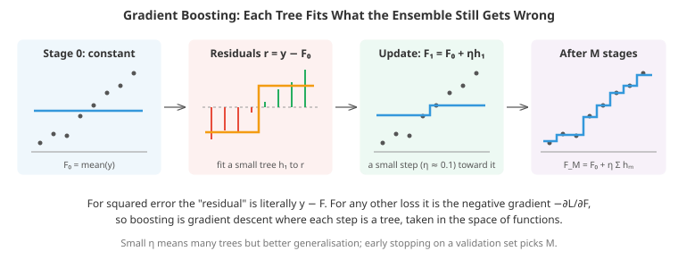
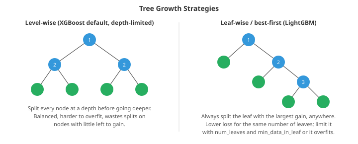

# Tree Ensembles and Gradient Boosting

*Gradient-boosted decision trees are the default winning model for tabular data: spreadsheets, database tables, logs, anything with heterogeneous columns. This file builds them from the ground up: how a tree finds its splits, why averaging trees works, boosting as gradient descent in function space, the second-order maths inside XGBoost, what LightGBM and CatBoost change, how to tune them, and when a neural network is the better choice*

- File 01 introduced decision trees, bagging, random forests and boosting in a few paragraphs each. That is enough to know they exist, not enough to use them well. Yet for structured, tabular data (customer records, transactions, sensor readings, medical measurements) these are the models that win most of the time, in competitions and in production. If you only master one family of models for tabular work, make it this one.

- Why do trees beat neural networks on tables when neural networks dominate images, audio and text? A careful 2022 benchmark (Grinsztajn, Oyallon and Varoquaux, "Why do tree-based models still outperform deep learning on typical tabular data?") found three reasons, and each one is worth understanding:
    - **Tabular targets are often irregular.** A price jumps at a postcode boundary; risk changes sharply at age 65. Neural networks are biased towards smooth functions (they are compositions of smooth pieces trained by gradient descent). Trees are piecewise-constant, so a sharp jump costs them a single split.
    - **Tables carry many uninformative columns.** A tree simply never splits on a useless feature. An MLP has to learn to give it zero weight, and noisy features measurably hurt it.
    - **Columns have individual meaning.** In an image, rotating the pixel grid does not change what the picture is, so a model that treats all directions alike is fine. In a table, "age" and "income" are not interchangeable axes, and mixing them up with a rotation destroys information. Trees split on one column at a time, which respects that. An MLP's first layer mixes every column immediately.

- None of this means neural networks are useless on tables (we return to this at the end), but it explains why the sensible starting point for a new tabular problem is a gradient-boosted tree model with early stopping.

## How a Tree Finds Its Splits

- A **regression tree** is a piecewise-constant function. It chops the input space into axis-aligned boxes (the leaves) and predicts one number per box. A classification tree does the same with class proportions in each box.

- The tree is grown greedily. At a node holding samples $S$, we try every feature $j$ and every threshold $t$, split $S$ into $S_L = \{x : x_j \le t\}$ and $S_R = \{x : x_j > t\}$, and keep the split that most reduces the loss. For squared error the loss of a node is its **sum of squared errors** around its own mean:

$$\text{SSE}(S) = \sum_{i \in S} (y_i - \bar{y}_S)^2$$

- So the best split minimises $\text{SSE}(S_L) + \text{SSE}(S_R)$. The trick that makes this fast is that you never need to recompute the SSE from scratch. Sort the samples by feature $j$ once. Then, sweeping the threshold from left to right, each sample moves from the right child into the left child, and the running sums $\sum y$ and $\sum y^2$ update in $O(1)$. Using $\text{SSE} = \sum y^2 - (\sum y)^2 / n$, every candidate threshold is scored in constant time. One feature costs $O(n \log n)$ for the sort plus $O(n)$ for the sweep, and the coding tasks implement exactly this with `cumsum`.

- On large data even that is too slow, so modern libraries use **histogram-based splitting**. Each feature is bucketed once, up front, into at most about 256 bins (quantiles of its distribution). Finding a split now means accumulating gradient statistics per bin, $O(n)$, and then scanning only 256 candidate thresholds instead of $n$. A further trick, **histogram subtraction**, notes that a parent's histogram is the sum of its two children's, so you only build the histogram of the smaller child and get the larger one by subtraction. LightGBM, XGBoost's `hist` method and scikit-learn's `HistGradientBoosting*` all work this way. Binning also acts as mild regularisation: the model cannot split between two values that landed in the same bin.

- **Missing values** are handled natively by modern implementations. During the split search, the samples with a missing value for feature $j$ are tried in the left child and then in the right child, and whichever direction gives more gain becomes that node's **default direction**. The model learns where "unknown" should go, which is usually better than imputing a mean, because missingness itself is often informative (a blank "previous loan amount" usually means "no previous loan").

- **Categorical features** can be split by grouping categories. For a regression or binary target there is a classic result: sort the categories by their mean target, then the optimal two-way partition is one of the $K-1$ contiguous splits of that sorted order. This avoids testing all $2^{K-1}$ subsets. LightGBM and scikit-learn use this; CatBoost uses a different approach described below.

## Random Forests, More Carefully

- Why does averaging trees work? Suppose each of $B$ trees makes a prediction with variance $\sigma^2$, and any two trees' predictions have correlation $\rho$. The variance of their average is:

$$\text{Var}\left(\frac{1}{B}\sum_{b=1}^{B} T_b(x)\right) = \rho\,\sigma^2 + \frac{1-\rho}{B}\,\sigma^2$$

- This one formula explains random forests. As $B$ grows, the second term vanishes, but the first does not. **Correlation sets a floor on the variance you can remove by averaging.** If every tree were identical ($\rho = 1$), a thousand trees would be no better than one. Averaging cannot fix errors the trees all share.

- That is why random forests add a second source of randomness on top of bagging: each split only considers a random subset of `max_features` features. This lowers $\rho$, but each tree also gets worse (it is sometimes forced to split on a weak feature), so $\sigma^2$ rises. The best setting balances the two, and the third coding task measures exactly this trade-off. Common defaults are $\sqrt{d}$ features for classification and $d/3$ (or all $d$, in scikit-learn's current default) for regression. Treat it as a hyperparameter worth trying a few values of.

- Bias is not reduced by averaging: the forest's bias is roughly that of one tree. So forest trees are grown deep (low bias, high variance), and averaging removes the variance. This is the opposite of boosting, which uses shallow, high-bias trees and reduces bias by adding them up.

- **Out-of-bag (OOB) evaluation** is a free validation set. A bootstrap sample draws $n$ items with replacement, so a particular item is missed with probability $(1 - 1/n)^n \to e^{-1} \approx 0.368$. Each training point is therefore "unseen" by about a third of the trees. Predicting each point using only those trees gives an honest estimate of test error without holding any data out.

- More trees never hurts a random forest's accuracy (the variance term only shrinks); it only costs time. Past a few hundred trees the gains are usually negligible.

- **Extremely randomised trees** (Extra-Trees) go further: instead of searching for the best threshold, they draw a random threshold for each candidate feature and pick the best of those. Even lower correlation, faster training, and often equal accuracy.

- A warning about the feature importance a forest reports by default. **Mean decrease in impurity (MDI)** adds up how much each feature reduced the loss across all splits. It is computed on training data and is biased towards features with many unique values (a random ID column with $n$ distinct values offers $n-1$ thresholds, and some will look useful by chance). Prefer permutation importance on held-out data or SHAP values, covered in the interpretability file.

## Boosting as Gradient Descent in Function Space

- Boosting builds an **additive model** one piece at a time:

$$F_M(x) = F_0(x) + \sum_{m=1}^{M} \eta\, h_m(x)$$

- Here each $h_m$ is a small tree, $\eta$ is a learning rate, and $F_0$ is a constant. At stage $m$ we keep $F_{m-1}$ fixed and choose $h_m$ to reduce the training loss $\sum_i L(y_i, F_{m-1}(x_i) + h_m(x_i))$. This is called **forward stagewise additive modelling**.

- For squared error $L = \frac{1}{2}(y - F)^2$ the answer is intuitive: fit $h_m$ to the residuals $r_i = y_i - F_{m-1}(x_i)$, the part of the target not yet explained.



- Friedman's insight (2001, "Greedy Function Approximation: A Gradient Boosting Machine") was to see that the residual is exactly the negative gradient of the loss with respect to the prediction:

$$r_i = -\frac{\partial L(y_i, F)}{\partial F}\bigg|_{F = F_{m-1}(x_i)}$$

- So boosting is gradient descent, but instead of moving a parameter vector downhill, you move the function's values at the training points downhill. You cannot move them independently (the model has to generalise to new points), so you fit a tree to the desired step and take that. The tree is a smooth-ish, generalisable approximation of the gradient. Swapping the loss swaps the pseudo-residuals, and the same algorithm handles many tasks:

| Task | Loss $L(y, F)$ | Pseudo-residual $-\partial L / \partial F$ |
|---|---|---|
| Regression | $\frac{1}{2}(y - F)^2$ | $y - F$ |
| Robust regression | $\lvert y - F \rvert$ | $\text{sign}(y - F)$ |
| Binary classification | $-[y \log p + (1-y)\log(1-p)]$, $p = \sigma(F)$ | $y - p$ |
| Quantile $\tau$ | $\tau (y - F)^+ + (1-\tau)(F - y)^+$ | $\tau$ if $y > F$, else $\tau - 1$ |
| Poisson counts | $e^F - yF$ | $y - e^F$ |

- Notice that for classification, $F$ is a logit (log-odds), not a probability. The model adds up trees in logit space and passes the total through a sigmoid at the end, exactly like logistic regression, but with trees instead of a linear function of the features.

- **The quantile loss** deserves a mention because it gives you prediction intervals almost for free. Train one model with $\tau = 0.1$ and one with $\tau = 0.9$, and between them they bracket roughly 80% of outcomes. The uncertainty file covers how to make such intervals provably calibrated.

- **AdaBoost, revisited.** File 01 presented AdaBoost's reweighting as a heuristic. It turns out (Friedman, Hastie and Tibshirani, 2000) to be forward stagewise additive modelling with the exponential loss $L = e^{-yF}$, $y \in \{-1, +1\}$. The example weights are the loss each point currently incurs, and $\alpha_t = \frac{1}{2}\ln\frac{1-\epsilon_t}{\epsilon_t}$ is the exact line-search step. Gradient boosting with log loss is usually preferred today because exponential loss punishes badly misclassified points (often mislabelled ones) exponentially hard, making AdaBoost fragile to label noise.

- **The learning rate (shrinkage)** $\eta$ is the most important regulariser in boosting. With $\eta = 1$ each tree tries to fix all remaining error at once, and the model overfits after few trees. With $\eta = 0.05$ each tree makes a small correction, and the ensemble needs many more trees but generalises better. A useful rule: halving $\eta$ roughly doubles the trees needed. Pick $\eta$ by your compute budget (0.05 to 0.1 is typical), then choose the number of trees by **early stopping**: track the loss on a validation set and stop when it has not improved for, say, 50 rounds.

- **Stochastic gradient boosting** (Friedman, 2002) fits each tree on a random subsample of rows (often 50 to 80%) and, in modern libraries, a random subset of columns. Like in random forests, this decorrelates the trees and regularises, and it also speeds training up.

## Inside XGBoost: Second-Order Boosting

- XGBoost (Chen and Guestrin, 2016) made gradient boosting fast, scalable and well-regularised. Its central idea is to use a **second-order Taylor expansion** of the loss, which turns tree building into a closed-form problem for any twice-differentiable loss.

- At stage $m$, write $g_i$ and $h_i$ for the first and second derivatives of the loss at the current prediction:

$$g_i = \frac{\partial L(y_i, F)}{\partial F}\bigg|_{F_{m-1}(x_i)}, \qquad h_i = \frac{\partial^2 L(y_i, F)}{\partial F^2}\bigg|_{F_{m-1}(x_i)}$$

- Adding a tree $f$ changes the loss by approximately $g_i f(x_i) + \frac{1}{2} h_i f(x_i)^2$ per sample (the Taylor expansion from chapter 03). XGBoost also adds an explicit penalty on tree complexity, with $T$ the number of leaves and $w_j$ the value in leaf $j$:

$$\Omega(f) = \gamma T + \frac{1}{2}\lambda \sum_{j=1}^{T} w_j^2$$

- A tree gives the same value $w_j$ to every sample in leaf $j$. Let $G_j = \sum_{i \in \text{leaf } j} g_i$ and $H_j = \sum_{i \in \text{leaf } j} h_i$. The objective then separates into independent quadratics, one per leaf:

$$\text{Obj} = \sum_{j=1}^{T} \left[ G_j w_j + \frac{1}{2}(H_j + \lambda) w_j^2 \right] + \gamma T$$

- Each quadratic is minimised by setting its derivative to zero, which gives the **optimal leaf value** and the resulting objective:

$$w_j^* = -\frac{G_j}{H_j + \lambda}, \qquad \text{Obj}^* = -\frac{1}{2}\sum_{j=1}^{T} \frac{G_j^2}{H_j + \lambda} + \gamma T$$

- This is a Newton step (chapter 03's second-order optimisation), with $\lambda$ acting like ridge regularisation on the leaf values. For squared error, $g_i = F - y_i$ and $h_i = 1$, so $w^* = \sum (y_i - F)/(n_j + \lambda)$: the mean residual, shrunk slightly towards zero. For log loss, $g_i = p_i - y_i$ and $h_i = p_i(1 - p_i)$, which automatically gives samples the model is already sure about (where $p(1-p)$ is small) less pull on the leaf value.

- The same expression scores candidate splits. Splitting a leaf into left and right children improves the objective by:

$$\text{Gain} = \frac{1}{2}\left[\frac{G_L^2}{H_L + \lambda} + \frac{G_R^2}{H_R + \lambda} - \frac{(G_L + G_R)^2}{H_L + H_R + \lambda}\right] - \gamma$$

- If the gain is negative, the split is not worth its complexity cost $\gamma$, which gives a principled pruning rule. The `min_child_weight` parameter is a minimum on $H$ in each child. For squared error that is simply a minimum number of samples, and for log loss it stops the model from creating leaves made only of points it is already confident about.

- Because the tree builder only ever sees $(g_i, h_i)$ pairs, **any loss with a gradient and a positive second derivative plugs in for free**. That is why XGBoost, LightGBM and CatBoost all let you write a custom objective as a function returning two arrays. The first two coding tasks build exactly this tree builder from scratch.

- Other XGBoost engineering contributions: the sparsity-aware split finding with default directions described above, a weighted quantile sketch for proposing bin edges on huge or distributed data (weighted by $h_i$, because the second-order objective is a weighted squared error), cache-aware memory layout, and out-of-core training.

## LightGBM and CatBoost

- **LightGBM** (Microsoft; Ke et al., 2017) is built for speed on large data.
    - **Leaf-wise growth.** Instead of growing all nodes at one depth before going deeper, it always splits the single leaf with the largest gain. For the same number of leaves this reaches a lower loss, but it can grow very deep, lopsided trees, so the main capacity control is `num_leaves` (default 31) rather than depth.
    - **GOSS** (Gradient-based One-Side Sampling). Samples with small gradients are already fitted well and contribute little to the split search. GOSS keeps all large-gradient samples (the top $a$ fraction), randomly keeps a $b$ fraction of the rest, and upweights those by $(1-a)/b$ so that the gradient sums stay unbiased.
    - **EFB** (Exclusive Feature Bundling). In sparse data (one-hot encodings, bag-of-words) many features are never non-zero at the same time. LightGBM packs such mutually exclusive features into a single feature with offset bin ranges, cutting the effective number of columns.



- **CatBoost** (Yandex; Prokhorenkova et al., 2018) targets two problems, especially with categorical data.
    - **Target statistics without leakage.** The natural way to encode a high-cardinality category (say 10,000 merchant IDs) is by the mean target of that category. But if a row's own label is included in its own encoding, the feature leaks the answer: rare categories get encodings that nearly equal their labels, and the model learns to trust them. CatBoost imposes a random order on the rows and encodes each row using only the rows *before* it, with a prior to stabilise rare categories. Several permutations are used to reduce variance.
    - **Ordered boosting.** The same leakage happens more subtly in gradient boosting itself: the residuals of a training point are computed by a model that was fit on that point, so they are biased compared with the residuals on new data (the paper calls this prediction shift). CatBoost computes each point's gradient with a model that has not seen it, using the same ordering trick.
    - **Oblivious (symmetric) trees.** Every node at a given depth uses the same split. The tree is effectively a lookup table indexed by $d$ binary tests, which is a strong regulariser and makes prediction extremely fast (one bit per level, then a table lookup).

- In practice all three libraries perform within noise of each other on most problems once tuned. CatBoost tends to need the least tuning and handles raw categorical columns best; LightGBM is usually fastest on large data; XGBoost has the most mature ecosystem and GPU support. scikit-learn's `HistGradientBoostingClassifier` and `HistGradientBoostingRegressor` are LightGBM-style and need no extra dependency.

## Tuning Gradient Boosting

- A good order of operations, from most to least important:
    1. **Fix a learning rate** (0.05 to 0.1) and use **early stopping** on a validation set to choose the number of trees. Never tune the number of trees by hand or by grid search.
    2. **Tree capacity**: `max_depth` (3 to 8) or `num_leaves` (15 to 255), plus `min_child_weight` / `min_data_in_leaf`. Deeper trees capture more feature interactions (a depth-$k$ tree can represent interactions of up to $k$ features).
    3. **Randomisation**: row subsampling (0.5 to 0.9) and column subsampling (0.5 to 0.9).
    4. **Regularisation**: $\lambda$ (L2 on leaf values), $\alpha$ (L1), $\gamma$ (minimum gain).
    5. Finally, lower the learning rate (e.g. halve it), let early stopping use more trees, and usually gain a little more accuracy.

- Use a random or Bayesian search over steps 2 to 4 rather than a grid (the evaluation file explains why). Twenty to fifty trials is usually enough to get close to the best achievable.

- **Monotonic constraints** let you force the prediction to only increase (or only decrease) with a feature. A credit model where more income can never increase predicted default risk is easier to defend to a regulator, and the constraint often improves generalisation because it injects true prior knowledge. The libraries enforce it by rejecting splits that would violate the ordering of leaf values. **Interaction constraints** similarly limit which features may appear together in one tree.

- **Feature importance** in boosting libraries comes in several flavours: *split* (how often a feature is used), *gain* (total loss reduction from its splits) and *cover* (how many samples its splits touch). They often disagree. Like MDI in forests, they are computed on training data and can mislead; use SHAP (which has an exact, fast algorithm for trees) or permutation importance on held-out data for decisions.

## Common Pitfalls

- **Trees cannot extrapolate.** A tree's prediction outside the range of its training data is the value of the nearest edge leaf, a flat line. If a target trends upward over time (sales, prices, user counts) and you predict the future, a tree model will predict the last level it saw, forever. The fourth coding task shows this. Remedies: model the trend separately (predict the change or the ratio rather than the level), detrend first, or use a linear model or a model with a linear component for the extrapolating part.

- **Leaky features look like magic.** If a feature has suspiciously high importance, ask whether it could be known at prediction time. A "days since account closed" column is a perfect predictor of churn, and useless for predicting it. Boosted trees are very good at finding leaks.

- **Target encoding without out-of-fold computation** leaks labels in the way CatBoost was designed to avoid. If you target-encode manually, compute each row's encoding using only other folds.

- **Treating integer category codes as numbers.** Postcode 90210 is not "more" than 10001. Either use native categorical support or an appropriate encoding (the practical data file covers this).

- **Too many trees without early stopping.** Unlike a random forest, a boosted model *does* overfit as trees are added. The second coding task shows the validation loss turning back up.

## Stacking and Blending

- Different model families make different mistakes, so combining them can help, for the same reason averaging helps in a forest. **Blending** averages the predictions of a few strong, diverse models (for example a GBDT, a neural network and a linear model). **Stacking** trains a simple meta-model (often logistic or ridge regression) on their predictions.

- The essential rule for stacking: the meta-model must be trained on **out-of-fold predictions**, predictions each base model made for rows it was not trained on. Training the meta-model on in-sample predictions teaches it to trust whichever base model overfits most.

- Stacking wins competitions, where 0.1% matters. In production weigh it against the cost of maintaining several models; one well-tuned GBDT is often the better engineering choice.

## Ranking with Boosted Trees

- Search engines and recommender systems need to order items, not score them independently. **LambdaMART** (Burges, 2010) is gradient boosting where the "gradient" for each document is derived from how much swapping it with another document would change a ranking metric such as NDCG. It remains a strong baseline for learning-to-rank, available as the `lambdarank` or `rank:ndcg` objective in LightGBM and XGBoost. Chapter 18's search and recommendation design examples build on this.

## Trees vs Neural Networks on Tables

- Deep learning for tables has improved considerably, and some approaches are worth knowing:
    - **FT-Transformer** (Gorishniy et al., 2021) embeds each column as a token and runs a Transformer over the columns. Competitive with GBDTs on many benchmarks, at higher cost.
    - **TabNet** (Arik and Pfister, 2019/2021) uses sequential attention to select features at each step, mimicking a tree's feature selection.
    - **TabPFN** (Hollmann et al.; v2 published in Nature in 2025) is a Transformer pretrained on millions of synthetic datasets to do *in-context learning*: you feed it the whole training set and the test rows, and it outputs predictions in a single forward pass with no training. On small datasets (thousands of rows) it often beats tuned GBDTs in seconds.

- Practical guidance: start with a GBDT. Reach for neural networks when the table is mixed with modalities neural nets handle natively (text, images), when you need to share representations with other deep models, when there are very large amounts of data, or when the dataset is small enough for TabPFN-style models to shine. And if accuracy is critical, an ensemble of a GBDT and a neural network often beats either alone.

## Coding Tasks (use CoLab or notebook)

1. Build gradient boosting from scratch for regression. The tree builder works on gradients and hessians (the XGBoost formulation): with $g = F - y$ and $h = 1$ it is an ordinary least-squares tree. Compare learning rates. Notice that the training MSE drops below the noise variance (0.64): the model has started memorising noise.
```python
import numpy as np
import matplotlib.pyplot as plt

# A regression tree that fits gradients g and hessians h (the XGBoost formulation).
# With g = pred - y and h = 1 this is an ordinary least-squares regression tree.
def build_tree(X, g, h, depth, max_depth=3, lam=1.0, min_leaf=5):
    G, H = g.sum(), h.sum()
    leaf = {"value": -G / (H + lam)}
    if depth == max_depth or len(g) < 2 * min_leaf:
        return leaf
    best_gain, best = 0.0, None
    for j in range(X.shape[1]):
        order = np.argsort(X[:, j])
        xs, gs, hs = X[order, j], g[order], h[order]
        GL, HL = np.cumsum(gs)[:-1], np.cumsum(hs)[:-1]
        GR, HR = G - GL, H - HL
        gain = GL**2 / (HL + lam) + GR**2 / (HR + lam) - G**2 / (H + lam)
        # forbid splits between equal x values and tiny leaves
        valid = (xs[1:] != xs[:-1])
        valid[:min_leaf - 1] = False
        valid[len(valid) - min_leaf + 1:] = False
        if not valid.any():
            continue
        gain = np.where(valid, gain, -np.inf)
        i = np.argmax(gain)
        if gain[i] > best_gain:
            best_gain, best = gain[i], (j, (xs[i] + xs[i + 1]) / 2)
    if best is None:
        return leaf
    j, t = best
    m = X[:, j] <= t
    return {"feature": j, "threshold": t,
            "left": build_tree(X[m], g[m], h[m], depth + 1, max_depth, lam, min_leaf),
            "right": build_tree(X[~m], g[~m], h[~m], depth + 1, max_depth, lam, min_leaf)}

def predict_tree(node, X):
    if "value" in node:
        return np.full(len(X), node["value"])
    m = X[:, node["feature"]] <= node["threshold"]
    out = np.empty(len(X))
    out[m] = predict_tree(node["left"], X[m])
    out[~m] = predict_tree(node["right"], X[~m])
    return out

# Data: a wiggly 1D function plus noise
rng = np.random.default_rng(0)
X = rng.uniform(0, 10, (300, 1))
y = np.sin(X[:, 0]) * X[:, 0] + rng.normal(0, 0.8, 300)
X_test = np.linspace(0, 10, 500)[:, None]

def gradient_boost(X, y, n_trees, lr, max_depth=3):
    pred = np.full(len(y), y.mean())
    trees, losses = [], []
    for _ in range(n_trees):
        g = pred - y                     # gradient of 0.5*(pred - y)^2
        h = np.ones_like(y)              # its second derivative
        tree = build_tree(X, g, h, 0, max_depth)
        pred += lr * predict_tree(tree, X)
        trees.append(tree)
        losses.append(np.mean((pred - y) ** 2))
    return y.mean(), trees, losses

fig, axes = plt.subplots(1, 2, figsize=(13, 4))
for lr, colour in [(1.0, '#e74c3c'), (0.3, '#f39c12'), (0.1, '#3498db')]:
    base, trees, losses = gradient_boost(X, y, 100, lr)
    axes[0].plot(losses, color=colour, label=f"lr={lr}")
    if lr == 0.1:
        f = base + lr * sum(predict_tree(t, X_test) for t in trees)
axes[0].set_title("Training MSE vs number of trees"); axes[0].set_xlabel("trees")
axes[0].set_yscale("log"); axes[0].legend()
axes[1].scatter(X[:, 0], y, s=8, alpha=0.4, color='#95a5a6')
axes[1].plot(X_test[:, 0], f, color='#3498db', linewidth=2, label="100 trees, lr=0.1")
axes[1].plot(X_test[:, 0], np.sin(X_test[:, 0]) * X_test[:, 0], 'k--', label="true function")
axes[1].set_title("Gradient-boosted fit"); axes[1].legend()
plt.tight_layout(); plt.show()
print(f"final training MSE (lr=0.1): {losses[-1]:.3f}  (noise variance is 0.64)")
```

2. Binary classification with log loss on two noisy interleaved spirals. Each leaf takes the Newton step $-G/(H + \lambda)$ with $g = p - y$ and $h = p(1-p)$. Track training and validation loss: training loss keeps falling forever, but validation loss turns back up, and early stopping picks the best point. Try `lam=10` or `max_depth=2` and see how the curves change.
```python
import numpy as np
import matplotlib.pyplot as plt

def build_tree(X, g, h, depth=0, max_depth=3, lam=1.0, min_leaf=5):
    G, H = g.sum(), h.sum()
    if depth < max_depth and len(g) >= 2 * min_leaf:
        best_gain, best = 0.0, None
        for j in range(X.shape[1]):
            o = np.argsort(X[:, j]); xs = X[o, j]
            GL, HL = np.cumsum(g[o])[:-1], np.cumsum(h[o])[:-1]
            gain = GL**2/(HL+lam) + (G-GL)**2/(H-HL+lam) - G**2/(H+lam)
            ok = xs[1:] != xs[:-1]; ok[:min_leaf-1] = False; ok[len(ok)-min_leaf+1:] = False
            gain[~ok] = -np.inf
            i = np.argmax(gain)
            if gain[i] > best_gain:
                best_gain, best = gain[i], (j, (xs[i] + xs[i+1]) / 2)
        if best:
            j, t = best; m = X[:, j] <= t
            return (j, t, build_tree(X[m], g[m], h[m], depth+1, max_depth, lam, min_leaf),
                          build_tree(X[~m], g[~m], h[~m], depth+1, max_depth, lam, min_leaf))
    return -G / (H + lam)          # leaf: the Newton step

def predict(node, x):
    while isinstance(node, tuple):
        j, t, left, right = node
        node = left if x[j] <= t else right
    return node

def predict_all(tree, X):
    return np.array([predict(tree, x) for x in X])

# Two interleaved spirals: hopeless for a linear model
rng = np.random.default_rng(1)
n = 600
theta = np.sqrt(rng.uniform(0, 1, n)) * 3 * np.pi
label = rng.integers(0, 2, n)
r = theta + np.pi * label
X = np.c_[r * np.cos(theta), r * np.sin(theta)] + rng.normal(0, 1.2, (n, 2))
y = label.astype(float)
idx = rng.permutation(n); tr, va = idx[:400], idx[400:]

sigmoid = lambda z: 1 / (1 + np.exp(-z))
logloss = lambda y, p: -np.mean(y*np.log(p+1e-12) + (1-y)*np.log(1-p+1e-12))

lr, n_trees = 0.3, 300
F_tr, F_va = np.zeros(len(tr)), np.zeros(len(va))
hist_tr, hist_va = [], []
for t in range(n_trees):
    p = sigmoid(F_tr)
    g, h = p - y[tr], p * (1 - p)          # log-loss gradient and hessian w.r.t. the logit
    tree = build_tree(X[tr], g, h, max_depth=4, lam=1.0)
    F_tr += lr * predict_all(tree, X[tr]); F_va += lr * predict_all(tree, X[va])
    hist_tr.append(logloss(y[tr], sigmoid(F_tr))); hist_va.append(logloss(y[va], sigmoid(F_va)))

best = int(np.argmin(hist_va))
print(f"best validation log-loss {hist_va[best]:.3f} at {best+1} trees; "
      f"after {n_trees} trees it is {hist_va[-1]:.3f}")
print(f"validation accuracy: {np.mean((F_va > 0) == y[va]):.3f}")

fig, axes = plt.subplots(1, 2, figsize=(13, 4.5))
axes[0].plot(hist_tr, color='#3498db', label="train")
axes[0].plot(hist_va, color='#e74c3c', label="validation")
axes[0].axvline(best, color='#555', linestyle='--', label="early-stopping point")
axes[0].set_xlabel("trees"); axes[0].set_ylabel("log-loss"); axes[0].legend()
axes[0].set_title("Early stopping finds the right number of trees")
axes[1].scatter(X[:, 0], X[:, 1], c=y, cmap='coolwarm', s=8)
axes[1].set_title("Two spirals"); axes[1].set_aspect('equal')
plt.tight_layout(); plt.show()
```

3. Measure the random forest trade-off from the variance formula $\rho\sigma^2 + (1-\rho)\sigma^2/B$. Fewer features per split makes each tree worse (higher $\sigma^2$) but the trees less correlated (lower $\rho$). Also check that the out-of-bag estimate tracks the true test error without any held-out data.
```python
import numpy as np
import matplotlib.pyplot as plt

def build_tree(X, y, rng, max_features, depth=0, max_depth=10, min_leaf=3):
    """Least-squares regression tree; each split looks at a random subset of features."""
    if depth == max_depth or len(y) < 2 * min_leaf or np.all(y == y[0]):
        return y.mean()
    best_sse, best = np.inf, None
    for j in rng.choice(X.shape[1], max_features, replace=False):
        o = np.argsort(X[:, j]); xs, ys = X[o, j], y[o]
        n = len(ys); k = np.arange(1, n)
        cs, cs2 = np.cumsum(ys)[:-1], np.cumsum(ys**2)[:-1]
        sse = (cs2 - cs**2 / k) + ((ys**2).sum() - cs2 - (ys.sum() - cs)**2 / (n - k))
        ok = xs[1:] != xs[:-1]; ok[:min_leaf-1] = False; ok[n-min_leaf:] = False
        sse[~ok] = np.inf
        i = np.argmin(sse)
        if sse[i] < best_sse:
            best_sse, best = sse[i], (j, (xs[i] + xs[i+1]) / 2)
    if best is None:
        return y.mean()
    j, t = best; m = X[:, j] <= t
    return (j, t, build_tree(X[m], y[m], rng, max_features, depth+1, max_depth, min_leaf),
                  build_tree(X[~m], y[~m], rng, max_features, depth+1, max_depth, min_leaf))

def predict_all(node, X):
    out = np.empty(len(X))
    for i, x in enumerate(X):
        nd = node
        while isinstance(nd, tuple):
            nd = nd[2] if x[nd[0]] <= nd[1] else nd[3]
        out[i] = nd
    return out

# Friedman #1 benchmark: 5 informative features, 5 pure noise features
rng = np.random.default_rng(0)
def friedman(n):
    X = rng.uniform(0, 1, (n, 10))
    y = 10*np.sin(np.pi*X[:, 0]*X[:, 1]) + 20*(X[:, 2]-0.5)**2 + 10*X[:, 3] + 5*X[:, 4]
    return X, y + rng.normal(0, 1, n)
X, y = friedman(400); X_te, y_te = friedman(2000)

def forest(max_features, B=60):
    preds, oob_sum, oob_cnt = [], np.zeros(len(y)), np.zeros(len(y))
    for b in range(B):
        boot = rng.integers(0, len(y), len(y))
        out = np.setdiff1d(np.arange(len(y)), boot)      # ~37% never drawn
        tree = build_tree(X[boot], y[boot], rng, max_features)
        preds.append(predict_all(tree, X_te))
        oob_sum[out] += predict_all(tree, X[out]); oob_cnt[out] += 1
    preds = np.array(preds)
    curve = [np.mean((preds[:b].mean(0) - y_te)**2) for b in range(1, B + 1)]
    seen = oob_cnt > 0
    oob_mse = np.mean((oob_sum[seen] / oob_cnt[seen] - y[seen])**2)
    rho = np.corrcoef(preds - preds.mean(1, keepdims=True))[np.triu_indices(B, 1)].mean()
    return curve, oob_mse, rho

results = []
for mf in [1, 2, 3, 5, 7, 10]:
    curve, oob, rho = forest(mf, B=40)
    results.append((mf, curve[-1], curve[0], oob, rho))
    print(f"max_features={mf:2d}: forest test MSE {curve[-1]:5.2f} (OOB {oob:5.2f}), "
          f"one tree {curve[0]:5.2f}, tree correlation {rho:.2f}")
mf, forest_mse, tree_mse, oob, rho = map(np.array, zip(*results))

fig, ax = plt.subplots(figsize=(8, 4.5))
ax.plot(mf, tree_mse, 'o-', color='#95a5a6', label="a single tree")
ax.plot(mf, forest_mse, 'o-', color='#3498db', label="forest of 40 trees")
ax.plot(mf, oob, 'x--', color='#27ae60', label="OOB estimate of forest MSE")
ax.set_xlabel("features considered per split"); ax.set_ylabel("test MSE"); ax.legend(loc="upper center")
ax2 = ax.twinx(); ax2.plot(mf, rho, 's:', color='#e74c3c'); ax2.set_ylabel("tree correlation", color='#e74c3c')
ax.set_title("Fewer features per split: weaker trees, but less correlated ones")
plt.tight_layout(); plt.show()
```

4. See why trees cannot extrapolate. Train on a linear trend and forecast beyond the training range. Then fix the boosted model by fitting it to the *detrended* target (residuals of the linear fit) and adding the trend back. The hybrid recovers the trend, but notice it still cannot continue the seasonal wiggle past $t = 8$: trees flatten anything they have not seen. Seasonality needs explicit features such as $\sin$ and $\cos$ of the period, covered in the time series file.
```python
import numpy as np
import matplotlib.pyplot as plt

# Sales that grow linearly with time, plus a seasonal wiggle.
# Train on t in [0, 8], forecast t in (8, 12].
rng = np.random.default_rng(3)
t = np.sort(rng.uniform(0, 8, 200))
truth = lambda t: 5 + 2 * t + 2 * np.sin(2 * t)
y = truth(t) + rng.normal(0, 0.7, 200)
t_future = np.linspace(0, 12, 300)

def boost_stumps(t, target, n_rounds=200, lr=0.1):
    """Gradient boosting with depth-1 trees on squared error; returns a predict function."""
    base = target.mean()
    pred, stumps = np.full(len(t), base), []
    cuts = (t[1:] + t[:-1]) / 2
    for _ in range(n_rounds):
        r = target - pred
        sse = [((r[t <= c] - r[t <= c].mean())**2).sum() + ((r[t > c] - r[t > c].mean())**2).sum()
               for c in cuts]
        c = cuts[int(np.argmin(sse))]
        left, right = r[t <= c].mean(), r[t > c].mean()
        stumps.append((c, left, right))
        pred += lr * np.where(t <= c, left, right)
    return lambda s: base + lr * sum(np.where(s <= c, l, r) for c, l, r in stumps)

# 1. Boosting directly on the level of the series
f_gbm = boost_stumps(t, y)(t_future)

# 2. Linear trend only
w = np.polyfit(t, y, 1)
f_lin = np.polyval(w, t_future)

# 3. Linear trend + boosting on what the trend leaves over
f_hybrid = f_lin + boost_stumps(t, y - np.polyval(w, t))(t_future)

plt.figure(figsize=(10, 4.5))
plt.scatter(t, y, s=8, color='#95a5a6', label="training data")
plt.plot(t_future, truth(t_future), 'k--', linewidth=1, label="truth")
plt.plot(t_future, f_gbm, color='#e74c3c', linewidth=2, label="boosted trees on the level")
plt.plot(t_future, f_lin, color='#3498db', linewidth=2, label="linear trend")
plt.plot(t_future, f_hybrid, color='#27ae60', linewidth=2, label="trend + boosted residuals")
plt.axvspan(8, 12, color='#f39c12', alpha=0.1)
plt.legend(); plt.xlabel("time"); plt.ylabel("sales")
plt.title("Trees predict a flat line outside the training range")
plt.show()

future = t_future > 8
for name, f in [("trees on level", f_gbm), ("linear trend", f_lin), ("trend + trees", f_hybrid)]:
    print(f"{name:15s} forecast MSE on t > 8: {np.mean((f[future] - truth(t_future[future]))**2):6.2f}")
```

## Project Milestone 2: Gradient Boosting on the Adult Data

- The tabular project's second milestone (chapter 21's roadmap). Milestone 1 set a logistic regression baseline; this one replaces it with what this file recommends for tabular data, gradient-boosted trees, and tunes the few hyperparameters that matter.

- The boosting model needs far less preprocessing: no scaling, no one-hot encoding, no imputation. It splits on raw values, handles the category columns natively, and learns where to send missing values. It also uses early stopping on an internal validation split to choose the number of trees.

- What to look for:
    - Boosting should beat logistic regression clearly, by roughly 0.02-0.03 in ROC-AUC on this data, because it captures interactions (education matters differently by age and occupation) and thresholds (capital gains) that a linear model cannot.
    - Tuning should add much less than switching model families did, and the spread across the random-search candidates shows how flat the good region is. Defaults plus early stopping are usually close to the best.
    - Run time: a few minutes on a laptop CPU for the whole block, almost all of it the random search.
    - The test set is still untouched; every number here is cross-validated on the training set.

```py
import numpy as np
import pandas as pd
from sklearn.datasets import fetch_openml
from sklearn.model_selection import train_test_split

# Same loading, cleaning and split as milestone 1 (practical data work)
raw = fetch_openml("adult", version=2, as_frame=True, data_home="~/ml-data").frame
df = raw.drop_duplicates().copy()
df["target"] = (df["class"].astype(str).str.strip() == ">50K").astype(int)
df = df.drop(columns=["class", "fnlwgt", "education"]).reset_index(drop=True)
numeric = ["age", "education-num", "capital-gain", "capital-loss", "hours-per-week"]
categorical = [c for c in df.columns if c not in numeric + ["target"]]
df[categorical] = df[categorical].astype("category")         # gradient boosting reads category dtype natively
X, y = df.drop(columns="target"), df["target"]
X_train, X_test, y_train, y_test = train_test_split(X, y, test_size=0.2, stratify=y, random_state=42)

import time
from scipy.stats import loguniform, randint
from sklearn.compose import ColumnTransformer
from sklearn.pipeline import make_pipeline
from sklearn.impute import SimpleImputer
from sklearn.preprocessing import OneHotEncoder, StandardScaler, FunctionTransformer
from sklearn.linear_model import LogisticRegression
from sklearn.ensemble import HistGradientBoostingClassifier
from sklearn.model_selection import StratifiedKFold, cross_validate, RandomizedSearchCV

cv = StratifiedKFold(5, shuffle=True, random_state=42)
to_str = FunctionTransformer(lambda d: d.astype(object), feature_names_out="one-to-one")
logreg = make_pipeline(ColumnTransformer([          # the milestone 1 model, for comparison
    ("num", make_pipeline(FunctionTransformer(np.log1p, feature_names_out="one-to-one"), StandardScaler()), numeric),
    ("cat", make_pipeline(to_str, SimpleImputer(strategy="constant", fill_value="missing"),
                          OneHotEncoder(handle_unknown="ignore", min_frequency=20)), categorical)]),
    LogisticRegression(max_iter=2000))

# Gradient boosting needs no scaling, no one-hot encoding and no imputation: it splits on raw values,
# treats category columns natively and learns where to send missing values.
hgb = HistGradientBoostingClassifier(categorical_features="from_dtype", early_stopping=True,
                                     validation_fraction=0.1, max_iter=1000, random_state=42)

def score(model, name):
    t = time.time()
    s = cross_validate(model, X_train, y_train, cv=cv, scoring=["roc_auc", "average_precision", "neg_log_loss"])
    print(f"{name:34s} ROC-AUC {s['test_roc_auc'].mean():.4f}  AP {s['test_average_precision'].mean():.4f}  "
          f"log-loss {-s['test_neg_log_loss'].mean():.4f}  ({time.time() - t:.0f}s)")

score(logreg, "logistic regression (milestone 1)")
score(hgb, "gradient boosting, defaults")

# A small random search over the hyperparameters that matter most (tree file: learning rate, tree size,
# leaf size, L2). Each candidate is scored by the same 5-fold CV on the training set only.
search = RandomizedSearchCV(hgb, {
    "learning_rate": loguniform(0.02, 0.3),
    "max_leaf_nodes": randint(8, 64),
    "min_samples_leaf": randint(10, 200),
    "l2_regularization": loguniform(1e-3, 10)},
    n_iter=15, cv=cv, scoring="average_precision", random_state=42, n_jobs=1)
search.fit(X_train, y_train)
print(f"\nbest settings: { {k: round(float(v), 3) for k, v in search.best_params_.items()} }")
score(search.best_estimator_, "gradient boosting, tuned")
gap = search.cv_results_["mean_test_score"]
print(f"spread of AP across the 15 candidates: {gap.min():.4f} - {gap.max():.4f}")
```

- Make it better:
    - Add the logistic regression's prediction as a feature to the boosting model, inside a pipeline so it is fitted only on training folds, and see whether stacking helps.
    - Compare with `RandomForestClassifier` (after ordinal-encoding the categories) and explain the gap using this file's bias-variance discussion.
    - Plot the validation loss against the number of trees for one fit, and find where early stopping cut it off.
