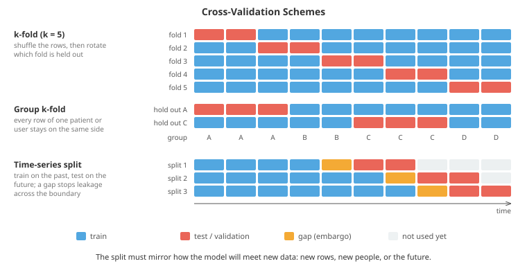

# Model Evaluation and Validation

*Training a model takes one line of code; knowing whether it works is the hard part. This file covers how to estimate performance honestly: data splits and cross-validation schemes, data leakage in all its forms, choosing metrics that match the real goal, decision thresholds, calibrated probabilities, imbalanced classes, hyperparameter search without fooling yourself, and statistical tests for comparing models*

- Every evaluation tries to answer one question: **how well will this model do on data it has not seen, in the situation it will actually be used?** Everything in this file is a technique for answering that question honestly, or a way people accidentally answer a different, easier question instead.

- Most of the failures are not exotic. A model that scored 95% offline and 60% in production almost always suffered from one of three things: the evaluation data leaked information that will not exist at prediction time, the split did not mirror how new data arrives, or so many choices were tuned against the validation set that its score stopped meaning anything. File 02 introduced the core metrics and $k$-fold cross-validation; this file goes much deeper.

## Training, Validation and Test Sets

- The three sets have distinct jobs:
    - The **training set** fits the parameters (weights, splits).
    - The **validation set** (or development set) makes choices: hyperparameters, features, architectures, when to stop training, which model to ship.
    - The **test set** estimates the performance of the final, fully chosen system. It is used **once**, at the end.

- Why is a separate test set needed when validation already measures held-out performance? Because every decision made by looking at validation performance leaks a little information about the validation set into the model. Choose between 100 configurations by validation score and the winner's score is optimistic: it is the best of 100 noisy measurements, and part of its lead is luck. The fourth coding task measures this **winner's curse**. The test set, untouched by any decision, corrects for it.

- If you look at the test score, change something, and look again, the test set has become a validation set. Kaggle competitions show this at scale: teams that tune against the public leaderboard often drop dozens of places on the private leaderboard, a "shake-up". Research on **adaptive data analysis** (Dwork et al., 2015) formalises the problem: each adaptive query to a holdout set uses up some of its statistical validity.

- How large should each set be? It depends on how precisely you need to measure. An accuracy estimate from $n$ test examples has standard error $\sqrt{p(1-p)/n}$. With $n = 1000$ and $p = 0.9$ that is about 0.0095, so a 95% interval is roughly $\pm 1.9$ percentage points. You cannot reliably tell 90% from 91% with a thousand examples. With millions of examples (common in deep learning) 1% for validation and test is plenty; with a few thousand, cross-validation is the better use of data.

## Cross-Validation, Properly

- **$k$-fold cross-validation** splits the data into $k$ folds, trains $k$ models each with one fold held out, and averages the $k$ scores. Every example is used for evaluation exactly once. $k = 5$ or $k = 10$ is standard. Larger $k$ means each model trains on more data (less pessimistic bias) but costs more, and **leave-one-out** ($k = n$) gives an estimate with high variance because the $n$ models are nearly identical. **Repeated** $k$-fold reshuffles and repeats to reduce the variance that comes from one particular split.

- The folds must reflect how new data will differ from training data. Choosing the wrong scheme is the most common way cross-validation lies.
    - **Stratified $k$-fold** keeps the class proportions equal in every fold. Use it for classification, especially with rare classes, where a fold could otherwise contain no positives at all.
    - **Group $k$-fold** keeps all rows from one group together. If a patient contributes ten scans, and some scans of that patient are in training and others in test, the model can recognise the patient rather than the disease. The score will be wonderful and meaningless. Groups are patients, users, sessions, devices, documents, recording speakers, or anything else that makes rows non-independent.
    - **Time-series splits** always train on the past and test on the future. Random shuffling of time-ordered data lets the model see tomorrow while predicting today. An expanding window grows the training period each split; a sliding window keeps it fixed. Add a **gap** (sometimes called an embargo) between train and test when features are computed over windows, so that a 7-day rolling average at the end of training does not overlap with the test period.



- A useful question to pick a scheme: *when this model is deployed, what will be new?* New rows from the same customers (plain $k$-fold), new customers (group by customer), next month (time split), a new hospital (group by hospital). Mirror that.

- **Nested cross-validation** is needed when you want an unbiased performance estimate *and* you tune hyperparameters. The inner loop selects hyperparameters by cross-validation within each outer training fold; the outer loop measures the performance of that whole selection procedure on its held-out fold. Reporting the best inner cross-validation score instead is optimistic, for the winner's-curse reason above. Nested CV is expensive ($k_{\text{outer}} \times k_{\text{inner}} \times$ configurations) and is mostly used with small datasets, where the optimism is largest.

- A subtle fact: there is no unbiased estimator of the variance of the $k$-fold estimate (Bengio and Grandvalet, 2004), because the folds share training data, so the $k$ scores are correlated. The standard deviation of the fold scores understates the true uncertainty. Keep this in mind when comparing models (see the final section).

## Data Leakage

- **Leakage** is when information that will not be available at prediction time influences training or evaluation. It is the single biggest source of models that look excellent and fail in production. The main forms:

- **Preprocessing leakage.** Any step that learns from data (scaling, imputation, feature selection, PCA, target encoding, oversampling) must be fitted on the training fold only, then applied to the validation fold. Fitting a scaler on the full dataset leaks the test set's mean and variance; usually a small effect. Feature selection on the full dataset can be catastrophic: the first coding task selects features using all labels, then cross-validates, and reports 100% accuracy on pure noise. The fix is to treat every fitted step as part of the model, which is exactly what scikit-learn's `Pipeline` enforces (see the practical data file).

- **Target leakage.** A feature that encodes the answer. Classic examples: "number of calls to the cancellations team" when predicting churn; "treatment administered" when predicting diagnosis; an account status field updated after the fraud was discovered. The test: *at the exact moment the prediction will be made, would this value already be known?* Point-in-time correct feature stores (chapter 18) exist to answer that question systematically.

- **Temporal leakage.** Random splits of time-ordered data, or features computed with information from the future (a "30-day average" that includes days after the prediction date). Also global normalisation statistics computed over the whole time range.

- **Duplicate and near-duplicate leakage.** The same image at two resolutions, the same sentence in two documents, the same user under two IDs. Large web-scraped datasets are full of these, and benchmark test sets turning up in pretraining data (**contamination**) is a serious problem for evaluating large language models (chapter 07).

- **Leakage through the validation set itself.** Excessive tuning, early stopping on the test set, or choosing a random seed by test score.

- A practical leakage detector: if a single feature gives far better performance than the domain makes plausible, or the model is far better than human experts on a problem humans find hard, assume leakage until proven otherwise.

## Choosing a Metric

- The metric should be the quantity you care about, or as close to it as you can get. Optimising the wrong metric, however well, produces the wrong model.

- **Regression metrics:**
    - **MSE / RMSE** penalises large errors heavily (squared). It is the right choice when large errors are disproportionately costly, and it is minimised by predicting the conditional **mean**.
    - **MAE** is robust to outliers and is minimised by predicting the conditional **median**. Choosing between MSE and MAE is choosing which of these you want.
    - **MAPE** (mean absolute percentage error) is popular with business users but has real problems: it is undefined when the true value is zero, explodes near zero, and penalises over-prediction more than under-prediction (an under-prediction can be at most 100% wrong, an over-prediction unboundedly wrong), so models optimised for it are biased low. Scaled errors like MASE, covered in the time series file, avoid these problems.
    - **$R^2$** is $1 - \text{MSE}/\text{Var}(y)$: the fraction of variance explained, relative to always predicting the mean. On held-out data it can be negative, which means the model is worse than that constant.

- **Classification metrics** fall into three families, and it helps to know which family a question belongs to:
    - **Threshold metrics** evaluate hard decisions: accuracy, precision, recall, F1, specificity. They depend on the threshold you choose.
    - **Ranking metrics** evaluate the ordering of scores, independent of threshold: ROC-AUC, average precision.
    - **Probabilistic metrics** evaluate the probabilities themselves: log loss and the Brier score.

- **ROC-AUC** has a clean meaning: it is the probability that a randomly chosen positive is scored higher than a randomly chosen negative. That equivalence to the Mann-Whitney U statistic (chapter 04) is computed both ways in the second coding task. An AUC of 0.5 is random ranking and 1.0 perfect ranking.

- ROC curves can be misleading under heavy class imbalance. The false positive rate divides by the number of negatives, which is huge, so even many false positives look like a small rate. A fraud model with FPR 1% on 10 million legitimate transactions raises 100,000 false alarms. The **precision-recall curve** puts precision on the y-axis, which directly shows what fraction of alarms are real. Its summary, **average precision** (AP), has a baseline equal to the positive rate rather than 0.5. In the second coding task, model A has the higher ROC-AUC but model B is much better at the top of the ranking, which is the only part a fraud team ever looks at. When positives are rare and you act on the top of the list, use PR curves.

- For **multiclass** problems, per-class metrics are combined by **macro** averaging (mean over classes; every class counts equally, so rare classes matter), **micro** averaging (pool all decisions; dominated by common classes, and equal to accuracy for single-label problems) or **weighted** averaging (by class frequency). Report macro if rare classes matter.

- Two single-number metrics robust to imbalance are **Cohen's kappa** (agreement beyond chance) and the **Matthews correlation coefficient** (the correlation between predicted and true labels, using all four cells of the confusion matrix).

- **Log loss** (cross-entropy) and the **Brier score** $\frac{1}{n}\sum (p_i - y_i)^2$ are **proper scoring rules**: they are optimised, in expectation, only by reporting the true probability. That makes them the right metrics whenever predicted probabilities will be used as probabilities (pricing, risk, expected-value decisions). Log loss punishes confident mistakes severely (predicting 0.001 for something that happens costs $-\ln 0.001 \approx 6.9$); Brier is bounded and gentler.

- Offline metrics are proxies. The real objective (revenue, patient outcomes, user retention) is usually measured with online experiments, A/B tests, covered in chapter 18. A good offline metric is one that predicts the online result.

## Decision Thresholds

- A classifier outputs a score; a decision needs a threshold. The default of 0.5 is only right if false positives and false negatives cost the same and the probabilities are calibrated. Neither is usually true.

- Decision theory gives the right threshold directly. Say a false positive costs $C_{FP}$ and a false negative costs $C_{FN}$. Predicting positive for an example with probability $p$ costs $(1-p)\,C_{FP}$ in expectation, predicting negative costs $p\,C_{FN}$. Predict positive when the first is smaller:

$$p > \frac{C_{FP}}{C_{FP} + C_{FN}}$$

- If missing a fraud costs 50 times more than investigating a legitimate transaction, the threshold is $1/51 \approx 0.02$, not 0.5. This only works if $p$ is a real probability, which is why calibration matters.

- When costs are not known, choose the threshold on the **validation** set to meet an operating constraint ("recall of at least 95%", "no more than 200 alerts per day") and report the test metrics at that fixed threshold. Choosing the threshold on the test set is another form of tuning on test.

## Calibration

- A model is **calibrated** if, among all the cases where it says 70%, about 70% turn out positive. Calibration and discrimination (ranking quality) are different things: multiply every logit by 3 and the ranking, and so the AUC, is unchanged, but the probabilities become wildly overconfident.

- A **reliability diagram** bins predictions by predicted probability and plots the observed frequency in each bin against the mean prediction. A calibrated model sits on the diagonal. The **expected calibration error (ECE)** is the average gap, weighted by how many predictions fall in each bin:

$$\text{ECE} = \sum_{b=1}^{B} \frac{n_b}{n} \left| \text{acc}(b) - \text{conf}(b) \right|$$

- Which models are miscalibrated? Naive Bayes pushes probabilities to the extremes (its independence assumption double-counts correlated evidence). Random forests are pulled towards the middle (averaging votes rarely reaches 0 or 1). Boosted trees and SVMs are often distorted. Modern deep networks, trained to near-zero training loss, tend to be overconfident (Guo et al., 2017, "On Calibration of Modern Neural Networks"). Logistic regression is usually well calibrated, because log loss is a proper scoring rule.

- **Recalibration** fits a monotone mapping from scores to probabilities on a held-out **calibration set** (never the training set: on training data the model looks calibrated already).
    - **Platt scaling** fits a logistic regression on the score: $p = \sigma(a z + b)$. Two parameters, so it needs little data, but it can only fix sigmoid-shaped distortions.
    - **Isotonic regression** fits any non-decreasing step function, using the pool-adjacent-violators algorithm. More flexible, but it needs more data and can overfit with small calibration sets.
    - **Temperature scaling** is Platt scaling with $b = 0$ for multiclass networks: divide all logits by a single learned temperature $T$. It cannot change the predicted class, so accuracy is untouched, and it is remarkably effective for deep networks.

- The third coding task makes a model three times overconfident, then fixes it with Platt scaling and isotonic regression. Platt recovers the exact correction factor of $1/3$.

## Imbalanced Classes

- When one class is rare (fraud, disease, defects, clicks), accuracy becomes useless: predicting "never" scores 99.9% on a 0.1% problem. The fixes, roughly in the order to try them:
    1. **Use the right metric**: PR-AUC, recall at a fixed precision, or cost-weighted error.
    2. **Move the threshold** using the cost formula above. A model trained on imbalanced data with log loss usually ranks well; it is the default 0.5 threshold that is wrong.
    3. **Class weights**: weight the loss of the rare class more heavily. Equivalent in spirit to resampling, without discarding or duplicating data.
    4. **Resampling**: undersample the majority class, oversample the minority, or synthesise minority examples (**SMOTE**, which interpolates between a minority example and its neighbours). Resampling must happen inside each training fold, never before splitting, and never on the validation or test set.

- Resampling and class weights distort predicted probabilities: a model trained on balanced data thinks positives are as common as negatives. If you need real probabilities afterwards, correct for the prior shift. If the training positive rate was $\pi'$ and the true rate is $\pi$, Bayes' rule (chapter 05) gives:

$$p_{\text{true}} = \frac{p \cdot \pi / \pi'}{p \cdot \pi / \pi' + (1 - p)(1 - \pi)/(1 - \pi')}$$

- Or simply recalibrate on a held-out set with the natural class balance. A number of medical-prediction studies have found that resampling mostly harms calibration without improving discrimination, so "fix the threshold, keep the probabilities honest" is a good default.

## Hyperparameter Search

- File 02 listed the strategies. Here is why they behave the way they do.

- **Random search beats grid search** (Bergstra and Bengio, 2012) because usually only a few hyperparameters really matter, and you do not know in advance which. A $4 \times 4$ grid tries only 4 distinct values of each hyperparameter; 16 random points try 16 distinct values of each. If only the learning rate matters, random search has effectively explored it four times more finely for the same cost. The fourth coding task shows random search beating the grid in nearly every run.

- Search on the right scale. Learning rates, regularisation strengths and kernel widths should be sampled **log-uniformly** (e.g. uniform in $\log_{10}$ between $-5$ and $-1$), because the difference between 0.001 and 0.01 matters as much as between 0.01 and 0.1.

- **Bayesian optimisation** builds a probabilistic model (often a Gaussian process, see the uncertainty file, or a tree-based model as in TPE/Optuna) of score as a function of hyperparameters, and picks each next trial where the model expects improvement, balancing exploring uncertain regions against exploiting good ones. Best when each trial is expensive and the number of hyperparameters is modest.

- **Successive halving** and **Hyperband** (and the asynchronous ASHA from file 02) start many configurations on a small budget (few epochs, a data subsample), keep the best fraction, give them more budget, and repeat. Most bad configurations are identified cheaply.

- Two traps:
    - **The winner's curse.** The best validation score among many trials is biased upward. The coding task shows the optimism growing with the number of configurations tried. Always confirm on untouched data.
    - **Tuning the baseline less than your model.** A heavily tuned new method compared against a baseline with default settings is not a fair comparison. Many published "improvements" disappear when baselines are tuned equally.

## Diagnosing with Learning Curves

- A **learning curve** plots training and validation error against training set size. It tells you what to do next:
    - **High bias (underfitting):** training and validation errors are both high and close together. More data will not help. Use a more flexible model, add features, or reduce regularisation.
    - **High variance (overfitting):** training error is low, validation error much higher, and the gap shrinks as data grows. More data will help; so will regularisation, a simpler model, or data augmentation.

- A **validation curve** plots both errors against one hyperparameter (tree depth, regularisation strength) and shows the bias-variance trade-off from file 02 directly: training error falls monotonically with flexibility, validation error falls then rises.

- **Error analysis** is the other essential diagnostic: look at 100 misclassified validation examples and tally *why* each failed (blurry image, mislabelled, rare subgroup, ambiguous). The largest category is where effort pays off. Also evaluate on **slices**: per country, device, age group, or any segment where the model may behave differently. A good overall number can hide a subgroup where the model fails completely, which the fairness file returns to.

## Comparing Models Statistically

- Model A scores 0.812 and model B scores 0.806. Is A better? Only if the difference is larger than the noise in the measurement.

- **Bootstrap confidence intervals** work for any metric. Resample the test set with replacement thousands of times, recompute the metric on each resample, and take the 2.5th and 97.5th percentiles. This captures uncertainty from the finite test set.

- **Pair your comparisons.** Both models are evaluated on the same examples, and they tend to get the same examples right and wrong. Comparing two separate intervals ignores this shared variation and is far too conservative. Instead bootstrap the *difference* in the metric on each resample, or use **McNemar's test** for accuracy, which looks only at the examples where the models disagree. If $b$ examples are right only under A and $c$ only under B:

$$\chi^2 = \frac{(|b - c| - 1)^2}{b + c}$$

- Under the null hypothesis that the models are equally accurate, this has a chi-squared distribution with one degree of freedom (chapter 04). In the fifth coding task the two separate 95% intervals overlap, yet the paired analysis finds a clear difference.

- Comparing by cross-validation needs care because fold scores are correlated (training sets overlap). A plain paired $t$-test on the $k$ fold differences is overconfident. The **corrected resampled $t$-test** (Nadeau and Bengio, 2003) inflates the variance by a factor that accounts for the overlap, and Dietterich's **$5 \times 2$ cross-validation test** uses five repetitions of 2-fold CV for the same reason.

- Comparing many models means many tests, and with 20 comparisons at $p < 0.05$ you expect one false "significant" result by chance. Apply a multiple-comparison correction (Bonferroni, or Holm), or report effect sizes with confidence intervals and let readers judge.

- Finally: statistical significance is not practical significance. A 0.1% improvement can be real and still not worth a more complex model.

## An Evaluation Checklist

- Before trusting a number, check:
    1. Does the split mirror deployment (groups, time, new entities)?
    2. Is every fitted preprocessing step inside the cross-validation loop?
    3. Would every feature be known at prediction time?
    4. Are there duplicates or near-duplicates across the split?
    5. Does the metric match the real objective and cost structure?
    6. Was the threshold chosen on validation, not test?
    7. Are probabilities calibrated if they will be used as probabilities?
    8. How many configurations were tried, and was the final number measured on untouched data?
    9. Is the difference from the baseline larger than its confidence interval, with the baseline tuned equally?
    10. How does performance vary across important slices of the data?

## Coding Tasks (use CoLab or notebook)

1. Reproduce the most famous leakage mistake (from *The Elements of Statistical Learning*). With 50 samples of pure noise and 5000 features, select the 100 features most correlated with the label, then cross-validate. Do it again with selection inside each fold. The first reports near-perfect accuracy on data that contains no signal at all.
```python
import numpy as np

# Pure noise: 50 samples, 5000 random features, random labels.
# No model can do better than 50% on new data.
rng = np.random.default_rng(0)
n, d, k = 50, 5000, 100
X = rng.normal(size=(n, d))
y = rng.integers(0, 2, n)

def select_features(X, y, k):
    """Indices of the k features most correlated with the label."""
    Xc, yc = X - X.mean(0), y - y.mean()
    corr = np.abs(Xc.T @ yc) / (np.linalg.norm(Xc, axis=0) * np.linalg.norm(yc) + 1e-12)
    return np.argsort(corr)[-k:]

def nearest_centroid(X_tr, y_tr, X_te):
    c0, c1 = X_tr[y_tr == 0].mean(0), X_tr[y_tr == 1].mean(0)
    return (np.linalg.norm(X_te - c1, axis=1) < np.linalg.norm(X_te - c0, axis=1)).astype(int)

def cross_val(X, y, select_inside, folds=5, seed=0):
    idx = np.random.default_rng(seed).permutation(len(y))
    if not select_inside:
        cols = select_features(X, y, k)              # WRONG: looks at every label, including test folds
    accs = []
    for f in range(folds):
        te = idx[f::folds]; tr = np.setdiff1d(idx, te)
        if select_inside:
            cols = select_features(X[tr], y[tr], k)  # RIGHT: selection is part of training
        pred = nearest_centroid(X[tr][:, cols], y[tr], X[te][:, cols])
        accs.append(np.mean(pred == y[te]))
    return np.mean(accs)

wrong = [cross_val(X, y, False, seed=s) for s in range(20)]
right = [cross_val(X, y, True, seed=s) for s in range(20)]
print(f"feature selection BEFORE cross-validation: {np.mean(wrong):.1%} accuracy")
print(f"feature selection INSIDE each fold:        {np.mean(right):.1%} accuracy")
print("The truth is 50%. The first number is a fiction created by leakage.")
```

2. ROC versus precision-recall on a 1%-positive problem. Compute both curves from scratch, verify that ROC-AUC equals the rank-based Mann-Whitney formula, and see how the two metrics disagree about which model is better.
```python
import numpy as np
import matplotlib.pyplot as plt

# A rare-event problem: 1% positives. Scores from two models with different behaviour.
rng = np.random.default_rng(1)
n_pos, n_neg = 200, 19800
y = np.r_[np.ones(n_pos), np.zeros(n_neg)]
# Model A separates the bulk well; Model B ranks its top predictions more cleanly.
score_a = np.r_[rng.normal(2.0, 1.0, n_pos), rng.normal(0, 1.0, n_neg)]
score_b = np.r_[rng.normal(1.6, 1.4, n_pos), rng.normal(0, 0.8, n_neg)]

def roc_pr(y, s):
    order = np.argsort(-s)
    y = y[order]
    tp, fp = np.cumsum(y), np.cumsum(1 - y)
    tpr, fpr = tp / y.sum(), fp / (1 - y).sum()
    precision = tp / (tp + fp)
    return np.r_[0, fpr], np.r_[0, tpr], tpr, precision

def auc_rank(y, s):
    """AUC = P(random positive scores above random negative), via the Mann-Whitney U statistic."""
    ranks = np.empty(len(s)); ranks[np.argsort(s)] = np.arange(1, len(s) + 1)
    n1, n0 = y.sum(), len(y) - y.sum()
    return (ranks[y == 1].sum() - n1 * (n1 + 1) / 2) / (n1 * n0)

fig, axes = plt.subplots(1, 2, figsize=(12, 4.5))
for s, name, colour in [(score_a, "A", '#3498db'), (score_b, "B", '#e74c3c')]:
    fpr, tpr, rec, prec = roc_pr(y, s)
    auc = np.trapezoid(tpr, fpr) if hasattr(np, "trapezoid") else np.trapz(tpr, fpr)
    ap = np.sum(np.diff(np.r_[0, rec]) * prec)          # average precision
    print(f"model {name}: ROC-AUC {auc:.3f} (rank formula {auc_rank(y, s):.3f}), "
          f"average precision {ap:.3f}, precision in top 100: {prec[99]:.2f}")
    axes[0].plot(fpr, tpr, color=colour, label=f"{name}: AUC={auc:.3f}")
    axes[1].plot(rec, prec, color=colour, label=f"{name}: AP={ap:.3f}")
axes[0].plot([0, 1], [0, 1], 'k:'); axes[0].set_xlabel("false positive rate"); axes[0].set_ylabel("recall")
axes[0].set_title("ROC: A looks better"); axes[0].legend()
axes[1].axhline(y.mean(), color='k', linestyle=':', label="random (= base rate)")
axes[1].set_xlabel("recall"); axes[1].set_ylabel("precision")
axes[1].set_title("Precision-recall: the difference that matters"); axes[1].legend()
plt.tight_layout(); plt.show()
```

3. Calibrate an overconfident classifier. Draw a reliability diagram, compute ECE, then fix the probabilities with Platt scaling and with isotonic regression (pool-adjacent-violators) fitted on a separate calibration set. Notice that log loss improves too, but ranking (and so AUC) cannot change, since both maps are monotone.
```python
import numpy as np
import matplotlib.pyplot as plt

# An overconfident classifier: its logits are 3x too large (a common outcome of
# training a large model to near-zero training loss).
rng = np.random.default_rng(2)
def make(n):
    true_logit = rng.normal(0, 1.5, n)
    y = (rng.uniform(size=n) < 1 / (1 + np.exp(-true_logit))).astype(int)
    return 3.0 * true_logit, y                     # model logit = 3x the truth
z_cal, y_cal = make(3000)                          # calibration set
z_te, y_te = make(20000)                           # test set
sigmoid = lambda z: 1 / (1 + np.exp(-z))

def reliability(p, y, bins=10):
    edges = np.linspace(0, 1, bins + 1)
    idx = np.clip(np.digitize(p, edges) - 1, 0, bins - 1)
    conf = np.array([p[idx == b].mean() if np.any(idx == b) else np.nan for b in range(bins)])
    acc = np.array([y[idx == b].mean() if np.any(idx == b) else np.nan for b in range(bins)])
    weight = np.array([np.mean(idx == b) for b in range(bins)])
    ece = np.nansum(weight * np.abs(conf - acc))     # expected calibration error
    return conf, acc, ece

# Platt scaling: fit p = sigmoid(a*z + b) by gradient descent on log-loss
a, b = 1.0, 0.0
for _ in range(3000):
    p = sigmoid(a * z_cal + b)
    a -= 0.05 * np.mean((p - y_cal) * z_cal)
    b -= 0.05 * np.mean(p - y_cal)

# Isotonic regression with the pool-adjacent-violators algorithm
def fit_isotonic(x, y):
    order = np.argsort(x); xs, ys = x[order], y[order].astype(float)
    vals, wts, ends = [], [], []
    for xi, yi in zip(xs, ys):
        vals.append(yi); wts.append(1.0); ends.append(xi)
        while len(vals) > 1 and vals[-2] > vals[-1]:   # merge blocks that violate monotonicity
            w = wts[-2] + wts[-1]
            v = (vals[-2] * wts[-2] + vals[-1] * wts[-1]) / w
            vals[-2:], wts[-2:], ends[-2:] = [v], [w], [ends[-1]]
    ends, vals = np.array(ends), np.array(vals)
    return lambda x_new: vals[np.minimum(np.searchsorted(ends, x_new), len(vals) - 1)]

iso = fit_isotonic(z_cal, y_cal)
methods = {"uncalibrated": sigmoid(z_te), "Platt scaling": sigmoid(a * z_te + b), "isotonic": iso(z_te)}

plt.figure(figsize=(6.5, 6))
plt.plot([0, 1], [0, 1], 'k:', label="perfect calibration")
for (name, p), colour in zip(methods.items(), ['#e74c3c', '#3498db', '#27ae60']):
    conf, acc, ece = reliability(p, y_te)
    ll = -np.mean(y_te * np.log(np.clip(p, 1e-6, 1)) + (1 - y_te) * np.log(np.clip(1 - p, 1e-6, 1)))
    print(f"{name:13s}: ECE {ece:.3f}, log-loss {ll:.3f}")
    plt.plot(conf, acc, 'o-', color=colour, label=f"{name} (ECE {ece:.3f})")
plt.xlabel("predicted probability"); plt.ylabel("observed frequency")
plt.title("Reliability diagram"); plt.legend(); plt.show()
print(f"Platt found a = {a:.2f} (the ideal is 1/3 = 0.33)")
```

4. Random versus grid search when only one hyperparameter matters, and the winner's curse: the more configurations you compare on a noisy validation set, the more the winner's validation score overstates its true quality.
```python
import numpy as np
import matplotlib.pyplot as plt

# Validation score as a function of two hyperparameters, where only the learning rate matters much.
def true_score(log_lr, log_reg):
    return 0.9 - 0.08 * (log_lr + 2.3)**2 - 0.002 * (log_reg + 3)**2

rng = np.random.default_rng(4)
budget, trials = 16, 2000
lo, hi = np.array([-5, -6]), np.array([0, 0])

grid_best, rand_best = [], []
g = np.linspace(0, 1, 4)
G = np.array([[a, b] for a in g for b in g]) * (hi - lo) + lo   # a 4x4 grid = 16 points
grid_value = true_score(*G.T).max()
for _ in range(trials):
    R = rng.uniform(lo, hi, (budget, 2))                        # 16 random points
    rand_best.append(true_score(*R.T).max())
print(f"4x4 grid: best true score {grid_value:.4f} (it only ever tries 4 learning rates)")
print(f"16 random points: median best {np.median(rand_best):.4f}, "
      f"beats the grid in {np.mean(np.array(rand_best) > grid_value):.0%} of runs")

# The winner's curse: pick the best of N configurations using a noisy validation score
noise_sd = 0.02                                                 # e.g. a validation set of ~500 rows
print("\nN configs | validation score of the winner | its true score | optimism")
for N in [1, 10, 100, 1000]:
    reported, actual = [], []
    for _ in range(500):
        true = rng.normal(0.80, 0.01, N)                         # configs are all roughly equally good
        noisy = true + rng.normal(0, noise_sd, N)
        w = np.argmax(noisy)
        reported.append(noisy[w]); actual.append(true[w])
    print(f"{N:9d} | {np.mean(reported):.3f} | {np.mean(actual):.3f} | "
          f"+{np.mean(reported) - np.mean(actual):.3f}")

fig, ax = plt.subplots(figsize=(6, 4.5))
xx, yy = np.meshgrid(np.linspace(-5, 0, 200), np.linspace(-6, 0, 200))
ax.contourf(xx, yy, true_score(xx, yy), levels=20, cmap='viridis')
ax.scatter(*G.T, color='white', marker='s', label='grid')
ax.scatter(*rng.uniform(lo, hi, (budget, 2)).T, color='#e74c3c', label='random')
ax.set_xlabel("log learning rate (matters)"); ax.set_ylabel("log regularisation (barely matters)")
ax.legend(); ax.set_title("Same budget, more distinct learning rates"); plt.show()
```

5. Compare two classifiers properly: bootstrap confidence intervals for each model and for the paired difference, and McNemar's test on the disagreements.
```python
import numpy as np

# Two classifiers evaluated on the same 1000 test examples. Like real models trained on
# the same data, they mostly find the same examples easy and the same examples hard.
rng = np.random.default_rng(5)
n = 1000
difficulty = rng.uniform(size=n)
correct_a = difficulty + rng.normal(0, 0.05, n) < 0.80          # ~80% accurate
correct_b = difficulty + rng.normal(0, 0.05, n) < 0.77          # ~77% accurate
print(f"accuracy A = {correct_a.mean():.3f}, B = {correct_b.mean():.3f}, "
      f"difference = {correct_a.mean() - correct_b.mean():+.3f}")

# 1. Bootstrap confidence interval for each accuracy, and for the paired difference
B = 5000
idx = rng.integers(0, n, (B, n))
acc_a, acc_b = correct_a[idx].mean(1), correct_b[idx].mean(1)
diff = acc_a - acc_b
ci = lambda v: np.percentile(v, [2.5, 97.5])
print(f"95% CI for A: [{ci(acc_a)[0]:.3f}, {ci(acc_a)[1]:.3f}]")
print(f"95% CI for B: [{ci(acc_b)[0]:.3f}, {ci(acc_b)[1]:.3f}]   (the intervals overlap...)")
print(f"95% CI for A - B (paired): [{ci(diff)[0]:+.3f}, {ci(diff)[1]:+.3f}]")

# 2. McNemar's test: only the examples where the models disagree carry information
b = np.sum(correct_a & ~correct_b)        # A right, B wrong
c = np.sum(~correct_a & correct_b)        # A wrong, B right
chi2 = (abs(b - c) - 1)**2 / (b + c)      # with continuity correction, 1 degree of freedom
from math import erfc, sqrt
p_value = erfc(sqrt(chi2 / 2))            # survival function of chi-square(1)
print(f"\nMcNemar: A-only correct {b}, B-only correct {c}, chi2 = {chi2:.2f}, p = {p_value:.1e}")
print("Pairing removes the variance the two models share, so it can detect differences that "
      "comparing two separate confidence intervals cannot.")
```
