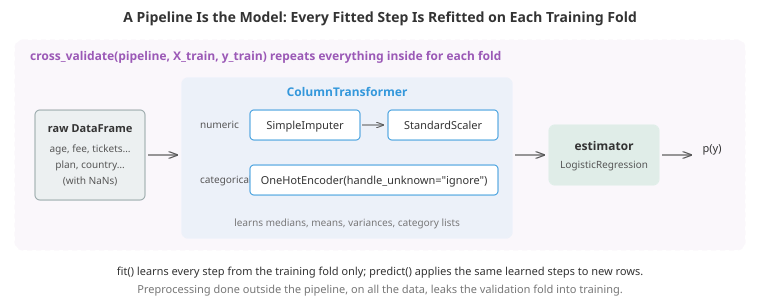

# Practical Data Work: From Raw Table to Model

*Most of the work in applied machine learning happens before any model is trained. This file covers the practical side: framing a problem, pandas for loading, cleaning and reshaping data, exploratory analysis, missing values and outliers, encoding categorical variables, scaling and transforming numbers, feature engineering without leakage, scikit-learn pipelines, and a complete end-to-end project on a messy customer table*

- The algorithms in the rest of this chapter assume a clean numeric matrix $X$ and a target $y$. Real data arrives as CSV exports, database tables and event logs, with numbers stored as text, the same country spelled four ways, ages of 999, duplicated rows and values missing for reasons that matter. Turning that into a good $X$ is where most of the time goes, and most of the accuracy is won or lost.

- This file uses **pandas** (the standard Python library for tables) and **scikit-learn** (the standard library for classical ML). Both run in the browser on this site. The ideas carry over to any toolset: SQL, Polars, Spark or R.

## Framing the Problem First

- Before touching data, write down answers to these questions. Many failed projects skipped them.
    - **What exactly is predicted, and at what moment?** "Will this customer cancel within the next 30 days, predicted on the first of each month" is a problem; "predict churn" is not.
    - **What action will the prediction drive?** A retention offer, a manual review, a price. The action determines the costs of each kind of error and therefore the metric and threshold (see the evaluation file).
    - **What data will be available at that moment?** Only those features are allowed. This one question prevents most leakage.
    - **What is the baseline?** The current rule ("call anyone who has not logged in for 14 days"), or simply predicting the base rate. A model that cannot beat the existing process is not worth deploying.
    - **How will the labels be obtained, and how noisy are they?** If "churned" means "did not pay for 60 days", some of those customers simply had expired cards.

## pandas Essentials

- A **DataFrame** is a table: named columns, each a **Series** with a single data type (dtype), sharing a row **index**. Thinking in whole columns rather than rows is the core habit. A Python loop over rows is typically 100 to 1000 times slower than the equivalent vectorised column operation, which runs in compiled code (chapter 13 explains why).

- **Loading.** `pd.read_csv` guesses types, and guesses wrong surprisingly often. Specify what you know: `dtype={"zip": str}` keeps leading zeros in postcodes, `parse_dates=["signup_date"]` gives real datetimes, `na_values=["N/A", "-", "?"]` declares the dataset's own missing markers. Columns of IDs, phone numbers and postcodes are strings even when they look like numbers: you never add two postcodes.

- **Selecting.** `df["col"]` gives one column; `df.loc[rows, cols]` selects by label and boolean mask; `df.iloc[i, j]` by position. Boolean masks are the workhorse: `df.loc[df["age"] > 65, "segment"] = "senior"`.

- **Assigning safely.** Modern pandas uses *copy-on-write* (the default from pandas 3.0): selecting a subset always behaves like a copy, so chained assignment like `df[df.age > 65]["segment"] = "x"` silently does nothing. Always assign through a single `.loc[...]` call on the frame you mean to change.

- **Group-and-aggregate** is the most important pattern: split rows into groups, compute something per group, combine.
    - `df.groupby("plan")["churned"].mean()` gives one row per group.
    - `df.groupby("customer")["amount"].transform("mean")` returns the group statistic broadcast back to every original row, which is how you create "customer's average spend" as a feature on each transaction.
    - `.agg(total="sum", count="size")` computes several named statistics at once.

- **Joining.** `pd.merge(left, right, on="key", how="left")` is SQL's join. The classic bug is an unexpected many-to-many key, which silently multiplies rows. Pass `validate="many_to_one"` (or whatever you expect) and pandas raises an error when the data disagrees, and check the row count before and after every merge.

- **Reshaping.** `pivot_table` turns long data (one row per customer and month) into wide data (one column per month); `melt` goes back. Models usually want one row per prediction, so the reshaping you need follows from the framing above.

- **Time.** With a datetime column, `.dt.dayofweek`, `.dt.month` and friends extract parts; `resample("W")` aggregates to weekly periods; `rolling("30D")` computes trailing windows; `shift(1)` moves values one step down (yesterday's value on today's row); `pd.merge_asof` joins each row to the most recent matching row in another table at or before its timestamp. These are the building blocks of point-in-time features.

- **Categoricals.** `astype("category")` stores a repeated string column as small integer codes plus a lookup table: much less memory and faster grouping, and libraries such as LightGBM and scikit-learn's gradient boosting can use the categories natively.

## Exploratory Data Analysis

- **Exploratory data analysis (EDA)** means looking at the data before modelling it. It is how you find the problems that would otherwise silently corrupt a model. A practical order:
    1. **Shape, types and a few raw rows.** Are numbers stored as numbers? Dates as dates?
    2. **Missingness per column**, and whether it differs by target value.
    3. **Duplicates**, both exact rows and repeated IDs.
    4. **Value ranges**: `describe()` on numeric columns, `value_counts()` on categorical ones. Look for impossible values (negative ages, dates in 1900, percentages of 250), sentinel codes (999, -1, 0 meaning "unknown"), and inconsistent spellings.
    5. **The target**: its distribution, base rate, and how it changes over time.
    6. **Relationships**: target rate by category, distributions of numeric features split by class, correlations between features (highly correlated pairs matter for linear models and for interpretation).

- Keep a written log of every issue found and every decision made. It becomes the data documentation that anyone reviewing the model will need.

- Be cautious about how much EDA you do on the **test** data. Looking at the overall shape of the full dataset is fine; choosing features because they looked predictive on the test rows is tuning on test.

## Cleaning

- Write cleaning as a **function** (or pipeline step) that takes raw data and returns clean data, never as a sequence of manual notebook edits. The same function must run on training data, on the test set and on live data in production. Manual fixes are the source of **training-serving skew**: the model was trained on data prepared one way and served data prepared another.

- Typical steps: drop exact duplicates; parse numbers stored as text (`"$15.99"`); normalise strings (strip whitespace, consistent case, map synonyms like "USA" to "US"); convert sentinel values to proper missing values; parse dates; fix units (a column mixing kilograms and pounds is common in merged data).

- **Outliers** come in two kinds, and they need opposite treatment. **Errors** (an age of 999, a typo adding three zeros) should be corrected or set to missing. **Genuine extremes** (a customer who really spends 100 times the median) are real information: keep them, but consider a transformation (like a log) or a robust loss so they do not dominate a model. Robust detection uses the median and the **median absolute deviation (MAD)**, or the interquartile range rule (flag points beyond $Q_3 + 1.5\,\text{IQR}$), because the mean and standard deviation are themselves dragged by the outliers you are looking for.

## Missing Data

- Statistics distinguishes three mechanisms (Rubin, 1976), and which one applies decides what is safe:
    - **MCAR** (missing completely at random): missingness is unrelated to anything, e.g. a sensor dropping readings at random. Simple imputation is safe; you only lose information.
    - **MAR** (missing at random): missingness depends on *other observed* columns, e.g. younger users skip the income question more often. Imputation using those other columns works well.
    - **MNAR** (missing not at random): missingness depends on the *missing value itself*, e.g. people with high debt decline to report their debt. Here the fact that a value is missing is itself evidence.

- Strategies:
    - **Drop rows** only when few are missing and they are MCAR; otherwise it biases the sample.
    - **Drop columns** that are mostly empty and uninformative.
    - **Simple imputation**: median for numeric (robust to skew), most frequent or a new "missing" category for categorical.
    - **Missing indicators**: add a binary column "was this missing?" alongside the imputed value. Under MNAR this is where the signal is. In the fifth coding task the indicator helps substantially under MNAR and does nothing under MCAR, and in the churn project a missing "days since last login" turns out to be one of the strongest churn signals of all.
    - **Model-based imputation**: predict the missing column from the others (k-nearest neighbours, or iterative imputation which cycles regressions over each column). Better under MAR, more complex, and the imputation model must be fitted on training data only.
    - **Native handling**: gradient-boosted trees learn a default direction for missing values (see the gradient boosting file), often the simplest and best option.

- Whatever the method, imputation statistics are learned parameters: the median used to fill a column must come from the training fold. That is exactly what putting `SimpleImputer` inside a pipeline guarantees.

## Encoding Categorical Variables

- Models need numbers. How a category becomes numbers matters a great deal.

- **One-hot encoding** creates one binary column per category. It makes no assumptions and is the default for linear models and neural networks with few categories. With high cardinality it creates thousands of sparse columns, and categories unseen in training must be handled (`handle_unknown="ignore"` encodes them as all zeros).

- **Ordinal encoding** maps categories to integers. Correct when the order is real (small < medium < large, education levels). For unordered categories it invents an order that does not exist; tree models tolerate this (they can split repeatedly), linear models do not.

- **Target encoding** replaces each category with the mean target among training rows of that category. It compresses any number of categories into one informative column, which makes it powerful for high-cardinality features such as postcode, merchant or product ID. Two refinements are essential:
    - **Smoothing** towards the global mean, so that a category seen twice does not get an extreme value. With $n_c$ rows in category $c$, category mean $\bar{y}_c$, global mean $\bar{y}$ and a smoothing strength $m$:

$$\text{enc}(c) = \frac{n_c\, \bar{y}_c + m\, \bar{y}}{n_c + m}$$

    - **Cross-fitting**: each training row's encoding must be computed without that row's own label (from the other folds). Otherwise rare categories get an encoding that is nearly their own label, a perfect-looking, useless feature. The third coding task shows a pure-noise postcode column lifting training AUC from 0.84 to 0.97 while dropping test AUC from 0.80 to 0.58, and cross-fitting removing the damage. scikit-learn's `TargetEncoder` cross-fits automatically inside `fit_transform`, and CatBoost's ordered statistics solve the same problem.

- **Frequency or count encoding** replaces a category with how often it appears. Cheap and sometimes surprisingly useful (rare merchants behave differently from common ones).

- **The hashing trick** maps categories to a fixed number of columns with a hash function. It needs no stored vocabulary and handles unseen categories, at the price of occasional collisions. Used in large-scale ads and recommendation models.

- **Learned embeddings** map each category to a dense vector trained with the rest of a neural network, the same idea as word embeddings in chapter 07. Standard for very high-cardinality IDs in deep recommender systems (chapter 18).

## Numeric Features: Scaling and Transforms

- **Which models care about scale?** Anything using distances (k-NN, k-means, SVMs with RBF kernels), anything regularised by weight size (ridge, lasso, logistic regression with a penalty: the penalty treats a weight on "income in dollars" and one on "age in years" as comparable, which they are not unless the features are scaled), PCA, and neural networks (whose optimisation is badly conditioned by unscaled inputs, chapter 03). Tree models do not care: a split threshold is unaffected by rescaling.

- **Standardisation**: subtract the mean, divide by the standard deviation. The default. **Min-max scaling** to $[0, 1]$: sensitive to outliers. **Robust scaling**: subtract the median, divide by the interquartile range.

- **Skewed features** (income, counts, durations, prices) are common. A $\log(1 + x)$ transform often makes relationships closer to linear and stops a few extreme values dominating. **Box-Cox** (positive data only) and **Yeo-Johnson** (any sign) learn the power transformation that makes a feature most Gaussian-like.

- **Binning** a continuous feature into ranges loses information, but can help linear models capture non-linear effects and makes some models easier to explain. Splines are a smoother alternative.

## Feature Engineering

- A good feature makes the pattern easy for the model to find. Domain knowledge is the biggest lever, and this is where much of the gain in tabular problems comes from.
    - **Ratios and differences**: debt-to-income, price per square metre, change since last month. Linear models cannot form a ratio from two raw columns; trees approximate it only with many splits.
    - **Date and time parts**: day of week, month, hour, holiday flags, time since an event ("days since signup", "days since last purchase").
    - **Cyclical encoding**: hour 23 is next to hour 0, but the numbers are far apart. Encode a periodic value $h$ with period $P$ as the pair $\sin(2\pi h/P)$ and $\cos(2\pi h/P)$, which places it on a circle where neighbours are close.
    - **Group aggregates**: a customer's average order value, number of orders in the last 30 days, a merchant's fraud rate. Usually the most powerful features in transactional data.
    - **Text**: length, keyword flags, TF-IDF vectors (chapter 07), or embeddings from a pretrained model.

- **Point-in-time correctness** is the essential rule for aggregate features. Every aggregate must be computed only from events strictly before the prediction moment. A customer's "total spend" computed over the whole log includes purchases made after the prediction date; their "current plan" may reflect an upgrade that happened later. Both are leakage, and both are easy to create by accident. The fourth coding task builds correct 30-day features with an explicit time filter and `merge_asof`, and shows how the naive versions leak. In production this logic usually lives in a **feature store** (chapter 18), whose main job is serving the same point-in-time correct features for training and prediction.

- **Feature selection** removes useless or redundant features: simpler models, faster training, sometimes better accuracy. Filter methods (correlation or mutual information with the target), wrapper methods (recursive feature elimination) and embedded methods (lasso, tree importances) all work, provided the selection happens inside cross-validation (the evaluation file's first coding task shows what happens otherwise).

## scikit-learn's Design

- Every scikit-learn object follows one small interface, which is why the library composes so well:
    - **Estimators** learn from data with `fit(X, y)`.
    - **Transformers** also have `transform(X)` (scalers, imputers, encoders); `fit_transform` does both.
    - **Predictors** have `predict(X)`, and classifiers usually `predict_proba(X)`.
    - Learned attributes end in an underscore (`scaler.mean_`, `model.coef_`), and constructor arguments are hyperparameters, readable with `get_params()`.

- A **Pipeline** chains transformers and a final estimator into a single estimator. A **ColumnTransformer** applies different transformers to different columns and concatenates the results. Together they turn the whole path from raw table to prediction into one object.



- Three reasons this matters more than it seems:
    - **No leakage**: cross-validation and hyperparameter search refit every step on each training fold, automatically.
    - **No training-serving skew**: the saved pipeline (e.g. with `joblib.dump`) contains the exact preprocessing that the model was trained with.
    - **Tunable preprocessing**: hyperparameters of any step are addressable as `step__param` in a search, e.g. `{"columntransformer__num__simpleimputer__strategy": ["mean", "median"], "logisticregression__C": [0.1, 1, 10]}`.

- `set_output(transform="pandas")` makes transformers return DataFrames with column names, which makes debugging and inspection much easier.

## The End-to-End Workflow

- Putting it together, a sound tabular project follows this loop. The second coding task runs every step on a messy customer-churn table.
    1. **Frame** the problem, the prediction moment, the action and its costs.
    2. **Hold out a test set** immediately (split by time or group if the deployment calls for it, see the evaluation file) and do not look at it again until the end.
    3. **Explore and clean** with a reusable cleaning function.
    4. **Engineer features**, point-in-time correct.
    5. **Establish baselines**: the base rate, a simple rule, a regularised linear model.
    6. **Build pipelines** for a few model families (linear, gradient-boosted trees) and compare them by cross-validation on the training set. Expect to be surprised: in the coding task the linear model beats gradient boosting, because the engineered features make the relationship nearly linear.
    7. **Tune** the most promising one, with early stopping and a modest random search.
    8. **Choose the decision threshold** from costs, using out-of-fold predictions on the training set.
    9. **Evaluate once on the test set**, including the business metric (in the task, expected cost per customer falls from 39 with no model to about 7, with the cost-based threshold beating the default 0.5 by a factor of two).
    10. **Inspect**: permutation importance, error analysis and performance on important slices.
    11. **Document and ship**: save the pipeline, record the data version, code version, metrics and known limitations (a **model card**), and set up monitoring for data drift and performance (chapter 15 and chapter 18).

- **Reproducibility** deserves deliberate effort: fix random seeds, pin library versions, version the data (tools like DVC, or immutable dated snapshots), and track experiments (MLflow, Weights & Biases) so that every reported number can be traced to the exact code and data that produced it.

- **Validate data in production too.** Schema checks (types, allowed values, ranges, missingness rates) on incoming data catch upstream changes before they silently degrade the model. Libraries like Pandera and Great Expectations make these checks declarative.

## Coding Tasks (use CoLab or notebook)

1. Explore and clean a messy customer table: numbers stored as text, inconsistent country spellings, impossible ages, duplicate rows, and values missing for a reason. Write the cleaning as a function, then explore how churn varies across groups and whether missingness itself is informative. (The generator function at the top stands in for loading a real file.)
```python
import matplotlib.pyplot as plt
import numpy as np
import pandas as pd

def make_churn_data(n=6000, seed=0):
    """A messy customer table of the kind real projects start from."""
    rng = np.random.default_rng(seed)
    plan = rng.choice(["basic", "standard", "premium"], n, p=[0.5, 0.35, 0.15])
    fee = pd.Series(plan).map({"basic": 9.99, "standard": 15.99, "premium": 24.99}).to_numpy()
    country = rng.choice(["UK", "US", "DE", "FR", "IN", "BR"], n, p=[.25, .3, .15, .1, .12, .08])
    tenure = rng.gamma(2.0, 9.0, n).round()                           # months as a customer
    tickets = rng.poisson(0.4 + 0.08 * (plan == "basic") * 10, n)      # support tickets last 90 days
    minutes = rng.lognormal(3.0, 0.8, n).round(1)                      # average session length
    age = rng.normal(38, 12, n).clip(18, 85).round()
    discount = rng.uniform(size=n) < 0.2
    logit = (-1.0 - 0.06 * tenure + 0.55 * tickets - 0.5 * np.log(minutes)
             + 0.9 * (plan == "basic") - 0.8 * discount + 0.4 * (country == "BR") + 1.0)
    churned = (rng.uniform(size=n) < 1 / (1 + np.exp(-logit))).astype(int)
    last_login = rng.exponential(5 + 25 * churned, n).round()
    df = pd.DataFrame({
        "customer_id": [f"C{i:05d}" for i in range(n)],
        "signup_date": (pd.Timestamp("2024-06-30") - pd.to_timedelta(tenure * 30.4, unit="D")).strftime("%Y-%m-%d"),
        "plan": plan, "country": country, "monthly_fee": fee, "age": age,
        "support_tickets": tickets, "avg_session_min": minutes,
        "days_since_login": last_login, "discount": discount, "churned": churned})
    # --- the mess ---
    df["monthly_fee"] = ["$" + f"{v:.2f}" for v in df["monthly_fee"]]            # numbers stored as text
    typo = (rng.uniform(size=n) < 0.10) & df["country"].isin(["UK", "US"]).to_numpy()
    df.loc[typo, "country"] = df.loc[typo, "country"].map(
        {"UK": "uk", "US": " usa"}).where(rng.uniform(size=typo.sum()) < 0.5,
        df.loc[typo, "country"].map({"UK": "U.K.", "US": "US "}))                # inconsistent spellings
    bad = rng.uniform(size=n) < 0.03
    df.loc[bad, "age"] = rng.choice([-1, 0, 999], bad.sum())                     # impossible sentinel values
    df.loc[rng.uniform(size=n) < 0.15, "age"] = np.nan
    # days_since_login goes missing mostly for customers who stopped using the app (MNAR)
    miss = rng.uniform(size=n) < np.where(df["churned"] == 1, 0.35, 0.05)
    df.loc[miss, "days_since_login"] = np.nan
    df = pd.concat([df, df.sample(60, random_state=seed)], ignore_index=True)    # duplicate rows
    return df.sample(frac=1, random_state=seed).reset_index(drop=True)

df = make_churn_data()

# 1. First look: size, types, a few rows
print(df.shape)
print(df.dtypes, "\n")
print(df.head(3).T, "\n")

# 2. Data quality: missing values, duplicates, suspicious values
print("missing fraction per column:\n", df.isna().mean().round(3)[lambda s: s > 0], "\n")
print("exact duplicate rows:", df.duplicated().sum())
print("duplicate customer ids:", df["customer_id"].duplicated().sum())
print("country spellings:", sorted(df["country"].unique()))
print("age summary:\n", df["age"].describe().round(1), "\n")

# 3. Clean, as one function so exactly the same steps run in training and in production
def clean(raw):
    out = raw.drop_duplicates().copy()
    out["monthly_fee"] = out["monthly_fee"].str.replace("$", "", regex=False).astype(float)
    out["country"] = (out["country"].str.strip().str.upper().str.replace(".", "", regex=False)
                      .replace({"USA": "US"}))
    out["age"] = out["age"].where(out["age"].between(18, 100))      # impossible values become NaN
    out["signup_date"] = pd.to_datetime(out["signup_date"])
    out["plan"] = out["plan"].astype("category")
    return out

df = clean(df)
print("after cleaning:", df.shape, "| countries:", sorted(df["country"].unique()))

# 4. Explore the target: how does churn vary across groups?
print("\noverall churn rate:", round(df["churned"].mean(), 3))
print(df.groupby("plan", observed=True)["churned"].agg(["mean", "size"]).round(3))
print(df.groupby(pd.cut(df["support_tickets"], [-1, 0, 1, 2, 20]), observed=True)["churned"].mean().round(3))

# 5. Is missingness informative? Compare churn rate when a value is missing vs present
for col in ["age", "days_since_login"]:
    rates = df.groupby(df[col].isna())["churned"].mean().round(3)
    print(f"churn rate when {col} is present: {rates[False]}, when missing: {rates[True]}")

fig, axes = plt.subplots(1, 3, figsize=(14, 3.8))
for v, colour in [(0, '#3498db'), (1, '#e74c3c')]:
    sub = df[df["churned"] == v]
    axes[0].hist(np.log(sub["avg_session_min"]), bins=40, alpha=0.6, color=colour, density=True, label=f"churned={v}")
    axes[1].hist(sub["signup_date"], bins=40, alpha=0.6, color=colour, density=True)
axes[0].set_title("log(session minutes)"); axes[0].legend(); axes[1].set_title("signup date")
df.groupby("country")["churned"].mean().sort_values().plot.barh(ax=axes[2], color='#3498db')
axes[2].set_title("churn rate by country")
plt.tight_layout(); plt.show()
```

2. The complete project: clean, engineer features, hold out a test set, compare a baseline, a regularised linear model and gradient boosting inside pipelines by cross-validation, pick the decision threshold from business costs on out-of-fold predictions, evaluate once on the test set, and inspect permutation importance. Then try adding a feature or changing a hyperparameter and see whether the cross-validated score really moves.
```python
import matplotlib.pyplot as plt
import numpy as np
import pandas as pd

def make_churn_data(n=6000, seed=0):
    """A messy customer table of the kind real projects start from."""
    rng = np.random.default_rng(seed)
    plan = rng.choice(["basic", "standard", "premium"], n, p=[0.5, 0.35, 0.15])
    fee = pd.Series(plan).map({"basic": 9.99, "standard": 15.99, "premium": 24.99}).to_numpy()
    country = rng.choice(["UK", "US", "DE", "FR", "IN", "BR"], n, p=[.25, .3, .15, .1, .12, .08])
    tenure = rng.gamma(2.0, 9.0, n).round()                           # months as a customer
    tickets = rng.poisson(0.4 + 0.08 * (plan == "basic") * 10, n)      # support tickets last 90 days
    minutes = rng.lognormal(3.0, 0.8, n).round(1)                      # average session length
    age = rng.normal(38, 12, n).clip(18, 85).round()
    discount = rng.uniform(size=n) < 0.2
    logit = (-1.0 - 0.06 * tenure + 0.55 * tickets - 0.5 * np.log(minutes)
             + 0.9 * (plan == "basic") - 0.8 * discount + 0.4 * (country == "BR") + 1.0)
    churned = (rng.uniform(size=n) < 1 / (1 + np.exp(-logit))).astype(int)
    last_login = rng.exponential(5 + 25 * churned, n).round()
    df = pd.DataFrame({
        "customer_id": [f"C{i:05d}" for i in range(n)],
        "signup_date": (pd.Timestamp("2024-06-30") - pd.to_timedelta(tenure * 30.4, unit="D")).strftime("%Y-%m-%d"),
        "plan": plan, "country": country, "monthly_fee": fee, "age": age,
        "support_tickets": tickets, "avg_session_min": minutes,
        "days_since_login": last_login, "discount": discount, "churned": churned})
    # --- the mess ---
    df["monthly_fee"] = ["$" + f"{v:.2f}" for v in df["monthly_fee"]]            # numbers stored as text
    typo = (rng.uniform(size=n) < 0.10) & df["country"].isin(["UK", "US"]).to_numpy()
    df.loc[typo, "country"] = df.loc[typo, "country"].map(
        {"UK": "uk", "US": " usa"}).where(rng.uniform(size=typo.sum()) < 0.5,
        df.loc[typo, "country"].map({"UK": "U.K.", "US": "US "}))                # inconsistent spellings
    bad = rng.uniform(size=n) < 0.03
    df.loc[bad, "age"] = rng.choice([-1, 0, 999], bad.sum())                     # impossible sentinel values
    df.loc[rng.uniform(size=n) < 0.15, "age"] = np.nan
    # days_since_login goes missing mostly for customers who stopped using the app (MNAR)
    miss = rng.uniform(size=n) < np.where(df["churned"] == 1, 0.35, 0.05)
    df.loc[miss, "days_since_login"] = np.nan
    df = pd.concat([df, df.sample(60, random_state=seed)], ignore_index=True)    # duplicate rows
    return df.sample(frac=1, random_state=seed).reset_index(drop=True)

def clean(raw):
    out = raw.drop_duplicates().copy()
    out["monthly_fee"] = out["monthly_fee"].str.replace("$", "", regex=False).astype(float)
    out["country"] = (out["country"].str.strip().str.upper().str.replace(".", "", regex=False)
                      .replace({"USA": "US"}))
    out["age"] = out["age"].where(out["age"].between(18, 100))      # impossible values become NaN
    out["signup_date"] = pd.to_datetime(out["signup_date"])
    out["plan"] = out["plan"].astype("category")
    return out

from sklearn.model_selection import train_test_split, StratifiedKFold, cross_validate, cross_val_predict
from sklearn.compose import ColumnTransformer
from sklearn.pipeline import make_pipeline
from sklearn.impute import SimpleImputer
from sklearn.preprocessing import StandardScaler, OneHotEncoder, OrdinalEncoder
from sklearn.linear_model import LogisticRegression
from sklearn.ensemble import HistGradientBoostingClassifier
from sklearn.dummy import DummyClassifier
from sklearn.inspection import permutation_importance
from sklearn.metrics import roc_auc_score, average_precision_score

def add_features(d, snapshot=pd.Timestamp("2024-06-30")):
    d = d.copy()
    d["tenure_months"] = (snapshot - d["signup_date"]).dt.days / 30.4
    d["tickets_per_year_of_tenure"] = d["support_tickets"] / (1 + d["tenure_months"] / 12)
    d["log_session_min"] = np.log(d["avg_session_min"])
    return d.drop(columns=["signup_date", "avg_session_min", "customer_id"])

df = add_features(clean(make_churn_data()))
X, y = df.drop(columns="churned"), df["churned"]
X_train, X_test, y_train, y_test = train_test_split(X, y, test_size=0.2, stratify=y, random_state=0)

numeric = ["monthly_fee", "age", "support_tickets", "days_since_login", "tenure_months",
           "tickets_per_year_of_tenure", "log_session_min"]
categorical = ["plan", "country", "discount"]

# Every learned step lives inside the pipeline, so cross-validation refits it on each fold.
linear_prep = ColumnTransformer([
    ("num", make_pipeline(SimpleImputer(strategy="median", add_indicator=True), StandardScaler()), numeric),
    ("cat", OneHotEncoder(handle_unknown="ignore"), categorical)])
tree_prep = ColumnTransformer([
    ("num", "passthrough", numeric),                     # trees handle NaN and scale natively
    ("cat", OrdinalEncoder(handle_unknown="use_encoded_value", unknown_value=-1), categorical)])
n_num = len(numeric)
models = {
    "always the base rate": DummyClassifier(strategy="prior"),
    "logistic regression": make_pipeline(linear_prep, LogisticRegression(C=1.0, max_iter=2000)),
    "gradient boosting": make_pipeline(tree_prep, HistGradientBoostingClassifier(
        learning_rate=0.05, max_iter=500, early_stopping=True, validation_fraction=0.15,
        categorical_features=[False] * n_num + [True] * len(categorical), random_state=0)),
}

cv = StratifiedKFold(5, shuffle=True, random_state=0)
print("5-fold cross-validation on the training set")
cv_ap = {}
for name, model in models.items():
    s = cross_validate(model, X_train, y_train, cv=cv, scoring=["roc_auc", "average_precision", "neg_log_loss"])
    print(f"  {name:22s} ROC-AUC {s['test_roc_auc'].mean():.3f} ± {s['test_roc_auc'].std():.3f}   "
          f"AP {s['test_average_precision'].mean():.3f}   log-loss {-s['test_neg_log_loss'].mean():.3f}")
    cv_ap[name] = s["test_average_precision"].mean()

# Pick the winner by cross-validated average precision, not by reputation.
best_name = max(cv_ap, key=cv_ap.get)
best = models[best_name]
print(f"selected: {best_name}")

# Choose the decision threshold from costs, using out-of-fold predictions on the TRAINING set.
# A retention offer costs 20; losing a customer costs 200.
oof = cross_val_predict(best, X_train, y_train, cv=cv, method="predict_proba")[:, 1]
cost = lambda y_true, p, t: (20 * ((p >= t) & (y_true == 0)) + 200 * ((p < t) & (y_true == 1))).sum()
thresholds = np.linspace(0.01, 0.9, 90)
costs = [cost(y_train.to_numpy(), oof, t) for t in thresholds]
t_best = thresholds[int(np.argmin(costs))]
print(f"\ncost-optimal threshold on out-of-fold predictions: {t_best:.2f} "
      f"(theory for calibrated probabilities: 20 / 220 = {20/220:.2f})")

# Only now touch the test set, once.
best.fit(X_train, y_train)
p_test = best.predict_proba(X_test)[:, 1]
print(f"\nTEST  ROC-AUC {roc_auc_score(y_test, p_test):.3f}   AP {average_precision_score(y_test, p_test):.3f}")
for t in [0.5, t_best]:
    print(f"  threshold {t:.2f}: cost per customer {cost(y_test.to_numpy(), p_test, t) / len(y_test):.2f}, "
          f"customers contacted {np.mean(p_test >= t):.0%}")
print(f"  contact nobody: cost per customer {200 * y_test.mean():.2f}")

imp = permutation_importance(best, X_test, y_test, scoring="roc_auc", n_repeats=5, random_state=0)
order = np.argsort(imp.importances_mean)
plt.figure(figsize=(7, 4))
plt.barh(np.array(X_test.columns)[order], imp.importances_mean[order], xerr=imp.importances_std[order], color='#3498db')
plt.xlabel("drop in test ROC-AUC when the column is shuffled")
plt.title("Permutation importance"); plt.tight_layout(); plt.show()
```

3. Target encoding done wrong and right. A pure-noise, high-cardinality postcode column looks like the best feature in training when each row's encoding includes its own label, and it wrecks test performance. Cross-fitted encoding removes the leak.
```python
import numpy as np
import pandas as pd
from sklearn.model_selection import train_test_split
from sklearn.preprocessing import TargetEncoder
from sklearn.ensemble import HistGradientBoostingClassifier
from sklearn.metrics import roc_auc_score

# One real signal plus a high-cardinality category (think postcode) that is pure noise.
rng = np.random.default_rng(0)
n = 6000
signal = rng.normal(size=n)
postcode = rng.integers(0, 2000, n).astype(str)                 # ~3 rows per postcode
y = (rng.uniform(size=n) < 1 / (1 + np.exp(-1.5 * signal))).astype(int)
df = pd.DataFrame({"signal": signal, "postcode": postcode})
X_tr, X_te, y_tr, y_te = train_test_split(df, y, test_size=0.3, random_state=0)

def evaluate(enc_tr, enc_te, label):
    model = HistGradientBoostingClassifier(max_iter=200, random_state=0)
    Xa = np.c_[X_tr["signal"], enc_tr]; Xb = np.c_[X_te["signal"], enc_te]
    model.fit(Xa, y_tr)
    print(f"{label:38s} train AUC {roc_auc_score(y_tr, model.predict_proba(Xa)[:, 1]):.3f}   "
          f"test AUC {roc_auc_score(y_te, model.predict_proba(Xb)[:, 1]):.3f}")

# Baseline: ignore the postcode entirely
evaluate(np.zeros(len(X_tr)), np.zeros(len(X_te)), "signal only")

# WRONG: each row's encoding includes its own label
means = pd.Series(y_tr, index=X_tr.index).groupby(X_tr["postcode"]).mean()
global_mean = y_tr.mean()
naive_tr = X_tr["postcode"].map(means).to_numpy()
naive_te = X_te["postcode"].map(means).fillna(global_mean).to_numpy()
evaluate(naive_tr, naive_te, "naive target encoding")

# RIGHT: cross-fitting. Each training row is encoded by a model fitted on the other folds,
# and rare categories are shrunk towards the global mean.
te = TargetEncoder(target_type="binary")
enc_tr = te.fit_transform(X_tr[["postcode"]], y_tr).ravel()     # fit_transform cross-fits internally
enc_te = te.transform(X_te[["postcode"]]).ravel()
evaluate(enc_tr, enc_te, "cross-fitted target encoding")
print("\nThe naive encoding makes a useless column look like the best feature in training,"
      "\nand the model pays for trusting it on the test set.")
```

4. Point-in-time correct features from event logs. Build a "plan at prediction time" feature with `merge_asof` and 30-day spend and count features with an explicit time filter, then compare them with the naive versions that quietly use the future.
```python
import numpy as np
import pandas as pd

rng = np.random.default_rng(1)
day = lambda d: pd.Timestamp("2024-01-01") + pd.to_timedelta(d, unit="D")

# A transaction log, a log of plan changes, and the moments we want to predict at.
tx = pd.DataFrame({"customer": rng.choice(["A", "B", "C"], 300),
                   "time": day(rng.uniform(0, 180, 300)),
                   "amount": rng.lognormal(3, 1, 300).round(2)})
plans = pd.DataFrame({"customer": ["A", "A", "B", "C", "C"],
                      "time": day(np.array([0, 70, 0, 0, 95])),
                      "plan": ["basic", "premium", "standard", "basic", "standard"]})
predict_at = pd.DataFrame({"customer": ["A", "B", "C", "A"],
                           "time": pd.to_datetime(["2024-03-01", "2024-03-15", "2024-04-01", "2024-05-20"])})
for t in (tx, plans, predict_at):                     # one datetime resolution everywhere
    t["time"] = t["time"].astype("datetime64[ns]")

# 1. "Latest known value" features: merge_asof takes the last plan row at or before each prediction time.
feats = pd.merge_asof(predict_at.sort_values("time"), plans.sort_values("time"),
                      on="time", by="customer", direction="backward")

# 2. Window aggregates relative to the PREDICTION time: join, keep only the past 30 days, aggregate.
pairs = predict_at.reset_index().merge(tx, on="customer", suffixes=("", "_tx"))
in_window = (pairs["time_tx"] < pairs["time"]) & (pairs["time_tx"] >= pairs["time"] - pd.Timedelta("30D"))
agg = (pairs[in_window].groupby("index")["amount"].agg(spend_30d="sum", n_tx_30d="size"))
feats = (predict_at.reset_index().merge(feats, on=["customer", "time"])
         .merge(agg, left_on="index", right_index=True, how="left")
         .fillna({"spend_30d": 0, "n_tx_30d": 0}).drop(columns="index"))
print("point-in-time correct features:\n", feats, "\n")

# The common mistake: aggregate over the whole log, which includes the future,
# and take the customer's CURRENT plan rather than the plan at prediction time.
leaky = predict_at.merge(tx.groupby("customer")["amount"].sum().rename("total_spend_all_time"), on="customer")
leaky = leaky.merge(plans.sort_values("time").groupby("customer").last()["plan"].rename("current_plan"), on="customer")
print("leaky features:\n", leaky)
print("\nCustomer A on 2024-03-01 was on 'basic'; the leaky table says 'premium' (an upgrade that happened later).")
```

5. Missing-data mechanisms. Make one feature missing completely at random, at random given another feature, and not at random, and measure whether a missing-indicator column helps in each case.
```python
import numpy as np
from sklearn.pipeline import make_pipeline
from sklearn.impute import SimpleImputer
from sklearn.preprocessing import StandardScaler
from sklearn.linear_model import LogisticRegression
from sklearn.model_selection import cross_val_score

rng = np.random.default_rng(2)
n = 4000
income = rng.normal(0, 1, n)
debt = rng.normal(0, 1, n)
y = (rng.uniform(size=n) < 1 / (1 + np.exp(-(1.2 * debt - 0.8 * income)))).astype(int)

def with_missing(mechanism):
    X = np.c_[income, debt].copy()
    if mechanism == "MCAR":     # missing completely at random
        m = rng.uniform(size=n) < 0.3
    elif mechanism == "MAR":    # depends on another observed column
        m = rng.uniform(size=n) < np.where(income < 0, 0.5, 0.1)
    else:                       # MNAR: people with high debt decline to report it
        m = rng.uniform(size=n) < np.where(debt > 0.5, 0.7, 0.05)
    X[m, 1] = np.nan
    return X

print("mechanism | mean imputation | + missing indicator")
for mech in ["MCAR", "MAR", "MNAR"]:
    X = with_missing(mech)
    scores = []
    for indicator in [False, True]:
        model = make_pipeline(SimpleImputer(strategy="mean", add_indicator=indicator),
                              StandardScaler(), LogisticRegression())
        scores.append(cross_val_score(model, X, y, cv=5, scoring="roc_auc").mean())
    print(f"{mech:9s} | {scores[0]:.3f}           | {scores[1]:.3f}")
print("\nUnder MNAR the fact that a value is missing carries information about the value itself;"
      "\nthe indicator column lets the model use it.")
```

## Project Milestone 1: Load, Clean and Baseline the Adult Data

- The first milestone of the tabular project (see chapter 21's setup and roadmap). It applies this file's workflow to real census data: look before touching, write every cleaning decision into a function, explore the questions that drive modelling, hold out a test set immediately, and set baselines that later milestones must beat.

- Install nothing beyond the setup environment. The code downloads the data once (a few megabytes) and caches it in `~/ml-data`. It runs on your machine, not in the browser.

- What to look for:
    - Missing values sit in three categorical columns (workclass, occupation, native-country), each for a few per cent of rows. Compare the target rate for rows with and without them before deciding how to fill them: if missingness is informative, an explicit "missing" category keeps that signal.
    - About a quarter of people earn more than 50,000 dollars, so accuracy alone flatters weak models: the majority-class baseline already scores about 76%. Average precision and ROC-AUC are more telling.
    - `capital-gain` is zero for most people with a long right tail (and a cap at 99,999), so it is log-transformed.
    - Two columns are dropped on purpose: `fnlwgt` is a census sampling weight, not a property of the person, and `education` repeats `education-num`. Both choices are written in the code, so later milestones can revisit them.
    - `sex` and `race` are kept as features for now. Milestone 3 asks whether they should be.

```py
import numpy as np
import pandas as pd
from sklearn.datasets import fetch_openml
from sklearn.model_selection import train_test_split, StratifiedKFold, cross_validate
from sklearn.compose import ColumnTransformer
from sklearn.pipeline import make_pipeline
from sklearn.impute import SimpleImputer
from sklearn.preprocessing import OneHotEncoder, StandardScaler, FunctionTransformer
from sklearn.linear_model import LogisticRegression
from sklearn.dummy import DummyClassifier

# Downloads once (about 4 MB) and caches in ~/ml-data; later runs load from disk.
raw = fetch_openml("adult", version=2, as_frame=True, data_home="~/ml-data").frame

# 1. Look before touching anything
print(f"{raw.shape[0]} rows, {raw.shape[1]} columns")
print("\nmissing values (% of rows):")
print((raw.isna().mean() * 100).round(1)[lambda s: s > 0].to_string())
print(f"\nexact duplicate rows: {raw.duplicated().sum()}")
print("\ntarget balance:"); print(raw["class"].value_counts(normalize=True).round(3).to_string())
print("\nnumeric columns:"); print(raw.describe().T[["mean", "50%", "max"]].round(1).to_string())

# 2. Clean: every decision written down, so later milestones can revisit it
def clean(df):
    df = df.drop_duplicates().copy()
    df["target"] = (df["class"].astype(str).str.strip() == ">50K").astype(int)
    # fnlwgt is a census sampling weight, not a property of the person; education duplicates education-num
    df = df.drop(columns=["class", "fnlwgt", "education"])
    for c in df.select_dtypes(["category", "object"]).columns:
        df[c] = df[c].astype("object").where(df[c].notna(), np.nan)   # plain strings, NaN kept as missing
    return df.reset_index(drop=True)

df = clean(raw)
numeric = ["age", "education-num", "capital-gain", "capital-loss", "hours-per-week"]
categorical = [c for c in df.columns if c not in numeric + ["target"]]
print(f"\nafter cleaning: {len(df)} rows; numeric {numeric}; categorical {categorical}")

# 3. Explore the questions that drive modelling decisions
print("\nshare earning >50K by education level (years):")
print(df.groupby(pd.cut(df["education-num"], [0, 8, 9, 12, 13, 16]), observed=True)["target"]
      .agg(["mean", "size"]).round(3).to_string())
print("\nshare earning >50K when occupation is missing vs present:")
print(df.groupby(df["occupation"].isna())["target"].mean().rename({False: "present", True: "missing"}).round(3).to_string())
print(f"\ncapital-gain is zero for {np.mean(df['capital-gain'] == 0):.0%} of people; heavy right tail -> log1p it")

# 4. Hold out a test set now and do not look at it until the final milestone.
#    The fixed random_state lets every later milestone recreate exactly the same split.
X, y = df.drop(columns="target"), df["target"]
X_train, X_test, y_train, y_test = train_test_split(X, y, test_size=0.2, stratify=y, random_state=42)

# 5. Baselines, judged by 5-fold cross-validation on the training set only
prep = ColumnTransformer([
    ("num", make_pipeline(FunctionTransformer(np.log1p, feature_names_out="one-to-one"), StandardScaler()), numeric),
    ("cat", make_pipeline(SimpleImputer(strategy="constant", fill_value="missing"),
                          OneHotEncoder(handle_unknown="ignore", min_frequency=20)), categorical)])
models = {"always predict the majority": DummyClassifier(strategy="prior"),
          "logistic regression": make_pipeline(prep, LogisticRegression(max_iter=2000))}
cv = StratifiedKFold(5, shuffle=True, random_state=42)
print(f"\n{'model':30s} {'accuracy':>9s} {'ROC-AUC':>8s} {'avg precision':>14s}")
for name, model in models.items():
    s = cross_validate(model, X_train, y_train, cv=cv, scoring=["accuracy", "roc_auc", "average_precision"])
    print(f"{name:30s} {s['test_accuracy'].mean():9.3f} {s['test_roc_auc'].mean():8.3f} "
          f"{s['test_average_precision'].mean():14.3f}")
```

- Make it better:
    - Look at the logistic regression's coefficients (after one-hot encoding) and check that the strongest ones make sense.
    - Try `class_weight="balanced"` and see what happens to accuracy and to average precision, and why they move differently.
    - Group rare categories in `native-country` yourself instead of with `min_frequency`, and check whether cross-validation notices.
