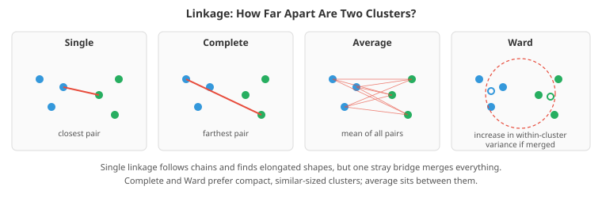
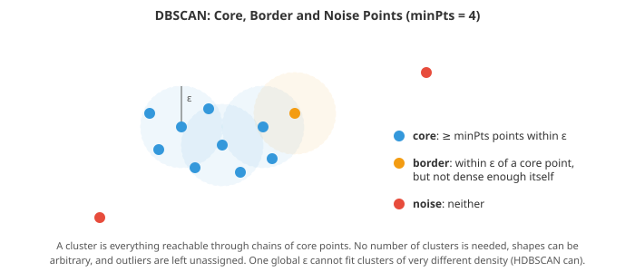

# Clustering, Manifold Learning and Anomaly Detection

*Unsupervised learning finds structure in data without labels. File 01 introduced k-means, Gaussian mixtures and PCA. This file goes further: fitting and selecting Gaussian mixtures, hierarchical, density-based and spectral clustering, how to judge a clustering when there is no ground truth, nonlinear embeddings such as t-SNE and UMAP and how to read them without being fooled, and the main families of anomaly detection*

- Most of the world's data is unlabelled. Unsupervised methods are used to discover segments (customer groups, cell types, topics), to compress and visualise high-dimensional data, to find unusual events (fraud, faults, intrusions), and as preprocessing for supervised models. They are also easy to misuse, because there is no test-set accuracy to tell you when you are wrong. This file pays as much attention to judging results as to producing them.

## What Clustering Can and Cannot Do

- A clustering algorithm always returns clusters, even on pure noise. Whether those clusters mean anything depends on three choices you make before running it:
    - **The representation**: which features, and how they are scaled. Clustering customers by raw income and age is in effect clustering by income alone, because income's numbers are thousands of times larger. Standardise first, or choose a distance on purpose.
    - **The notion of distance or similarity**: Euclidean for continuous measurements, cosine for text and embeddings (where direction matters more than magnitude), Jaccard for sets, or a domain-specific metric.
    - **The notion of a cluster**: compact balls (k-means), ellipses (Gaussian mixtures), dense regions of any shape (DBSCAN), or groups connected in a graph (spectral clustering). Each algorithm encodes one of these, and finds that kind of structure whether or not it is there.

- There is no universally right answer. Kleinberg (2002) proved an **impossibility theorem**: no clustering function can satisfy three natural-seeming properties at once (it should not depend on the units of measurement; any partition should be possible for some data; and shrinking within-cluster distances while growing between-cluster ones should not change the result). Every algorithm gives one of them up. Clustering is a modelling choice, not a measurement.

## Gaussian Mixtures in Practice

- File 01 introduced the **Gaussian mixture model (GMM)**: the data density is a weighted sum of $K$ Gaussians,

$$p(x) = \sum_{k=1}^{K} \pi_k\, \mathcal{N}(x \mid \mu_k, \Sigma_k)$$

- and **expectation-maximisation (EM)** fits it by alternating two steps. The **E-step** computes each point's **responsibilities**, its posterior probability of belonging to each component:

$$r_{ik} = \frac{\pi_k\, \mathcal{N}(x_i \mid \mu_k, \Sigma_k)}{\sum_j \pi_j\, \mathcal{N}(x_i \mid \mu_j, \Sigma_j)}$$

- The **M-step** re-estimates each component as a weighted maximum-likelihood fit, with $N_k = \sum_i r_{ik}$:

$$\pi_k = \frac{N_k}{n}, \qquad \mu_k = \frac{1}{N_k}\sum_i r_{ik}\, x_i, \qquad \Sigma_k = \frac{1}{N_k}\sum_i r_{ik}\,(x_i - \mu_k)(x_i - \mu_k)^\top$$

- Why does this work? EM maximises a lower bound on the log-likelihood, built with **Jensen's inequality** ($\log \mathbb{E}[Z] \ge \mathbb{E}[\log Z]$, because the logarithm is concave): the E-step makes the bound tight at the current parameters, and the M-step maximises the bound. Each iteration therefore never decreases the likelihood. It converges to a local maximum, not necessarily the global one, so run it from several random starts and keep the best.

- Practical issues the textbook formula hides:
    - **Numerical underflow.** Gaussian densities in many dimensions are astronomically small. Compute in log space and normalise with the **log-sum-exp** trick ($\log\sum_k e^{a_k} = m + \log\sum_k e^{a_k - m}$ with $m = \max_k a_k$), as the first coding task does.
    - **Singularities.** If a component collapses onto a single point, its variance goes to zero and the likelihood to infinity. Adding a small constant to the diagonal of each covariance (scikit-learn's `reg_covar`) prevents this.
    - **Covariance structure.** A full covariance in $d$ dimensions has $d(d+1)/2$ parameters per component. Restricting to *diagonal* (axis-aligned ellipses), *spherical* (balls) or *tied* (all components share one shape) trades flexibility for stability when data are high-dimensional or scarce.

- **Choosing $K$.** The likelihood always increases with more components, so it cannot choose $K$ alone. Information criteria penalise the number of parameters $p$:

$$\text{BIC} = -2 \log \hat{L} + p \log n, \qquad \text{AIC} = -2 \log \hat{L} + 2p$$

- Pick the $K$ with the lowest value. BIC penalises complexity more heavily and tends to choose fewer components; it is the usual choice when the goal is to find the "true" number of groups. In the first coding task it correctly picks 3.

- A GMM gives more than labels: soft assignments (a point can be 60/40 between two segments), a density (so it doubles as an anomaly detector: low $p(x)$ means unusual), and a generative model you can sample from. The **Bayesian GMM** with a Dirichlet process prior can switch off unneeded components automatically, giving an alternative way to choose $K$.

## Hierarchical Clustering

- **Agglomerative clustering** starts with every point as its own cluster and repeatedly merges the two closest clusters until one remains. The full sequence of merges is a tree, the **dendrogram**. Cutting the tree at a chosen height gives a flat clustering, and you can inspect all granularities at once rather than committing to one $K$ up front.

- The key choice is the **linkage**: how the distance between two *clusters* is defined from distances between points.
    - **Single linkage**: the distance between the closest pair. Finds long, chain-like shapes, but suffers from **chaining**: a thin line of points between two blobs merges them. Single linkage is equivalent to building a minimum spanning tree and cutting its longest edges.
    - **Complete linkage**: the distance between the farthest pair. Produces compact clusters of similar diameter; sensitive to outliers.
    - **Average linkage**: the mean distance over all pairs. A compromise.
    - **Ward's method**: merge the pair that increases the total within-cluster sum of squares the least. The same objective as k-means, applied greedily; usually the best default for numeric data.



- Cost is the drawback: the pairwise distance matrix takes $O(n^2)$ memory, and the merging $O(n^2)$ to $O(n^3)$ time depending on linkage and implementation. Hierarchical clustering is practical up to tens of thousands of points. It is popular in biology (gene expression heatmaps with dendrograms on both axes) and anywhere a taxonomy is the goal.

## Density-Based Clustering

- **DBSCAN** (Ester et al., 1996) defines clusters as dense regions separated by sparse ones. With two parameters, a radius $\varepsilon$ and a count `minPts`:
    - a **core point** has at least `minPts` points (itself included) within distance $\varepsilon$;
    - a **border point** is within $\varepsilon$ of a core point but is not core itself;
    - everything else is **noise**.
    - A cluster is a maximal set of points connected through chains of core points.



- DBSCAN needs no number of clusters, finds arbitrary shapes, and labels outliers as noise instead of forcing them into a cluster. Choosing $\varepsilon$: compute each point's distance to its $(\text{minPts} - 1)$-th nearest neighbour, sort these distances, and look for the knee of the curve, the **k-distance plot** in the second coding task. A common starting point for `minPts` is twice the number of dimensions.

- Its weakness is a single global density threshold. Clusters of very different densities cannot all be captured by one $\varepsilon$: a value small enough to separate dense clusters fragments sparse ones into noise. **OPTICS** orders points so that clusters at all density levels can be read off, and **HDBSCAN** (Campello, Moulavi and Sander, 2013) builds the hierarchy of DBSCAN clusterings over all $\varepsilon$ and keeps the clusters that persist longest. HDBSCAN has essentially one intuitive parameter (minimum cluster size) and is a strong default for exploratory clustering, especially combined with UMAP for high-dimensional data.

- **Mean shift** is another density method: move every point uphill on a kernel density estimate until it reaches a mode; points arriving at the same mode form a cluster. It finds the number of clusters itself but needs a bandwidth and scales poorly.

## Spectral Clustering

- Some cluster shapes defeat every method based on distances to centres: two concentric rings, two interlocking spirals. **Spectral clustering** instead builds a **similarity graph** (connect each point to its nearest neighbours, weighted by similarity) and asks how to cut the graph into pieces with few, weak edges between them.

- The graph tools come from chapter 12. With weight matrix $W$ and degree matrix $D = \text{diag}(\sum_j W_{ij})$, the **graph Laplacian** is $L = D - W$, or in normalised form $L_{\text{sym}} = I - D^{-1/2} W D^{-1/2}$. Two facts make it useful:
    - The number of eigenvalues equal to zero equals the number of connected components of the graph, and the corresponding eigenvectors are indicators of those components.
    - When the clusters are only *nearly* disconnected (a few weak edges between them), the smallest eigenvectors are nearly such indicators. Minimising a graph cut normalised by cluster size (the **normalised cut** of Shi and Malik, 2000) is NP-hard, and its continuous relaxation is solved exactly by these eigenvectors.

- The algorithm (in the form of Ng, Jordan and Weiss, 2002): compute the $K$ eigenvectors of $L_{\text{sym}}$ with the smallest eigenvalues, stack them as columns, normalise each row to unit length, and run k-means on the rows. Points that were tangled in the original space become well-separated points in the eigenvector space. The fourth coding task separates concentric rings perfectly where k-means on the raw points is no better than chance.

- The costs: an eigendecomposition (cubic in $n$ unless sparse methods are used), and results that depend on how the graph is built (number of neighbours, similarity bandwidth).

## Judging a Clustering

- **External validation** applies when some ground-truth labels exist (for checking the method, not for training). The **adjusted Rand index (ARI)** measures pair-counting agreement between two partitions, corrected so that random labelling scores 0 and perfect agreement 1. **Normalised mutual information (NMI)** measures shared information (chapter 05). Both ignore the arbitrary numbering of clusters.

- **Internal validation** uses the data alone. The **silhouette** of a point compares $a$, its mean distance to the other members of its own cluster, with $b$, its mean distance to the members of the nearest other cluster:

$$s = \frac{b - a}{\max(a, b)}$$

- $s$ near 1 means well inside its cluster, near 0 on a boundary, negative probably misassigned. The mean silhouette over all points summarises a clustering; the **Davies-Bouldin** and **Calinski-Harabasz** indices are alternatives. All internal indices encode a preference (silhouette favours compact, well-separated, convex clusters) and will rate DBSCAN's correct answer on two moons worse than k-means's wrong one. Use them to compare settings of one method, not to crown a method.

- **Stability** is often the most convincing check: rerun the clustering on bootstrap samples or with small perturbations and measure how consistently the same points end up together. Real structure is stable; clusters that reshuffle are artefacts.

- **Usefulness** is the final test. A customer segmentation is good if the segments respond differently to different actions; a set of cell clusters is good if they correspond to biologically distinct cell types confirmed by marker genes. Look at cluster profiles (feature means, typical members) and ask a domain expert.

## Dimensionality Reduction Beyond PCA

- PCA (chapter 02) finds the linear projection that keeps the most variance. It is fast, deterministic, invertible, and its axes have a meaning. It is still the first thing to try. But it can only find linear structure, and data often lie near a curved, low-dimensional **manifold**: images of a face rotating, for example, vary along a few smooth directions that are far from linear in pixel space.

- Other linear methods worth knowing:
    - **Random projections**: multiply by a random Gaussian matrix. The **Johnson-Lindenstrauss lemma** guarantees that $n$ points can be projected into $k = O(\log n / \epsilon^2)$ dimensions while preserving all pairwise distances within a factor $1 \pm \epsilon$. Cheap and data-independent; used for speeding up nearest-neighbour search and sketching.
    - **Independent component analysis (ICA)** finds directions in which the projected data is as *non-Gaussian* as possible, which recovers statistically independent sources from linear mixtures: the cocktail-party problem of chapter 09's source separation.
    - **Non-negative matrix factorisation (NMF)**, from chapter 02, gives additive, parts-based factors for non-negative data such as word counts and spectra.

- **Classical nonlinear methods** build a neighbourhood graph and preserve some property of it. **Isomap** replaces straight-line distances with shortest-path distances along the graph (approximating distances along the manifold) and then embeds them with multidimensional scaling. **Locally linear embedding (LLE)** reconstructs each point from its neighbours and finds low-dimensional points with the same reconstruction weights. Both are elegant and fragile (sensitive to noise and to "short-circuit" edges between parts of the manifold).

### t-SNE

- **t-SNE** (van der Maaten and Hinton, 2008) is the most widely used method for visualising high-dimensional data in 2D. It converts distances into probabilities of being neighbours and arranges points in 2D so that the two sets of neighbour probabilities match.

- In the original space, point $i$ picks $j$ as a neighbour with a Gaussian-weighted probability, and the two directions are averaged into a symmetric joint probability:

$$p_{j|i} = \frac{\exp(-\|x_i - x_j\|^2 / 2\sigma_i^2)}{\sum_{k \ne i} \exp(-\|x_i - x_k\|^2 / 2\sigma_i^2)}, \qquad p_{ij} = \frac{p_{j|i} + p_{i|j}}{2n}$$

- Each bandwidth $\sigma_i$ is set by binary search so that the distribution $p_{\cdot|i}$ has a fixed **perplexity**, the exponential of its entropy. Perplexity is roughly the effective number of neighbours each point considers; typical values are 5 to 50. Dense regions get small $\sigma_i$, sparse regions large ones, which is how t-SNE adapts to varying density.

- In the 2D embedding, similarities use a **Student-t distribution with one degree of freedom** instead of a Gaussian:

$$q_{ij} = \frac{(1 + \|y_i - y_j\|^2)^{-1}}{\sum_{k \ne l} (1 + \|y_k - y_l\|^2)^{-1}}$$

- The embedding minimises the KL divergence $\text{KL}(P \,\|\, Q) = \sum_{ij} p_{ij} \log (p_{ij} / q_{ij})$ (chapter 05) by gradient descent, with gradient:

$$\frac{\partial\, \text{KL}}{\partial y_i} = 4 \sum_j (p_{ij} - q_{ij})(y_i - y_j)(1 + \|y_i - y_j\|^2)^{-1}$$

- Why the heavy-tailed Student-t? In 20 dimensions a point can have many equidistant neighbours; in 2D there is not enough room to place them all at that distance, the **crowding problem**. The heavy tail lets moderately distant points be placed much farther apart in 2D at little cost, which opens up clear gaps between clusters.

- Because KL divergence penalises placing true neighbours far apart heavily, but placing non-neighbours close together only weakly, t-SNE preserves **local** structure and largely discards **global** structure. That leads to firm rules for reading t-SNE plots (Wattenberg, Viégas and Johnson's "How to Use t-SNE Effectively", 2016, illustrates each one):
    - **Cluster sizes mean little.** Dense clusters are expanded and sparse ones contracted.
    - **Distances between clusters mean little.** Two clusters far apart in the plot are not necessarily far apart in the data. The fifth coding task measures this: at perplexity 5, a cluster that is truly 6 times farther away than another is drawn less than 2 times farther.
    - **Perplexity changes the picture**, and random noise can look clustered at low perplexity. Always try several values.
    - **Different runs differ.** The objective is non-convex. Initialising from PCA rather than randomly makes runs more reproducible and preserves more global structure.

- Exact t-SNE costs $O(n^2)$ per iteration. The **Barnes-Hut** approximation reduces it to $O(n \log n)$, and FFT-accelerated interpolation (FIt-SNE) goes further, making millions of points feasible.

### UMAP

- **UMAP** (McInnes, Healy and Melville, 2018) builds a weighted $k$-nearest-neighbour graph in the original space (each point's edge weights decay from its nearest neighbour's distance, again adapting to local density), then lays out a low-dimensional graph whose edges match it, optimising a cross-entropy between edge weights with negative sampling. Its two main parameters are `n_neighbors` (local versus global emphasis, like perplexity) and `min_dist` (how tightly points may pack).

- Compared with t-SNE, UMAP is much faster, scales to millions of points, can embed new points without rerunning, can produce any number of dimensions (useful as preprocessing for clustering, e.g. UMAP followed by HDBSCAN), and often appears to keep more global arrangement. That last advantage has been shown to come largely from its default initialisation (Kobak and Linderman, 2021): t-SNE with the same initialisation behaves similarly. The reading rules above apply to UMAP too.

- For any neural representation, an **autoencoder** (file 03) is the learned alternative: an encoder compresses to a low-dimensional code and a decoder reconstructs the input. A linear autoencoder with squared error recovers the PCA subspace; nonlinear ones learn curved manifolds.

## Anomaly Detection

- **Anomaly detection** (or outlier, or novelty detection) finds observations that do not fit the pattern of the rest: fraudulent transactions, failing machines, network intrusions, data-entry errors. Three kinds are worth distinguishing:
    - **Point anomalies**: a single observation is unusual on its own (a transaction of 50,000 from an account that spends 50).
    - **Contextual anomalies**: normal in general but unusual in context (heating usage that is normal in January is anomalous in July). Model the context explicitly, often as features or with a forecasting model (see the time series file) and flag large residuals.
    - **Collective anomalies**: individually normal points that are unusual together (a sequence of small transactions testing a stolen card).

- Labels are usually scarce, so most methods are unsupervised: model what "normal" looks like, and score how far each point departs from it. The main families:

- **Statistical models.** Fit a distribution and flag low-probability points. A z-score per feature catches only extreme single values. The **Mahalanobis distance** $\sqrt{(x - \mu)^\top \Sigma^{-1}(x - \mu)}$ accounts for correlations (a tall, light person may be unusual even if neither height nor weight is). Since outliers distort $\mu$ and $\Sigma$, robust estimates (minimum covariance determinant) are preferred. A GMM or kernel density estimate handles multimodal data.

- **Distance-based.** A point far from its $k$-th nearest neighbour is isolated. Simple and effective, but a single global threshold struggles when normal data have regions of different density.

- **Local outlier factor (LOF)** (Breunig et al., 2000) compares a point's local density with that of its neighbours. A point in a sparse region surrounded by equally sparse neighbours is normal; a point slightly outside a very dense cluster is anomalous even if its absolute distances are small. LOF near 1 means "as dense as my neighbours"; much greater than 1 means outlier.

- **Isolation forest** (Liu, Ting and Zhou, 2008) turns the problem around: anomalies are few and different, so they are *easy to isolate*. Build random trees by repeatedly picking a random feature and a random split value between its minimum and maximum. An anomaly ends up alone after few splits; a normal point deep in a dense region needs many. With $h(x)$ the path length to isolate $x$, averaged over trees, and $c(n)$ the average path length in a random binary search tree of $n$ points, the score is:

$$s(x) = 2^{-\,\mathbb{E}[h(x)] / c(\psi)}, \qquad c(n) = 2H(n-1) - \frac{2(n-1)}{n}$$

- where $\psi$ is the subsample size per tree (256 by default) and $H$ the harmonic number ($H(m) \approx \ln m + 0.5772$). Scores near 1 indicate anomalies; around 0.5 or below, normal points. Isolation forests are fast, need no distance computations, handle high dimensions reasonably, and are a strong default.

- **One-class models.** A **one-class SVM** learns a boundary enclosing most of the training data in a kernel feature space. **Reconstruction-based** methods train PCA or an autoencoder on normal data and flag points that reconstruct poorly; widely used for images, sensor signals and logs.

- The sixth coding task compares these on data with a tight cluster, a loose cluster, outliers just outside the tight cluster and outliers far from everything. Mahalanobis catches only the far ones; LOF catches both kinds because it is local; isolation forest is close behind.

- Practical issues:
    - **Thresholds and contamination.** Methods produce scores; turning them into alerts needs a threshold. Libraries ask for a `contamination` fraction, which is just a quantile threshold in disguise. Set it from alert capacity ("investigators can review 200 cases per day") rather than guessing the true anomaly rate.
    - **Evaluation.** With a few labelled anomalies, use precision at the top $k$ and PR-AUC (see the evaluation file), not accuracy.
    - **Feature engineering dominates.** An isolation forest on raw transaction amounts finds big transactions. One on "amount relative to this customer's usual spend" and "distance from usual location" finds fraud.
    - **Feedback loops.** Once investigators label alerts, the problem becomes semi-supervised or supervised (see the limited-labels file), which usually beats any purely unsupervised detector.

## Coding Tasks (use CoLab or notebook)

1. Fit a Gaussian mixture with EM from scratch, in log space, with full covariances. Choose the number of components with BIC, compare with k-means on elongated clusters, and draw the fitted ellipses.
```python
import numpy as np
import matplotlib.pyplot as plt

# Three elongated, overlapping clusters: hard for k-means, natural for a GMM
rng = np.random.default_rng(0)
means = [np.array([0, 0]), np.array([4, 1]), np.array([1, 4])]
covs = [np.array([[3, 2.4], [2.4, 2.4]]), np.array([[0.5, 0], [0, 2.5]]), np.array([[2.5, -1.2], [-1.2, 1]])]
X = np.vstack([rng.multivariate_normal(m, c, 300) for m, c in zip(means, covs)])
truth = np.repeat([0, 1, 2], 300)

def log_gauss(X, mu, S):
    d = X - mu
    L = np.linalg.cholesky(S)
    z = np.linalg.solve(L, d.T)
    return -0.5 * (z**2).sum(0) - np.log(np.diag(L)).sum() - 0.5 * X.shape[1] * np.log(2 * np.pi)

def fit_gmm(X, K, iters=300, seed=0, reg=1e-6):
    n, d = X.shape
    r = np.random.default_rng(seed)
    mu = X[r.choice(n, K, replace=False)]
    S = np.array([np.cov(X.T) for _ in range(K)])
    pi = np.full(K, 1 / K)
    prev = -np.inf
    for _ in range(iters):
        # E-step: responsibilities r_ik = p(component k | x_i), computed in log space for stability
        logp = np.stack([np.log(pi[k]) + log_gauss(X, mu[k], S[k]) for k in range(K)], 1)
        ll = np.logaddexp.reduce(logp, 1)
        R = np.exp(logp - ll[:, None])
        # M-step: weighted maximum-likelihood estimates
        Nk = R.sum(0)
        pi = Nk / n
        mu = (R.T @ X) / Nk[:, None]
        S = np.array([((R[:, k, None] * (X - mu[k])).T @ (X - mu[k])) / Nk[k] + reg * np.eye(d) for k in range(K)])
        if ll.sum() - prev < 1e-6: break
        prev = ll.sum()
    return pi, mu, S, R, ll.sum()

def kmeans(X, K, iters=100, seed=0):
    C = X[np.random.default_rng(seed).choice(len(X), K, replace=False)]
    for _ in range(iters):
        lab = np.argmin(((X[:, None] - C[None])**2).sum(-1), 1)
        C = np.array([X[lab == k].mean(0) for k in range(K)])
    return lab

def best_of(X, K, restarts=5):
    return max((fit_gmm(X, K, seed=s) for s in range(restarts)), key=lambda f: f[-1])

# Choose K with BIC = -2 log L + (number of parameters) log n
n, d = X.shape
print(" K | log-likelihood |   BIC")
bics = {}
for K in range(1, 7):
    *_, ll = best_of(X, K)
    params = K * d + K * d * (d + 1) / 2 + (K - 1)        # means + covariances + mixing weights
    bics[K] = -2 * ll + params * np.log(n)
    print(f"{K:2d} | {ll:14.1f} | {bics[K]:7.1f}")
print("BIC picks K =", min(bics, key=bics.get))

pi, mu, S, R, _ = best_of(X, 3)
def agreement(a, b):  # fraction of point pairs on which two clusterings agree (Rand index)
    same_a, same_b = a[:, None] == a[None], b[:, None] == b[None]
    return (same_a == same_b).mean()
print(f"Rand index vs truth: GMM {agreement(R.argmax(1), truth):.3f}, k-means {agreement(kmeans(X, 3), truth):.3f}")

fig, axes = plt.subplots(1, 2, figsize=(12, 5))
axes[0].scatter(*X.T, c=kmeans(X, 3), cmap='viridis', s=6); axes[0].set_title("k-means: straight boundaries")
axes[1].scatter(*X.T, c=R.argmax(1), cmap='viridis', s=6); axes[1].set_title("GMM: elliptical components")
t = np.linspace(0, 2 * np.pi, 100)
for k in range(3):
    vals, vecs = np.linalg.eigh(S[k])
    ell = (vecs @ (2 * np.sqrt(vals)[:, None] * np.vstack([np.cos(t), np.sin(t)]))).T + mu[k]
    axes[1].plot(*ell.T, color='#e74c3c')
for a in axes: a.set_aspect('equal')
plt.tight_layout(); plt.show()
```

2. Implement DBSCAN. Use the k-distance plot to choose $\varepsilon$, then see what happens with values that are too small (everything becomes noise) and too large (clusters merge).
```python
import numpy as np
import matplotlib.pyplot as plt

# Two interleaved half-moons plus background noise
rng = np.random.default_rng(1)
t = rng.uniform(0, np.pi, 400)
moons = np.r_[np.c_[np.cos(t[:200]), np.sin(t[:200])],
              np.c_[1 - np.cos(t[200:]), 0.5 - np.sin(t[200:])]] + rng.normal(0, 0.06, (400, 2))
noise = rng.uniform([-1.5, -1], [2.5, 1.5], (40, 2))
X = np.r_[moons, noise]

D = np.sqrt(((X[:, None] - X[None]) ** 2).sum(-1))       # all pairwise distances (fine for small n)

def dbscan(D, eps, min_pts):
    n = len(D)
    neighbours = [np.flatnonzero(D[i] <= eps) for i in range(n)]
    core = np.array([len(nb) >= min_pts for nb in neighbours])   # includes the point itself
    labels = np.full(n, -1)                                       # -1 = noise
    cluster = 0
    for i in range(n):
        if labels[i] != -1 or not core[i]:
            continue
        labels[i] = cluster
        frontier = list(neighbours[i])
        while frontier:                                           # grow the cluster through core points
            j = frontier.pop()
            if labels[j] == -1:
                labels[j] = cluster                               # border or core point joins
                if core[j]:
                    frontier.extend(neighbours[j])
        cluster += 1
    return labels, core

min_pts = 5
# The k-distance plot: sorted distance to each point's (min_pts-1)-th nearest neighbour.
kdist = np.sort(np.sort(D, 1)[:, min_pts - 1])
eps = 0.15
labels, core = dbscan(D, eps, min_pts)
print(f"eps={eps}: {labels.max() + 1} clusters, {np.sum(labels == -1)} points labelled noise, "
      f"{core.sum()} core points")
for e in [0.05, 0.4]:
    l, _ = dbscan(D, e, min_pts)
    print(f"eps={e}: {l.max() + 1} clusters, {np.sum(l == -1)} noise points")

fig, axes = plt.subplots(1, 2, figsize=(12, 4.5))
axes[0].plot(kdist, color='#3498db'); axes[0].axhline(eps, color='#e74c3c', linestyle='--', label=f"eps = {eps}")
axes[0].set_title(f"k-distance plot (k = {min_pts - 1}): pick eps near the knee")
axes[0].set_xlabel("points sorted by distance"); axes[0].legend()
axes[1].scatter(*X[labels >= 0].T, c=labels[labels >= 0], cmap='viridis', s=10)
axes[1].scatter(*X[labels == -1].T, color='#e74c3c', marker='x', s=25, label="noise")
axes[1].set_title("DBSCAN finds non-convex clusters and flags noise"); axes[1].legend()
plt.tight_layout(); plt.show()
```

3. Hierarchical clustering with single and Ward linkage on two blobs joined by a thin bridge. Look at the dendrograms: single linkage chains through the bridge.
```python
import numpy as np
import matplotlib.pyplot as plt
from scipy.cluster.hierarchy import linkage, fcluster, dendrogram

# Two compact blobs joined by a thin bridge of points
rng = np.random.default_rng(2)
blob1 = rng.normal([0, 0], 0.5, (150, 2))
blob2 = rng.normal([5, 0], 0.5, (150, 2))
bridge = np.c_[np.linspace(0.5, 4.5, 25), rng.normal(0, 0.05, 25)]
X = np.r_[blob1, blob2, bridge]

fig, axes = plt.subplots(2, 2, figsize=(12, 8))
for col, method in enumerate(["single", "ward"]):
    Z = linkage(X, method=method)                 # the full merge history
    labels = fcluster(Z, t=2, criterion="maxclust")
    sizes = np.bincount(labels)[1:].tolist()
    print(f"{method:6s} linkage, cut into 2 clusters: sizes {sorted(sizes)}")
    axes[0, col].scatter(*X.T, c=labels, cmap='coolwarm', s=8)
    axes[0, col].set_title(f"{method} linkage, 2 clusters")
    dendrogram(Z, ax=axes[1, col], truncate_mode="lastp", p=20, no_labels=True, color_threshold=0)
    axes[1, col].set_title(f"{method} linkage dendrogram (top 20 merges)")
plt.tight_layout(); plt.show()
print("Single linkage merges the two blobs through the chain of bridge points, so its 'two clusters'"
      "\nare one stray point and everything else. Ward minimises within-cluster variance and splits the blobs.")
```

4. Spectral clustering from scratch on two concentric rings: build a k-nearest-neighbour similarity graph, compute the normalised Laplacian, embed with its smallest eigenvectors, and run k-means there.
```python
import numpy as np
import matplotlib.pyplot as plt

# Two concentric rings: no straight line or ellipse separates them
rng = np.random.default_rng(3)
angle = rng.uniform(0, 2 * np.pi, 400)
radius = np.r_[np.full(200, 1.0), np.full(200, 3.0)] + rng.normal(0, 0.1, 400)
X = np.c_[radius * np.cos(angle), radius * np.sin(angle)]
truth = np.r_[np.zeros(200), np.ones(200)]

def kmeans(Z, K, iters=100, seed=0):
    # farthest-point initialisation: each new centre is the point farthest from the existing ones
    C = [Z[np.random.default_rng(seed).integers(len(Z))]]
    for _ in range(K - 1):
        C.append(Z[np.argmax(np.min([((Z - c) ** 2).sum(1) for c in C], 0))])
    C = np.array(C)
    for _ in range(iters):
        lab = np.argmin(((Z[:, None] - C[None]) ** 2).sum(-1), 1)
        C = np.array([Z[lab == k].mean(0) for k in range(K)])
    return lab

# 1. Similarity graph: Gaussian similarity, kept only between k nearest neighbours
D2 = ((X[:, None] - X[None]) ** 2).sum(-1)
sigma, k = 0.5, 10
W = np.exp(-D2 / (2 * sigma**2))
knn = np.argsort(D2, 1)[:, 1:k + 1]
mask = np.zeros_like(W, dtype=bool)
mask[np.repeat(np.arange(len(X)), k), knn.ravel()] = True
W = np.where(mask | mask.T, W, 0.0)

# 2. Normalised graph Laplacian  L = I - D^{-1/2} W D^{-1/2}
deg = W.sum(1)
L = np.eye(len(X)) - W / np.sqrt(np.outer(deg, deg))

# 3. Embed each point with the eigenvectors of the smallest eigenvalues, then run k-means there
vals, vecs = np.linalg.eigh(L)
U = vecs[:, :2]
U = U / np.linalg.norm(U, axis=1, keepdims=True)
print("smallest Laplacian eigenvalues:", np.round(vals[:4], 4) + 0.0, "(two near zero = two connected parts)")

acc = lambda lab: max(np.mean(lab == truth), np.mean(lab != truth))
lab_km, lab_sc = kmeans(X, 2), kmeans(U, 2)
print(f"k-means on raw points: {acc(lab_km):.0%} agreement with the rings")
print(f"spectral clustering:   {acc(lab_sc):.0%} agreement with the rings")

fig, axes = plt.subplots(1, 3, figsize=(15, 4.5))
axes[0].scatter(*X.T, c=lab_km, cmap='coolwarm', s=8); axes[0].set_title("k-means on the raw points")
axes[1].scatter(*U.T, c=truth, cmap='coolwarm', s=8); axes[1].set_title("spectral embedding (2 eigenvectors)")
axes[2].scatter(*X.T, c=lab_sc, cmap='coolwarm', s=8); axes[2].set_title("spectral clustering")
for a in (axes[0], axes[2]): a.set_aspect('equal')
plt.tight_layout(); plt.show()
```

5. Implement t-SNE: perplexity calibration by binary search, the Student-t output kernel, early exaggeration and momentum. Then measure what the plots distort: cluster widths and distances between clusters, compared with PCA and the original data.
```python
import numpy as np
import matplotlib.pyplot as plt

# Four clusters in 20 dimensions. Cluster 0 is 5x wider than the others; cluster 3 is far away.
rng = np.random.default_rng(4)
d = 20
centres = np.zeros((4, d)); centres[1, 0] = 10; centres[2, 1] = 10; centres[3, 0] = 60
spread = [5.0, 1.0, 1.0, 1.0]
sizes = [120, 60, 60, 30]
X = np.vstack([rng.normal(c, s, (m, d)) for c, s, m in zip(centres, spread, sizes)])
lab = np.repeat(np.arange(4), sizes)
n = len(X)
D2 = ((X[:, None] - X[None]) ** 2).sum(-1)

def affinities(D2, perplexity):
    """Gaussian conditional probabilities p_{j|i}, with each sigma_i found by binary search
    so that the entropy of row i equals log(perplexity)."""
    P = np.zeros_like(D2)
    target = np.log(perplexity)
    for i in range(len(D2)):
        d = np.delete(D2[i], i)
        lo, hi, beta = 0.0, np.inf, 1.0                     # beta = 1 / (2 sigma^2)
        for _ in range(60):
            p = np.exp(-(d - d.min()) * beta); p /= p.sum()
            H = -np.sum(p * np.log(p + 1e-12))
            if H > target: lo, beta = beta, beta * 2 if hi == np.inf else (beta + hi) / 2
            else:          hi, beta = beta, (beta + lo) / 2
        P[i, np.arange(len(D2)) != i] = p
    P = (P + P.T) / (2 * len(D2))                            # symmetrise
    return np.maximum(P, 1e-12)

def tsne(D2, perplexity=30, iters=600, lr=200.0, seed=0):
    P = affinities(D2, perplexity)
    Y = np.random.default_rng(seed).normal(0, 1e-4, (len(D2), 2))
    vel = np.zeros_like(Y)
    for it in range(iters):
        exaggeration = 12.0 if it < 250 else 1.0            # early exaggeration forms tight groups first
        diff = Y[:, None] - Y[None]
        num = 1 / (1 + (diff ** 2).sum(-1))                  # Student-t kernel with one degree of freedom
        np.fill_diagonal(num, 0)
        Q = np.maximum(num / num.sum(), 1e-12)
        grad = 4 * (((exaggeration * P - Q) * num)[:, :, None] * diff).sum(1)
        vel = (0.5 if it < 250 else 0.8) * vel - lr * grad
        Y += vel
    kl = np.sum(P * np.log(P / Q))
    return Y, kl

def report(name, Y):
    c = np.array([Y[lab == k].mean(0) for k in range(4)])
    width = [np.sqrt(((Y[lab == k] - c[k]) ** 2).sum(1).mean()) for k in range(4)]
    print(f"{name:22s} width of cluster 0 / cluster 1: {width[0] / width[1]:4.1f}   "
          f"distance 0->3 / distance 0->1: {np.linalg.norm(c[3] - c[0]) / np.linalg.norm(c[1] - c[0]):4.1f}")

report("original 20-D data", X)
fig, axes = plt.subplots(1, 3, figsize=(16, 4.8))
# PCA for comparison: keeps true relative distances and spreads, but overlaps the clusters
Xc = X - X.mean(0)
pca = Xc @ np.linalg.svd(Xc, full_matrices=False)[2][:2].T
axes[0].scatter(*pca.T, c=lab, cmap='tab10', s=6, vmax=9); axes[0].set_title("PCA")
report("PCA", pca)
for ax, perp in zip(axes[1:], [5, 50]):
    Y, kl = tsne(D2, perplexity=perp)
    ax.scatter(*Y.T, c=lab, cmap='tab10', s=6, vmax=9)
    ax.set_title(f"t-SNE, perplexity {perp} (KL = {kl:.2f})")
    report(f"t-SNE perplexity {perp}", Y)
plt.tight_layout(); plt.show()
print("Both t-SNE plots separate the clusters cleanly, yet they disagree about how wide the clusters are"
      "\nand how far apart: at low perplexity the distant cluster is drawn almost as close as the others."
      "\nThe geometry depends on a tuning knob, so read neighbourhoods from t-SNE, not sizes or gaps.")
```

6. Compare four anomaly detectors (Mahalanobis distance, k-nearest-neighbour distance, local outlier factor and an isolation forest built from scratch) on local and global anomalies.
```python
import numpy as np
import matplotlib.pyplot as plt

rng = np.random.default_rng(5)
dense = rng.normal([0, 0], 0.3, (300, 2))                 # a tight cluster
sparse = rng.normal([6, 6], 2.0, (300, 2))                # a loose cluster
ring = rng.uniform(-1.6, 1.6, (200, 2))
local = ring[(np.linalg.norm(ring, axis=1) > 1.2) & (np.linalg.norm(ring, axis=1) < 1.6)][:8]  # just outside the tight cluster
glob = rng.uniform([-6, 10], [-2, 14], (8, 2))            # far from everything
X = np.r_[dense, sparse, local, glob]
y = np.r_[np.zeros(600), np.ones(len(local) + len(glob))]   # 1 = anomaly
kind = np.r_[np.zeros(600), np.ones(len(local)), 2 * np.ones(len(glob))]

def auc(score, y):
    r = np.empty(len(score)); r[np.argsort(score)] = np.arange(1, len(score) + 1)
    n1 = y.sum(); n0 = len(y) - n1
    return (r[y == 1].sum() - n1 * (n1 + 1) / 2) / (n1 * n0)

D = np.sqrt(((X[:, None] - X[None]) ** 2).sum(-1))
k = 10
knn_idx = np.argsort(D, 1)[:, 1:k + 1]
knn_dist = np.take_along_axis(D, knn_idx, 1)

# 1. Mahalanobis distance from the overall mean: assumes one elliptical cloud
mu, S = X.mean(0), np.cov(X.T)
maha = np.sqrt(np.einsum('ij,jk,ik->i', X - mu, np.linalg.inv(S), X - mu))

# 2. Distance to the k-th nearest neighbour: big when a point is isolated
kth = knn_dist[:, -1]

# 3. Local outlier factor: a point's density compared with its neighbours' densities
k_distance = knn_dist[:, -1]
reach = np.maximum(knn_dist, k_distance[knn_idx])            # reachability distances
lrd = 1 / reach.mean(1)                                       # local reachability density
lof = lrd[knn_idx].mean(1) / lrd

# 4. Isolation forest: anomalies are isolated by fewer random splits
def isolation_tree(Xs, depth, max_depth, r):
    if depth >= max_depth or len(Xs) <= 1:
        return len(Xs)
    j = r.integers(Xs.shape[1]); lo, hi = Xs[:, j].min(), Xs[:, j].max()
    if lo == hi: return len(Xs)
    t = r.uniform(lo, hi)
    return (j, t, isolation_tree(Xs[Xs[:, j] < t], depth + 1, max_depth, r),
                  isolation_tree(Xs[Xs[:, j] >= t], depth + 1, max_depth, r))

def c(n):  # average path length of an unsuccessful search in a binary search tree of n points
    return 2 * (np.log(n - 1) + 0.5772) - 2 * (n - 1) / n if n > 2 else (1.0 if n == 2 else 0.0)

def path_length(x, node, depth=0):
    while isinstance(node, tuple):
        j, t, left, right = node
        node = left if x[j] < t else right
        depth += 1
    return depth + c(node)                    # unfinished leaf: add the expected remaining depth

r = np.random.default_rng(0)
psi, n_trees = 256, 100
trees = [isolation_tree(X[r.choice(len(X), psi, replace=False)], 0, int(np.ceil(np.log2(psi))), r)
         for _ in range(n_trees)]
avg_path = np.array([np.mean([path_length(x, t) for t in trees]) for x in X])
iforest = 2 ** (-avg_path / c(psi))           # score near 1 = anomaly, around 0.5 = normal

print(f"{'method':22s} {'AUC all':>8s} {'AUC local only':>15s} {'AUC global only':>16s}")
for name, s in [("Mahalanobis", maha), ("k-NN distance", kth), ("LOF", lof), ("isolation forest", iforest)]:
    a_loc = auc(s[kind != 2], (kind[kind != 2] == 1).astype(int))
    a_glob = auc(s[kind != 1], (kind[kind != 1] == 2).astype(int))
    print(f"{name:22s} {auc(s, y):8.3f} {a_loc:15.3f} {a_glob:16.3f}")

fig, axes = plt.subplots(1, 2, figsize=(13, 5))
for ax, s, name in [(axes[0], iforest, "isolation forest score"), (axes[1], np.log(lof), "log LOF")]:
    sc = ax.scatter(*X.T, c=s, cmap='magma', s=10)
    ax.scatter(*X[y == 1].T, facecolors='none', edgecolors='#27ae60', s=60, label="true anomalies")
    ax.set_title(name); ax.legend(); plt.colorbar(sc, ax=ax)
plt.tight_layout(); plt.show()
```
