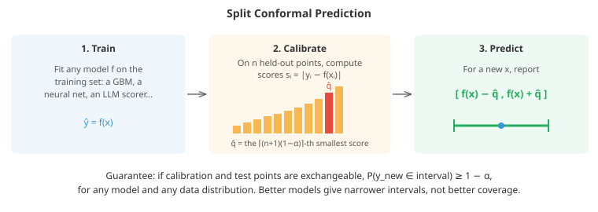

# Gaussian Processes and Uncertainty

*A prediction is more useful when it says how sure it is. This file covers models and methods that quantify uncertainty: the two kinds of uncertainty, Bayesian linear regression, Gaussian processes and their kernels, Bayesian optimisation, approximate inference with MCMC, variational methods and the Laplace approximation, uncertainty for deep networks with ensembles and dropout, and conformal prediction, which gives coverage guarantees for any model*

- A model that predicts "the bridge load is 412 kN" is less useful than one that says "412 kN, give or take 15", and much less useful than one that also says "but I have never seen a structure like this, so do not trust me". Uncertainty matters whenever a prediction feeds a decision with asymmetric costs (medicine, finance, engineering safety margins), whenever a model chooses what to measure next (experimental design, active learning, hyperparameter search), and whenever a model may be used on inputs unlike its training data.

- Most of the models in this chapter output a single number. This file is about turning that into a distribution, an interval or a set, and about knowing when the uncertainty itself can be trusted.

## Two Kinds of Uncertainty

- **Aleatoric uncertainty** is randomness in the data itself: measurement noise, inherently unpredictable outcomes (whether a particular customer clicks). It does not shrink with more data. A model captures it by predicting a distribution rather than a point: a variance alongside the mean, quantiles, or class probabilities.

- **Epistemic uncertainty** is the model's ignorance: uncertainty about the parameters, or about the function itself, because it has seen too little data in this region. It shrinks as data accumulate, and it should be large far from the training data.

- The distinction matters for action. High aleatoric uncertainty says "this outcome is unpredictable; plan for the spread". High epistemic uncertainty says "I do not know yet; collect data here", which is exactly the signal that Bayesian optimisation and active learning exploit.

- In probabilistic terms (chapter 05), the predictive distribution integrates over what we do not know about the parameters $\theta$:

$$p(y \mid x, \mathcal{D}) = \int p(y \mid x, \theta)\, p(\theta \mid \mathcal{D})\, d\theta$$

- The likelihood $p(y \mid x, \theta)$ carries the aleatoric part; the posterior $p(\theta \mid \mathcal{D})$ carries the epistemic part. A point estimate (maximum likelihood or MAP) replaces the posterior by a single spike and throws the epistemic part away. Most of this file is about computing or approximating that integral.

## Bayesian Linear Regression

- Start with the one case where everything is exact. Model $y = w^\top x + \varepsilon$ with noise $\varepsilon \sim \mathcal{N}(0, \sigma^2)$ and a Gaussian prior $w \sim \mathcal{N}(0, \tau^2 I)$. Because a Gaussian prior times a Gaussian likelihood is Gaussian (conjugacy, chapter 05), the posterior is Gaussian with:

$$\Sigma_N = \left(\frac{1}{\sigma^2} X^\top X + \frac{1}{\tau^2} I\right)^{-1}, \qquad \mu_N = \frac{1}{\sigma^2} \Sigma_N X^\top y$$

- The posterior mean $\mu_N$ is exactly the ridge regression solution with $\lambda = \sigma^2 / \tau^2$: file 02's observation that L2 regularisation is a Gaussian prior, made concrete. What ridge regression discards is $\Sigma_N$. The predictive distribution for a new input $x_*$ is:

$$p(y_* \mid x_*, \mathcal{D}) = \mathcal{N}\left(\mu_N^\top x_*,\; \underbrace{x_*^\top \Sigma_N x_*}_{\text{epistemic}} + \underbrace{\sigma^2}_{\text{aleatoric}}\right)$$

- The epistemic term grows as $x_*$ moves away from where the training inputs lie (in directions where $X^\top X$ is small), while the aleatoric term is constant. With basis functions (polynomials, splines, Fourier features) in place of raw $x$, this already gives curved fits with honest error bars.

## Gaussian Processes

- Bayesian linear regression puts a prior on weights. A **Gaussian process (GP)** puts a prior directly on **functions**. A GP is a collection of random variables, one for every input $x$, such that any finite set of them has a joint Gaussian distribution. It is specified by a mean function $m(x)$ (usually zero) and a **kernel** or covariance function $k(x, x')$:

$$f \sim \mathcal{GP}(m, k), \qquad \text{Cov}(f(x), f(x')) = k(x, x')$$

- The kernel encodes what kinds of function are plausible. The most common, the **squared exponential** or **RBF** kernel, says that inputs close together have strongly correlated outputs:

$$k(x, x') = s^2 \exp\left(-\frac{\|x - x'\|^2}{2\ell^2}\right)$$

- The **length scale** $\ell$ sets how far you must move before the function changes appreciably; the **amplitude** $s$ sets how far it typically strays from the mean. The first coding task draws random functions from this prior.

- Why is this the same thing as before? Bayesian linear regression with features $\phi(x)$ is a GP with kernel $k(x, x') = \tau^2 \phi(x)^\top \phi(x')$. Conversely, the RBF kernel corresponds to infinitely many features. This is the **kernel trick** from file 01's SVMs applied to Bayesian regression: work with inner products and never build the features. Neal (1996) showed that a neural network with one hidden layer becomes a GP as its width goes to infinity, a link that later grew into the neural tangent kernel theory of wide networks.

### Prediction

- Given noisy observations $y = f(X) + \varepsilon$, predicting at new points $X_*$ needs only one fact about Gaussians: conditioning a joint Gaussian on some of its variables leaves a Gaussian. If

$$\begin{bmatrix} a \\ b \end{bmatrix} \sim \mathcal{N}\left(0, \begin{bmatrix} A & C \\ C^\top & B \end{bmatrix}\right) \quad\text{then}\quad b \mid a \sim \mathcal{N}\left(C^\top A^{-1} a,\; B - C^\top A^{-1} C\right)$$

- Under the GP prior, the observations $y$ and the unknown values $f(X_*)$ are jointly Gaussian. With $K = k(X, X)$, $K_* = k(X, X_*)$ and $K_{**} = k(X_*, X_*)$, take $a = y$, $A = K + \sigma^2 I$, $b = f(X_*)$, $B = K_{**}$ and $C = K_*$. The posterior over $f(X_*)$ is therefore Gaussian with:

$$\bar{f}_* = K_*^\top (K + \sigma^2 I)^{-1} y, \qquad \text{Cov}(f_*) = K_{**} - K_*^\top (K + \sigma^2 I)^{-1} K_*$$

- Read these carefully. The mean is a weighted combination of observed $y$ values, with weights from the kernel: nearby observations count more. The covariance starts at the prior $K_{**}$ and subtracts what the data explain; far from all observations, $K_*$ is near zero and the variance returns to the prior. That is the behaviour we want from epistemic uncertainty, and a GP delivers it by construction. In the first coding task the posterior standard deviation is 0.13 inside the data, 0.86 in a gap, and back to the prior's 1.0 far away.

- Computationally, never invert the matrix. Compute a **Cholesky decomposition** $K + \sigma^2 I = LL^\top$ (chapter 02) once, in $O(n^3)$, then solve triangular systems. The same factorisation gives the log-determinant needed below as $2\sum_i \log L_{ii}$.

### Kernels

- The kernel is where domain knowledge enters, and kernels can be combined: sums and products of valid kernels are valid kernels.
  - **RBF**: infinitely smooth functions. Often too smooth for physical data.
  - **Matérn** family, indexed by $\nu$: $\nu = 1/2$ gives rough, continuous-but-jagged functions (the exponential kernel, related to Brownian motion); $\nu = 3/2$ and $\nu = 5/2$ give once and twice differentiable functions. Matérn 5/2 is a common default in Bayesian optimisation.
  - **Periodic**: $k(x, x') = s^2 \exp\left(-2\sin^2(\pi |x - x'| / p) / \ell^2\right)$ for repeating patterns with period $p$.
  - **Linear**: $k(x, x') = x^\top x'$, recovering Bayesian linear regression.
  - A sum such as linear + periodic × RBF models "a trend, plus a seasonal pattern whose shape slowly changes", a classic construction for time series such as atmospheric CO2.

- With several input dimensions, giving each its own length scale (**automatic relevance determination**, ARD) lets the GP learn that some inputs barely matter (a very long length scale).

### Learning the hyperparameters

- Kernel hyperparameters (length scales, amplitude, noise level) are chosen by maximising the **log marginal likelihood**, the probability of the observed data with the function integrated out:

$$\log p(y \mid X) = -\frac{1}{2} y^\top (K + \sigma^2 I)^{-1} y \;-\; \frac{1}{2} \log |K + \sigma^2 I| \;-\; \frac{n}{2}\log 2\pi$$

- The first term rewards fitting the data; the second penalises complexity (a flexible kernel spreads its probability over many possible datasets, so the determinant is large). This is an automatic Occam's razor: too long a length scale cannot fit the data, too short a one wastes probability on wiggly functions. In the first coding task the marginal likelihood is far higher at the fitted length scale (0.58) than at 0.1 or 5. In practice it is maximised with gradient methods and several restarts, because it can have multiple local optima.

### Limits and extensions

- **Scaling.** The $O(n^3)$ time and $O(n^2)$ memory limit exact GPs to roughly ten thousand points. **Sparse GPs** summarise the data through $m \ll n$ **inducing points**, reducing cost to $O(nm^2)$; the variational formulations of Titsias (2009) and Hensman et al. (2013) allow mini-batch training on millions of points. GPU libraries such as GPyTorch exploit fast matrix-vector products to scale further.

- **Non-Gaussian likelihoods.** For classification, counts or robust regression the posterior is no longer Gaussian, and needs approximations (Laplace, expectation propagation or variational inference).

- **High dimensions.** Distance-based kernels lose meaning in hundreds of raw dimensions: in high dimensions the distances between random points become nearly all equal (the curse of dimensionality), so "nearby" stops being informative. GPs shine with tens of inputs and modest data: exactly the regime of engineering experiments, simulations and hyperparameter tuning.

## Bayesian Optimisation

- **Bayesian optimisation** finds the maximum of an expensive black-box function (a training run that takes a day, a physical experiment, a slow simulation) with as few evaluations as possible. It repeats three steps:
  1. Fit a **surrogate model**, usually a GP, to the evaluations so far.
  2. Choose the next point by maximising an **acquisition function** that trades off exploiting the predicted mean against exploring where uncertainty is high.
  3. Evaluate the true function there and add the result to the data.

- The most common acquisition function is **expected improvement (EI)**. With $f^+$ the best value so far, and the GP saying $f(x) \sim \mathcal{N}(\mu(x), \sigma(x)^2)$, the expected amount by which $x$ beats $f^+$ has a closed form:

$$\text{EI}(x) = (\mu(x) - f^+)\, \Phi(z) + \sigma(x)\, \phi(z), \qquad z = \frac{\mu(x) - f^+}{\sigma(x)}$$

- where $\Phi$ and $\phi$ are the standard normal CDF and density. The first term rewards a high predicted mean, the second a large uncertainty. **Upper confidence bound** $\mu(x) + \kappa\, \sigma(x)$ makes the trade-off explicit through $\kappa$. **Thompson sampling** draws one function from the posterior and evaluates its maximum.

- In the second coding task Bayesian optimisation gets within 0.003 of the optimum of a bumpy function in 15 evaluations, while random search is still 0.33 away. Its sweet spot is fewer than about 20 continuous parameters and evaluations that are expensive enough that the surrogate's own cost is irrelevant. Tools: BoTorch/Ax, scikit-optimize, and Optuna (whose default TPE surrogate uses density estimates instead of a GP).

## Approximate Bayesian Inference

- Beyond conjugate models and GPs, the posterior $p(\theta \mid \mathcal{D}) \propto p(\mathcal{D} \mid \theta)\, p(\theta)$ has no closed form, because the normalising constant is an intractable integral. Three families of approximation dominate.

### Markov chain Monte Carlo (MCMC)

- MCMC builds a random walk whose long-run distribution is the posterior, so its samples can be used to estimate any posterior quantity. It only needs the unnormalised posterior, since the constant cancels in ratios.

- **Metropolis-Hastings**: from the current $\theta$, propose $\theta'$ from a distribution $q(\theta' \mid \theta)$, and accept the move with probability:

$$a = \min\left(1,\; \frac{p(\theta' \mid \mathcal{D})\, q(\theta \mid \theta')}{p(\theta \mid \mathcal{D})\, q(\theta' \mid \theta)}\right)$$

- otherwise stay put (and record the current point again). For a symmetric proposal such as $\theta' = \theta + \text{noise}$, the $q$ terms cancel: always accept uphill moves, and accept downhill moves with probability equal to the posterior ratio. This satisfies **detailed balance**, which guarantees the chain's stationary distribution is the posterior.

- The step size matters a great deal. Tiny steps are almost always accepted but crawl; huge steps are almost always rejected. The fifth coding task shows acceptance rates of 0.93, 0.46 and 0.01 for three step sizes; theory for random-walk proposals suggests aiming for roughly 0.2 to 0.5.

- **Hamiltonian Monte Carlo (HMC)** uses the gradient of the log-posterior to simulate a physical particle moving on the negative log-posterior surface. It makes long, directed moves that are still accepted, which makes it vastly more efficient in high dimensions. The **No-U-Turn Sampler** (NUTS) tunes HMC's trajectory length automatically, and is the default in Stan and PyMC.

- Always check convergence: discard an initial **burn-in**, run several chains from different starting points and check that they agree (the $\hat{R}$ statistic should be close to 1), and report the **effective sample size**, which accounts for the correlation between consecutive samples.

### Variational inference (VI)

- VI turns inference into optimisation. Choose a family of tractable distributions $q_\phi(\theta)$ (for example, independent Gaussians for every parameter, the **mean-field** family) and find the member closest to the posterior in KL divergence. Minimising that KL directly is impossible (it needs the posterior), but it is equivalent to maximising the **evidence lower bound (ELBO)**:

$$\log p(\mathcal{D}) \;\ge\; \text{ELBO}(\phi) = \mathbb{E}_{q_\phi}[\log p(\mathcal{D} \mid \theta)] - \text{KL}(q_\phi(\theta) \,\|\, p(\theta))$$

- The gap between the two sides is exactly $\text{KL}(q_\phi \,\|\, p(\theta \mid \mathcal{D}))$. The first term rewards explaining the data; the second keeps $q$ close to the prior. The **reparameterisation trick** ($\theta = \mu + \sigma \odot \epsilon$ with $\epsilon \sim \mathcal{N}(0, I)$) makes the ELBO differentiable, so it can be maximised with stochastic gradient descent. This is the same machinery as the variational autoencoder in file 03, there applied to latent variables rather than weights.

- VI is fast and scales to large models and datasets, but it is only as good as the family $q$: mean-field VI minimises $\text{KL}(q \| p)$, which is mode-seeking (chapter 05) and tends to **underestimate** posterior variance.

### The Laplace approximation

- Fit a Gaussian at the MAP estimate, with covariance equal to the inverse Hessian of the negative log-posterior (the curvature there, chapter 03). Cheap, and it can be applied after ordinary training. For large networks it is usually restricted to the last layer or approximated with Kronecker-factored curvature.

## Uncertainty for Deep Networks

- Full Bayesian inference over millions of weights is expensive and hard to get right, so several practical approximations are used:
  - **Deep ensembles** (Lakshminarayanan, Pritzel and Blundell, 2017): train $M$ networks (typically 5) from different random initialisations, and use the spread of their predictions as uncertainty. Simple, parallel, and in a large benchmark of uncertainty under distribution shift (Ovadia et al., 2019) the most reliable of the practical methods. The cost is $M$ times the training and inference.
  - **MC dropout** (Gal and Ghahramani, 2016): keep dropout switched on at prediction time and run several forward passes; the spread approximates a variational posterior. Almost free if the network already uses dropout, but the uncertainty it produces is often poorly calibrated.
  - **SWAG** fits a Gaussian to the trajectory of SGD iterates late in training; **last-layer Laplace** puts a Gaussian posterior on the final layer only.
  - **Heteroscedastic heads** add aleatoric uncertainty: predict both a mean $\mu(x)$ and a variance $\sigma^2(x)$, and train on the Gaussian negative log-likelihood $\frac{1}{2}\log \sigma^2(x) + \frac{(y - \mu(x))^2}{2\sigma^2(x)}$. Combine with an ensemble to get both kinds.

- A warning, demonstrated in the third coding task: these methods often, but not always, report more uncertainty away from the data. ReLU networks extrapolate linearly, and if every ensemble member happens to extrapolate along the same line, they agree confidently on a wrong answer, dozens of standard deviations from the truth in the task. A GP with a stationary kernel cannot make that mistake, because its variance returns to the prior by construction. Treat neural-network uncertainty as a useful heuristic, measure its calibration on held-out data, and pair it with explicit out-of-distribution checks (see the robustness file) when the stakes are high.

- Evaluate predictive distributions with proper scoring rules: the **negative log-likelihood** of held-out targets, or the **continuous ranked probability score (CRPS)**, which generalises absolute error to a full predictive distribution. And check calibration: do 90% intervals contain 90% of outcomes?

## Conformal Prediction

- Everything above gives uncertainty that is only as good as the model's assumptions. **Conformal prediction** (Vovk, Gammerman and Shafer, 2005) gives intervals or sets with a **guaranteed** coverage probability, for any model, with no assumption about the data distribution beyond one: calibration and test points must be **exchangeable** (for example, independent draws from the same distribution).

- **Split conformal prediction** for regression:
  1. Train any model $f$ on a training set.
  2. On a separate **calibration set** of $n$ points, compute **nonconformity scores**: here the absolute residuals $s_i = |y_i - f(x_i)|$.
  3. Let $\hat{q}$ be the $\lceil (n+1)(1-\alpha) \rceil$-th smallest score.
  4. For a new input, predict the interval $[f(x) - \hat{q},\; f(x) + \hat{q}]$.



- Then $P(y_{\text{new}} \in \text{interval}) \ge 1 - \alpha$. The proof is a symmetry argument: the new point's score is equally likely to fall at any rank among the $n + 1$ scores, so it exceeds the $\lceil (n+1)(1-\alpha) \rceil$-th smallest of the calibration scores with probability at most $\alpha$. The $+1$ is the finite-sample correction that makes this exact. If the scores have no ties, coverage is also at most $1 - \alpha + 1/(n+1)$, so the intervals are not wastefully conservative.

- The model's quality does not affect validity, only efficiency: a bad model gives wide intervals that still cover. That makes conformal prediction a safe wrapper around anything, including black-box neural networks and language models.

- **The catch: coverage is marginal, not conditional.** The guarantee holds on average over all inputs, not for every input. With noise that varies across the input space, constant-width intervals over-cover easy regions and under-cover hard ones. The fourth coding task shows split conformal covering 100% where noise is low and only 75% where it is high, averaging to the promised 90%.

- **Conformalised quantile regression (CQR)** (Romano, Patterson and Candès, 2019) fixes much of this. Train quantile regressors for the $\alpha/2$ and $1 - \alpha/2$ quantiles (see the gradient boosting file), use as score how far each calibration point falls outside the predicted band, $s_i = \max(\hat{q}_{\text{lo}}(x_i) - y_i,\; y_i - \hat{q}_{\text{hi}}(x_i))$, and widen (or shrink) the band by the conformal quantile of these scores. Intervals adapt to local noise and keep the guarantee. In the coding task CQR is much closer to 90% in both regions, with narrower intervals on average, and raw quantile regression without the conformal step under-covers.

- **Classification** works the same way with a different score. Using $s_i = 1 - \hat{p}(y_i \mid x_i)$, the probability the model assigned to the true class, the **prediction set** for a new input is every class $y$ with $1 - \hat{p}(y \mid x) \le \hat{q}$. Confident inputs get a single class; ambiguous ones get several; the set contains the truth with probability at least $1 - \alpha$. Adaptive scores (APS, RAPS) improve conditional behaviour.

- **Under distribution shift** the exchangeability assumption fails and so does the guarantee. Weighted conformal prediction restores it under known covariate shift by reweighting calibration points by the likelihood ratio between test and calibration inputs; adaptive conformal methods adjust $\alpha$ online for time series.

## Choosing a Method

| Situation | Reasonable choice |
|---|---|
| Small data, few inputs, smooth function, need honest error bars | Gaussian process |
| Expensive black-box optimisation | Bayesian optimisation with a GP surrogate |
| Interpretable statistical model, full posterior needed | MCMC (Stan, PyMC) |
| Large probabilistic model, approximate posterior acceptable | Variational inference |
| Deep network, decent uncertainty with little effort | Deep ensemble (+ heteroscedastic head) |
| Any model, guaranteed coverage on in-distribution data | Conformal prediction (CQR for regression) |

## Coding Tasks (use CoLab or notebook)

1. Gaussian process regression from scratch with a Cholesky solver. Draw functions from the prior, fit the hyperparameters by maximising the log marginal likelihood, and look at how the posterior band behaves inside the data, in a gap, and far away. Then try a length scale that is too short.
```python
import numpy as np
import matplotlib.pyplot as plt

def rbf(A, B, length, amp):
    """Squared-exponential kernel k(a, b) = amp^2 exp(-|a - b|^2 / (2 length^2))."""
    d2 = (A[:, None] - B[None]) ** 2
    return amp**2 * np.exp(-0.5 * d2 / length**2)

def gp_posterior(X, y, Xs, length, amp, noise):
    K = rbf(X, X, length, amp) + noise**2 * np.eye(len(X))
    L = np.linalg.cholesky(K)                                   # K = L L^T, O(n^3) once
    alpha = np.linalg.solve(L.T, np.linalg.solve(L, y))         # K^{-1} y
    Ks = rbf(X, Xs, length, amp)
    mean = Ks.T @ alpha
    v = np.linalg.solve(L, Ks)
    var = amp**2 - (v**2).sum(0)                                # diag of K** - K*^T K^{-1} K*
    # log marginal likelihood: data fit + complexity penalty + constant
    lml = -0.5 * y @ alpha - np.log(np.diag(L)).sum() - 0.5 * len(X) * np.log(2 * np.pi)
    return mean, np.maximum(var, 0), lml

rng = np.random.default_rng(0)
f = lambda x: np.sin(3 * x) + 0.3 * x
X = np.r_[rng.uniform(-3, -0.5, 12), rng.uniform(1.5, 3, 6)]      # a gap in the middle
y = f(X) + rng.normal(0, 0.15, len(X))
Xs = np.linspace(-5, 5, 300)

# 1. Samples from the prior: functions the kernel considers plausible before seeing data
fig, axes = plt.subplots(1, 3, figsize=(17, 4.2))
prior_cov = rbf(Xs, Xs, 1.0, 1.0) + 1e-8 * np.eye(len(Xs))
for s in rng.multivariate_normal(np.zeros(len(Xs)), prior_cov, 4):
    axes[0].plot(Xs, s, linewidth=1)
axes[0].set_title("Prior samples (length scale 1)")

# 2. Choose the hyperparameters by maximising the log marginal likelihood over a grid
best = max(((l, a, n) for l in np.geomspace(0.1, 5, 30) for a in [0.5, 1, 2] for n in [0.05, 0.15, 0.4]),
           key=lambda p: gp_posterior(X, y, Xs[:1], *p)[2])
print("hyperparameters maximising marginal likelihood: length %.2f, amplitude %.1f, noise %.2f" % best)
for l in [0.1, best[0], 5.0]:
    print(f"  length scale {l:4.2f}: log marginal likelihood {gp_posterior(X, y, Xs[:1], l, best[1], best[2])[2]:7.2f}")

# 3. The posterior: mean and a 95% band, which widens away from the data
for ax, l, title in [(axes[1], best[0], "Posterior with the fitted length scale"),
                     (axes[2], 0.1, "Length scale too short: overfits, reverts to prior")]:
    mean, var, _ = gp_posterior(X, y, Xs, l, best[1], best[2])
    sd = np.sqrt(var + best[2]**2)                                 # include observation noise
    ax.fill_between(Xs, mean - 2 * sd, mean + 2 * sd, color='#3498db', alpha=0.2, label="95% band")
    ax.plot(Xs, mean, color='#3498db', label="posterior mean")
    ax.plot(Xs, f(Xs), 'k--', linewidth=1, label="truth")
    ax.scatter(X, y, color='#e74c3c', zorder=3, s=15, label="data")
    ax.set_title(title); ax.set_ylim(-4, 4)
axes[1].legend(loc="lower right")
plt.tight_layout(); plt.show()

mean, var, _ = gp_posterior(X, y, Xs, *best)
inside = (Xs > -3) & (Xs < -0.5); gap = (Xs > 0) & (Xs < 1); outside = Xs > 4
for name, m in [("inside the data", inside), ("in the gap", gap), ("far outside", outside)]:
    print(f"average posterior sd {name:16s}: {np.sqrt(var[m]).mean():.2f}")
```

2. Bayesian optimisation with expected improvement on a bumpy one-dimensional function. Watch the GP belief and the acquisition function evolve, then compare with random search over 30 repetitions.
```python
import numpy as np
import matplotlib.pyplot as plt
from math import erf, sqrt, pi

# An expensive black box we want to MAXIMISE (imagine each call is a day-long training run)
def objective(x):
    return np.sin(3 * x) + 0.6 * np.sin(7 * x + 1) - 0.08 * (x - 1) ** 2
grid = np.linspace(-4, 4, 800)
true_best = objective(grid).max()

def rbf(A, B, l=0.5):
    return np.exp(-0.5 * (A[:, None] - B[None]) ** 2 / l**2)

def gp(X, y, Xs, noise=1e-4):
    ym, ys = y.mean(), y.std() + 1e-9                     # standardise targets
    yn = (y - ym) / ys
    L = np.linalg.cholesky(rbf(X, X) + noise * np.eye(len(X)))
    Ks = rbf(X, Xs)
    mean = Ks.T @ np.linalg.solve(L.T, np.linalg.solve(L, yn))
    var = 1 - (np.linalg.solve(L, Ks) ** 2).sum(0)
    return mean * ys + ym, np.sqrt(np.maximum(var, 1e-12)) * ys

Phi = np.vectorize(lambda z: 0.5 * (1 + erf(z / sqrt(2))))
phi = lambda z: np.exp(-0.5 * z**2) / sqrt(2 * pi)

def expected_improvement(mu, sd, best, xi=0.01):
    """E[max(f - best - xi, 0)] under the GP's Gaussian belief about f."""
    z = (mu - best - xi) / sd
    return (mu - best - xi) * Phi(z) + sd * phi(z)

def bayes_opt(n_calls, seed, plot=False):
    r = np.random.default_rng(seed)
    X = r.uniform(-4, 4, 3); y = objective(X)              # a few random starting points
    if plot: fig, axes = plt.subplots(2, 3, figsize=(16, 6.5)); axes = axes.ravel()
    for i in range(n_calls - 3):
        mu, sd = gp(X, y, grid)
        ei = expected_improvement(mu, sd, y.max())
        x_next = grid[np.argmax(ei)]
        if plot and i < 6:
            ax = axes[i]
            ax.plot(grid, objective(grid), 'k--', linewidth=1)
            ax.plot(grid, mu, color='#3498db'); ax.fill_between(grid, mu - 2*sd, mu + 2*sd, color='#3498db', alpha=0.15)
            ax.scatter(X, y, color='#e74c3c', zorder=3, s=15)
            ax2 = ax.twinx(); ax2.fill_between(grid, 0, ei, color='#27ae60', alpha=0.3); ax2.set_yticks([])
            ax.axvline(x_next, color='#27ae60', linestyle=':')
            ax.set_title(f"step {i + 1}: GP belief (blue), EI (green)")
        X = np.r_[X, x_next]; y = np.r_[y, objective(x_next)]
    if plot: plt.tight_layout(); plt.show()
    return np.maximum.accumulate(y)

def random_search(n_calls, seed):
    y = objective(np.random.default_rng(seed).uniform(-4, 4, n_calls))
    return np.maximum.accumulate(y)

bayes_opt(15, seed=0, plot=True)
bo = np.array([true_best - bayes_opt(15, s) for s in range(30)])
rs = np.array([true_best - random_search(15, s) for s in range(30)])
print("median gap to the true optimum after n evaluations")
print(" n  | Bayesian opt | random search")
for n in [3, 5, 8, 10, 15]:
    print(f"{n:3d} | {np.median(bo[:, n - 1]):12.4f} | {np.median(rs[:, n - 1]):.4f}")
```

3. Uncertainty for neural networks: a deep ensemble of five ReLU networks and MC dropout, both trained with hand-written backpropagation. Compare each method's error with its own claimed uncertainty inside the data, in a gap and far outside.
```python
import numpy as np
import matplotlib.pyplot as plt

rng = np.random.default_rng(0)
X = np.r_[rng.uniform(-4, -1, 30), rng.uniform(1, 2.5, 15)][:, None]
truth = lambda x: np.sin(2 * x) + 0.1 * x ** 2
y = (truth(X[:, 0]) + rng.normal(0, 0.1, len(X)))[:, None]
Xs = np.linspace(-7, 6, 400)[:, None]

def init(seed, h=64):
    r = np.random.default_rng(seed)
    return [r.normal(0, np.sqrt(2), (1, h)), r.normal(0, 1, h), r.normal(0, np.sqrt(2 / h), (h, h)), np.zeros(h),
            r.normal(0, np.sqrt(1 / h), (h, 1)), np.zeros(1)]       # He initialisation for ReLU

def forward(p, x, drop=0.0, r=None):
    W1, b1, W2, b2, W3, b3 = p
    h1 = np.maximum(x @ W1 + b1, 0)
    m1 = (r.uniform(size=h1.shape) > drop) / (1 - drop) if drop else 1.0
    h1d = h1 * m1
    h2 = np.maximum(h1d @ W2 + b2, 0)
    m2 = (r.uniform(size=h2.shape) > drop) / (1 - drop) if drop else 1.0
    h2d = h2 * m2
    return h2d @ W3 + b3, (x, h1, m1, h1d, h2, m2, h2d)

def train(seed, drop=0.0, steps=3000, lr=0.01, wd=1e-4):
    p = init(seed); r = np.random.default_rng(seed + 100)
    m = [np.zeros_like(q) for q in p]; v = [np.zeros_like(q) for q in p]
    for t in range(1, steps + 1):
        out, (x, h1, m1, h1d, h2, m2, h2d) = forward(p, X, drop, r)
        g = 2 * (out - y) / len(X)                                   # d MSE / d out
        gW3 = h2d.T @ g; gb3 = g.sum(0)
        gh2 = (g @ p[4].T) * m2 * (h2 > 0)
        gW2 = h1d.T @ gh2; gb2 = gh2.sum(0)
        gh1 = (gh2 @ p[2].T) * m1 * (h1 > 0)
        gW1 = x.T @ gh1; gb1 = gh1.sum(0)
        for i, gr in enumerate([gW1, gb1, gW2, gb2, gW3, gb3]):     # Adam with weight decay
            gr = gr + wd * p[i]
            m[i] = 0.9 * m[i] + 0.1 * gr; v[i] = 0.999 * v[i] + 0.001 * gr**2
            p[i] -= lr * (m[i] / (1 - 0.9**t)) / (np.sqrt(v[i] / (1 - 0.999**t)) + 1e-8)
    return p

# Deep ensemble: same architecture, different random initialisations
ensemble = [train(s) for s in range(5)]
preds_ens = np.array([forward(p, Xs)[0][:, 0] for p in ensemble])

# MC dropout: one network trained with dropout, dropout kept ON at prediction time
p_drop = train(0, drop=0.1)
r = np.random.default_rng(1)
preds_mc = np.array([forward(p_drop, Xs, 0.1, r)[0][:, 0] for _ in range(100)])

fig, axes = plt.subplots(1, 2, figsize=(14, 4.5))
for ax, P, title in [(axes[0], preds_ens, "Deep ensemble (5 networks)"), (axes[1], preds_mc, "MC dropout (100 passes)")]:
    mu, sd = P.mean(0), P.std(0)
    ax.fill_between(Xs[:, 0], mu - 2 * sd, mu + 2 * sd, color='#3498db', alpha=0.2)
    ax.plot(Xs[:, 0], mu, color='#3498db')
    if P is preds_ens:
        for row in P: ax.plot(Xs[:, 0], row, color='#3498db', linewidth=0.5, alpha=0.5)
    ax.scatter(X[:, 0], y[:, 0], color='#e74c3c', s=12, zorder=3)
    ax.plot(Xs[:, 0], truth(Xs[:, 0]), 'k--', linewidth=1)
    ax.set_ylim(-5, 8); ax.set_title(title)
plt.tight_layout(); plt.show()

print("    x  | truth | ensemble mean ± sd (error in sds) | MC dropout mean ± sd (error in sds)")
for x0 in [-6.5, -2.0, 0.0, 2.0, 5.5]:
    i = np.argmin(np.abs(Xs[:, 0] - x0)); t = truth(Xs[i, 0])
    row = f"{x0:5.1f} | {t:5.2f} |"
    for P in (preds_ens, preds_mc):
        mu, sd = P[:, i].mean(), P[:, i].std()
        row += f"   {mu:5.2f} ± {sd:4.2f} ({abs(mu - t) / sd:5.1f})        |"
    print(row)
print("\nInside the data both fit well (errors of a few hundredths). The ensemble's sd there is tiny because"
      "\nmember disagreement measures only epistemic uncertainty; it ignores the 0.1 observation noise."
      "\nAway from the data uncertainty sometimes grows (the gap, the far left), but at x = 5.5 the ensemble"
      "\nmembers agree on the same wrong extrapolation, an error of dozens of sds."
      "\nNeural-network uncertainty is a useful heuristic, not a guarantee.")
```

4. Conformal prediction with heteroscedastic noise. Wrap a gradient-boosted model with split conformal intervals and with conformalised quantile regression, and measure coverage overall and in the easy and hard regions.
```python
import numpy as np
import matplotlib.pyplot as plt
from sklearn.ensemble import HistGradientBoostingRegressor

# Noise that grows with x: easy region on the left, hard region on the right
def make(n, rng):
    x = rng.uniform(0, 10, n)
    y = np.sin(x) * 2 + rng.normal(0, 0.1 + 0.25 * x, n)
    return x[:, None], y

alpha = 0.1                                             # target: 90% coverage
def conformal_quantile(scores, alpha):
    """The ceil((n+1)(1-alpha))-th smallest score: the finite-sample-corrected quantile."""
    n = len(scores)
    k = int(np.ceil((n + 1) * (1 - alpha)))
    return np.sort(scores)[min(k, n) - 1]

def run(seed, plot=False):
    rng = np.random.default_rng(seed)
    (Xtr, ytr), (Xcal, ycal), (Xte, yte) = make(1000, rng), make(500, rng), make(1000, rng)

    # 1. Split conformal around ANY point predictor: scores are absolute residuals
    model = HistGradientBoostingRegressor(max_iter=60, max_leaf_nodes=8, random_state=0).fit(Xtr, ytr)
    q = conformal_quantile(np.abs(ycal - model.predict(Xcal)), alpha)
    lo1, hi1 = model.predict(Xte) - q, model.predict(Xte) + q

    # 2. Conformalised quantile regression (CQR): adaptive width from quantile models
    q_lo = HistGradientBoostingRegressor(loss="quantile", quantile=alpha / 2, max_iter=60, max_leaf_nodes=8, random_state=0).fit(Xtr, ytr)
    q_hi = HistGradientBoostingRegressor(loss="quantile", quantile=1 - alpha / 2, max_iter=60, max_leaf_nodes=8, random_state=0).fit(Xtr, ytr)
    s = np.maximum(q_lo.predict(Xcal) - ycal, ycal - q_hi.predict(Xcal))   # how far outside the band
    q2 = conformal_quantile(s, alpha)
    lo2, hi2 = q_lo.predict(Xte) - q2, q_hi.predict(Xte) + q2

    # Raw quantile regression without the conformal step, for comparison
    lo3, hi3 = q_lo.predict(Xte), q_hi.predict(Xte)
    out = {}
    for name, lo, hi in [("split conformal", lo1, hi1), ("CQR", lo2, hi2), ("raw quantile GBM", lo3, hi3)]:
        cover = (yte >= lo) & (yte <= hi)
        left, right = Xte[:, 0] < 3, Xte[:, 0] > 7
        out[name] = (cover.mean(), cover[left].mean(), cover[right].mean(), (hi - lo).mean())
    if plot:
        order = np.argsort(Xte[:, 0]); x = Xte[order, 0]
        fig, axes = plt.subplots(1, 2, figsize=(14, 4.5), sharey=True)
        for ax, lo, hi, title in [(axes[0], lo1, hi1, "split conformal: constant width"),
                                  (axes[1], lo2, hi2, "CQR: width adapts to the noise")]:
            ax.scatter(Xte[:, 0], yte, s=3, color='#95a5a6')
            ax.fill_between(x, lo[order], hi[order], color='#3498db', alpha=0.3)
            ax.set_title(title)
        plt.tight_layout(); plt.show()
    return out

run(0, plot=True)
results = [run(s) for s in range(10)]
print(f"{'method':18s} {'coverage':>9s} {'x<3':>7s} {'x>7':>7s} {'width':>7s}   (target 0.90, 10 repetitions)")
for name in results[0]:
    m = np.mean([r[name] for r in results], 0)
    print(f"{name:18s} {m[0]:9.3f} {m[1]:7.3f} {m[2]:7.3f} {m[3]:7.2f}")
print("\nBoth conformal methods hit 90% on average, as guaranteed; raw quantile regression does not."
      "\nSplit conformal over-covers the easy region and under-covers the hard one; CQR is much closer to"
      "\n90% in both. The guarantee is marginal (on average over x), not conditional on x.")
```

5. Bayesian logistic regression with Metropolis-Hastings on only 20 points. Tune the proposal step by its acceptance rate, inspect the trace, and compare the posterior predictive with the MAP prediction.
```python
import numpy as np
import matplotlib.pyplot as plt

# Only 20 labelled points: the posterior over weights is wide, and that should show in predictions.
rng = np.random.default_rng(0)
n = 20
X = rng.normal(0, 1, (n, 2))
w_true = np.array([2.0, -1.0])
y = (rng.uniform(size=n) < 1 / (1 + np.exp(-(X @ w_true)))).astype(float)
Xb = np.c_[X, np.ones(n)]                                   # add bias

def log_post(w, prior_sd=2.0):
    z = Xb @ w
    log_lik = np.sum(y * z - np.logaddexp(0, z))              # Bernoulli log-likelihood, stable form
    log_prior = -0.5 * np.sum(w**2) / prior_sd**2             # Gaussian prior = L2 regularisation
    return log_lik + log_prior

# Random-walk Metropolis-Hastings
def metropolis(n_samples, step, w0):
    w, lp = w0.copy(), log_post(w0)
    chain, accepted = [], 0
    for _ in range(n_samples):
        prop = w + rng.normal(0, step, 3)                      # symmetric proposal
        lp_prop = log_post(prop)
        if np.log(rng.uniform()) < lp_prop - lp:               # accept with prob min(1, ratio)
            w, lp = prop, lp_prop; accepted += 1
        chain.append(w.copy())
    return np.array(chain), accepted / n_samples

for step in [0.05, 0.6, 5.0]:
    _, acc = metropolis(3000, step, np.zeros(3))
    print(f"proposal step {step:4.2f}: acceptance rate {acc:.2f}")
chain, acc = metropolis(30000, 0.6, np.zeros(3))
samples = chain[5000::10]                                      # drop burn-in, thin
print(f"\nposterior mean of w: {samples.mean(0).round(2)},  sd: {samples.std(0).round(2)}")

# MAP estimate by gradient ascent, for comparison
w_map = np.zeros(3)
for _ in range(5000):
    p = 1 / (1 + np.exp(-(Xb @ w_map)))
    w_map += 0.05 * (Xb.T @ (y - p) - w_map / 4.0)
print(f"MAP estimate of w:   {w_map.round(2)}")

# Predictions: MAP gives one confident surface; the posterior averages over all plausible ones
g = np.linspace(-4, 4, 120)
G = np.c_[np.repeat(g, len(g)), np.tile(g, len(g)), np.ones(len(g) ** 2)]
p_map = 1 / (1 + np.exp(-(G @ w_map)))
p_bayes = (1 / (1 + np.exp(-(G @ samples.T)))).mean(1)       # posterior predictive
far = np.abs(G[:, 0]) + np.abs(G[:, 1]) > 6
print(f"\nfar from the data, mean confidence max(p, 1-p): MAP {np.maximum(p_map, 1-p_map)[far].mean():.3f}, "
      f"Bayesian {np.maximum(p_bayes, 1-p_bayes)[far].mean():.3f}")

fig, axes = plt.subplots(1, 3, figsize=(16, 4.5))
axes[0].plot(chain[:3000, 0], color='#3498db', linewidth=0.6); axes[0].set_title("trace of w1 (first 3000 steps)")
for ax, P, title in [(axes[1], p_map, "MAP prediction"), (axes[2], p_bayes, "posterior predictive")]:
    im = ax.contourf(g, g, P.reshape(len(g), len(g)).T, levels=np.linspace(0, 1, 11), cmap='coolwarm')
    ax.scatter(*X.T, c=y, cmap='coolwarm', edgecolors='k', s=30); ax.set_title(title)
plt.colorbar(im, ax=axes[2]); plt.tight_layout(); plt.show()
```
