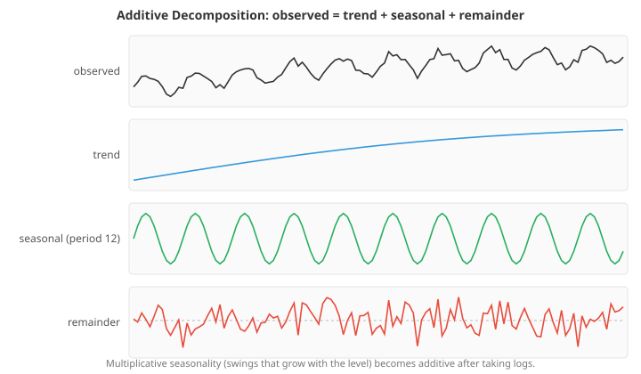
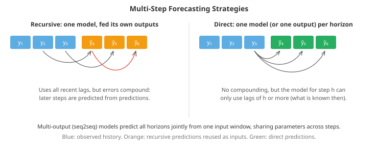

# Time Series and Forecasting

*Time series are measurements ordered in time: sales, prices, sensor readings, web traffic, energy demand. Their order breaks the independence assumption behind most of machine learning, and it creates both structure to exploit and new ways to fool yourself. This file covers trend and seasonality, stationarity and autocorrelation, the baselines every forecast must beat, exponential smoothing, ARIMA, state-space models and the Kalman filter, machine-learning forecasters built from lag features, deep and foundation models, and how to evaluate forecasts honestly*

- A forecaster predicts the future of a series from its past and from anything else that will be known in time. Forecasting is everywhere: inventory and staffing, energy grids, finance, capacity planning, epidemiology. It is also a field where simple methods are notoriously hard to beat. In the large forecasting competitions run by Spyros Makridakis, statistical methods and combinations held their own against machine learning for decades; the M4 competition (2018) was won by a hybrid of exponential smoothing and a recurrent network, and only in M5 (2020, Walmart sales) did gradient-boosted trees trained across thousands of series clearly dominate. Knowing both toolkits, and how to compare them fairly, is the skill.

- Two properties set time series apart from the tabular data elsewhere in this chapter. Observations are **dependent**: today's value is correlated with yesterday's, so the usual "independent and identically distributed" assumption fails. And there is an **arrow of time**: a model may only use information available at the moment it forecasts. Most mistakes in forecasting are violations of one or the other.

## Components of a Series

- It helps to think of a series as a sum (or product) of parts:
  - **Trend**: the long-run direction, rising, falling, or changing slope.
  - **Seasonality**: patterns that repeat with a fixed period (hour of the day, day of the week, month of the year). A series can have several at once: electricity demand has daily, weekly and yearly cycles.
  - **Cycles**: rises and falls without a fixed period, such as business cycles.
  - **Remainder**: what is left, ideally unpredictable noise.



- In an **additive** decomposition $y_t = T_t + S_t + R_t$ the seasonal swings have constant size. In a **multiplicative** one, $y_t = T_t \times S_t \times R_t$, they grow with the level (December sales are 30% higher, not 300 units higher). Taking logs turns multiplicative into additive, which is why log-transforming sales and traffic is so common.

- **Classical decomposition** estimates the trend with a centred moving average over one season, then averages the detrended values for each position in the season. **STL** (Seasonal-Trend decomposition using Loess) does the same job with local regression, allows the seasonal shape to change slowly over time, and is robust to outliers. Decomposition is mostly a tool for understanding a series and for seasonal adjustment, but several forecasting methods are built directly on it.

## Stationarity and Autocorrelation

- A series is **(weakly) stationary** if its mean and variance do not change over time and the covariance between $y_t$ and $y_{t+k}$ depends only on the lag $k$, not on $t$. Stationarity matters because a model fitted to one stretch of history can only be expected to work on another stretch if the statistical behaviour is the same. Trends and seasonality break stationarity; so does a **random walk** $y_t = y_{t-1} + \varepsilon_t$, whose variance grows without bound.

- The standard fixes: **differencing** ($y_t - y_{t-1}$ removes a trend or a random walk), **seasonal differencing** ($y_t - y_{t-m}$ removes a seasonal pattern of period $m$), and a log transform to stabilise variance. Formal tests help decide: the **augmented Dickey-Fuller (ADF)** test has the null hypothesis of a unit root (non-stationary), while **KPSS** has the null of stationarity; using both guards against each one's blind spots.

- The **autocorrelation function (ACF)** measures the correlation between a series and itself $k$ steps earlier:

$$\rho_k = \frac{\sum_{t}(y_t - \bar{y})(y_{t-k} - \bar{y})}{\sum_t (y_t - \bar{y})^2}$$

- The **partial autocorrelation function (PACF)** at lag $k$ measures the correlation with lag $k$ *after removing* the effects of lags 1 to $k-1$. It equals the last coefficient when you regress $y_t$ on its previous $k$ values, and the first coding task computes it exactly that way.

- For white noise, sample autocorrelations fall within about $\pm 1.96/\sqrt{n}$, so plots draw that band. Reading the two plots together identifies simple models, as the first coding task shows:
  - An **AR(p)** process has a PACF that **cuts off** after lag $p$ and an ACF that decays gradually.
  - An **MA(q)** process has an ACF that cuts off after lag $q$ and a PACF that decays.
  - A non-stationary series has an ACF that decays very slowly; difference it first.
  - Seasonality shows up as spikes at multiples of the period.

- After fitting any model, the **residuals** should look like white noise. The **Ljung-Box test** checks whether a group of residual autocorrelations is jointly larger than chance; remaining structure means the model has missed something predictable.

## Baselines First

- Every forecast should be compared with simple benchmarks, because they are surprisingly strong and they reveal whether a sophisticated model is earning its complexity:
  - **Naive**: the next value equals the last observed value. Optimal for a random walk, and hard to beat for many financial series.
  - **Seasonal naive**: the next value equals the value one season ago (same weekday last week, same month last year).
  - **Mean**: the average of the history.
  - **Drift**: the naive forecast plus the average historical change per step.

- In the second coding task the naive and mean forecasts are terrible on a seasonal series, while seasonal naive is a tough benchmark that a properly fitted seasonal model beats by about 17% (MASE 0.81 against 0.97).

## Exponential Smoothing

- **Simple exponential smoothing (SES)** forecasts with a weighted average of past observations whose weights decay geometrically into the past:

$$\ell_t = \alpha\, y_t + (1 - \alpha)\, \ell_{t-1}, \qquad \hat{y}_{t+h} = \ell_t$$

- The **level** $\ell_t$ moves a fraction $\alpha$ of the way towards each new observation. Large $\alpha$ reacts quickly and is noisy; small $\alpha$ is smooth and slow.

- **Holt's method** adds a trend $b_t$, and **Holt-Winters** adds a seasonal component $s_t$ with period $m$. In additive form:

$$\ell_t = \alpha (y_t - s_{t-m}) + (1 - \alpha)(\ell_{t-1} + b_{t-1})$$

$$b_t = \beta (\ell_t - \ell_{t-1}) + (1 - \beta)\, b_{t-1}$$

$$s_t = \gamma (y_t - \ell_t) + (1 - \gamma)\, s_{t-m}$$

$$\hat{y}_{t+h} = \ell_t + h\, b_t + s_{t+h-m}$$

- (For $h > m$, the seasonal index wraps around to the most recent season.) The smoothing parameters are chosen by minimising one-step-ahead forecast errors on the training data. Linear trends extrapolated far ahead tend to overshoot, so a **damped trend** that flattens out over the horizon is often a better default.

- The **ETS** framework (error, trend, seasonality) recasts all of these as statistical state-space models, which provides likelihoods for choosing between variants with AIC and principled prediction intervals. Exponential smoothing is fast, robust and still a strong method for individual series with a few years of history.

## ARIMA

- **ARIMA** models describe a series through its own past values and past forecast errors.
  - An **autoregressive** model AR($p$) predicts from the last $p$ values: $y_t = c + \phi_1 y_{t-1} + \dots + \phi_p y_{t-p} + \varepsilon_t$. AR(1) is stationary only if $|\phi_1| < 1$, in which case it is **mean-reverting**, and its autocorrelation decays as $\phi_1^k$.
  - A **moving average** model MA($q$) predicts from the last $q$ errors: $y_t = c + \varepsilon_t + \theta_1 \varepsilon_{t-1} + \dots + \theta_q \varepsilon_{t-q}$. A shock affects exactly $q$ future values, then vanishes.
  - **Integrated** I($d$) means the model is fitted to the series differenced $d$ times.

- ARIMA($p, d, q$) combines all three; **SARIMA** adds seasonal AR, MA and differencing terms at lags that are multiples of the season, and **ARIMAX** adds external regressors. The classical **Box-Jenkins** workflow is: make the series stationary, identify candidate orders from the ACF and PACF, estimate by maximum likelihood, check that the residuals are white noise, and compare candidates with AIC. Automatic procedures (such as `auto.arima` in R or `pmdarima` in Python) search over orders.

- ARIMA and exponential smoothing overlap: SES is exactly ARIMA(0,1,1), and Holt's linear method corresponds to ARIMA(0,2,2). Both families produce prediction intervals that widen with the horizon, because uncertainty about the future compounds.

## State-Space Models and the Kalman Filter

- A **state-space model** separates what you observe from a hidden **state** that evolves over time. The simplest, the **local level model**, says a hidden level follows a random walk and each observation is that level plus noise:

$$\ell_t = \ell_{t-1} + w_t, \quad w_t \sim \mathcal{N}(0, q), \qquad y_t = \ell_t + v_t, \quad v_t \sim \mathcal{N}(0, r)$$

- The **Kalman filter**, derived for object tracking in chapter 08, computes the exact posterior over the state as each observation arrives. Here, with $P_t$ the variance of the level estimate, each step predicts ($P \leftarrow P + q$) and then, if an observation is available, updates with the **Kalman gain** $K = P / (P + r)$: the estimate moves a fraction $K$ of the way towards the new reading, and its variance shrinks to $(1 - K) P$.

- That update has exactly the form of exponential smoothing with $\alpha = K$. In steady state the gain converges to a constant, and the Kalman filter for a local level model *is* simple exponential smoothing; the smoothing parameter is determined by the ratio of the two noise variances. State-space models add what plain smoothing lacks:
  - **Missing data** are handled naturally: skip the update, let the uncertainty grow, and the next observation then gets a larger gain. In the third coding task the gain rises from 0.16 to over 0.5 at the first reading after an outage.
  - The noise variances, and so the smoothing behaviour, are learned by maximising the **likelihood of the one-step prediction errors**, the same quantity the filter computes as it runs.
  - Uncertainty comes out of the model as a variance at every step.
  - Richer structures (trend, seasonality, regression effects, several series) are just larger state vectors. ETS and ARIMA can both be written in state-space form.

## Machine Learning with Lag Features

- Any regression model can forecast if you turn the series into a table, one row per prediction, with features built from the past:
  - **Lags**: the value $k$ steps before the target time.
  - **Rolling statistics**: means, standard deviations, minima and maxima over recent windows.
  - **Calendar features**: day of week, month, holiday flags, days to the next holiday, with cyclical encodings for periodic values (see the practical data file).
  - **Fourier terms**: $\sin(2\pi k t / m)$ and $\cos(2\pi k t / m)$ for a few $k$, a compact way to represent smooth seasonality, especially long or non-integer periods such as 365.25 days.
  - **Known future inputs**: planned promotions, prices, scheduled events, and weather *forecasts* (not the actual weather, which is not known in advance).

- The arrow of time must be respected in every feature. A forecast made today for 14 days ahead cannot use any value from the next 13 days, so for that horizon the most recent usable lag is lag 14. This is the most common forecasting bug. In the fourth coding task a single lag-1 feature, unavailable 14 days ahead, makes the model look 18% better than it can ever be in production, and a random split of rows (rather than a split by time) is optimistic as well, because neighbouring days leak into training.

- **Multi-step strategies.** To forecast $h$ steps ahead:
  - **Recursive**: train a one-step model and feed its predictions back in as lags for the next step. Simple, but errors compound.
  - **Direct**: train a separate model (or a separate output) for each horizon, each using only lags that will be available. No compounding, more models.
  - **Multi-output**: one model, typically a neural network, predicts the whole horizon at once.



- **Global models** are the big shift of the last decade. Instead of fitting one model per series, fit one model to many related series (all products, all stores, all sensors), with the series identity and its properties as features. A global model learns shared patterns (how promotions lift sales, how holidays shift demand) from far more data than any single series offers, and it can forecast new series with little history. Global gradient-boosted trees with lag features were the backbone of the winning M5 solutions, and the fourth coding task builds one across 40 stores. Recall from the gradient boosting file that trees cannot extrapolate trends; common remedies are to predict differences or ratios relative to a recent level, or to detrend first.

- **Hierarchical forecasting.** Series often form hierarchies (product, category, total; store, region, country), and forecasts made independently at each level will not add up. **Reconciliation** methods adjust them to be coherent: bottom-up, top-down, or optimal combinations such as MinT, which usually improve accuracy at every level.

## Deep Learning and Foundation Models

- **Recurrent and sequence-to-sequence networks** (chapter 07) read a window of history and emit the forecast horizon. **DeepAR** (Salinas et al., 2020) trains one autoregressive RNN across many series and outputs the parameters of a probability distribution at each step, giving probabilistic forecasts.

- **N-BEATS** (Oreshkin et al., 2020) uses stacks of fully connected blocks that each subtract what they explain from the input (a backcast) and add to the forecast, optionally constrained to interpretable trend and seasonality bases. **Temporal Fusion Transformer** (Lim et al., 2021) combines recurrent layers, attention and explicit handling of static, known-future and observed inputs, with built-in variable importance.

- Transformers for long-horizon forecasting received a useful reality check: Zeng et al. (2023) showed that a single linear layer on a decomposed input (DLinear) matched or beat several sophisticated Transformer forecasters on standard benchmarks. **PatchTST** (Nie et al., 2023) recovered the Transformer's edge by splitting each series into patches (like ViT for images, chapter 08) and treating each channel independently.

- **Time series foundation models** are pretrained on huge collections of real and synthetic series and forecast new series **zero-shot**, without training on them: TimesFM (Google), Chronos (Amazon; it quantises values into bins and trains a language model on the resulting tokens), Moirai (Salesforce), Lag-Llama and TimeGPT. They are strong out-of-the-box baselines, particularly for short series and when many unrelated series need forecasts quickly. Whether they beat a well-engineered global model on a specific business problem has to be tested by backtesting, like everything else.

- Practical guidance: start with baselines and exponential smoothing per series; move to a global gradient-boosted model when there are many related series with useful external features; consider deep or foundation models for very many series, long horizons, rich covariates, or when engineering time is short. Combinations of several methods are often more accurate and more robust than any one.

## Evaluating Forecasts

- **Rolling-origin backtesting** (time-series cross-validation, as in the evaluation file's diagram) is the standard: choose several forecast origins, train on everything before each one, forecast the next $h$ steps, and average the errors. It mimics deployment, captures performance across different periods, and gives a sense of variability. Report errors by horizon too, since a model can be good at one day ahead and poor at four weeks ahead.

- **Metrics:**
  - **MAE** and **RMSE**, in the series' own units, are fine for one series but cannot be averaged across series of different scales.
  - **MAPE** is scale-free but breaks on zeros and is biased (see the evaluation file). **sMAPE** fixes some of this but has its own asymmetries.
  - **MASE** (Hyndman and Koehler, 2006) divides the forecast's MAE by the in-sample MAE of the one-step seasonal naive method. It is scale-free, defined whenever the series is not constant, and easy to interpret: below 1 means better than that benchmark.
  - For probabilistic forecasts, use the **pinball (quantile) loss** for each quantile and check **interval coverage**; CRPS summarises a whole predictive distribution (see the uncertainty file). Conformal methods adapted to time series give intervals with coverage guarantees that adjust online.

- Watch for **regime changes**: a structural break (a pandemic, a price change, a new competitor) can make all history before it misleading. Backtests across several periods reveal how sensitive a method is to such shifts.

## Related Tasks

- **Anomaly detection in time series** usually means forecasting each point and flagging large residuals, which handles seasonality and trend naturally (a contextual anomaly, see the clustering and anomaly file).

- **Change-point detection** finds the moments when the statistical behaviour changes: a mean shift, a variance change. **CUSUM** accumulates deviations from a target and alarms when the sum crosses a threshold; methods like PELT find several change points efficiently by penalised likelihood.

- **Time series classification** assigns a label to a whole series (an ECG beat, a gesture from accelerometer data). Nearest neighbours with **dynamic time warping** (DTW), which aligns series that are similar but locally stretched in time, was the classic strong baseline; **ROCKET** (Dempster et al., 2020) transforms series with thousands of random convolutional kernels and fits a linear classifier on top, matching far more complex methods at a fraction of the cost.

- **Granger causality** asks whether the past of one series helps predict another beyond its own past. Despite the name it tests predictive usefulness, not causation; the causal inference file explains the difference.

## Coding Tasks (use CoLab or notebook)

1. Compute the ACF and PACF from scratch and use them to identify simulated AR(2), MA(1) and random-walk processes. Then difference the random walk and look again.
```python
import numpy as np
import matplotlib.pyplot as plt

rng = np.random.default_rng(0)
n = 1000
e = rng.normal(size=n + 2)

ar2 = np.zeros(n + 2)                                   # AR(2): x_t = 0.6 x_{t-1} + 0.3 x_{t-2} + e_t
for t in range(2, n + 2):
    ar2[t] = 0.6 * ar2[t - 1] + 0.3 * ar2[t - 2] + e[t]
ar2 = ar2[2:]
ma1 = e[2:] + 0.8 * e[1:-1]                            # MA(1): x_t = e_t + 0.8 e_{t-1}
walk = np.cumsum(e[2:])                                 # random walk: not stationary

def acf(x, max_lag):
    x = x - x.mean()
    c0 = x @ x / len(x)
    return np.array([1.0] + [(x[:-k] @ x[k:]) / len(x) / c0 for k in range(1, max_lag + 1)])

def pacf(x, max_lag):
    """Partial autocorrelation at lag k = last coefficient of an AR(k) least-squares fit."""
    x = x - x.mean()
    out = [1.0]
    for k in range(1, max_lag + 1):
        Y = x[k:]
        Z = np.column_stack([x[k - j:len(x) - j] for j in range(1, k + 1)])
        out.append(np.linalg.lstsq(Z, Y, rcond=None)[0][-1])
    return np.array(out)

lags = 20
band = 1.96 / np.sqrt(n)                                # approximate 95% band for white noise
series = [("AR(2)", ar2), ("MA(1)", ma1), ("random walk", walk), ("random walk, differenced", np.diff(walk))]
fig, axes = plt.subplots(len(series), 3, figsize=(15, 10))
for row, (name, x) in enumerate(series):
    axes[row, 0].plot(x[:300], color='#3498db', linewidth=0.8); axes[row, 0].set_title(name)
    for col, (fn, label) in enumerate([(acf, "ACF"), (pacf, "PACF")], start=1):
        v = fn(x, lags)
        axes[row, col].bar(range(lags + 1), v, color='#3498db', width=0.4)
        axes[row, col].axhspan(-band, band, color='#e74c3c', alpha=0.15)
        axes[row, col].set_title(f"{label} of {name}"); axes[row, col].set_ylim(-1, 1.05)
plt.tight_layout(); plt.show()

sig = lambda v: [k for k in range(1, lags + 1) if abs(v[k]) > band]
print("lags outside the white-noise band (first 8 shown):")
for name, x in series:
    print(f"  {name:26s} ACF: {sig(acf(x, lags))[:8]}   PACF: {sig(pacf(x, lags))[:8]}")
print("AR(p): PACF cuts off after p, ACF decays.  MA(q): ACF cuts off after q, PACF decays."
      "\nRandom walk: ACF decays very slowly (non-stationary) until you difference it.")
```

2. Implement additive Holt-Winters, fit its smoothing parameters by one-step-ahead error, and compare it with naive, seasonal naive, mean and AR forecasts in a rolling-origin backtest scored with MASE.
```python
import numpy as np
import matplotlib.pyplot as plt

# Daily sales: slow trend, weekly pattern, a level shift halfway, noise
rng = np.random.default_rng(1)
n, m = 500, 7                                            # m = season length
t = np.arange(n)
weekly = np.array([0, 2, 3, 3, 4, 9, 7])                 # weekends sell more
y = 50 + 0.03 * t + weekly[t % m] + 6 * (t > 250) + rng.normal(0, 1.5, n)

def holt_winters(y, alpha, beta, gamma, m, h):
    """Additive Holt-Winters. Returns one-step-ahead fitted values and an h-step forecast."""
    level, trend = y[:m].mean(), (y[m:2 * m].mean() - y[:m].mean()) / m
    season = list(y[:m] - level)
    fitted = np.full(len(y), np.nan)
    for i in range(m, len(y)):
        s = season[i - m]
        fitted[i] = level + trend + s
        new_level = alpha * (y[i] - s) + (1 - alpha) * (level + trend)
        trend = beta * (new_level - level) + (1 - beta) * trend
        season.append(gamma * (y[i] - new_level) + (1 - gamma) * s)
        level = new_level
    k = len(y)
    forecast = np.array([level + (j + 1) * trend + season[k - m + (j % m)] for j in range(h)])
    return fitted, forecast

def fit_hw(y, m, h):
    """Choose smoothing parameters by minimising one-step-ahead squared error (a small grid)."""
    grid = [0.05, 0.1, 0.2, 0.4, 0.7]
    best = min(((a, b, g) for a in grid for b in [0.01, 0.05, 0.1] for g in grid),
               key=lambda p: np.nanmean((holt_winters(y, *p, m, 1)[0] - y) ** 2))
    return holt_winters(y, *best, m, h)[1], best

def ar_forecast(y, p, h):
    """AR(p) on the series, fitted by least squares, forecast recursively."""
    Z = np.column_stack([np.ones(len(y) - p)] + [y[p - j:len(y) - j] for j in range(1, p + 1)])
    coef = np.linalg.lstsq(Z, y[p:], rcond=None)[0]
    hist = list(y)
    for _ in range(h):
        hist.append(coef[0] + coef[1:] @ np.array(hist[-1:-p - 1:-1]))
    return np.array(hist[len(y):])

methods = {
    "naive (last value)":   lambda tr, h: np.full(h, tr[-1]),
    "seasonal naive":       lambda tr, h: np.array([tr[len(tr) - m + (j % m)] for j in range(h)]),
    "mean of history":      lambda tr, h: np.full(h, tr.mean()),
    "AR(14)":               lambda tr, h: ar_forecast(tr, 14, h),
    "Holt-Winters":         lambda tr, h: fit_hw(tr, m, h)[0],
}

# Rolling-origin backtest: forecast 14 days ahead from 10 different cut-off points
h, origins = 14, range(300, 440, 14)
errors = {k: [] for k in methods}
for o in origins:
    train, test = y[:o], y[o:o + h]
    scale = np.mean(np.abs(train[m:] - train[:-m]))      # in-sample MAE of seasonal naive
    for name, f in methods.items():
        errors[name].append(np.mean(np.abs(f(train, h) - test)) / scale)   # MASE

print(f"{'method':22s} MASE (mean over {len(origins)} origins; < 1 beats in-sample seasonal naive)")
for name, e in sorted(errors.items(), key=lambda kv: np.mean(kv[1])):
    print(f"{name:22s} {np.mean(e):.3f}")
print("chosen Holt-Winters parameters (alpha, beta, gamma):", fit_hw(y[:440], m, h)[1])

o = 440
plt.figure(figsize=(12, 4))
plt.plot(range(380, 470), y[380:470], color='#555', label="actual")
for name, colour in [("seasonal naive", '#f39c12'), ("AR(14)", '#9b59b6'), ("Holt-Winters", '#3498db')]:
    plt.plot(range(o, o + h), methods[name](y[:o], h), color=colour, linewidth=2, label=name)
plt.axvline(o, color='k', linestyle=':'); plt.legend(); plt.title("14-day forecasts from the last origin")
plt.show()
```

3. Kalman filtering for a local level model with a sensor outage and scattered missing values. Estimate the noise variances by maximum likelihood, watch the uncertainty band grow during the outage, and confirm that in steady state the filter is simple exponential smoothing.
```python
import numpy as np
import matplotlib.pyplot as plt

# Local level model: a hidden level drifts as a random walk; we observe it with noise.
#   level_t = level_{t-1} + w_t,   w ~ N(0, q)
#   y_t     = level_t + v_t,       v ~ N(0, r)
rng = np.random.default_rng(2)
n, q_true, r_true = 300, 0.05, 1.0
level = 10 + np.cumsum(rng.normal(0, np.sqrt(q_true), n))
y = level + rng.normal(0, np.sqrt(r_true), n)
y_obs = y.copy()
y_obs[120:150] = np.nan                                    # a sensor outage
y_obs[rng.uniform(size=n) < 0.05] = np.nan                 # and scattered missing readings

def kalman_local_level(y, q, r, x0=0.0, p0=1e6):
    x, p = x0, p0
    means, variances, gains, loglik = [], [], [], 0.0
    for obs in y:
        p = p + q                                          # predict: uncertainty grows by q
        k = np.nan
        if not np.isnan(obs):                              # update only when there is data
            s = p + r                                      # variance of the one-step prediction error
            loglik += -0.5 * (np.log(2 * np.pi * s) + (obs - x) ** 2 / s)
            k = p / s                                      # Kalman gain: how much to trust the new reading
            x, p = x + k * (obs - x), (1 - k) * p
        gains.append(k)                                    # NaN where the reading was missing
        means.append(x); variances.append(p)
    return np.array(means), np.array(variances), np.array(gains), loglik

# Estimate q and r by maximising the likelihood of the one-step prediction errors
grid_q, grid_r = np.geomspace(0.005, 0.5, 25), np.geomspace(0.2, 5, 25)
ll = np.array([[kalman_local_level(y_obs, q, r, x0=y_obs[0])[3] for r in grid_r] for q in grid_q])
iq, ir = np.unravel_index(np.argmax(ll), ll.shape)
q_hat, r_hat = grid_q[iq], grid_r[ir]
print(f"maximum-likelihood noise variances: q = {q_hat:.3f} (true {q_true}), r = {r_hat:.2f} (true {r_true})")

mean, var, gains, _ = kalman_local_level(y_obs, q_hat, r_hat, x0=y_obs[0])
first_after = 150 + np.argmax(~np.isnan(y_obs[150:]))
print(f"Kalman gain settles at {np.nanmedian(gains[-100:]):.3f}, "
      f"but is {gains[first_after]:.3f} at the first reading after the outage")

# Simple exponential smoothing with alpha equal to that steady-state gain gives the same filter
alpha, s = np.nanmedian(gains[-100:]), y_obs[0]
ses = []
for obs in y_obs:
    if not np.isnan(obs): s = alpha * obs + (1 - alpha) * s
    ses.append(s)
ses = np.array(ses)
print(f"mean |Kalman - SES| over the last 100 steps: {np.mean(np.abs(mean[-100:] - ses[-100:])):.4f}  "
      f"(over the 10 steps after the outage: {np.mean(np.abs(mean[150:160] - ses[150:160])):.3f})")
print("In steady state the Kalman filter IS exponential smoothing; after missing data it raises its gain"
      "\nbecause its uncertainty has grown, which a fixed-alpha smoother cannot do.")
print(f"RMSE vs true level: raw observations {np.sqrt(np.nanmean((y_obs - level)**2)):.2f}, "
      f"Kalman {np.sqrt(np.mean((mean - level)**2)):.2f}")

plt.figure(figsize=(12, 4.5))
plt.scatter(range(n), y_obs, s=6, color='#95a5a6', label="observations (with gaps)")
plt.plot(level, 'k--', linewidth=1, label="true level")
plt.plot(mean, color='#3498db', label="Kalman estimate")
plt.fill_between(range(n), mean - 2 * np.sqrt(var), mean + 2 * np.sqrt(var), color='#3498db', alpha=0.2)
plt.axvspan(120, 150, color='#e74c3c', alpha=0.08, label="outage: uncertainty grows")
plt.legend(); plt.title("Local level model filtered with a Kalman filter"); plt.show()
```

4. A global gradient-boosted forecaster across 40 stores with lag, rolling and calendar features for a 14-day horizon, compared with seasonal naive. Then see how a single unavailable lag feature, or a random rather than time-based split, inflates the score.
```python
import numpy as np
import pandas as pd
from sklearn.ensemble import HistGradientBoostingRegressor

# 40 stores x 600 days: store-specific level and weekly shape, shared promotions known in advance
rng = np.random.default_rng(3)
rows = []
for store in range(40):
    base, amp = rng.uniform(20, 80), rng.uniform(0.5, 2.0)
    shape = rng.normal(0, 3, 7)
    promo = rng.uniform(size=600) < 0.1
    level = base + np.cumsum(rng.normal(0, 1.0, 600))
    for d in range(600):
        sales = level[d] + amp * shape[d % 7] + 12 * promo[d] + rng.normal(0, 2)
        rows.append((store, d, d % 7, int(promo[d]), max(sales, 0)))
df = pd.DataFrame(rows, columns=["store", "day", "dow", "promo", "sales"])

# Features for forecasting H = 14 days ahead: only lags >= 14 are known at forecast time (direct strategy)
H = 14
g = df.groupby("store")["sales"]
for lag in [14, 21, 28, 35]:
    df[f"lag_{lag}"] = g.shift(lag)
df["roll_mean_28_at_lag14"] = g.transform(lambda s: s.shift(H).rolling(28).mean())
df["lag_1"] = g.shift(1)                     # NOT available 14 days ahead: used only in the leaky model
df = df.dropna().reset_index(drop=True)

honest = ["store", "dow", "promo", "lag_14", "lag_21", "lag_28", "lag_35", "roll_mean_28_at_lag14"]
leaky = honest + ["lag_1"]
cutoff = 600 - 60                             # last 60 days are the test period
train, test = df[df.day < cutoff], df[df.day >= cutoff]

def fit_eval(features, tr, te):
    model = HistGradientBoostingRegressor(max_iter=300, learning_rate=0.05,
                                          categorical_features=[f == "store" for f in features], random_state=0)
    model.fit(tr[features], tr["sales"])
    return np.mean(np.abs(model.predict(te[features]) - te["sales"]))

mae_snaive = np.mean(np.abs(test["lag_14"] - test["sales"]))   # seasonal naive two weeks back
print(f"seasonal naive (same weekday, 2 weeks earlier): MAE {mae_snaive:.2f}")
print(f"global GBM, honest features, time split:        MAE {fit_eval(honest, train, test):.2f}")

# Two ways to fool yourself
print(f"global GBM using lag_1 (not known 14 days ahead): MAE {fit_eval(leaky, train, test):.2f}   <- leakage")
shuffled = df.sample(frac=1, random_state=0)
tr_r, te_r = shuffled.iloc[:len(train)], shuffled.iloc[len(train):]
print(f"global GBM, honest features, RANDOM row split:    MAE {fit_eval(honest, tr_r, te_r):.2f}   <- optimistic")
print("\nThe honest model is the only number you can expect in production. The other two look better"
      "\nbecause they peek at information (yesterday's sales, or neighbouring days in the training set)"
      "\nthat will not exist when the forecast is made 14 days ahead."
      "\nOne global model learns from all 40 stores at once; the store id keeps each store's own level.")
```
