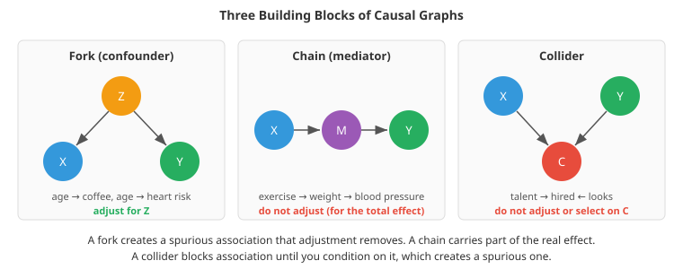

# Causal Inference

*Machine learning predicts what will happen; causal inference asks what would happen if we acted. The two are different questions, and confusing them is one of the most consequential mistakes in applied data science. This file covers potential outcomes, causal graphs, confounding and the backdoor criterion, colliders and mediators, randomised experiments, propensity scores, doubly robust and double machine learning estimators, heterogeneous effects and uplift modelling, quasi-experimental designs, sensitivity analysis, and causal discovery*

- A model that predicts which patients will recover, which customers will churn, or which machines will fail can be very accurate and still be useless for deciding what to *do*. Patients who receive intensive care die more often, but intensive care does not kill them; the sickest patients receive it. Customers who contact support churn more, but closing the support line would not keep them. A predictive model learns associations, whatever their cause. A decision needs to know the effect of an action, and that is a causal question.

- Judea Pearl describes a **ladder of causation** with three rungs:
  1. **Association**, $P(y \mid x)$: "what does seeing $x$ tell me about $y$?" All of standard machine learning lives here.
  2. **Intervention**, $P(y \mid do(x))$: "what happens to $y$ if I *set* $x$?" Policy, pricing, treatment and product decisions live here.
  3. **Counterfactuals**: "would *this* patient have recovered had they not been treated?" Questions about specific individuals and alternative histories.

- Data alone, however much of it, cannot get you up the ladder. You need either an experiment or assumptions about how the data were generated. Causal inference is the discipline of making those assumptions explicit and then extracting as much as they allow.

## Potential Outcomes

- The **potential outcomes** framework (Neyman, Rubin) defines effects precisely. For a binary treatment $T$, each unit $i$ has two potential outcomes: $Y_i(1)$ if treated and $Y_i(0)$ if not. The **individual treatment effect** is $Y_i(1) - Y_i(0)$.

- The **fundamental problem of causal inference** is that we only ever observe one of the two. A patient either took the drug or did not. The other outcome is a counterfactual. So individual effects are never observed directly, and we target averages instead:
  - the **average treatment effect** $\text{ATE} = \mathbb{E}[Y(1) - Y(0)]$ over the population;
  - the **average treatment effect on the treated** $\text{ATT} = \mathbb{E}[Y(1) - Y(0) \mid T = 1]$;
  - the **conditional average treatment effect** $\text{CATE}(x) = \mathbb{E}[Y(1) - Y(0) \mid X = x]$ for units with features $x$.

- The naive comparison $\mathbb{E}[Y \mid T=1] - \mathbb{E}[Y \mid T=0]$ equals the ATE plus a **selection bias** term, the difference between the groups' untreated outcomes, $\mathbb{E}[Y(0) \mid T=1] - \mathbb{E}[Y(0) \mid T=0]$. If sicker patients are treated, that term is large and negative, and it can swamp or reverse the real effect. The first coding task shows exactly this: a treatment that helps every patient appears to harm them in the raw comparison.

- Identifying a causal effect from observational data needs three assumptions:
  - **Consistency / SUTVA**: each unit's outcome depends only on its own treatment, and the treatment is well defined (no interference between units: vaccinating my neighbour does not change *my* outcome, an assumption that fails for infectious disease and for marketplaces).
  - **Unconfoundedness** (ignorability): given the measured covariates $X$, treatment assignment is independent of the potential outcomes, $(Y(1), Y(0)) \perp T \mid X$. In words: there are no unmeasured common causes of treatment and outcome. This is the big one, and it cannot be tested from the data.
  - **Positivity** (overlap): every kind of unit has some chance of either treatment, $0 < P(T = 1 \mid X = x) < 1$. If doctors always treat severe cases, the data contain no information about untreated severe cases.

## Randomised Experiments

- **Randomisation** makes unconfoundedness true by design. If a coin decides who is treated, treatment cannot be related to anything about the units, measured or not, so the treated and control groups have the same distribution of potential outcomes, and the simple difference in means is an unbiased estimate of the ATE.

- That is why randomised controlled trials are the gold standard in medicine, and why A/B tests (chapter 18) are the standard for product decisions. Everything else in this file is about getting causal answers when an experiment is impossible (unethical, too expensive, too slow) or about squeezing more out of one (heterogeneous effects, better precision).

## Causal Graphs

- A **causal directed acyclic graph (DAG)** draws each variable as a node and each direct causal influence as an arrow. It encodes assumptions in a way that makes their consequences mechanical to derive. Three patterns are the building blocks:
  - **Fork**, $X \leftarrow Z \rightarrow Y$: $Z$ is a **confounder**. It creates an association between $X$ and $Y$ even with no causal link. Conditioning on $Z$ blocks this path.
  - **Chain**, $X \rightarrow M \rightarrow Y$: $M$ is a **mediator** carrying part of $X$'s effect. Conditioning on $M$ blocks part of the effect you may want to measure.
  - **Collider**, $X \rightarrow C \leftarrow Y$: $C$ is caused by both. The path is blocked by default; conditioning on $C$, or selecting data based on it, *opens* it and creates a spurious association.



- Colliders are the least intuitive. Among actors who were hired, talent and looks are negatively correlated, even if they are independent in the population: someone hired despite modest talent probably has striking looks (**Berkson's paradox**). The same mechanism explains why studies of hospitalised patients find odd negative correlations between diseases, and why analysing only "users who completed onboarding" can produce nonsense. The second coding task shows a correlation of $-0.67$ appearing out of nothing, a mediator adjustment that removes most of an effect, and a confounder adjustment that is required. Same regression, three different verdicts: **what to adjust for depends on the graph, not on the data.**

- The **do-operator** formalises intervention. $P(y \mid do(x))$ is the distribution of $Y$ if we reach into the system and set $X = x$, which deletes the arrows into $X$. The **backdoor criterion** says when a set of variables $Z$ is enough to compute it from observational data: $Z$ must block every path from $X$ to $Y$ that starts with an arrow *into* $X$ (a "backdoor" path), and must contain no descendant of $X$. Then the **adjustment formula** applies:

$$P(y \mid do(x)) = \sum_z P(y \mid x, z)\, P(z)$$

- Compute the effect within each stratum of $Z$, then average the strata by how common they are in the population. The first coding task does exactly this to recover the true effect from confounded data. The **front-door criterion** and the general rules of **do-calculus** handle some cases where no valid backdoor set is measured.

- Rules of thumb that follow from the graph view:
  - Adjust for common causes of treatment and outcome.
  - Do not adjust for anything caused by the treatment (mediators, or downstream outcomes), unless you specifically want a direct effect.
  - Do not adjust for colliders, and beware of "M-bias", where adjusting for a pre-treatment variable that is a collider opens a path.
  - "Control for everything available" is not a safe default.

## Estimating Effects under Unconfoundedness

- Assume the measured covariates $X$ block all backdoor paths. Several estimators then recover the ATE.

- **Regression adjustment** (outcome modelling, G-computation): fit models for $\mathbb{E}[Y \mid X, T]$, predict every unit's outcome under both treatments, and average the difference. In machine-learning terms this is an **S-learner** (one model with $T$ as a feature) or a **T-learner** (one model per treatment arm). It is only as good as the outcome model: if the model is misspecified, the estimate is biased.

- **The propensity score** $e(x) = P(T = 1 \mid X = x)$ is the probability of treatment given covariates. Rosenbaum and Rubin (1983) showed that it is enough to adjust for this single number instead of all of $X$: units with the same propensity score are as good as randomised with respect to $X$. It underlies **matching** (pair each treated unit with a control unit of similar propensity) and **stratification**.

- **Inverse propensity weighting (IPW)** reweights the data to create a pseudo-population in which treatment is independent of $X$:

$$\widehat{\text{ATE}}_{\text{IPW}} = \frac{1}{n}\sum_i \left[\frac{T_i Y_i}{e(X_i)} - \frac{(1 - T_i)\, Y_i}{1 - e(X_i)}\right]$$

- A treated unit that was unlikely to be treated stands in for many similar units that were not, so it gets a large weight. IPW is only as good as the propensity model, and propensities near 0 or 1 create huge, unstable weights. Remedies are weight clipping or trimming, stabilised (normalised) weights, and, most importantly, checking overlap: plot the propensity distributions of the two groups. Regions with no overlap have no information, and an estimate there is extrapolation.

- **Doubly robust estimation** (augmented IPW, AIPW) combines the two:

$$\widehat{\text{ATE}}_{\text{AIPW}} = \frac{1}{n}\sum_i \left[\hat{m}_1(X_i) - \hat{m}_0(X_i) + \frac{T_i (Y_i - \hat{m}_1(X_i))}{e(X_i)} - \frac{(1 - T_i)(Y_i - \hat{m}_0(X_i))}{1 - e(X_i)}\right]$$

- It starts from the regression adjustment and adds a weighted correction for the outcome model's residuals. If the outcome model is right, the residual terms average to zero; if the propensity model is right, the correction removes the outcome model's bias. So the estimate is consistent if **either** model is correct. The third coding task demonstrates this across all four combinations of right and wrong models: AIPW is close to unbiased in three of them, and nothing survives both models being wrong.

- **Double/debiased machine learning (DML)** (Chernozhukov et al., 2018) brings flexible ML into this framework without giving up valid confidence intervals. In the partially linear model $Y = \theta T + g(X) + \varepsilon$:
  1. Predict $Y$ from $X$ and $T$ from $X$ with any ML models (gradient boosting, random forests, neural networks), using **cross-fitting**: each unit's predictions come from models trained on other folds, so overfitting cannot leak in.
  2. Take the residuals $\tilde{Y} = Y - \hat{\mathbb{E}}[Y \mid X]$ and $\tilde{T} = T - \hat{\mathbb{E}}[T \mid X]$.
  3. Regress residual on residual: $\hat{\theta} = \sum_i \tilde{T}_i \tilde{Y}_i / \sum_i \tilde{T}_i^2$.

- This "partialling out" idea goes back to Robinson (1988). It works because the final estimate is **orthogonal** (insensitive to first order) to small errors in the two ML predictions, so their regularisation bias does not pass through to $\hat{\theta}$ at full strength. The guarantee still needs those predictions to be reasonably accurate, though, and the fourth coding task is honest about this. DML removes almost all of the confounding bias that linear controls leave (bias $-0.01$ against $+0.23$), but its 95% intervals cover the truth only about 80-85% of the time there, because trees approximate the smooth confounding functions with steps. Libraries such as DoubleML and EconML implement DML with many variants.

## Heterogeneous Effects and Uplift

- The average effect hides variation. A discount may delight price-sensitive customers and be wasted on loyal ones; a drug may help some patients and harm others. Estimating $\text{CATE}(x)$ lets you target the action at those it helps.

- **Meta-learners** turn any regression model into a CATE estimator:
  - **S-learner**: one model $\hat{\mu}(x, t)$; $\widehat{\text{CATE}}(x) = \hat{\mu}(x, 1) - \hat{\mu}(x, 0)$. Regularisation may shrink the treatment effect towards zero if $t$ is a weak feature.
  - **T-learner**: separate models for treated and control. Struggles when one group is small.
  - **X-learner** (Künzel et al., 2019): imputes individual effects using the other group's model, then blends using the propensity score; good with unbalanced groups.
  - **DR-learner**: regresses the AIPW pseudo-outcome on $x$.
  - **Causal forests** (Wager and Athey, 2018): random forests whose splits maximise differences in treatment effect, with valid confidence intervals.

- **Uplift modelling** is the marketing name for CATE estimation from randomised campaigns. It divides customers into four groups: *persuadables* (buy only if contacted), *sure things* (buy anyway), *lost causes* (never buy), and *sleeping dogs* (contacting them makes them *less* likely to buy, for example by reminding them to cancel). A response model targets the people most likely to buy, which wastes money on sure things and can wake sleeping dogs; an uplift model targets persuadables. Evaluation uses **uplift (Qini) curves**: the incremental gain from targeting the top $k\%$ by predicted uplift, measured on randomised hold-out data.

- Validating CATE models is hard, because true individual effects are never observed. Use randomised data where possible, compare predicted with realised effects in groups (calibration by decile), and be wary of interpreting individual estimates.

## Quasi-Experimental Designs

- When treatment is not randomised and you cannot measure all confounders, look for situations in the world that mimic an experiment.

- **Difference-in-differences (DiD)** compares the change over time in a treated group with the change in a comparison group:

$$\widehat{\text{effect}} = (\bar{Y}_{\text{treated, after}} - \bar{Y}_{\text{treated, before}}) - (\bar{Y}_{\text{control, after}} - \bar{Y}_{\text{control, before}})$$

- The first difference removes fixed differences between the groups; the second removes the shared time trend. The crucial assumption is **parallel trends**: without the treatment, both groups would have changed by the same amount. Check it by plotting pre-treatment trends. In the fifth coding task, DiD recovers the true effect when the trends are parallel and gets even the sign wrong when they are not. Modern work has shown that the common "two-way fixed effects" regression can mislead when treatment starts at different times for different units, and newer staggered-adoption estimators fix this.

- **Synthetic control** (Abadie and colleagues) builds the comparison from a weighted combination of untreated units chosen to match the treated unit's pre-treatment history, such as a "synthetic California" made of other states to study a tobacco law. Useful when there is a single treated unit.

- **Regression discontinuity (RD)** exploits sharp rules. If students scoring 70 or more get a scholarship, students scoring 69.9 and 70.1 are essentially identical except for the scholarship, so the jump in outcomes at the cutoff estimates its effect, for students near the cutoff. Check that units cannot precisely manipulate their score around the threshold.

- **Instrumental variables (IV)** handle unmeasured confounders using an **instrument** $Z$ that (1) affects the treatment (relevance), (2) affects the outcome only through the treatment (exclusion), and (3) is as good as randomly assigned (independence). Classic examples: distance to college for schooling, random assignment of judges for sentencing, lotteries. **Two-stage least squares** regresses the treatment on the instrument, then regresses the outcome on the *predicted* treatment, using only the variation in treatment that the instrument causes. In the fifth coding task OLS overstates the return to schooling by almost double because of unmeasured ability; 2SLS recovers it. Cautions:
  - Exclusion cannot be tested; it must be argued from domain knowledge.
  - **Weak instruments** (a weak first stage) give biased, unstable estimates.
  - Standard errors from naively running the second stage by hand are wrong; use a proper IV routine.
  - With heterogeneous effects, IV estimates a **local average treatment effect (LATE)**: the effect for "compliers", the units whose treatment was changed by the instrument, which may not be the population you care about.

## How Much Should You Believe It?

- Every observational estimate rests on untestable assumptions, so the analysis is not finished at the point estimate.
  - **Sensitivity analysis** asks how strong an unmeasured confounder would have to be to explain away the result. The **E-value** (VanderWeele and Ding, 2017) gives the minimum strength of association, on the risk-ratio scale, that a confounder would need with both treatment and outcome.
  - **Refutation tests**: replace the treatment with a random placebo (the effect should vanish), add a random common cause (the estimate should not move), estimate the effect on an outcome the treatment cannot affect (a negative control), or re-estimate on subsets of the data. Libraries such as DoWhy automate these.
  - **Triangulation**: estimates from different designs with different assumptions (matching, DiD, IV) that agree are far more convincing than any single one.

## Causal Discovery

- Can the graph itself be learned from data? Partially. Conditional independences in the data constrain which graphs are possible. **Constraint-based** methods such as the PC algorithm test conditional independences to prune edges and orient some of them (colliders leave a distinctive signature). **Score-based** methods search over graphs for the best penalised likelihood, and continuous-optimisation methods such as NOTEARS turn acyclicity into a differentiable constraint.

- The fundamental limit is that many graphs imply the same independences (they are **Markov equivalent**): $X \rightarrow Y$ and $Y \rightarrow X$ cannot be told apart from observational data on two variables without further assumptions (such as non-Gaussian noise or known time order). Causal discovery is best used to generate hypotheses for experts and experiments to check, not as an oracle.

## Causality and Machine Learning

- Causal thinking explains several machine learning failures:
  - **Shortcut learning**: a model that detects pneumonia from the hospital's watermark on the X-ray, or cows from green pasture backgrounds, has learned a spurious association that breaks when the environment changes. Methods such as **invariant risk minimisation** look for features whose relationship to the label is stable across environments, on the reasoning that causal mechanisms are stable while spurious correlations are not.
  - **Feedback loops**: a recommender trained on clicks from its own past recommendations learns its own biases (chapter 18). **Off-policy evaluation** estimates how a new policy would perform from logs collected under the old one, using inverse propensity scoring, the same idea as IPW.
  - **Feature importance is not causal**: a feature that a model relies on heavily need not be something you can change to change the outcome. The interpretability file returns to this.

- Counterfactual explanations ("you would have been approved with an income 5,000 higher") borrow the vocabulary of rung three, but they describe the *model's* behaviour, not the world's.

## Coding Tasks (use CoLab or notebook)

1. Simpson's paradox. A treatment that raises recovery by 10 points in every group looks harmful in the raw comparison, because severely ill patients are more likely to be treated. Recover the true effect with the backdoor adjustment formula.
```python
import numpy as np
import pandas as pd

# A hospital: severely ill patients are much more likely to get the new treatment.
# The treatment truly HELPS everyone: it raises the recovery probability by 10 points.
rng = np.random.default_rng(0)
n = 20000
severe = rng.uniform(size=n) < 0.5
treated = rng.uniform(size=n) < np.where(severe, 0.8, 0.2)        # confounding: severity drives treatment
p_recover = np.where(severe, 0.3, 0.8) + 0.10 * treated            # severity also drives recovery
recovered = rng.uniform(size=n) < p_recover
df = pd.DataFrame({"severe": severe, "treated": treated, "recovered": recovered})

naive = df.groupby("treated")["recovered"].mean()
print(f"recovery rate, treated {naive[True]:.3f} vs untreated {naive[False]:.3f}: "
      f"naive difference {naive[True] - naive[False]:+.3f}")

by_stratum = df.groupby(["severe", "treated"])["recovered"].mean().unstack()
print("\nrecovery rate within each severity group:\n", by_stratum.round(3))
effects = by_stratum[True] - by_stratum[False]

# Backdoor adjustment: average the within-stratum effects, weighted by how common each stratum is
weights = df["severe"].value_counts(normalize=True)
ate = sum(effects[s] * weights[s] for s in [True, False])
print(f"\nadjusted effect (standardisation over severity): {ate:+.3f}   (true effect +0.100)")
print("The raw comparison says the treatment harms patients; within every group it helps."
      "\nThat reversal is Simpson's paradox, caused by the confounder 'severity'.")
```

2. When adjusting helps and when it hurts. Selecting on a collider creates a correlation from nothing, adjusting for a mediator removes part of a real effect, and adjusting for a confounder removes a spurious one.
```python
import numpy as np
import matplotlib.pyplot as plt

rng = np.random.default_rng(1)
n = 20000
ols = lambda X, y: np.linalg.lstsq(np.c_[np.ones(len(y)), X], y, rcond=None)[0][1:]

# 1. Collider: talent and looks are independent in the population.
#    Film studios hire people who are talented OR good-looking enough: hired = talent + looks > 1.5
talent, looks = rng.normal(size=n), rng.normal(size=n)
hired = talent + looks > 1.5
print(f"correlation(talent, looks), everyone:      {np.corrcoef(talent, looks)[0, 1]:+.3f}")
print(f"correlation(talent, looks), among the hired: {np.corrcoef(talent[hired], looks[hired])[0, 1]:+.3f}"
      "   <- created by selecting on a collider")

# 2. Mediator: exercise lowers weight, and lower weight lowers blood pressure; exercise also has a direct effect.
#    exercise -> weight -> blood pressure, plus exercise -> blood pressure
exercise = rng.normal(size=n)
weight = -0.8 * exercise + rng.normal(size=n)
bp = 0.5 * weight - 0.3 * exercise + rng.normal(size=n)
total = -0.3 + 0.5 * -0.8
print(f"\ntrue total effect of exercise on blood pressure: {total:+.2f} (direct -0.30, via weight -0.40)")
print(f"regress bp on exercise:          {ols(exercise[:, None], bp)[0]:+.3f}   <- the total effect")
print(f"regress bp on exercise + weight: {ols(np.c_[exercise, weight], bp)[0]:+.3f}   <- only the direct effect")

# 3. Confounder: here adjusting is REQUIRED
age = rng.normal(size=n)
coffee = 0.7 * age + rng.normal(size=n)                    # older people drink more coffee
heart = 0.6 * age + 0.0 * coffee + rng.normal(size=n)      # coffee has NO effect
print(f"\ncoffee has no effect on heart risk; age causes both.")
print(f"regress heart on coffee:       {ols(coffee[:, None], heart)[0]:+.3f}   <- spurious")
print(f"regress heart on coffee + age: {ols(np.c_[coffee, age], heart)[0]:+.3f}   <- correct")

fig, ax = plt.subplots(figsize=(6, 5))
ax.scatter(talent[~hired][:2000], looks[~hired][:2000], s=3, color='#bdc3c7', label="not hired")
ax.scatter(talent[hired][:800], looks[hired][:800], s=4, color='#e74c3c', label="hired")
ax.set_xlabel("talent"); ax.set_ylabel("looks"); ax.legend()
ax.set_title("Selecting on a collider creates a correlation"); plt.show()
print("\nSame regression trick, three opposite verdicts: whether to adjust depends on the causal graph.")
```

3. Regression adjustment, inverse propensity weighting and the doubly robust AIPW estimator, each run with correct and deliberately wrong outcome and propensity models, to see double robustness in action.
```python
import numpy as np
from sklearn.linear_model import LogisticRegression, LinearRegression

TRUE_ATE = 2.0
def simulate(n, rng):
    X = rng.normal(size=(n, 3))
    propensity = 1 / (1 + np.exp(-(1.0 * X[:, 0] - 0.5 * X[:, 1])))      # confounding through X0 and X1
    T = (rng.uniform(size=n) < propensity).astype(int)
    Y = 2 * np.exp(X[:, 0]) + 1.5 * X[:, 1] + X[:, 2] + TRUE_ATE * T + rng.normal(size=n)
    return X, T, Y

def estimates(X, T, Y, outcome_ok, propensity_ok):
    # Outcome model E[Y | X, T]: correct form uses exp(X0), the wrong one is linear in X
    F = np.c_[np.exp(X[:, 0]), X[:, 1:]] if outcome_ok else X
    reg = LinearRegression().fit(np.c_[F, T], Y)
    m1, m0 = reg.predict(np.c_[F, np.ones(len(T))]), reg.predict(np.c_[F, np.zeros(len(T))])
    # Propensity model P(T=1 | X): the wrong one leaves out the confounder X0
    P = X if propensity_ok else X[:, 1:]
    e = LogisticRegression().fit(P, T).predict_proba(P)[:, 1]
    return {"regression adjustment": np.mean(m1 - m0),
            "IPW": np.mean(T * Y / e) - np.mean((1 - T) * Y / (1 - e)),
            "AIPW": np.mean(m1 - m0 + T * (Y - m1) / e - (1 - T) * (Y - m0) / (1 - e))}

rng = np.random.default_rng(2)
X, T, Y = simulate(100000, rng)
print(f"naive difference in means: {Y[T == 1].mean() - Y[T == 0].mean():.2f}   (true ATE {TRUE_ATE})\n")
print(f"{'outcome model':14s} {'propensity':11s} | {'regression adj.':>16s} {'IPW':>8s} {'AIPW':>8s}   (mean bias over 100 runs)")
for outcome_ok in [True, False]:
    for propensity_ok in [True, False]:
        runs = [estimates(*simulate(3000, rng), outcome_ok, propensity_ok) for _ in range(100)]
        bias = {k: np.mean([r[k] for r in runs]) - TRUE_ATE for k in runs[0]}
        print(f"{'right' if outcome_ok else 'wrong':14s} {'right' if propensity_ok else 'wrong':11s} | "
              f"{bias['regression adjustment']:+16.3f} {bias['IPW']:+8.3f} {bias['AIPW']:+8.3f}")
print("\nAIPW is (nearly) unbiased whenever at least one of its two models is right: double robustness."
      "\nWhen both are wrong, nothing saves you.")
```

4. Double machine learning with cross-fitted gradient boosting against linear regression with controls, when the confounding is nonlinear. Look at both the bias and how often the confidence intervals cover the truth.
```python
import numpy as np
from sklearn.ensemble import HistGradientBoostingRegressor
from sklearn.model_selection import KFold

# Partially linear model: Y = theta * D + g(X) + noise,  D = m(X) + noise
# The confounding functions g and m are nonlinear, so a linear regression cannot adjust for X properly.
THETA = 0.5
def simulate(n, rng):
    X = rng.uniform(-2, 2, (n, 5))
    m = np.sin(2 * X[:, 0]) + X[:, 1] ** 2 - 1
    g = 2 * np.cos(2 * X[:, 0]) + np.abs(X[:, 1]) + X[:, 2] * X[:, 3]
    D = m + rng.normal(0, 1, n)                                  # a continuous "treatment" (e.g. price)
    Y = THETA * D + g + rng.normal(0, 1, n)
    return X, D, Y

def ols_theta(X, D, Y):
    Z = np.c_[np.ones(len(D)), D, X]
    return np.linalg.lstsq(Z, Y, rcond=None)[0][1]

def dml_theta(X, D, Y, folds=5):
    """Double/debiased ML: predict Y and D from X with cross-fitting, then regress residual on residual."""
    res_y, res_d = np.zeros(len(Y)), np.zeros(len(D))
    for tr, te in KFold(folds, shuffle=True, random_state=0).split(X):
        model = lambda: HistGradientBoostingRegressor(max_iter=300, learning_rate=0.1, max_leaf_nodes=15,
                                                     early_stopping=True, random_state=0)
        res_y[te] = Y[te] - model().fit(X[tr], Y[tr]).predict(X[te])
        res_d[te] = D[te] - model().fit(X[tr], D[tr]).predict(X[te])
    theta = (res_d @ res_y) / (res_d @ res_d)
    psi = (res_y - theta * res_d) * res_d                        # influence function for the standard error
    se = np.sqrt(np.mean(psi**2)) / np.mean(res_d**2) / np.sqrt(len(Y))
    return theta, se

rng = np.random.default_rng(3)
print(f"true effect theta = {THETA}\n")
print("run | linear regression | double ML estimate and 95% CI")
ols, dml = [], []
for run in range(5):
    X, D, Y = simulate(3000, rng)
    ols.append(ols_theta(X, D, Y))
    th, se = dml_theta(X, D, Y)
    dml.append(th)
    print(f"{run + 1:3d} | {ols[-1]:17.3f} | {th:.3f}  [{th - 1.96 * se:.3f}, {th + 1.96 * se:.3f}]")
print(f"\nmean bias: linear regression {np.mean(ols) - THETA:+.3f}, double ML {np.mean(dml) - THETA:+.3f}")
print("Linear controls cannot remove nonlinear confounding. Double ML removes almost all of it."
      "\nIts intervals cover the truth a bit less often than 95% here (about 80-85% over many runs):"
      "\nthe tree models approximate the smooth confounding functions with steps, leaving a small bias."
      "\nThe theory needs the two prediction models to be accurate enough; smoother or better-tuned learners close the gap.")
```

5. Two quasi-experiments: difference-in-differences (with and without parallel trends) and instrumental variables with two-stage least squares when an important confounder is unmeasured.
```python
import numpy as np
import matplotlib.pyplot as plt

rng = np.random.default_rng(4)

# ---- 1. Difference-in-differences ----
# A city introduces a policy in month 12. A comparison city does not. Both share a common trend.
months = np.arange(24)
def city(base, slope, effect, treated):
    return base + slope * months + effect * (treated & (months >= 12)) + rng.normal(0, 0.5, 24)
EFFECT = -3.0
for title, slope_treated in [("parallel trends hold", 0.5), ("parallel trends violated", 0.8)]:
    a = city(40, slope_treated, EFFECT, True)           # treated city: higher baseline
    b = city(30, 0.5, 0.0, False)                       # comparison city
    pre, post = months < 12, months >= 12
    before_after = a[post].mean() - a[pre].mean()
    treated_vs_control = a[post].mean() - b[post].mean()
    did = (a[post].mean() - a[pre].mean()) - (b[post].mean() - b[pre].mean())
    print(f"DiD, {title} (true effect {EFFECT}):")
    print(f"   before vs after in the treated city: {before_after:+.2f}   (mixes in the time trend)")
    print(f"   treated vs comparison after:         {treated_vs_control:+.2f}   (mixes in the baseline gap)")
    print(f"   difference-in-differences:           {did:+.2f}")
    if title == "parallel trends hold":
        plt.figure(figsize=(8, 4))
        plt.plot(months, a, 'o-', color='#e74c3c', label="treated city")
        plt.plot(months, b, 'o-', color='#3498db', label="comparison city")
        plt.plot(months[post], b[post] + (a[pre].mean() - b[pre].mean()), '--', color='#e74c3c', alpha=0.5,
                 label="treated city without the policy (assumed)")
        plt.axvline(11.5, color='k', linestyle=':'); plt.legend(); plt.title("Difference-in-differences")
        plt.show()

# ---- 2. Instrumental variables ----
# Does more schooling raise wages? Unobserved ability raises both, so OLS is biased.
# Instrument: distance to the nearest college shifts schooling but (by assumption) affects wages only through it.
n = 20000
ability = rng.normal(size=n)                            # unobserved confounder
distance = rng.normal(size=n)                           # instrument
schooling = 12 - 0.6 * distance + 1.0 * ability + rng.normal(size=n)
wage = 1.0 + 0.08 * schooling + 0.15 * ability + rng.normal(0, 0.3, n)

def ols(x, y):
    Z = np.c_[np.ones(len(x)), x]
    return np.linalg.lstsq(Z, y, rcond=None)[0][1]

first_stage = np.polyfit(distance, schooling, 1)        # stage 1: schooling predicted by the instrument
schooling_hat = np.polyval(first_stage, distance)
print(f"\nIV: true effect of a year of schooling on (log) wage = 0.080")
print(f"   OLS:  {ols(schooling, wage):.3f}   (biased upward by ability)")
print(f"   2SLS: {ols(schooling_hat, wage):.3f}   (uses only the variation in schooling caused by distance)")
print(f"   first-stage strength: correlation(distance, schooling) = {np.corrcoef(distance, schooling)[0, 1]:.2f}")
```
