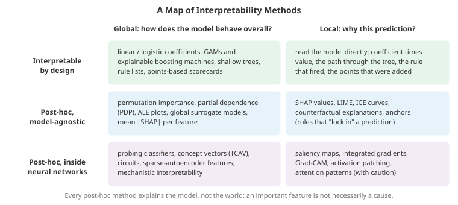

# Interpretability and Explainability

*Interpretability asks why a model makes the predictions it does. This file covers why that matters, models that are interpretable by design, global explanations (permutation importance, partial dependence, ICE and ALE), local explanations (Shapley values and SHAP, LIME, counterfactuals), attribution methods for neural networks (saliency, integrated gradients, Grad-CAM), concept-based methods and probing, mechanistic interpretability (circuits, superposition, sparse autoencoders), and the many ways explanations mislead*

- A model that is 95% accurate may still be right for the wrong reasons. A famous pneumonia-risk model learned that asthma patients were at *lower* risk of dying, because asthmatic patients were routinely sent to intensive care and so did well; deployed naively, it would have sent them home. A skin-cancer classifier learned that images with rulers in them were more likely to be malignant, because dermatologists measure the lesions they worry about. Neither failure shows up in test accuracy. Both show up the moment someone looks at *why* the model predicts what it does.

- Interpretability serves several distinct goals, and which one you have decides which method fits:
    - **Debugging**: finding leakage, shortcuts and spurious features before deployment.
    - **Trust and adoption**: a doctor or loan officer needs to judge whether to rely on a prediction.
    - **Recourse and regulation**: people affected by decisions may be owed reasons. US credit law requires lenders to state the principal reasons for an adverse decision; the EU's GDPR and AI Act impose transparency obligations on automated decision-making, especially for high-risk systems.
    - **Scientific discovery**: learning something about the world from what a model found (which genes matter, which molecular substructures drive toxicity).
    - **Safety**: understanding the internal computations of powerful models well enough to detect deception, dangerous capabilities or unexpected goals.

- A useful vocabulary: an explanation is **global** (how the model behaves overall) or **local** (why this one prediction); it is produced by a model that is **interpretable by design** or computed **post hoc** for any model; and post-hoc methods are **model-agnostic** (only query inputs and outputs) or **model-specific** (use gradients, tree structure or activations).



## Interpretable by Design

- Before explaining a black box, ask whether you need one. Cynthia Rudin's influential argument (2019) is that for high-stakes decisions on tabular data, interpretable models often perform about as well as black boxes, and their explanations are the model itself rather than an approximation of it.

- **Linear and logistic regression** are interpretable if used carefully: a coefficient is the change in prediction (or log-odds) per unit change of a feature *with all other features held fixed*. Standardise features to compare magnitudes, and beware that correlated features make individual coefficients unstable and holding the others fixed can be unrealistic.

- **Generalised additive models (GAMs)** replace each linear term with a learned shape function: $g(\mathbb{E}[y]) = \beta_0 + f_1(x_1) + f_2(x_2) + \dots$. Each $f_j$ can be plotted, so the whole model can be inspected one feature at a time, yet it captures non-linear effects. **Explainable boosting machines (EBMs)** fit each $f_j$ by boosting shallow trees on one feature at a time, and add a small number of pairwise interaction terms $f_{jk}(x_j, x_k)$; on many tabular problems they come close to gradient-boosted trees. The pneumonia-asthma problem above was rediscovered with exactly such a model (Caruana et al., 2015), and could be fixed by editing the offending shape function.

- **Shallow decision trees, rule lists and scorecards** (add points for each condition, compare with a threshold) can be checked line by line by a domain expert. Learning optimal sparse trees and rule lists is computationally hard, but modern solvers handle realistic sizes.

## Global Explanations

- **Permutation importance** measures how much a model's performance drops when one feature's values are randomly shuffled, breaking its relationship with the target while keeping its distribution. Compute it on held-out data: on training data it rewards features the model overfits to. It is model-agnostic and directly answers "how much does the model rely on this feature?", but it has two well-known problems:
    - **Correlated features share credit.** If two features carry the same information, shuffling one leaves the other to compensate, so both look less important than the information they carry. In the first coding task a feature and its noisy copy each receive a fraction of the importance the feature gets on its own.
    - **Shuffling creates impossible inputs.** With correlated features, permuting one produces combinations never seen in training (a 25-year-old with 40 years of work experience), and the model's behaviour on those is arbitrary.

- Tree ensembles also report **impurity-based importance** (MDI), the total loss reduction from each feature's splits. It is computed on training data and biased towards features with many unique values; the first coding task shows a pure-noise ID column receiving 14% of it, against roughly zero permutation importance. Prefer permutation importance or SHAP.

- **Partial dependence plots (PDP)** show how the average prediction changes as one feature varies. For each value $v$ on a grid, set the feature to $v$ for every row, predict, and average:

$$\text{PD}_j(v) = \frac{1}{n}\sum_{i=1}^{n} f(v, x_{i, -j})$$

- **Individual conditional expectation (ICE)** curves plot that line separately for each row instead of averaging. The PDP is the average of the ICE curves, and averaging can hide everything. In the second coding task price raises the prediction by 10 for premium customers and lowers it by 10 for budget customers; the PDP is nearly flat and suggests price does not matter. Always look at ICE curves, or PDPs split by a suspected interacting feature.

- PDPs share permutation importance's weakness with correlated features: they average over combinations that do not occur. **Accumulated local effects (ALE)** plots (Apley and Zhu, 2020) fix this by averaging local *differences* in prediction within narrow bins of the feature, using only rows that actually fall in each bin, and then accumulating those differences.

- A **global surrogate** trains an interpretable model (a shallow tree) to mimic the black box's predictions. Report its fidelity (how often it agrees with the black box): a surrogate that agrees 70% of the time explains a different model.

## Local Explanations

### Shapley values and SHAP

- **Shapley values** come from cooperative game theory (Shapley, 1953): how should players who cooperate split a payout fairly? In explanation, the "players" are features, and the "payout" is the difference between this prediction and an average prediction. Feature $i$'s Shapley value averages its marginal contribution over every possible subset $S$ of the other features:

$$\phi_i = \sum_{S \subseteq F \setminus \{i\}} \frac{|S|!\,(|F| - |S| - 1)!}{|F|!} \Big[v(S \cup \{i\}) - v(S)\Big]$$

- Equivalently: line the features up in a random order, add them one at a time, record how much the prediction changes when feature $i$ joins, and average over all orderings. The weights in the formula count the orderings in which exactly the features in $S$ come before $i$.

- Shapley values are the unique attribution satisfying four axioms:
    - **Efficiency**: the attributions add up exactly to the prediction minus the baseline, $\sum_i \phi_i = f(x) - \mathbb{E}[f(X)]$.
    - **Symmetry**: two features that contribute identically get equal credit.
    - **Dummy**: a feature that never changes the prediction gets zero.
    - **Additivity**: for a sum of models, attributions add.

- The third coding task computes them exactly by enumerating all coalitions, verifies efficiency, and confirms the closed form for a linear model with independent features, $\phi_i = w_i (x_i - \mathbb{E}[x_i])$. It also shows that an interaction $x_0 x_1$ is split between the two features involved.

- What does $v(S)$, "the prediction using only the features in $S$", mean for a model that needs all its inputs? The common answer replaces the missing features with values drawn from background data. Drawing them independently (**interventional** Shapley) explains the model as a function. Drawing them conditionally on the present features (**observational**) respects correlations but can give credit to features the model never uses. The two answer different questions, and libraries default to different choices.

- **SHAP** (Lundberg and Lee, 2017) made Shapley values practical:
    - **KernelSHAP** estimates them for any model with a weighted linear regression over sampled coalitions.
    - **TreeSHAP** computes them *exactly* for tree ensembles in polynomial time by pushing all coalitions through the tree structure at once. This made SHAP the standard for gradient-boosted models.
    - **DeepSHAP** and **GradientSHAP** approximate them for neural networks.
    - SHAP **summary plots** (every row's attribution for every feature) and **dependence plots** (attribution against feature value) turn local attributions into global insight.

- The exact computation needs $2^{|F|}$ coalitions, a billion for 30 features, so sampling and model structure are what make Shapley values usable in practice.

### LIME

- **LIME** (Ribeiro, Singh and Guestrin, 2016) explains one prediction by fitting a simple model locally: perturb the input many times, query the black box, weight the perturbed samples by how close they are to the original, and fit a weighted linear model whose coefficients are the explanation. It works for tabular data, text (removing words) and images (hiding superpixels).

- Its weakness is that "local" must be defined, through a kernel width and a perturbation distribution, and the explanation depends on both. In the fourth coding task a narrow kernel reproduces the true local gradient, while a wide one averages over a region where the model's behaviour changes, shrinks one feature's coefficient eight-fold and flips the ranking of the two features. Explanations can also change between runs because of random sampling.

### Counterfactual explanations

- A **counterfactual explanation** answers "what is the smallest change to the input that would change the decision?" ("the loan would have been approved with an income 4,000 higher, or with 2,000 less debt"). Found by optimisation (Wachter et al., 2017): minimise the distance to the original input subject to the prediction flipping. Good counterfactuals are sparse (few features change), plausible (stay on the data distribution), and actionable (do not ask someone to become younger). They are attractive for recourse because they tell people what they could do, but they describe the *model*, not the world: raising your income might not change your actual default risk at all. The causal inference file explains why.

- **Anchors** (Ribeiro et al., 2018) give rule-based local explanations: a set of conditions that "anchors" the prediction, so that it almost never changes when the other features vary.

## Explaining Neural Networks

- For neural networks the gradient of the output with respect to the input is cheap (one backward pass, file 03), and it is the basis of many attribution methods.

- **Saliency maps** plot $|\partial f / \partial x|$: which pixels would change the output most if nudged. **Gradient × input** multiplies by the input. **SmoothGrad** averages gradients over noisy copies of the input to reduce visual noise.

- Gradients are *local*: they describe what happens under tiny changes. A saturated network (a sigmoid near 1, a ReLU that is off) can have nearly zero gradient for a feature that is responsible for the output. **Integrated gradients** (Sundararajan, Taly and Yan, 2017) fixes this by integrating the gradient along a straight path from a **baseline** input $x'$ (a black image, all-zero embeddings) to the actual input:

$$\text{IG}_i(x) = (x_i - x'_i) \int_0^1 \frac{\partial f\big(x' + \alpha (x - x')\big)}{\partial x_i}\, d\alpha$$

- It satisfies **completeness**: the attributions sum to $f(x) - f(x')$, the same property as Shapley efficiency (integrated gradients corresponds to a Shapley-like value for a continuous game called Aumann-Shapley). In the fifth coding task the plain gradient is below $10^{-5}$ for the two features that drive a saturated output, while integrated gradients assigns them almost all of the change. The catch is the baseline: a different baseline gives different attributions, and choosing it is a modelling decision.

- **Grad-CAM** (Selvaraju et al., 2017) is specific to CNNs (chapter 08): it weights the last convolutional layer's feature maps by the average gradient of the class score with respect to each map, giving a coarse heatmap of the regions that drive the class.

- **Sanity checks matter.** Adebayo et al. (2018) randomised a network's weights and found that some popular saliency methods produced nearly the same pictures, which means those pictures were showing image edges, not the model's reasoning. A useful attribution method must at least change when the model changes.

- **Attention weights are not explanations by default.** Transformers (chapter 07) expose attention patterns that are tempting to read as "what the model looked at". Jain and Wallace (2019) showed that very different attention distributions can produce the same predictions, so attention alone is weak evidence of what drives an output; follow-up work clarified when it can be informative. Treat attention as one signal, not the answer.

## Concepts and Probing

- Pixel- and token-level attributions are hard for people to reason about. **Concept-based** methods explain in human terms. **TCAV** (Kim et al., 2018) learns a **concept activation vector**, the direction in a layer's activation space that separates examples of a concept (striped textures) from random examples, then measures how sensitive a class prediction (zebra) is to moving in that direction.

- **Probing classifiers** test whether a representation *contains* some information: train a simple (usually linear) classifier to predict a property (part of speech, syntactic depth, the colour of an object) from a layer's activations. Two cautions: a powerful probe can learn the task itself, so compare against **control tasks** with random labels (Hewitt and Liang, 2019); and information being decodable does not mean the model *uses* it. Causal interventions (below) test use.

## Mechanistic Interpretability

- **Mechanistic interpretability** tries to reverse-engineer a network into human-understandable algorithms: which components compute what, and how they connect. It treats a trained network like a compiled program to decompile.

- **Circuits.** Work on vision models (Olah et al., 2020) traced curve detectors and how later layers assemble them into object parts. In transformers, researchers identified **induction heads** (Olsson et al., 2022), pairs of attention heads that implement "find where the current token appeared before and copy what came next", a mechanism behind in-context learning, and full circuits for narrow tasks such as identifying the indirect object in a sentence.

- **Causal interventions** are the main experimental tool. **Activation patching** (or causal tracing, Meng et al., 2022) runs the model on two inputs, copies an internal activation from one run into the other, and measures how the output changes; components whose patching changes the output are causally involved. The **logit lens** decodes intermediate layers through the output head to see how a prediction forms layer by layer.

- **Superposition.** Individual neurons are often **polysemantic**: one neuron responds to cat faces, car fronts and a particular font. Elhage et al. (2022) explained why with toy models: when features are sparse (rarely active at the same time), a network can represent *more features than it has dimensions* by assigning them nearly orthogonal directions and tolerating a little interference. The sixth coding task reproduces this: with dense features a two-dimensional bottleneck keeps two features, and with sparse features it packs in all five. This is one reason single neurons are the wrong unit of analysis.

- **Sparse autoencoders (SAEs)** attempt to undo superposition. Train a wide autoencoder with a sparsity penalty to reconstruct a layer's activations as a sparse combination of many learned directions ("dictionary learning"). The learned directions are often far more interpretable than neurons. Anthropic's work (Bricken et al., 2023; Templeton et al., 2024) scaled this to production language models and found millions of features, from specific landmarks to abstract concepts such as deception or code bugs. Amplifying a feature steers the model's behaviour, which is causal evidence that the feature is used. Later work combined such features into **attribution graphs** that trace, step by step, how a model arrives at a particular output.

- Mechanistic interpretability is young. Explanations so far cover a small fraction of what large models compute, SAE features are not guaranteed to be the model's "true" units, and validating that an explanation is complete is hard. It is also one of the most active research areas in AI safety, because it is the only approach that looks at *how* a model computes rather than only at what it outputs.

## How Explanations Mislead

- **Explanations are about the model, not the world.** A high SHAP value for "zip code" says the model uses zip code; it does not say zip code causes default, and it may be a proxy for something protected (see the fairness file).

- **Different methods disagree.** On the same model and input, SHAP, LIME and gradient methods frequently rank features differently (the "disagreement problem", Krishna et al., 2022). Practitioners tend to pick whichever explanation looks most plausible, which is the opposite of what an explanation is for.

- **Explanations can be gamed.** Slack et al. (2020) built models that behave in a discriminatory way on real inputs but innocuously on the off-distribution perturbations that LIME and KernelSHAP query, so the explanations hide the discrimination. Perturbation-based explanations are only as trustworthy as the model's behaviour off the data distribution.

- **Plausible is not faithful.** An explanation that matches human intuition is not necessarily what the model does. Measure **faithfulness**: remove the features an explanation ranks highest and check that the prediction changes much more than when removing random features (deletion and insertion curves), or retrain without them (ROAR, Hooker et al., 2019).

- **Explanations can create false confidence.** Studies of human-AI teams have found that explanations sometimes increase people's trust in a model even when it is wrong.

## A Practical Recipe

- For tabular models in production:
    1. Consider an interpretable model (a GAM, EBM or sparse linear model) first, and quantify what accuracy you would give up.
    2. For a gradient-boosted model, use TreeSHAP: a global summary plot, dependence plots for the top features, and local explanations for individual cases. Check permutation importance on held-out data alongside.
    3. Inspect ICE curves and interactions for the top features.
    4. Treat any surprisingly important feature as a leakage or shortcut suspect until explained.
    5. Explain to the audience: regulators and affected individuals need reasons and recourse (counterfactuals, reason codes); developers need debugging tools.
    6. Validate: check stability across seeds and samples, and test faithfulness.

## Coding Tasks (use CoLab or notebook)

1. Feature importance pitfalls in a random forest: compare impurity importance with permutation importance on held-out data when the data include a pure-noise ID column and a near-duplicate of a real feature.
```python
import numpy as np
from sklearn.ensemble import RandomForestClassifier
from sklearn.inspection import permutation_importance
from sklearn.model_selection import train_test_split

rng = np.random.default_rng(0)
n = 3000
income = rng.normal(size=n)
debt = rng.normal(size=n)
income_copy = income + rng.normal(0, 0.1, n)            # a near-duplicate (e.g. income from two sources)
row_id = rng.permutation(n).astype(float)               # pure noise with n unique values
y = (rng.uniform(size=n) < 1 / (1 + np.exp(-(1.5 * income - 1.5 * debt)))).astype(int)

names = ["income", "debt", "income_copy", "row_id"]
X = np.c_[income, debt, income_copy, row_id]
X_tr, X_te, y_tr, y_te = train_test_split(X, y, test_size=0.3, random_state=0)
rf = RandomForestClassifier(n_estimators=200, min_samples_leaf=1, random_state=0, n_jobs=1).fit(X_tr, y_tr)
print(f"test accuracy {rf.score(X_te, y_te):.3f}\n")

pi_te = permutation_importance(rf, X_te, y_te, n_repeats=10, random_state=0, n_jobs=1)
print(f"{'feature':12s} {'impurity (MDI)':>15s} {'permutation, test':>18s}")
for i in np.argsort(-rf.feature_importances_):
    print(f"{names[i]:12s} {rf.feature_importances_[i]:15.3f} {pi_te.importances_mean[i]:18.3f}")

# Drop the copy and refit: the credit for income moves back to one column
rf2 = RandomForestClassifier(n_estimators=200, random_state=0, n_jobs=1).fit(X_tr[:, [0, 1, 3]], y_tr)
pi2 = permutation_importance(rf2, X_te[:, [0, 1, 3]], y_te, n_repeats=10, random_state=0, n_jobs=1)
print(f"\nwithout income_copy: permutation importance of income = {pi2.importances_mean[0]:.3f}")
share = rf.feature_importances_[3] / rf.feature_importances_.sum()
print(f"\n1. Impurity importance gives the useless row_id {share:.0%} of the total: many unique values mean many"
      "\n   chances to find a split that helps on the training data by luck."
      "\n   Permutation importance on held-out data correctly gives it about zero."
      "\n2. income and its copy split the credit between them; each looks less important than it is, because"
      "\n   shuffling one leaves the other to carry the information.")
```

2. Partial dependence versus ICE curves for a model where price has opposite effects for two customer groups.
```python
import numpy as np
import matplotlib.pyplot as plt
from sklearn.ensemble import HistGradientBoostingRegressor

# A price effect that is POSITIVE for premium customers and NEGATIVE for budget customers
rng = np.random.default_rng(1)
n = 4000
price = rng.uniform(0, 10, n)
premium = rng.integers(0, 2, n)                      # 0 = budget, 1 = premium
age = rng.uniform(20, 70, n)
y = 2 * (premium - 0.5) * price + 0.05 * age + rng.normal(0, 1, n)
X = np.c_[price, premium, age]
model = HistGradientBoostingRegressor(max_iter=300, random_state=0).fit(X, y)

grid = np.linspace(0, 10, 30)
sample = rng.choice(n, 150, replace=False)
ice = np.empty((len(sample), len(grid)))
for j, v in enumerate(grid):                         # set price = v for every sampled customer
    Xv = X[sample].copy(); Xv[:, 0] = v
    ice[:, j] = model.predict(Xv)
pdp = ice.mean(0)                                    # partial dependence = average of the ICE curves
ice_c = ice - ice[:, :1]                             # centred ICE: every curve starts at 0

fig, axes = plt.subplots(1, 2, figsize=(13, 4.5))
axes[0].plot(grid, pdp, color='#e74c3c', linewidth=3)
axes[0].set_title("Partial dependence of prediction on price"); axes[0].set_xlabel("price")
for k, i in enumerate(sample):
    axes[1].plot(grid, ice_c[k], color='#3498db' if premium[i] else '#27ae60', alpha=0.3, linewidth=0.8)
axes[1].plot(grid, pdp - pdp[0], color='#e74c3c', linewidth=3, label="average (PDP)")
axes[1].set_title("Centred ICE curves: blue premium, green budget"); axes[1].legend(); axes[1].set_xlabel("price")
plt.tight_layout(); plt.show()

print(f"PDP change from price 0 to 10: {pdp[-1] - pdp[0]:+.2f}  (looks like price barely matters)")
for g, name in [(1, "premium"), (0, "budget")]:
    print(f"average ICE change for {name:7s} customers: {ice_c[premium[sample] == g, -1].mean():+.2f}")
print("The average hides two large, opposite effects. ICE curves (or a PDP split by group) reveal the interaction.")
```

3. Exact Shapley values by enumerating every coalition. Verify the efficiency axiom, the dummy axiom and the closed form for linear models, and watch a Monte Carlo estimate over random orderings converge to the exact answer.
```python
import numpy as np
from itertools import combinations
from math import factorial

rng = np.random.default_rng(2)
d = 4
background = rng.normal(size=(500, d))                  # reference data used to "remove" features

def shapley_exact(f, x, background):
    """Exact Shapley values. v(S) = average prediction when features in S are fixed to x
    and the others are drawn from the background data (interventional Shapley)."""
    def value(S):
        Z = background.copy()
        Z[:, list(S)] = x[list(S)]
        return f(Z).mean()
    phi = np.zeros(d)
    for i in range(d):
        others = [j for j in range(d) if j != i]
        for k in range(d):
            for S in combinations(others, k):
                weight = factorial(k) * factorial(d - k - 1) / factorial(d)
                phi[i] += weight * (value(S + (i,)) - value(S))
    return phi, value(()), value(tuple(range(d)))

def shapley_sampled(f, x, background, n_perm=200, seed=0):
    """Monte Carlo: average each feature's marginal contribution over random orderings."""
    r = np.random.default_rng(seed)
    phi = np.zeros(d)
    for _ in range(n_perm):
        order = r.permutation(d)
        z = background[r.integers(len(background))].copy()
        prev = f(z[None])[0]
        for i in order:
            z[i] = x[i]
            cur = f(z[None])[0]
            phi[i] += cur - prev
            prev = cur
    return phi / n_perm

x = np.array([1.5, -1.0, 0.5, 2.0])

# 1. Linear model: Shapley values have a closed form w_i * (x_i - E[x_i])
w = np.array([2.0, -1.0, 0.5, 0.0])
linear = lambda Z: Z @ w + 3.0
phi, base, full = shapley_exact(linear, x, background)
print("linear model")
print("  exact Shapley:   ", phi.round(3))
print("  w_i (x_i - mean):", (w * (x - background.mean(0))).round(3))
print(f"  efficiency: base {base:.3f} + sum(phi) {phi.sum():.3f} = {base + phi.sum():.3f} = f(x) {full:.3f}")

# 2. A model with an interaction: x0 * x1 credit is split between the two features
inter = lambda Z: Z[:, 0] * Z[:, 1] + Z[:, 2]
phi, base, full = shapley_exact(inter, x, background)
print("\nmodel x0*x1 + x2")
print("  exact Shapley:   ", phi.round(3), "  (feature 3 is unused: its value is 0, the 'dummy' axiom)")
for n_perm in [100, 2000]:
    print(f"  sampled ({n_perm:4d} orderings):", shapley_sampled(inter, x, background, n_perm).round(3))
print(f"  efficiency: base {base:.3f} + sum(phi) {phi.sum():.3f} = {base + phi.sum():.3f} = f(x) {full:.3f}")
print(f"\nThe exact method evaluated all 2^{d} = {2**d} feature coalitions. With 30 features there are {2**30:,},"
      "\nwhich is why practical tools sample (KernelSHAP) or exploit the model's structure (TreeSHAP).")
```

4. LIME from scratch on a nonlinear black box. Compare its coefficients with the true local gradient as the kernel width grows.
```python
import numpy as np

# A nonlinear "black box": risk rises with x0 in a wave and with |x1|
def black_box(X):
    z = 3 * np.sin(2 * X[:, 0]) + 2 * X[:, 1] ** 2 - 2
    return 1 / (1 + np.exp(-z))

x = np.array([0.6, 0.5])                              # the instance to explain

def lime(f, x, kernel_width, n=2000, seed=0):
    """Sample around x, weight samples by proximity, fit a weighted linear model."""
    r = np.random.default_rng(seed)
    Z = x + r.normal(0, 1.0, (n, len(x)))             # perturbations
    d2 = ((Z - x) ** 2).sum(1)
    w = np.exp(-d2 / kernel_width**2)                 # proximity kernel
    A = np.c_[np.ones(n), Z - x]
    W = np.sqrt(w)[:, None]
    coef = np.linalg.lstsq(A * W, f(Z) * W[:, 0], rcond=None)[0]
    return coef[1:]

# The true local slope, by finite differences
eps = 1e-4
grad = np.array([(black_box((x + eps * e)[None]) - black_box((x - eps * e)[None]))[0] / (2 * eps)
                 for e in np.eye(2)])
print(f"true local gradient at x:            {grad.round(3)}")
results = {}
for width in [0.1, 0.3, 1.0, 3.0]:
    runs = np.array([lime(black_box, x, width, seed=s) for s in range(5)])
    results[width] = runs.mean(0)
    top = "x0" if abs(runs.mean(0)[0]) > abs(runs.mean(0)[1]) else "x1"
    print(f"LIME, kernel width {width:3.1f}: coefficients {runs.mean(0).round(3)} (seed spread {runs.std(0).max():.3f}),"
          f" most important: {top}")
print(f"\nWith a narrow kernel LIME matches the local gradient. With a wide one it averages over a region where"
      f"\nthe wave in x0 goes up and down, so x0's coefficient shrinks {results[0.1][0] / results[3.0][0]:.0f}-fold and the"
      f"\nfeature ranking flips. The explanation depends on a kernel width the user of the explanation rarely sees.")
```

5. Integrated gradients for a small saturated network: plain gradients almost vanish, while integrated gradients assign the output change to the features that caused it and add up exactly (completeness).
```python
import numpy as np

# A tiny network f(x) = sigmoid(v . tanh(W x + b)) with fixed weights, plus its exact gradient
W = np.array([[3.0, 0.5, 0.0], [0.5, 3.0, 0.0], [0.0, 0.0, 1.0]])
b = np.array([0.0, 0.0, 0.0])
v = np.array([3.0, 3.0, 0.2])
sigmoid = lambda z: 1 / (1 + np.exp(-z))

def f(x):
    return sigmoid(v @ np.tanh(W @ x + b))

def grad_f(x):
    h = np.tanh(W @ x + b)
    out = sigmoid(v @ h)
    return out * (1 - out) * (W.T @ (v * (1 - h**2)))     # chain rule through sigmoid and tanh

def integrated_gradients(x, baseline, steps=200):
    """(x - x') times the average gradient along the straight path from the baseline x' to x."""
    alphas = (np.arange(steps) + 0.5) / steps             # midpoint rule
    grads = np.array([grad_f(baseline + a * (x - baseline)) for a in alphas])
    return (x - baseline) * grads.mean(0)

x = np.array([2.0, 1.5, 0.3])                             # features 0 and 1 are large: the network is saturated
baseline = np.zeros(3)

g = grad_f(x)
ig = integrated_gradients(x, baseline)
print(f"f(x) = {f(x):.4f},  f(baseline) = {f(baseline):.4f},  difference {f(x) - f(baseline):.4f}\n")
print(f"{'feature':8s} {'gradient':>10s} {'grad x input':>13s} {'integrated grad':>16s}")
for i in range(3):
    print(f"{i:8d} {g[i]:10.1e} {g[i] * x[i]:13.1e} {ig[i]:16.5f}")
print(f"\nsum of integrated gradients = {ig.sum():.4f}, equal to f(x) - f(baseline) (completeness)")
print("The plain gradient is nearly zero for features 0 and 1 because the network is saturated there:"
      "\nnudging them changes nothing locally, even though they are why the output is high."
      "\nIntegrated gradients accumulate the effect along the whole path from the baseline and share it"
      "\nbetween the features that produced it. (A different baseline would give a different answer.)")
```

6. A toy model of superposition: compress five features into two dimensions and see how many features the model represents as the features become sparser.
```python
import numpy as np
import matplotlib.pyplot as plt

# Toy model of superposition (after Elhage et al., 2022):
# compress n sparse features into m < n dimensions and reconstruct them:  x_hat = ReLU(W^T W x + b)
n, m = 5, 2

def train(sparsity, steps=6000, batch=1024, lr=0.01, seed=0):
    r = np.random.default_rng(seed)
    W = r.normal(0, 0.1, (m, n)); b = np.zeros(n)
    mW, vW, mb, vb = 0 * W, 0 * W, 0 * b, 0 * b
    for t in range(1, steps + 1):
        x = r.uniform(size=(batch, n)) * (r.uniform(size=(batch, n)) > sparsity)   # each feature rarely active
        h = x @ W.T                                   # (batch, m): the compressed representation
        pre = h @ W + b
        out = np.maximum(pre, 0)
        g_out = 2 * (out - x) / batch                 # gradient of the squared error
        g_pre = g_out * (pre > 0)
        gW = h.T @ g_pre + (g_pre @ W.T).T @ x        # W appears twice: encoder and decoder
        gb = g_pre.sum(0)
        for P, G, M, V in [(W, gW, mW, vW), (b, gb, mb, vb)]:
            M *= 0.9; M += 0.1 * G; V *= 0.999; V += 0.001 * G**2
            P -= lr * (M / (1 - 0.9**t)) / (np.sqrt(V / (1 - 0.999**t)) + 1e-8)
    return W, b

fig, axes = plt.subplots(1, 3, figsize=(14, 4.6))
for ax, sparsity in zip(axes, [0.0, 0.7, 0.95]):
    W, b = train(sparsity)
    norms = np.linalg.norm(W, axis=0)
    represented = int(np.sum(norms > 0.5))
    print(f"P(feature is zero) = {sparsity:4.2f}: features represented in 2 dimensions: {represented} of {n};"
          f"  column norms {norms.round(2)}")
    for i in range(n):
        ax.arrow(0, 0, W[0, i], W[1, i], head_width=0.05, color=plt.cm.tab10(i), length_includes_head=True)
    ax.set_xlim(-1.4, 1.4); ax.set_ylim(-1.4, 1.4); ax.set_aspect('equal')
    ax.set_title(f"P(zero) = {sparsity}: {represented} features in 2D")
plt.tight_layout(); plt.show()
print("\nDense features: the model keeps only the 2 it has room for (like PCA)."
      "\nSparse features: it packs more features than dimensions, as nearly-opposite or spread-out directions,"
      "\nand relies on the ReLU and the bias to filter the interference, because features rarely co-occur."
      "\nThis superposition is one reason single neurons in real networks are hard to interpret.")
```

## Project Milestone 3: Explaining the Adult Model

- The tabular project's third milestone (chapter 21's roadmap). The boosting model from milestone 2 is accurate; this milestone asks what it learned, using this file's tools on a validation split carved from the training set.

- Four views:
    - **Permutation importance**: how much validation average precision drops when each column is shuffled.
    - **Correlated features**: `relationship` and `marital-status` carry overlapping information, so permutation importance splits the credit between them. Dropping each, then both, and re-running cross-validation shows how much the pair is really worth.
    - **Partial dependence**: the average predicted probability as age or education varies, with everything else held at its observed values.
    - **A local explanation**: for one person, the change in their predicted probability when each feature is replaced by a typical value, a simple cousin of SHAP.

- What to look for:
    - On the real data, expect marital status or relationship, capital gains, education and age near the top. A model leaning on being a "Husband" is a warning sign, which milestone 3's fairness audit follows up.
    - Dropping one of the correlated pair should cost little and dropping both much more: low permutation importance does not mean a feature is useless.
    - The partial dependence on age should rise and then flatten or fall in later working life, and the one on education should rise steeply after high school. If a curve looks implausible, investigate before trusting the model.

```py
import numpy as np
import pandas as pd
from sklearn.datasets import fetch_openml
from sklearn.model_selection import train_test_split

# Same loading, cleaning and split as milestone 1 (practical data work)
raw = fetch_openml("adult", version=2, as_frame=True, data_home="~/ml-data").frame
df = raw.drop_duplicates().copy()
df["target"] = (df["class"].astype(str).str.strip() == ">50K").astype(int)
df = df.drop(columns=["class", "fnlwgt", "education"]).reset_index(drop=True)
numeric = ["age", "education-num", "capital-gain", "capital-loss", "hours-per-week"]
categorical = [c for c in df.columns if c not in numeric + ["target"]]
df[categorical] = df[categorical].astype("category")         # gradient boosting reads category dtype natively
df[numeric] = df[numeric].astype(float)                       # floats avoid integer-dtype issues in sklearn tools
X, y = df.drop(columns="target"), df["target"]
X_train, X_test, y_train, y_test = train_test_split(X, y, test_size=0.2, stratify=y, random_state=42)

from sklearn.ensemble import HistGradientBoostingClassifier
from sklearn.model_selection import train_test_split, StratifiedKFold, cross_val_score
from sklearn.inspection import permutation_importance, partial_dependence
from sklearn.metrics import average_precision_score

# Explain on a validation split carved from the training set; the test set stays untouched.
X_fit, X_val, y_fit, y_val = train_test_split(X_train, y_train, test_size=0.25, stratify=y_train, random_state=0)
params = dict(categorical_features="from_dtype", early_stopping=True, max_iter=1000, random_state=42)
model = HistGradientBoostingClassifier(**params).fit(X_fit, y_fit)       # use your milestone 2 settings
print(f"validation AP: {average_precision_score(y_val, model.predict_proba(X_val)[:, 1]):.4f}")

# 1. Global: permutation importance = drop in validation AP when one column is shuffled
imp = permutation_importance(model, X_val, y_val, scoring="average_precision", n_repeats=5, random_state=0)
order = np.argsort(-imp.importances_mean)
print("\npermutation importance (drop in AP):")
for i in order:
    print(f"  {X_val.columns[i]:16s} {imp.importances_mean[i]:.4f} ± {imp.importances_std[i]:.4f}")

# 2. Correlated features share credit: relationship and marital-status describe much the same thing.
#    Shuffling one leaves the other to carry the signal, so each looks less important than the pair is.
cv = StratifiedKFold(5, shuffle=True, random_state=42)
base = cross_val_score(HistGradientBoostingClassifier(**params), X_train, y_train, cv=cv, scoring="average_precision").mean()
print(f"\nAP with all columns {base:.4f}")
for drop in (["relationship"], ["marital-status"], ["relationship", "marital-status"]):
    s = cross_val_score(HistGradientBoostingClassifier(**params), X_train.drop(columns=drop), y_train,
                        cv=cv, scoring="average_precision").mean()
    print(f"  without {' + '.join(drop):30s} {s:.4f}  ({s - base:+.4f})")

# 3. Shape: partial dependence of the predicted probability on age and education
for feat in ("age", "education-num"):
    pd_res = partial_dependence(model, X_val, [feat], kind="average", grid_resolution=8, method="brute",
                                response_method="predict_proba")
    grid = pd_res["grid_values"][0]; avg = pd_res["average"][0]
    print(f"\npartial dependence on {feat}: " + "  ".join(f"{g:.0f}:{a:.2f}" for g, a in zip(grid, avg)))

# 4. Local: why did the model score this person as it did? Swap one feature at a time to a typical value.
person = X_val.iloc[[int(np.argmax(model.predict_proba(X_val)[:, 1]))]]
p0 = model.predict_proba(person)[0, 1]
print(f"\nhighest-scored validation person: predicted probability {p0:.3f}")
typical = {c: (X_fit[c].median() if c in numeric else X_fit[c].mode()[0]) for c in X_fit.columns}
effects = []
for c in X_fit.columns:
    alt = person.copy(); alt[c] = typical[c]
    effects.append((c, p0 - model.predict_proba(alt)[0, 1], person[c].iloc[0]))
for c, e, v in sorted(effects, key=lambda t: -abs(t[1]))[:5]:
    print(f"  {c:16s} = {str(v):22s} contributes {e:+.3f} versus a typical value")
```

- Make it better:
    - Install `shap` (`pip install shap`) and compare its `TreeExplainer` values for the same person with the simple swap explanation above.
    - Plot individual conditional expectation curves (`kind="both"`) for age, and look for people whose curves go the opposite way to the average.
    - Group permutation importance by shuffling `relationship` and `marital-status` together.
