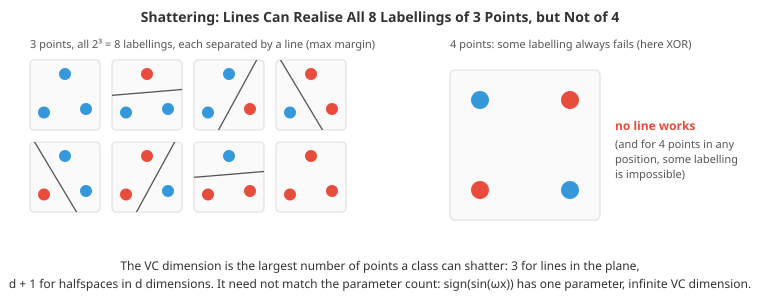

# Learning Theory

*Why should a model that fits its training data do well on data it has never seen? Learning theory answers that question with mathematics. This file covers the statistical learning setup, empirical risk minimisation and the approximation-estimation trade-off, concentration inequalities, PAC learning, VC dimension, Rademacher complexity and margins, the no-free-lunch theorem, stability and PAC-Bayes bounds, online learning and regret, and what theory does and does not explain about modern deep learning*

- Everything else in this chapter takes generalisation on trust: fit on training data, check on validation data, hope the two agree. Learning theory makes the hope precise. It says *when* and *by how much* training performance can be trusted, how much data a model class needs, and why restricting a model's flexibility helps. Its classical answers are clean and illuminating; its encounter with deep learning, where models with far more parameters than data points generalise well, has been one of the most interesting puzzles in the field.

- This file is more mathematical than its neighbours, but every result is checked numerically in the coding tasks, and the ideas (capacity, union bounds, margins, implicit regularisation) are useful intuitions even for purely practical work.

## The Setup

- Data points $(x, y)$ are drawn independently from an unknown distribution $\mathcal{D}$. A **hypothesis** $h$ maps inputs to predictions, and a **hypothesis class** $\mathcal{H}$ is the set of hypotheses the learner can choose from (all linear classifiers, all trees of depth 5, all networks of a given architecture). A loss $\ell(h(x), y)$, assumed here to lie in $[0, 1]$ (0-1 loss for classification), measures each mistake.

- The quantity we care about is the **true risk**, the expected loss on new data, and the quantity we can compute is the **empirical risk** on the $n$ training points:

$$R(h) = \mathbb{E}_{(x, y) \sim \mathcal{D}}\big[\ell(h(x), y)\big], \qquad \hat{R}_n(h) = \frac{1}{n}\sum_{i=1}^n \ell(h(x_i), y_i)$$

- **Empirical risk minimisation (ERM)** picks $\hat{h} = \arg\min_{h \in \mathcal{H}} \hat{R}_n(h)$. The **generalisation gap** $R(\hat{h}) - \hat{R}_n(\hat{h})$ is what theory tries to bound.

- The excess risk of ERM over the best possible predictor (the **Bayes risk** $R^*$) splits in two:

$$R(\hat{h}) - R^* = \underbrace{\Big(R(\hat{h}) - \min_{h \in \mathcal{H}} R(h)\Big)}_{\text{estimation error}} + \underbrace{\Big(\min_{h \in \mathcal{H}} R(h) - R^*\Big)}_{\text{approximation error}}$$

- A richer class lowers the approximation error (it contains better functions) but raises the estimation error (with finite data, it is harder to find the best one, and easier to be fooled by noise). This **bias-complexity trade-off** is the theoretical form of the bias-variance trade-off from file 02, and in practice there is a third term, **optimisation error**, when the learner does not actually find the empirical minimiser.

## Concentration: One Hypothesis

- For a single hypothesis fixed *before* seeing the data, $\hat{R}_n(h)$ is an average of $n$ independent bounded losses, so it concentrates around its mean $R(h)$. **Hoeffding's inequality** quantifies how fast:

$$P\big(|\hat{R}_n(h) - R(h)| \ge \epsilon\big) \le 2 e^{-2n\epsilon^2}$$

- Setting the right side to $\delta$ and solving: with probability at least $1 - \delta$, $|\hat{R}_n(h) - R(h)| \le \sqrt{\ln(2/\delta) / (2n)}$. With 1,000 test examples and $\delta = 0.05$, that is about 0.043. This is why a held-out test set gives an honest estimate: the model was fixed before the test data were looked at.

## Finite Classes and PAC Learning

- The catch is that ERM chooses $\hat{h}$ *after* looking at the training data, which breaks the "fixed in advance" condition. The fix is to demand the bound for every hypothesis at once. By the **union bound** (the probability that any of several bad events happens is at most the sum of their probabilities), for a finite class, with probability at least $1 - \delta$:

$$R(h) \le \hat{R}_n(h) + \sqrt{\frac{\ln |\mathcal{H}| + \ln(2/\delta)}{2n}} \quad \text{for every } h \in \mathcal{H}$$

- The price of choosing among $|\mathcal{H}|$ hypotheses is only logarithmic: doubling the class size adds $\ln 2$ to the numerator. The first coding task checks both Hoeffding and the union bound by simulation, and shows that ERM's training error is (slightly) optimistic, exactly the winner's-curse effect seen in the evaluation file.

- **PAC learning** (probably approximately correct; Valiant, 1984) formalises "learnable". A class is PAC-learnable if, for any accuracy $\epsilon$ and confidence $\delta$, some algorithm using a number of samples polynomial in $1/\epsilon$ and $1/\delta$ outputs, with probability at least $1 - \delta$ ("probably"), a hypothesis with risk within $\epsilon$ of the best in the class ("approximately correct"). In the **realisable** case (some $h \in \mathcal{H}$ has zero risk), a finite class needs only:

$$n \ge \frac{1}{\epsilon}\left(\ln |\mathcal{H}| + \ln \frac{1}{\delta}\right)$$

- samples, a rate of $1/\epsilon$ rather than the $1/\epsilon^2$ of the general (**agnostic**) case, because without noise every mistake on the training set is informative.

## Infinite Classes: VC Dimension

- Linear classifiers form an infinite class, yet they clearly generalise. Counting hypotheses is the wrong measure; what matters is how many *different labellings* of the data the class can produce. Many of the uncountably many lines in the plane make identical predictions on a given finite dataset.

- A class **shatters** a set of $n$ points if it can realise all $2^n$ labellings of them. The **VC dimension** (Vapnik and Chervonenkis) is the size of the largest set it can shatter.
  - Thresholds on a line, $h(x) = [x > t]$: VC dimension 1.
  - Intervals on a line: 2.
  - Halfspaces (linear classifiers) in $\mathbb{R}^d$: $d + 1$. In the plane, any 3 points in general position can be shattered, but no 4 points can, as the second coding task verifies with a linear program for every labelling.
  - Axis-aligned rectangles in the plane: 4.
  - The VC dimension need not match the number of parameters: $\text{sign}(\sin(\omega x))$ has one parameter and infinite VC dimension.



- The **Sauer-Shelah lemma** says that a class of VC dimension $d$ can produce at most $\sum_{i=0}^{d}\binom{n}{i} \le (en/d)^d$ labellings of $n$ points: polynomial in $n$, not $2^n$. Plugging that in where $|\mathcal{H}|$ appeared gives the **VC bound**: with probability at least $1 - \delta$, for every $h \in \mathcal{H}$,

$$R(h) \le \hat{R}_n(h) + O\left(\sqrt{\frac{d \log(n/d) + \log(1/\delta)}{n}}\right)$$

- The **fundamental theorem of statistical learning** says that, for binary classification, a class is PAC-learnable exactly when its VC dimension is finite, and the sample complexity scales with $d$. This is the precise sense in which capacity, not size, governs generalisation.

## Rademacher Complexity and Margins

- VC bounds depend only on the class, not on the data distribution, and are often loose. **Rademacher complexity** measures capacity on the actual data: how well can the class correlate with pure random noise? With $\sigma_i$ independent random signs ($\pm 1$ with equal probability):

$$\hat{\mathfrak{R}}_n(\mathcal{H}) = \mathbb{E}_\sigma\left[\sup_{h \in \mathcal{H}} \frac{1}{n}\sum_{i=1}^n \sigma_i\, h(x_i)\right]$$

- A class that can fit any random labelling has complexity near 1; a class that cannot fit noise has complexity near 0. For losses in $[0, 1]$, with probability at least $1 - \delta$, every hypothesis satisfies (up to the standard technicalities about applying it to the loss class):

$$R(h) \le \hat{R}_n(h) + 2\,\hat{\mathfrak{R}}_n(\mathcal{H}) + O\left(\sqrt{\frac{\log(1/\delta)}{n}}\right)$$

- For linear functions with bounded weights, $\|w\| \le B$, on inputs with $\|x\| \le R$, the complexity is at most $BR/\sqrt{n}$, **independent of the dimension**. The third coding task estimates it by Monte Carlo and finds it tracking that bound closely, while a lookup table that can memorise anything sits at 1 for every $n$.

- This dimension-free result explains two things. **Weight decay** (L2 regularisation) works by limiting $B$. And **margins** matter: if a classifier separates the data with margin $\gamma$ (every point at distance at least $\gamma$ from the boundary), rescaling to normalise the margin gives a bound depending on $R / (\gamma \sqrt{n})$, with no dependence on the number of features. That is the theory behind support vector machines (file 01): maximising the margin minimises a generalisation bound, which is why SVMs with kernels can work in effectively infinite-dimensional feature spaces.

## No Free Lunch

- The **no-free-lunch theorem** (Wolpert, 1996, and related results) says that, averaged over *all possible* target functions, every learning algorithm has the same expected performance on unseen points. A learner that does well on some problems must do badly on others.

- The lesson is not despair but **inductive bias**: learning is only possible because we assume something about the problem (smoothness, linearity, locality, translation invariance, sparsity, compositional structure). Choosing a model class, an architecture, a kernel or a regulariser is choosing an inductive bias. CNNs (chapter 08) work on images because their bias (locality and translation equivariance) matches how images are structured, and graph networks (chapter 12) work on molecules for the same reason.

## Other Routes to Generalisation

- **Algorithmic stability** (Bousquet and Elisseeff, 2002) bounds the generalisation gap of a *learning algorithm* rather than a class: if replacing one training point changes the learned model's loss on any input by at most $\beta$, the expected gap is at most about $\beta$. Ridge regression with penalty $\lambda$ is stable with $\beta = O(1/(\lambda n))$, a direct way to see regularisation reducing overfitting. SGD run for a limited number of steps is also stable, which connects early stopping to generalisation.

- **PAC-Bayes bounds** (McAllester, 1999) bound the risk of a *distribution* $Q$ over hypotheses (a posterior, or a network with noisy weights) in terms of its divergence from a prior $P$ chosen before seeing the data, roughly:

$$\mathbb{E}_{h \sim Q}[R(h)] \le \mathbb{E}_{h \sim Q}[\hat{R}_n(h)] + O\left(\sqrt{\frac{\text{KL}(Q \,\|\, P) + \log(n/\delta)}{n}}\right)$$

- A posterior that stays close to the prior (small KL) cannot have overfitted much. Solutions that tolerate a lot of weight noise (flat minima) admit a broad $Q$ with small KL, which gives one formal meaning to the intuition that flat minima generalise. PAC-Bayes bounds were among the first to give **non-vacuous** guarantees for real neural networks (Dziugaite and Roy, 2017).

- **Compression bounds**: if a model can be described with few bits (after pruning or quantisation, chapter 17), it generalises like a small finite class. Occam's razor, in its formal version.

## Online Learning and Regret

- Statistical learning assumes data are independent draws from a fixed distribution. **Online learning** drops even that: data arrive one at a time, possibly chosen by an adversary, and the learner predicts before seeing each label. Performance is measured by **regret**, the learner's cumulative loss minus that of the best fixed expert (or hypothesis) in hindsight.

- The **Hedge** or multiplicative weights algorithm keeps a weight for each of $N$ experts, predicts with the weighted average, and multiplies each expert's weight by $e^{-\eta \cdot \text{loss}}$ after every round. With a suitable $\eta$, its regret after $T$ rounds is at most $\sqrt{(T/2)\ln N}$, so the *average* regret per round goes to zero, with no assumption about where the data come from. The same family of ideas underlies boosting (file 06 here), bandit algorithms (file 04), and online convex optimisation, which gives regret-based analyses of SGD and Adam.

## Theory Meets Deep Learning

- Modern networks have millions or billions of parameters, trained on fewer examples, and yet generalise. Classical theory struggles to explain this.

- **Networks can fit random labels.** Zhang et al. (2017) trained standard image classifiers on CIFAR-10 with the labels randomly shuffled: the networks reached zero training error, with test accuracy at chance. The same architecture, trained on true labels, generalises well. So the class is rich enough to shatter the training set, and any bound that depends only on the class (VC dimension, worst-case Rademacher complexity) must be vacuous. The fifth coding task reproduces this with an over-parameterised random-features model. Whatever explains generalisation must depend on the data and on the training algorithm, not just the architecture.

- **Implicit regularisation.** When many parameter settings fit the training data perfectly, the optimiser chooses among them. For an over-parameterised linear least-squares problem, gradient descent started at zero converges to the **minimum-norm** interpolating solution, because every update lies in the span of the training inputs. Nothing in the loss asks for a small norm; the algorithm provides it. In the fifth coding task the descent solution matches the minimum-norm solution to machine precision and generalises far better than another, equally perfect, interpolator. For classification with logistic loss on separable data, gradient descent converges in direction to the maximum-margin solution (Soudry et al., 2018). Similar implicit biases are believed to operate in deep networks, though they are much harder to characterise.

- **Double descent.** Classical theory predicts a U-shaped test error curve as model size grows. Belkin et al. (2019) and Nakkiran et al. (2019) showed that in many settings test error rises to a peak where the model is *just* able to interpolate the training data (parameters ≈ data points, where the solution is forced to be wild, with huge weights), then **falls again** as the model grows further and the minimum-norm interpolant becomes smoother. The fourth coding task reproduces the full curve with random-feature regression. Regularisation and early stopping largely remove the peak.

- **Benign overfitting.** In high dimensions, a model can interpolate noisy training data and still predict nearly optimally, because the noise is absorbed by many weak directions that do not affect predictions much (Bartlett et al., 2020). Fitting noise is not automatically harmful.

- **Other threads**: the **neural tangent kernel** describes very wide networks as kernel methods (and connects to the Gaussian-process limit in the uncertainty file), but real networks learn features in ways the kernel limit misses; **flat versus sharp minima** links generalisation to the geometry of the loss surface (with the caveat that sharpness depends on parameterisation); **grokking** shows networks suddenly generalising long after fitting the training data; and **scaling laws** (file 05) describe test loss falling as a power law in data, parameters and compute, an empirical regularity that theory is still catching up with.

- The honest summary: classical theory explains *why* restricting capacity helps and *how* sample size controls the gap, and its tools (concentration, union bounds, capacity measures, margins, stability) remain the language of the field. A complete theory of why large networks generalise does not yet exist.

## Coding Tasks (use CoLab or notebook)

1. Check Hoeffding's inequality for one fixed hypothesis and the union bound for a class of 100 threshold classifiers by simulation, and measure how optimistic the empirical risk minimiser's training error is.
```python
import numpy as np

# Data: x ~ Uniform(0, 1), label y = 1 if x > 0.6, with 10% label noise.
# Hypothesis class: 100 threshold classifiers h_t(x) = [x > t], t on a grid.
rng = np.random.default_rng(0)
thresholds = np.linspace(0, 1, 100)
def true_risk(t, noise=0.1):
    disagree = abs(t - 0.6)                              # mass of x where h_t and the truth disagree
    return noise + (1 - 2 * noise) * disagree
R = true_risk(thresholds)

n, delta, trials = 200, 0.05, 2000
single_gap, max_gap, erm_gap = [], [], []
for _ in range(trials):
    x = rng.uniform(size=n)
    y = (x > 0.6) ^ (rng.uniform(size=n) < 0.1)
    R_hat = np.array([np.mean((x > t) != y) for t in thresholds])
    single_gap.append(abs(R_hat[30] - R[30]))           # one hypothesis fixed in advance
    max_gap.append(np.max(np.abs(R_hat - R)))           # worst case over the whole class
    best = np.argmin(R_hat)                             # empirical risk minimiser
    erm_gap.append(R[best] - R_hat[best])

hoeffding = np.sqrt(np.log(2 / delta) / (2 * n))
union = np.sqrt((np.log(len(thresholds)) + np.log(2 / delta)) / (2 * n))
print(f"n = {n}, delta = {delta}")
print(f"one fixed hypothesis: 95th percentile of |R_hat - R| = {np.quantile(single_gap, 0.95):.3f}   "
      f"Hoeffding bound {hoeffding:.3f}")
print(f"worst over 100:       95th percentile of max |R_hat - R| = {np.quantile(max_gap, 0.95):.3f}   "
      f"union bound {union:.3f}")
print(f"the ERM's optimism R - R_hat: mean {np.mean(erm_gap):+.3f}  (its training error is too good; "
      "small here because the class is simple)")
print("\nBoth bounds hold. The union bound is loose because the 100 thresholds are highly correlated: neighbouring"
      "\nthresholds make almost the same predictions. VC dimension and Rademacher complexity capture that.")
```

2. VC dimension by experiment: test with a linear program whether lines can realise every labelling of 3 and of 4 points in the plane, and confirm that halfspaces in $d$ dimensions shatter $d + 1$ points but not $d + 2$.
```python
import numpy as np
from itertools import product
from scipy.optimize import linprog

def linearly_separable(X, y):
    """Is there (w, b) with y_i (w . x_i + b) >= 1 for all i?  A linear-programming feasibility check."""
    d = X.shape[1]
    A_ub = -(y[:, None] * np.c_[X, np.ones(len(X))])        # -y_i [x_i, 1] . [w, b] <= -1
    res = linprog(np.zeros(d + 1), A_ub=A_ub, b_ub=-np.ones(len(X)), bounds=[(None, None)] * (d + 1))
    return res.status == 0

def shattered(X):
    """Can the class realise every one of the 2^n labellings of these points?"""
    return all(linearly_separable(X, np.array(lab)) for lab in product([-1, 1], repeat=len(X)))

rng = np.random.default_rng(0)
for n_points in [3, 4]:
    configs = [rng.normal(size=(n_points, 2)) for _ in range(200)]
    count = sum(shattered(X) for X in configs)
    print(f"{n_points} random points in the plane: shattered by lines in {count} of 200 configurations")

# Why 4 points fail: some labelling is always impossible, e.g. XOR on a square, or a point inside a triangle
square = np.array([[0, 0], [1, 1], [0, 1], [1, 0]], float)
print("\nXOR labelling of a square separable?", linearly_separable(square, np.array([1, 1, -1, -1])))
print("So the VC dimension of lines (halfspaces) in 2D is 3 = d + 1.")

# In d dimensions, halfspaces shatter d + 1 points in general position but never d + 2
for d in [3, 4]:
    X = rng.normal(size=(d + 1, d))
    Y = rng.normal(size=(d + 2, d))
    print(f"d = {d}: {d + 1} points shattered: {shattered(X)};  {d + 2} points shattered: {shattered(Y)}")
```

3. Estimate Rademacher complexity by Monte Carlo for bounded linear functions, threshold classifiers and a memoriser, and compare with the $BR/\sqrt{n}$ bound.
```python
import numpy as np
import matplotlib.pyplot as plt

# Empirical Rademacher complexity:  E_sigma[ sup_h (1/n) sum_i sigma_i h(x_i) ]
# = how well the class can correlate with random +-1 noise on these inputs.
rng = np.random.default_rng(1)

def rad_linear(X, B, draws=500):
    """Linear functions with ||w|| <= B: the sup has a closed form, B * ||sum sigma_i x_i|| / n."""
    n = len(X)
    sig = rng.choice([-1, 1], size=(draws, n))
    return np.mean(B * np.linalg.norm(sig @ X, axis=1) / n)

def rad_thresholds(x, draws=500):
    """Threshold classifiers h(x) = s * sign(x - t), s = +-1: brute force over all distinct cuts."""
    n = len(x); order = np.argsort(x)
    vals = []
    for _ in range(draws):
        s = rng.choice([-1, 1], size=n)[order]
        # predicting -1 left of the cut and +1 right of it: correlation = (sum right - sum left) / n
        right = np.r_[s.sum(), s.sum() - np.cumsum(s)]
        left = s.sum() - right
        vals.append(np.max(np.abs(right - left)) / n)
    return np.mean(vals)

def rad_memoriser(n, draws=500):
    """A class that can output any labelling (a lookup table): sup = 1 always."""
    return 1.0

ns = [25, 50, 100, 200, 400, 800, 1600]
lin, thr = [], []
for n in ns:
    X = rng.normal(size=(n, 5)); X /= np.linalg.norm(X, axis=1, keepdims=True)   # ||x|| = 1
    lin.append(rad_linear(X, B=1.0)); thr.append(rad_thresholds(rng.uniform(size=n)))
print(" n    | linear, ||w||<=1 | bound B*R/sqrt(n) | thresholds | memoriser")
for n, a, b in zip(ns, lin, thr):
    print(f"{n:5d} | {a:16.3f} | {1 / np.sqrt(n):17.3f} | {b:10.3f} | {rad_memoriser(n):.0f}")

plt.figure(figsize=(7, 4))
plt.loglog(ns, lin, 'o-', label="linear, ||w|| <= 1")
plt.loglog(ns, thr, 's-', label="thresholds on a line")
plt.loglog(ns, 1 / np.sqrt(np.array(ns)), 'k--', label="1 / sqrt(n)")
plt.loglog(ns, [1] * len(ns), 'r:', label="memoriser")
plt.xlabel("n"); plt.ylabel("Rademacher complexity"); plt.legend(); plt.show()
print("\nConstrained classes can fit noise less and less as n grows (about 1/sqrt(n)); a memoriser fits it"
      "\nperfectly at every n, so its training error says nothing about its test error.")
```

4. Double descent with random-features regression: sweep the number of features through the number of training points and watch the test error rise, spike and fall again, along with the norm of the solution.
```python
import numpy as np
import matplotlib.pyplot as plt

# Random-features regression: fixed random ReLU features, only the output weights are learned.
# With p features and n = 100 training points, fit the minimum-norm least-squares solution.
rng = np.random.default_rng(2)
n, d, n_test = 100, 10, 2000
w_true = rng.normal(size=d) / np.sqrt(d)
target = lambda X: np.tanh(X @ w_true * 2) + 0.5 * np.sin(X[:, 0])

def run(p, seed):
    r = np.random.default_rng(seed)
    X, Xt = r.normal(size=(n, d)), r.normal(size=(n_test, d))
    y = target(X) + r.normal(0, 0.3, n)
    W = r.normal(size=(d, p)) / np.sqrt(d)
    F, Ft = np.maximum(X @ W, 0), np.maximum(Xt @ W, 0)
    beta = np.linalg.pinv(F) @ y                  # least squares if p < n, minimum-norm interpolation if p > n
    return np.mean((F @ beta - y) ** 2), np.mean((Ft @ beta - target(Xt)) ** 2), np.linalg.norm(beta)

ps = [10, 20, 40, 60, 80, 90, 95, 100, 105, 110, 120, 150, 200, 400, 800, 2000]
res = np.array([[run(p, s) for s in range(20)] for p in ps]).mean(1)
print("   p  | train MSE | test MSE | ||beta||")
for p, (tr, te, nb) in zip(ps, res):
    print(f"{p:5d} | {tr:9.3f} | {te:8.3f} | {nb:8.1f}" + ("   <- p = n: interpolation threshold" if p == n else ""))

plt.figure(figsize=(8, 4.5))
plt.semilogx(ps, res[:, 1], 'o-', color='#e74c3c', label="test error")
plt.semilogx(ps, res[:, 0], 's-', color='#3498db', label="training error")
plt.axvline(n, color='k', linestyle=':', label="p = n")
plt.yscale('log'); plt.xlabel("number of random features p"); plt.legend()
plt.title("Double descent"); plt.show()
print("\nClassical U-curve up to p = n, a spike where the model can only just interpolate (huge weights),"
      "\nthen test error falls again as p grows: among all interpolating solutions the minimum-norm one gets"
      "\nsmoother as more features are available. Here the second descent approaches, but does not beat, the best"
      "\nsmall model; in other problems (and in large neural networks) it can go lower.")
```

5. An over-parameterised model fits random labels perfectly, and gradient descent from zero silently selects the minimum-norm interpolating solution, which generalises far better than another perfect fit.
```python
import numpy as np

# Part 1 (after Zhang et al., 2017): an over-parameterised model fits random labels perfectly.
rng = np.random.default_rng(3)
n, d, p = 200, 20, 1000
X, Xt = rng.normal(size=(n, d)), rng.normal(size=(2000, d))
w = rng.normal(size=d)
y_true, yt = np.sign(X @ w), np.sign(Xt @ w)
y_random = rng.choice([-1.0, 1.0], n)
W = rng.normal(size=(d, p)) / np.sqrt(d)
feats = lambda A: np.maximum(A @ W, 0)
F, Ft = feats(X), feats(Xt)
for name, y in [("true labels", y_true), ("random labels", y_random)]:
    beta = np.linalg.pinv(F) @ y                         # minimum-norm interpolating solution
    train_acc = np.mean(np.sign(F @ beta) == y)
    test_acc = np.mean(np.sign(Ft @ beta) == (yt if name == "true labels" else rng.choice([-1, 1], 2000)))
    print(f"{name:13s}: train accuracy {train_acc:.2f}, test accuracy {test_acc:.2f}, ||beta|| = {np.linalg.norm(beta):.1f}")
print("Same model class, same training accuracy, completely different generalisation: a bound that depends only"
      "\non the class (VC dimension, uniform convergence) cannot tell these apart. Fitting noise needs a larger"
      "\nweight norm, which is why norm- and margin-based measures do better.")

# Part 2: implicit regularisation. Gradient descent from zero on an underdetermined least-squares
# problem only ever adds multiples of rows of F, so it never leaves their span and converges to the
# minimum-norm solution. Heavy-ball momentum (file 02) keeps that property and converges much faster.
sv = np.linalg.svd(F, compute_uv=False)
L, mu = sv[0] ** 2, sv[-1] ** 2                            # curvature range of the loss inside that span
lr = 4 / (np.sqrt(L) + np.sqrt(mu)) ** 2
momentum = ((np.sqrt(L) - np.sqrt(mu)) / (np.sqrt(L) + np.sqrt(mu))) ** 2
beta_gd, velocity = np.zeros(p), np.zeros(p)
for _ in range(3000):
    velocity = momentum * velocity - lr * F.T @ (F @ beta_gd - y_true)
    beta_gd += velocity
F_pinv = np.linalg.pinv(F)
beta_min = F_pinv @ y_true
z = rng.normal(size=p) * 0.5
beta_other = beta_min + (z - F_pinv @ (F @ z))     # add a null-space component: still interpolates
print(f"\ntraining residual: GD {np.linalg.norm(F @ beta_gd - y_true):.1e}, "
      f"another interpolator {np.linalg.norm(F @ beta_other - y_true):.1e}")
print(f"distance from GD solution to the minimum-norm solution: {np.linalg.norm(beta_gd - beta_min):.1e}")
for name, b in [("GD from zero", beta_gd), ("another interpolator", beta_other)]:
    print(f"{name:21s} ||beta|| = {np.linalg.norm(b):6.2f}, test accuracy {np.mean(np.sign(Ft @ b) == yt):.3f}")
print("Nothing in the loss asks for a small norm; the optimiser chooses it. That implicit bias is part of why"
      "\nover-parameterised models trained by gradient descent generalise.")
```
