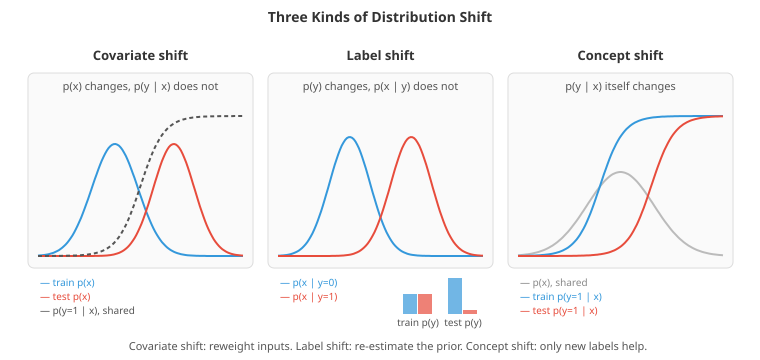

# Fairness, Robustness and Distribution Shift

*A model that scores well on its test set can still fail in the world: it can treat groups of people unequally, be fooled by tiny deliberate perturbations, or quietly degrade when the data drift away from what it was trained on. This file covers where bias comes from, the main fairness criteria and why they conflict, mitigation methods, adversarial examples and defences, poisoning and privacy attacks, the types of distribution shift, how to detect them, and how to adapt to them*

- The test set in a standard evaluation is drawn from the same distribution as the training data, scored with one aggregate metric, by a cooperative evaluator. Real deployment breaks all three assumptions. The population changes; the aggregate hides groups the model serves badly; and some users actively try to make the model fail. This file is about the three corresponding failure modes, which share one lesson: **an average accuracy number is not a safety guarantee**.

## Part 1: Fairness

### Where bias comes from

- Models learn patterns in data, and data record a world that contains inequality and a measurement process that contains errors. Bias enters at every stage:
    - **Historical bias**: the labels reflect past decisions that were themselves biased. A hiring model trained on who was hired learns who was *preferred*, not who was qualified.
    - **Representation bias**: some groups are underrepresented. The *Gender Shades* study (Buolamwini and Gebru, 2018) found commercial face-analysis systems had gender-classification error rates up to about 35% for darker-skinned women and under 1% for lighter-skinned men.
    - **Measurement bias**: the target is a proxy for what you care about, and the proxy is distorted differently for different groups. A widely used US healthcare algorithm predicted future health *costs* as a proxy for health *needs*; because less money was spent on Black patients with the same level of illness, it systematically underestimated their needs (Obermeyer et al., 2019).
    - **Aggregation bias**: one model for groups whose relationships differ (a medical marker whose normal range differs by ancestry).
    - **Deployment and feedback bias**: predictions change the world that generates future data. Predictive policing sends officers where past arrests happened, which produces more arrests there.

- **Fairness through unawareness**, simply deleting the protected attribute, does not work. Other features act as **proxies**: postcode, name, school, shopping patterns, even writing style. In the second coding task, removing the group column but keeping a correlated "neighbourhood" feature still leaves one group selected at 71% of the other's rate. Removing the attribute also makes it impossible to *measure* disparities, which is why fairness auditing usually needs the attribute even when the model must not use it.

### Fairness criteria

- Group fairness criteria compare statistics across groups defined by a protected attribute $A$ (with $\hat{Y}$ the decision and $Y$ the true outcome):
    - **Demographic (statistical) parity**: equal selection rates, $P(\hat{Y} = 1 \mid A = a)$ the same for all $a$. In US employment law, a selection-rate ratio below 0.8 (the "four-fifths rule") is a common flag for possible disparate impact.
    - **Equalised odds** (Hardt, Price and Srebro, 2016): equal true positive rates *and* equal false positive rates across groups, $P(\hat{Y} = 1 \mid Y = y, A = a)$ the same for all $a$ and each $y$.
    - **Equal opportunity**: equal true positive rates only (qualified people are equally likely to be selected in every group).
    - **Predictive parity**: equal precision, $P(Y = 1 \mid \hat{Y} = 1, A = a)$ the same for all $a$: a positive decision means the same thing in every group.
    - **Calibration within groups**: among people given score $s$, a fraction $s$ have the outcome, in every group.

- **Individual fairness** (Dwork et al., 2012) asks instead that similar individuals be treated similarly, which requires a defensible similarity metric. **Counterfactual fairness** (Kusner et al., 2017) asks whether the decision would change had the person's protected attribute been different, holding everything not caused by it fixed, a criterion that needs a causal model (see the causal inference file).

### The impossibility results

- These criteria cannot all hold at once. When the base rate of the outcome differs between groups, no classifier (other than a perfect one) can be **calibrated within groups** and also have **equal false positive and false negative rates** across them (Kleinberg, Mullainathan and Raghavan, 2016; Chouldechova, 2017). The proof is a short identity linking a group's base rate, its error rates and its precision: fix two of them and the third is determined.

- This was the core of the debate over the COMPAS recidivism tool in 2016: one side showed that its false positive rate was higher for Black defendants; the other showed that its scores were equally calibrated across races. Both were right, and the mathematics says both cannot be fixed simultaneously. The first coding task reproduces the dilemma: a perfectly calibrated score with one threshold gives one group a five times higher false positive rate, and group-specific thresholds that equalise true positive rates break precision parity instead.

- So choosing a fairness criterion is a **value judgement** about which errors matter most, for whom, in this context. It belongs to stakeholders, domain experts and the law, not to the modeller alone. Laws also differ: some jurisdictions prohibit using the protected attribute in the decision (disparate treatment) even when doing so would reduce disparate impact.

### Mitigation

- Three families of method, by where they intervene:
    - **Pre-processing**: change the data. **Reweighing** (Kamiran and Calders, 2012) gives each (group, label) combination a weight so that group and label become independent in the weighted data; resampling and relabelling do the same more crudely. Collecting better data for underrepresented groups is often the most effective intervention of all.
    - **In-processing**: change the training objective. Add a fairness constraint or penalty (Fairlearn's reductions approach turns constrained learning into a sequence of weighted classification problems), or use **adversarial debiasing**: train the predictor while an adversary tries to predict the protected attribute from its output, and penalise the predictor when the adversary succeeds.
    - **Post-processing**: change the decisions. Choose group-specific thresholds on an existing score to satisfy equal opportunity or equalised odds (Hardt et al., 2016). Simple and model-agnostic, but it requires the protected attribute at decision time, which may be illegal in some settings.

- Mitigation usually costs some accuracy *measured against the historical labels*, as the trade-off curve in the second coding task shows. When those labels encode past bias, that cost may be partly illusory: the "accuracy" being lost is accuracy at reproducing biased decisions.

### Auditing in practice

- Evaluate on slices: per group and, importantly, per **intersection** of groups (a model can look fine for women and for an ethnic group while failing for women of that group).
- Report uncertainty: small groups give noisy metrics, so use confidence intervals (see the evaluation file).
- Document: **model cards** (Mitchell et al., 2019) record intended use, evaluation across groups and known limitations; **datasheets for datasets** (Gebru et al., 2021) record how data were collected and what they do not represent.
- Monitor after deployment, because the population, and therefore the disparities, change.

## Part 2: Adversarial Robustness

### Adversarial examples

- Szegedy et al. (2014) found that adding a carefully chosen perturbation, invisible to people, to an image could make a state-of-the-art classifier assign the wrong class with high confidence. These **adversarial examples** exist for essentially every kind of model and data: images, audio (a hidden command in music), text (a synonym swap), malware features, and tabular inputs.

- The **fast gradient sign method (FGSM)** (Goodfellow, Shlens and Szegedy, 2015) creates one in a single step, moving every input feature by $\epsilon$ in the direction that increases the loss:

$$x_{\text{adv}} = x + \epsilon \cdot \text{sign}\big(\nabla_x \mathcal{L}(f(x), y)\big)$$

- Their explanation of why this works is the **linearity hypothesis**. For a linear score $w^\top x$, an $\epsilon$ change in every feature (an $L_\infty$ perturbation) changes the score by up to $\epsilon \|w\|_1$, which grows with the number of features. A perturbation too small to notice in any single pixel adds up across a million pixels. Deep networks are built from pieces that behave fairly linearly, so they inherit the problem. The third coding task shows this directly: the same per-feature budget is harmless with 10 features and drives accuracy to zero with 1,000.

- **Projected gradient descent (PGD)** (Madry et al., 2018) is the standard strong attack: take many small signed-gradient steps, projecting back into the allowed $\epsilon$-ball after each. Other threat models include $L_2$ and $L_0$ (few pixels) budgets, **black-box** attacks that only query outputs or exploit **transferability** (adversarial examples crafted on one model often fool another), and **physical** attacks: stickers on a stop sign that make it read as a speed limit sign, or a 3D-printed turtle classified as a rifle from most angles.

- A complementary view (Ilyas et al., 2019) is that adversarial examples exploit **non-robust features**: patterns that genuinely predict the label in the data but are imperceptible to humans and easy to flip. The model is not malfunctioning; it is using information humans ignore.

### Defences

- **Adversarial training** trains on worst-case inputs, solving a min-max problem:

$$\min_\theta\; \mathbb{E}_{(x, y)}\left[\max_{\|\delta\| \le \epsilon} \mathcal{L}(f_\theta(x + \delta), y)\right]$$

- The inner maximisation is approximated by PGD at every training step, which makes training several times more expensive. It remains the most reliable empirical defence. It typically lowers clean accuracy, an observed **robustness-accuracy trade-off**: in the third coding task, adversarial training raises accuracy under attack from 0.23 to 0.75 and lowers clean accuracy from 0.95 to 0.89, by shifting the model's weight from many weak features (which a small perturbation can overturn) onto a few strong ones.

- **Certified defences** give provable guarantees that no perturbation within the budget changes the prediction. **Randomised smoothing** (Cohen, Rosenfeld and Kolter, 2019) classifies by majority vote over Gaussian-noised copies of the input and certifies an $L_2$ radius from the vote margin; interval bound propagation and related methods certify small networks directly.

- **Beware of false robustness.** Many proposed defences worked only by making gradients uninformative (**gradient masking** or obfuscation), not by making the model robust; adaptive attacks designed for each defence broke most of them (Athalye, Carlini and Wagner, 2018). A defence should be evaluated with attacks designed against it, and an accuracy that does not decrease as the budget grows is a warning sign.

### Poisoning, backdoors and privacy

- **Data poisoning** attacks the training data instead of the test input. A **backdoor** (BadNets, Gu et al., 2017) implants a trigger: images containing a small yellow square are classified as the attacker's chosen label, while normal accuracy stays intact, so ordinary evaluation never notices. Models trained on scraped web data, or fine-tuned from untrusted checkpoints, are exposed to this.

- **Privacy attacks** extract information about the training data. **Membership inference** (Shokri et al., 2017) decides whether a specific record was in the training set, typically because models are more confident on examples they have seen. Large language models can regurgitate memorised training text, including personal data (Carlini et al., 2021). **Differential privacy** gives the formal defence: **DP-SGD** (Abadi et al., 2016) clips each example's gradient and adds calibrated noise, guaranteeing that no single example changes the trained model's distribution much, at a cost in accuracy.

- Language models add their own attack surface: **jailbreaks** that elicit prohibited behaviour, and **prompt injection**, where instructions hidden in retrieved documents or web pages hijack a model that uses tools. These are adversarial examples in natural language, and as with images, filtering inputs is not a complete defence.

## Part 3: Distribution Shift

### Types of shift

- Training and deployment data almost never come from exactly the same distribution. Writing the joint distribution two ways, $p(x, y) = p(x)\,p(y \mid x) = p(y)\,p(x \mid y)$, gives a useful taxonomy:
    - **Covariate shift**: $p(x)$ changes, $p(y \mid x)$ does not. A medical model trained on one hospital's patient mix is used where patients are older. The relationship is the same, but the model now operates in regions it saw rarely.
    - **Label (prior) shift**: $p(y)$ changes, $p(x \mid y)$ does not. A disease's prevalence rises during an outbreak; the symptoms of a sick person look the same.
    - **Concept shift**: $p(y \mid x)$ itself changes. What counts as spam evolves; fraudsters change tactics in response to the detector; customer preferences change after a price rise.



- Real shifts mix these, and others are named by their cause: **subpopulation shift** (the proportions of known subgroups change), **domain shift** (new sensors, new hospitals, new countries), and **temporal drift** (gradual change over time). Benchmarks such as WILDS (Koh et al., 2021) collect realistic examples, and even re-collecting a test set by following the original ImageNet procedure cost leading models 11-14 points of accuracy (Recht et al., 2019).

### Detecting shift

- **Monitor inputs.** Compare each feature's recent distribution with its training distribution: two-sample tests (Kolmogorov-Smirnov for one feature, maximum mean discrepancy for many), or the **population stability index** common in credit scoring (rules of thumb treat values above about 0.1 as a moderate shift and above 0.25 as a major one).

- **Adversarial validation.** Train a classifier to distinguish training inputs from recent production inputs. An AUC near 0.5 means no detectable shift; an AUC well above 0.5 means a shift, and the classifier's feature importances say where. The fourth coding task does this, and finds an AUC of 0.90.

- **Monitor outputs and performance.** The distribution of predicted scores, the rate of each predicted class, and, when labels arrive (often with a delay), the actual metrics, overall and per slice. Prediction-distribution monitoring catches problems before labels exist.

- **Out-of-distribution (OOD) detection** flags individual inputs unlike anything seen in training. The simplest baseline uses the classifier's **maximum softmax probability** (Hendrycks and Gimpel, 2017): low confidence suggests an unfamiliar input. Better scores include the **energy** of the logits, Mahalanobis distance in a network's feature space, and the anomaly detectors in the clustering and anomaly file. Overconfidence (see the uncertainty file) limits all confidence-based detectors: networks can be highly confident on inputs they have never seen anything like.

### Adapting to shift

- **Covariate shift: importance weighting.** If $p(y \mid x)$ is unchanged, training on data weighted by $w(x) = p_{\text{test}}(x) / p_{\text{train}}(x)$ makes the training loss an unbiased estimate of the test loss (Shimodaira, 2000). The density ratio does not need densities: a classifier distinguishing test from training inputs gives it through its odds, $w(x) \propto P(\text{test} \mid x) / P(\text{train} \mid x)$. In the fourth coding task, weighting cuts a misspecified model's deployment error from 0.69 to 0.16, matching a model fitted directly on deployment data. Two cautions: weighting matters mostly when the model is **misspecified** (a flexible model that is right everywhere gains little), and large weights reduce the effective sample size (to about 400 of 2,000 in the task), so clip them.

- **Label shift: re-estimate the prior.** If $p(x \mid y)$ is unchanged, a calibrated classifier's probabilities can be corrected with Bayes' rule, given the new class proportions, which can themselves be estimated from *unlabelled* deployment data: by the EM procedure of Saerens et al. (2002), or by black-box shift estimation (Lipton et al., 2018), which uses the classifier's confusion matrix. In the fifth coding task, a disease classifier developed on a balanced study grossly overstates risk where prevalence is 8%; re-estimating the prevalence from unlabelled data and adjusting cuts its log-loss by more than half without a single new label.

- **Domain adaptation** learns representations in which training and deployment inputs are indistinguishable. **Domain-adversarial training** (DANN, Ganin et al., 2016) adds a domain classifier on top of the features and trains the feature extractor to fool it, so that the features carry label information but not domain information. **Test-time adaptation** updates normalisation statistics or a small number of parameters on unlabelled test batches.

- **Concept shift** has no unsupervised fix, since the meaning of the inputs has changed. The answer is fresh labels and retraining: scheduled retraining, retraining triggered by monitoring, or continual learning (with care to avoid forgetting). Designing a system to collect labels after deployment (see chapter 18's discussion of feedback loops and delayed labels) is part of designing the model.

- Robustness to natural variation can also be built in: **data augmentation** (chapter 08), training on diverse sources, and **invariant** learning that favours features whose relationship to the label is stable across environments (the causal inference file).

## Coding Tasks (use CoLab or notebook)

1. The fairness impossibility in numbers. Two groups with different base rates are scored by a perfectly calibrated model. Compare selection rates, true and false positive rates, precision and calibration under one threshold, then under group-specific thresholds chosen for equal opportunity.
```python
import numpy as np

# Two groups with different base rates of the outcome (e.g. loan default 15% vs 30%).
# Each person has a true risk; the score IS that risk, so it is perfectly calibrated in both groups.
rng = np.random.default_rng(0)
n = 200000
group = rng.integers(0, 2, n)                               # 0 = A, 1 = B
risk = np.where(group == 0, rng.beta(1.5, 8.5, n), rng.beta(3, 7, n))   # mean 0.15 vs 0.30
y = (rng.uniform(size=n) < risk).astype(int)
score = risk

def report(pred, label):
    print(f"\n{label}")
    print(f"  {'group':6s} {'base rate':>9s} {'flagged':>8s} {'TPR':>6s} {'FPR':>6s} {'PPV':>6s} {'calib.':>7s}")
    for g, name in [(0, "A"), (1, "B")]:
        m = group == g
        tp = np.sum(pred[m] & (y[m] == 1)); fp = np.sum(pred[m] & (y[m] == 0))
        fn = np.sum(~pred[m] & (y[m] == 1)); tn = np.sum(~pred[m] & (y[m] == 0))
        band = m & (score > 0.25) & (score < 0.35)             # among people scored ~0.3, how many default?
        print(f"  {name:6s} {y[m].mean():9.3f} {pred[m].mean():8.3f} {tp / (tp + fn):6.3f} "
              f"{fp / (fp + tn):6.3f} {tp / (tp + fp):6.3f} {y[band].mean():7.3f}")

report(score > 0.3, "One threshold (0.3) on a calibrated score")
print("  -> calibrated in both groups (column 'calib.': ~0.30 for people scored ~0.30),"
      "\n     but group B has a much higher false positive rate and is flagged far more often.")

# Post-processing: group-specific thresholds chosen to equalise the true positive rate (equal opportunity)
target_tpr = 0.6
thr = {g: np.quantile(score[(group == g) & (y == 1)], 1 - target_tpr) for g in [0, 1]}
pred_eo = score > np.where(group == 0, thr[0], thr[1])
report(pred_eo, f"Group-specific thresholds ({thr[0]:.3f} for A, {thr[1]:.3f} for B) for equal TPR = {target_tpr}")
print("  -> equal TPR, but now FPR and PPV differ: the same score means different decisions by group.")
print("\nWith different base rates, no non-trivial classifier can be calibrated AND have equal FPR and FNR"
      "\nin both groups (Kleinberg et al. 2016; Chouldechova 2017). Choosing a fairness criterion is a value judgement.")
```

2. Fairness through unawareness fails: a model trained without the protected attribute but with a correlated proxy still reproduces the disparity in historically biased labels. Then trace the trade-off between the demographic parity gap and accuracy.
```python
import numpy as np
import matplotlib.pyplot as plt
from sklearn.linear_model import LogisticRegression
from sklearn.model_selection import train_test_split

# Historical hiring data. The label itself is biased: past decisions favoured group 0 at equal skill.
rng = np.random.default_rng(1)
n = 30000
group = rng.integers(0, 2, n)
skill = rng.normal(size=n)
neighbourhood = (rng.uniform(size=n) < np.where(group == 1, 0.8, 0.2)).astype(int)   # a proxy for group
experience = skill + rng.normal(0, 1, n)
hired = (rng.uniform(size=n) < 1 / (1 + np.exp(-(1.5 * skill - 1.0 * group)))).astype(int)

def selection_rates(X, label):
    Xtr, Xte, ytr, yte, gtr, gte = train_test_split(X, hired, group, test_size=0.3, random_state=0)
    p = LogisticRegression().fit(Xtr, ytr).predict_proba(Xte)[:, 1]
    pred = p > 0.5
    rates = [pred[gte == g].mean() for g in (0, 1)]
    print(f"{label:42s} selection rate A {rates[0]:.3f}, B {rates[1]:.3f}, ratio B/A {rates[1] / rates[0]:.2f}")
    return p, yte, gte

selection_rates(np.c_[experience, group], "with the group attribute")
selection_rates(np.c_[experience, neighbourhood], "without it, but with a correlated proxy")
p, yte, gte = selection_rates(np.c_[experience], "with neither (experience only)")
print("Dropping the protected attribute does not remove a disparity that a proxy can reconstruct.\n")

# Trading accuracy for demographic parity by shifting group B's threshold
p, yte, gte = selection_rates(np.c_[experience, neighbourhood], "proxy model again, for the trade-off curve")
gaps, accs = [], []
for shift in np.linspace(0, 0.3, 31):
    pred = p > np.where(gte == 1, 0.5 - shift, 0.5)
    gaps.append(abs(pred[gte == 0].mean() - pred[gte == 1].mean()))
    accs.append(np.mean(pred == yte))
plt.figure(figsize=(7, 4))
plt.plot(gaps, accs, 'o-', color='#3498db')
plt.xlabel("demographic parity gap |selection rate A - selection rate B|")
plt.ylabel("accuracy against historical labels"); plt.gca().invert_xaxis()
plt.title("Closing the gap costs accuracy, measured against biased labels"); plt.show()
print(f"accuracy {accs[0]:.3f} with gap {gaps[0]:.3f}  ->  accuracy {accs[int(np.argmin(gaps))]:.3f} "
      f"with gap {min(gaps):.3f}")
print("The 'cost' is measured against labels that encode past bias, so it may overstate the real cost.")
```

3. Adversarial examples for a linear classifier: watch accuracy under an FGSM attack collapse as the number of input dimensions grows, then use adversarial training and see where the robust model puts its weight.
```python
import numpy as np
import matplotlib.pyplot as plt

rng = np.random.default_rng(2)
sigmoid = lambda z: 1 / (1 + np.exp(-np.clip(z, -30, 30)))

def make(n, d, n_strong=5):
    """A few strongly predictive features plus many weak ones (each weak one carries a little signal)."""
    y = rng.choice([-1.0, 1.0], n)
    mu = np.full(d, 1.5 / np.sqrt(d)); mu[:n_strong] = 0.5
    X = y[:, None] * mu + rng.normal(size=(n, d))
    return X, y

def train(X, y, eps_adv=0.0, epochs=200, lr=0.5, l2=1e-3):
    w = np.zeros(X.shape[1]); b = 0.0
    for _ in range(epochs):
        Xa = X
        if eps_adv > 0:                                   # adversarial training: fit the worst-case inputs
            Xa = X - eps_adv * y[:, None] * np.sign(w)[None, :]
        m = y * (Xa @ w + b)
        g = -(y * sigmoid(-m))                             # gradient of log(1 + exp(-m)) w.r.t. the score
        w -= lr * (Xa.T @ g / len(y) + l2 * w); b -= lr * g.mean()
    return w, b

def fgsm(X, y, w, eps):
    """Fast gradient sign method. For a linear model it is the exact worst case under an L-infinity budget."""
    return X - eps * y[:, None] * np.sign(w)[None, :]

eps_grid = [0.0, 0.02, 0.05, 0.1, 0.2]
print("accuracy under an L-infinity perturbation of size eps (inputs have unit-variance noise)")
print("   d   | " + " | ".join(f"eps={e:<4}" for e in eps_grid))
for d in [10, 100, 1000]:
    X, y = make(4000, d); Xt, yt = make(4000, d)
    w, b = train(X, y)
    accs = [np.mean(np.sign(fgsm(Xt, yt, w, e) @ w + b) == yt) for e in eps_grid]
    print(f"{d:5d}  | " + " | ".join(f"{a:8.3f}" for a in accs))
print("The same tiny per-feature budget is harmless in 10 dimensions and devastating in 1000: the change in the"
      "\nscore is eps * ||w||_1, which grows with dimension. Linearity in high dimensions is enough.")

# Adversarial training on the 1000-dimensional problem
d = 1000
X, y = make(4000, d); Xt, yt = make(4000, d)
eps_train = 0.1
for label, w_b in [("standard training", train(X, y)), (f"adversarial training (eps={eps_train})", train(X, y, eps_train))]:
    w, b = w_b
    clean = np.mean(np.sign(Xt @ w + b) == yt)
    robust = np.mean(np.sign(fgsm(Xt, yt, w, eps_train) @ w + b) == yt)
    strong_share = np.abs(w[:5]).sum() / np.abs(w).sum()
    print(f"{label:34s} clean accuracy {clean:.3f}, under attack {robust:.3f}, "
          f"weight on the 5 strong features {strong_share:.0%}")
print("Robustness is bought with some clean accuracy: the robust model moves its weight onto the few strong"
      "\nfeatures, which a small perturbation cannot overturn, and away from the many weak ones it can.")
```

4. Covariate shift: detect it with a train-versus-deployment classifier, estimate importance weights from that classifier's odds, and correct a misspecified regression model.
```python
import numpy as np
import matplotlib.pyplot as plt
from sklearn.linear_model import LogisticRegression, LinearRegression
from sklearn.metrics import roc_auc_score

# Covariate shift: the input distribution moves, the relationship y | x stays the same.
rng = np.random.default_rng(3)
f = lambda x: np.sin(1.5 * x) + 0.3 * x
x_tr = rng.normal(0, 1, 2000); y_tr = f(x_tr) + rng.normal(0, 0.2, 2000)
x_te = rng.normal(1.5, 0.6, 2000); y_te = f(x_te) + rng.normal(0, 0.2, 2000)

# 1. Detect it: can a classifier tell training inputs from deployment inputs? ("adversarial validation")
Z = np.r_[x_tr, x_te][:, None]; Z = np.c_[Z, Z**2]
is_test = np.r_[np.zeros(2000), np.ones(2000)]
clf = LogisticRegression().fit(Z, is_test)
auc = roc_auc_score(is_test, clf.predict_proba(Z)[:, 1])
print(f"train-vs-deployment classifier AUC: {auc:.2f}  (0.5 would mean no detectable shift)")

# 2. Correct it: importance weights w(x) = p_test(x) / p_train(x), estimated from that classifier's odds
p = clf.predict_proba(np.c_[x_tr, x_tr**2])[:, 1]
w = p / (1 - p)
w = np.minimum(w, np.quantile(w, 0.99))                    # clip extreme weights to control variance
print(f"effective sample size of the weighted training set: {w.sum()**2 / (w**2).sum():.0f} of 2000")

# A deliberately simple (misspecified) model: a straight line cannot fit the sine everywhere,
# so WHERE it is accurate depends on which inputs it is trained to care about.
for label, weights in [("unweighted", None), ("importance-weighted", w)]:
    m = LinearRegression().fit(x_tr[:, None], y_tr, sample_weight=weights)
    print(f"{label:20s} test MSE {np.mean((m.predict(x_te[:, None]) - y_te)**2):.3f}   "
          f"train MSE {np.mean((m.predict(x_tr[:, None]) - y_tr)**2):.3f}")
oracle = LinearRegression().fit(x_te[:, None], y_te)
print(f"{'oracle (fit on test)':20s} test MSE {np.mean((oracle.predict(x_te[:, None]) - y_te)**2):.3f}")

grid = np.linspace(-3, 3.5, 200)
plt.figure(figsize=(9, 4.5))
plt.hist(x_tr, bins=50, density=True, alpha=0.3, color='#3498db', label="training inputs")
plt.hist(x_te, bins=50, density=True, alpha=0.3, color='#e74c3c', label="deployment inputs")
plt.plot(grid, f(grid), 'k--', label="true function")
for label, weights, c in [("unweighted fit", None, '#3498db'), ("weighted fit", w, '#e74c3c')]:
    m = LinearRegression().fit(x_tr[:, None], y_tr, sample_weight=weights)
    plt.plot(grid, m.predict(grid[:, None]), color=c, linewidth=2, label=label)
plt.legend(); plt.title("Importance weighting focuses a limited model where it will be used"); plt.show()
print("\nWeighting helps because the model is misspecified: it must trade accuracy in one region for another."
      "\nA flexible, well-specified model gains little from weighting, and weights cost effective sample size.")
```

5. Label shift: estimate a new class prevalence from unlabelled deployment data with EM, and correct a classifier's probabilities with Bayes' rule.
```python
import numpy as np
from sklearn.linear_model import LogisticRegression

# Label shift: p(x | y) stays the same, but the class balance changes.
# A disease test is developed on a balanced study (50% positive) and deployed where only 8% are positive.
rng = np.random.default_rng(4)
def sample(n, prior):
    y = (rng.uniform(size=n) < prior).astype(int)
    X = rng.normal(size=(n, 3)) + y[:, None] * np.array([1.2, 0.8, 0.5])
    return X, y
X_tr, y_tr = sample(5000, 0.5)
X_dep, y_dep = sample(20000, 0.08)                 # deployment labels are NOT available to the method
model = LogisticRegression().fit(X_tr, y_tr)
p = model.predict_proba(X_dep)[:, 1]               # calibrated for a 50% prior
pi_tr = y_tr.mean()

def adjust(p, pi_new, pi_old):
    """Bayes' rule: rescale the odds by the ratio of new to old priors."""
    a = p * pi_new / pi_old
    b = (1 - p) * (1 - pi_new) / (1 - pi_old)
    return a / (a + b)

# EM (Saerens et al., 2002): alternate between adjusting the probabilities and re-estimating the prior
pi = pi_tr
for it in range(100):
    pi_next = adjust(p, pi, pi_tr).mean()
    if abs(pi_next - pi) < 1e-8: break
    pi = pi_next
print(f"true deployment prevalence {y_dep.mean():.3f}; naive mean prediction {p.mean():.3f}; EM estimate {pi:.3f}")

def evaluate(q, label):
    ll = -np.mean(y_dep * np.log(q) + (1 - y_dep) * np.log(1 - q))
    acc = np.mean((q > 0.5) == y_dep)
    print(f"{label:30s} log-loss {ll:.3f}  accuracy {acc:.3f}  mean predicted risk {q.mean():.3f}")
evaluate(p, "unadjusted")
evaluate(adjust(p, pi, pi_tr), "adjusted with the EM prior")
evaluate(adjust(p, y_dep.mean(), pi_tr), "adjusted with the true prior")
print("\nThe unadjusted model, trained on a balanced study, grossly overstates everyone's risk. Re-estimating"
      "\nthe prevalence from unlabelled deployment data and applying Bayes' rule fixes it without new labels.")
```

## Project Milestone 3 (continued): Fairness Audit and Drift

- The second half of milestone 3. The Adult data contains sex and race, and income data records historical inequality, so a model trained on it will reproduce that inequality unless someone checks. This file's metrics turn that into numbers, on out-of-fold predictions from the training set.

- Four checks:
    - **Group metrics** at the milestone 2 threshold: base rate, selection rate, true and false positive rates, and mean prediction, for each sex and each race with at least 200 people.
    - **Fairness through unawareness**: drop sex and race and repeat. The gaps usually shrink only a little.
    - **Proxies**: how well the remaining columns predict sex. `relationship` (Husband or Wife) alone nearly gives it away, which is why removing a column rarely removes its influence.
    - **Drift**: resample a held-out slice to look like an older, more female population, then detect the shift with the population stability index (PSI) and a domain classifier, and measure what it does to the model.

- What to look for:
    - On the real data, men's base rate is roughly three times women's, and the selection rates differ even more than the base rates; equal opportunity (similar true positive rates) is closer, but not equal.
    - Dropping sex and race should cost a little average precision and leave most of the gaps in place, while the proxy classifier predicts sex from the other columns with a ROC-AUC of around 0.9 or above.
    - PSI for age should be far above the conventional 0.2 alarm, and the domain classifier clearly above 0.5. Ranking quality (ROC-AUC) often survives such a shift better than calibration does: compare the mean prediction with the actual rate.
    - Which fairness criterion to aim for is a decision for the people affected and accountable, not a modelling detail. This file explains why the criteria conflict when base rates differ.

```py
import numpy as np
import pandas as pd
from sklearn.datasets import fetch_openml
from sklearn.model_selection import train_test_split

# Same loading, cleaning and split as milestone 1 (practical data work)
raw = fetch_openml("adult", version=2, as_frame=True, data_home="~/ml-data").frame
df = raw.drop_duplicates().copy()
df["target"] = (df["class"].astype(str).str.strip() == ">50K").astype(int)
df = df.drop(columns=["class", "fnlwgt", "education"]).reset_index(drop=True)
numeric = ["age", "education-num", "capital-gain", "capital-loss", "hours-per-week"]
categorical = [c for c in df.columns if c not in numeric + ["target"]]
df[categorical] = df[categorical].astype("category")         # gradient boosting reads category dtype natively
df[numeric] = df[numeric].astype(float)                       # floats avoid integer-dtype issues in sklearn tools
X, y = df.drop(columns="target"), df["target"]
X_train, X_test, y_train, y_test = train_test_split(X, y, test_size=0.2, stratify=y, random_state=42)

from sklearn.ensemble import HistGradientBoostingClassifier
from sklearn.model_selection import StratifiedKFold, cross_val_predict, cross_val_score, train_test_split
from sklearn.metrics import roc_auc_score, average_precision_score

params = dict(categorical_features="from_dtype", early_stopping=True, max_iter=1000, random_state=42)
cv = StratifiedKFold(5, shuffle=True, random_state=42)
threshold = 0.22                                   # the cost-based threshold from milestone 2 (use yours)

# 1. Audit: group metrics on out-of-fold predictions (training set only)
oof = cross_val_predict(HistGradientBoostingClassifier(**params), X_train, y_train, cv=cv, method="predict_proba")[:, 1]
def audit(pred, label):
    print(f"\n{label}")
    print(f"  {'group':22s} {'n':>6s} {'base rate':>9s} {'selected':>9s} {'TPR':>6s} {'FPR':>6s} {'mean pred':>10s}")
    for col in ("sex", "race"):
        for g, idx in X_train.groupby(col, observed=True).groups.items():
            m = X_train.index.isin(idx)
            if m.sum() < 200: continue
            yt, s = y_train[m].to_numpy(), pred[m] >= threshold
            print(f"  {col + '=' + str(g):22s} {m.sum():6d} {yt.mean():9.3f} {s.mean():9.3f} "
                  f"{s[yt == 1].mean():6.3f} {s[yt == 0].mean():6.3f} {pred[m].mean():10.3f}")
audit(oof, "with sex and race as features")

# 2. "Fairness through unawareness": drop sex and race. Do the gaps close?
blind = X_train.drop(columns=["sex", "race"])
oof_blind = cross_val_predict(HistGradientBoostingClassifier(**params), blind, y_train, cv=cv, method="predict_proba")[:, 1]
audit(oof_blind, "without sex and race")
print(f"\nAP with {average_precision_score(y_train, oof):.4f}, without {average_precision_score(y_train, oof_blind):.4f}")

# 3. Why gaps survive: the remaining columns predict sex (proxies such as relationship = Husband / Wife)
is_male = (X_train["sex"].astype(str) == "Male").astype(int)
auc = cross_val_score(HistGradientBoostingClassifier(**params), blind, is_male, cv=cv, scoring="roc_auc").mean()
print(f"sex can be predicted from the other columns with ROC-AUC {auc:.3f} (0.5 = no information)")

# 4. Drift: deployment data rarely looks like training data. Simulate a population that is older and
#    more female by resampling a held-out slice, then detect the shift and measure its cost.
X_fit, X_val, y_fit, y_val = train_test_split(X_train, y_train, test_size=0.3, stratify=y_train, random_state=1)
model = HistGradientBoostingClassifier(**params).fit(X_fit, y_fit)
w = np.exp((X_val["age"] - 38) / 12) * np.where(X_val["sex"].astype(str) == "Female", 2.0, 1.0)
rng = np.random.default_rng(0)
idx = rng.choice(len(X_val), len(X_val), p=(w / w.sum()).to_numpy())
X_new, y_new = X_val.iloc[idx], y_val.iloc[idx]

def psi(a, b, bins=10):
    """Population stability index: above about 0.2 is conventionally treated as a significant shift."""
    edges = np.unique(np.quantile(a, np.linspace(0, 1, bins + 1)))
    pa = np.histogram(a, edges)[0] / len(a) + 1e-6; pb = np.histogram(np.clip(b, edges[0], edges[-1]), edges)[0] / len(b) + 1e-6
    return float(np.sum((pa - pb) * np.log(pa / pb)))
print("\nPSI per numeric feature (training slice vs new data):")
for c in numeric:
    print(f"  {c:16s} {psi(X_val[c].to_numpy(float), X_new[c].to_numpy(float)):.3f}")
both = pd.concat([X_val, X_new]); is_new = np.r_[np.zeros(len(X_val)), np.ones(len(X_new))]
dom = cross_val_score(HistGradientBoostingClassifier(**params), both, is_new, cv=cv, scoring="roc_auc").mean()
print(f"domain classifier (old vs new rows) ROC-AUC {dom:.3f}: well above 0.5 means the data has shifted")
for name, Xe, ye in [("training-like data", X_val, y_val), ("shifted data", X_new, y_new)]:
    p = model.predict_proba(Xe)[:, 1]
    print(f"{name:20s} ROC-AUC {roc_auc_score(ye, p):.4f}  mean prediction {p.mean():.3f}  actual rate {ye.mean():.3f}")
```

- Make it better:
    - Use group-specific thresholds to equalise true positive rates, and measure what it costs in average precision and in the milestone 2 business cost.
    - Check calibration within each group: is a predicted 0.3 equally reliable for women and men?
    - Turn the PSI and domain-classifier checks into a function that milestone 5's monitoring can call on each new batch of data.
