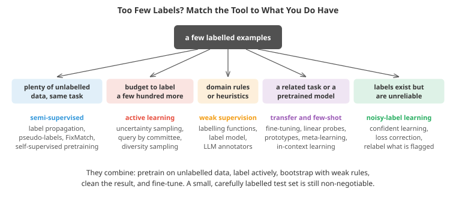

# Learning with Limited Labels

*Labels are usually the scarcest and most expensive ingredient of supervised learning. This file covers the ways to do more with fewer of them: active learning, which chooses what to label; semi-supervised learning, which learns from unlabelled data; weak supervision, which turns heuristics into training labels; learning with noisy labels; transfer, few-shot and in-context learning; labelling with large language models and synthetic data; and the practice of collecting good labels in the first place*

- In most real projects, raw data are cheap and labels are not. Every customer transaction is logged, but someone has to investigate each one to know it was fraud. Millions of X-rays sit in hospital archives, but a radiologist's time costs hundreds of dollars an hour. A model's quality is often limited less by the algorithm than by how many good labels it gets.

- Several families of technique attack the problem from different directions, and they combine well. Which to reach for depends on what you *do* have: unlabelled data, a labelling budget, domain heuristics, a related task, or labels of doubtful quality.



## Active Learning

- **Active learning** lets the model choose which examples a human should label next, on the principle that not all labels are equally informative. A point deep inside a region the model already classifies confidently teaches it little; a point near its decision boundary, or in a region it has never seen, teaches it a lot.

- The pool-based loop: train on the labelled set, score every unlabelled point by how useful its label would be, send the top few to an annotator, add them, retrain, repeat. Common scoring rules (Settles' survey, 2009, is the standard reference):
  - **Uncertainty sampling**: label the points the model is least sure about: probability closest to 0.5, smallest margin between the top two classes, or highest predictive entropy.
  - **Query by committee**: train several models (an ensemble, or bootstrap replicas) and label the points on which they disagree most.
  - **Expected model change or error reduction**: label the points whose labels would change the model, or reduce its expected error, the most. Principled and expensive.
  - **Diversity and representativeness**: pure uncertainty sampling picks redundant points from the same boundary region, and can chase outliers. Batch methods select points that are both uncertain and spread out (core-set selection, clustering the candidates first).
  - **Bayesian active learning by disagreement (BALD)** picks points with the highest mutual information between the prediction and the model parameters, separating epistemic uncertainty (worth labelling) from aleatoric noise (not worth it, see the uncertainty file).

- In the first coding task, uncertainty sampling reaches higher accuracy with 90 labels than random labelling does with 150, and it does so by spending its labels along the decision boundary.

- Caveats worth knowing before trying it:
  - **Cold start**: with very few labels the model does not yet know what it does not know, and uncertainty sampling can be *worse* than random, as the coding task's early rounds show. Start with a random or diverse seed set.
  - **Sampling bias**: the labelled set is no longer a random sample, so it cannot serve as an unbiased test set, and a model trained on it may be miscalibrated. Keep a separate, randomly drawn test set.
  - **Model dependence**: the labels chosen are tuned to one model; a different model trained later may benefit less from them.
  - **Annotation logistics** (batch sizes, annotator turnaround, interface design) often matter more than the choice of acquisition function.

## Semi-Supervised Learning

- **Semi-supervised learning** trains on a few labelled and many unlabelled examples together. Unlabelled data can only help if their distribution says something about the labels, which is captured in three assumptions:
  - **Smoothness**: nearby points tend to share a label.
  - **Cluster assumption**: points in the same cluster tend to share a label, so decision boundaries should pass through low-density regions.
  - **Manifold assumption**: the data lie near a low-dimensional manifold, and distances along it are more meaningful than straight-line distances.

- When the assumptions fail (classes overlap heavily, or clusters do not align with classes), unlabelled data can even hurt.

- **Graph-based methods.** Build a similarity graph over all points, labelled and unlabelled, and let labels spread along its edges. **Label propagation** (Zhu and Ghahramani, 2002) repeatedly replaces each node's label distribution by the weighted average of its neighbours', while clamping the known labels; it is the random-walk view of the graph Laplacian from the clustering file and chapter 12. In the second coding task, ten labels on two interleaved moons give a perfect classifier through propagation, while a supervised model on the same ten labels reaches 79%.

- **Self-training and pseudo-labelling.** Train on the labelled data, predict the unlabelled data, add the most confident predictions as **pseudo-labels**, and retrain. Simple and general, it is the oldest semi-supervised method (Scudder, 1965), and it was used at very large scale in **Noisy Student** training (Xie et al., 2020), where a teacher pseudo-labels 300 million images for a larger, noised student. Its danger is **confirmation bias**: early mistakes become confident pseudo-labels that reinforce themselves. In the second coding task self-training does not improve on the supervised baseline for exactly this reason. Remedies are high confidence thresholds, re-labelling everything each round rather than freezing pseudo-labels, and injecting noise so the student cannot simply copy the teacher.

- **Consistency regularisation.** A good classifier should give the same prediction for an input and a perturbed or augmented version of it, whether or not the input is labelled. This gives a training signal on unlabelled data: penalise disagreement between predictions on two augmentations. The Π-model, **Mean Teacher** (which compares against an exponential moving average of the model's own weights) and **MixMatch** built on this. **FixMatch** (Sohn et al., 2020) combined the ideas into a simple, strong recipe: predict on a weakly augmented unlabelled image; if the prediction is confident (above 0.95), use it as a pseudo-label for a strongly augmented version of the same image. With only 250 labels on CIFAR-10 it reached about 95% accuracy.

- **Entropy minimisation** adds a penalty on the entropy of predictions for unlabelled points, pushing the decision boundary away from dense regions, a direct implementation of the cluster assumption.

- **Self-supervised pretraining** is now the most important way to use unlabelled data: learn a representation from the data alone (contrastive learning, masked prediction; chapters 07, 08 and 10), then train on the labels. The fifth coding task shows the principle in miniature.

## Weak Supervision

- **Weak supervision** creates labels programmatically from sources that are noisy, partial and cheap: keyword rules, regular expressions, existing databases (**distant supervision**: label a sentence as expressing "founded by" if a knowledge base says that person founded that company), other models' predictions, or crowd workers.

- **Data programming** (Ratner et al., 2016), implemented in the Snorkel system, treats each source as a **labelling function** that votes for a label or abstains. The functions overlap and conflict, and their accuracies are unknown. A **label model** estimates each function's accuracy *without ground truth*, from the pattern of agreements and disagreements alone. The intuition: functions that agree with the consensus where they overlap are probably accurate. The model then combines votes, weighting accurate functions more, into a probabilistic label for each example. The classic version of this idea is Dawid and Skene's (1979) EM algorithm for combining unreliable annotators.

- Finally an **end model** (any classifier) is trained on those probabilistic labels, using the full feature set. It generalises beyond the labelling functions: it learns from features the rules never looked at, covers examples no rule fired on, and smooths over noise.

- The third coding task builds a label model with EM. It recovers each labelling function's accuracy almost exactly with no labels, and produces training labels more accurate than a majority vote, which lets several sloppy high-coverage rules outvote one precise rule. Trained on 20,000 weakly labelled examples, the end model beats one trained on 50 hand labels and matches one trained on true labels, because a simple model is robust to noise unrelated to the features. That robustness has limits: with feature-dependent noise, or a model flexible enough to memorise the noise, the quality of the label model matters more.

- Writing labelling functions is fast (minutes each), iterative, and auditable: when requirements change, edit the rules and regenerate the labels, rather than re-annotating thousands of examples.

## Learning with Noisy Labels

- Human labels contain errors. A study of ten popular benchmark datasets found label errors in their *test* sets averaging over 3%, with about 6% in the ImageNet validation set (Northcutt, Athalye and Mueller, 2021), enough to change which model looks best. Crowd-sourced, weakly supervised and web-scraped labels are noisier still.

- Label noise comes in kinds. **Uniform** noise flips labels at random. **Class-conditional** noise confuses particular pairs of classes (wolf and husky, malignant and benign borderline cases). **Instance-dependent** noise is more likely on hard, ambiguous examples. Models are fairly robust to uniform noise with enough data, and much less robust to systematic confusions.

- Deep networks first learn the clean, consistent patterns and only later **memorise** the noisy labels (Arpit et al., 2017), so early stopping on clean validation data is itself a defence. More targeted methods:
  - **Loss correction**: if the noise transition matrix $T_{ij} = P(\text{noisy label } j \mid \text{true label } i)$ is known or estimated, train the model's clean-label predictions through it (forward correction), so the model is fitted to the noisy labels while its own outputs stay clean.
  - **Robust losses**: losses that penalise confident disagreement less than cross-entropy does (mean absolute error, generalised cross-entropy) limit the pull of mislabelled points.
  - **Sample selection**: train on examples the model finds easy (small loss) and treat the rest as suspect. **Co-teaching** trains two networks that pick small-loss examples for each other.
  - **Confident learning** (Northcutt, Jiang and Chuang, 2021) finds likely label errors directly. Compute **out-of-fold** predicted probabilities (each example scored by a model that never saw its label), set a per-class confidence threshold at the average self-confidence of examples with that label, and flag examples where another class is confidently predicted. The fourth coding task implements a simplified version: removing the flagged examples recovers much of the accuracy lost to a systematic annotator confusion.

- In practice, flagged examples are best sent back for review rather than silently deleted: some are errors, some are genuinely ambiguous, and both are valuable to know about. Fixing errors in the **test** set comes first, because a noisy test set misleads every decision made with it.

## Transfer, Few-Shot and In-Context Learning

- The most effective way to need fewer labels is to start from a model that already understands the domain. **Transfer learning** takes a model pretrained on a large dataset (ImageNet, a web-scale text corpus, a protein database) and adapts it:
  - **Feature extraction / linear probing**: freeze the pretrained network and train only a new output layer on its features. Needs very few labels and little compute.
  - **Full fine-tuning**: update all weights with a small learning rate. Best when there are thousands of labels and the domain differs from pretraining.
  - **Parameter-efficient fine-tuning** (LoRA and adapters, chapter 07): train small added modules, a middle ground that is cheap to store per task.

- **Few-shot learning** asks a model to recognise new classes from a handful of examples each. **Prototypical networks** (Snell et al., 2017) embed the examples, average each class's embeddings into a **prototype**, and classify a query by its nearest prototype; with a good embedding this needs no training on the new classes at all. **Meta-learning** methods such as **MAML** (Finn et al., 2017) train a model across many small tasks so that it can adapt to a new task in a few gradient steps. In the fifth coding task, a representation learned from unlabelled data of *other* classes makes five new classes markedly easier to learn, most of all at one and three examples per class, and prototypes work even from a single example.

- **Zero-shot** and **in-context learning** take this furthest. CLIP-style models (chapter 10) classify images into categories described only by text. Large language models (chapter 07) perform new tasks from a natural-language instruction and a few examples in the prompt, with no weight updates. For many text tasks, a prompted model is now the first baseline to try, and the question becomes whether a small fine-tuned model can match it at a fraction of the inference cost.

## Labelling with Models and Synthetic Data

- **LLMs as annotators.** Large language models can label text (sentiment, topic, entity types, relevance judgements) and, with vision-language models, images, quickly and cheaply. Studies have found LLM annotations rival crowd workers on many tasks, but they have systematic biases (position, verbosity, their own preferences) and fail on specialised domains. Treat an LLM as one more labelling source: measure its agreement with expert gold labels on a sample before trusting it, use it inside a weak supervision framework, or use it to pre-label for human correction. **Distilling** an LLM's labels into a small task-specific model (chapter 17) is a common production pattern.

- **Synthetic data** generates labelled examples: simulators for robotics and autonomous driving (chapter 11), rendered images, procedurally generated documents, or generative models producing new examples. The labels are free and exact, but the **sim-to-real gap** means models trained on synthetic data may fail on real inputs; domain randomisation and mixing in real data help. Training generative models repeatedly on their own outputs can degrade them over generations (**model collapse**, Shumailov et al., 2024), so provenance matters.

- **Positive-unlabelled (PU) learning** handles a common special case: you have some confirmed positives (known fraud cases, known disease genes) and a large set of unlabelled examples that contains both classes. Treating the unlabelled set as negative biases the model; PU methods correct for the fraction of hidden positives (Elkan and Noto, 2008).

## Getting Good Labels

- No technique replaces a well-run labelling process. The essentials:
  - **Write labelling guidelines** with definitions, edge cases and examples, and revise them as disagreements surface. Ambiguity in the guidelines becomes noise in the labels.
  - **Measure inter-annotator agreement** (Cohen's kappa for two annotators, Krippendorff's alpha more generally) on a shared sample. Low agreement means the task is ill-defined, not that the annotators are careless; it also sets a ceiling on achievable model accuracy.
  - **Use gold questions and adjudication**: seed known answers to monitor annotator quality, and have experts resolve disagreements.
  - **Label the test set most carefully of all**, ideally with multiple annotators and expert review, because every decision rests on it.
  - **Look at the data**: many label problems are found in an afternoon of reading examples sorted by model loss. This **data-centric** loop (improve the labels, not just the model) is often the highest-return work available.

## Coding Tasks (use CoLab or notebook)

1. Active learning with uncertainty sampling against random sampling on a curved decision boundary: compare learning curves and see which points get chosen.
```python
import numpy as np
import matplotlib.pyplot as plt
from sklearn.linear_model import LogisticRegression
from sklearn.preprocessing import PolynomialFeatures
from sklearn.pipeline import make_pipeline

# A pool of 3000 unlabelled points with a curved class boundary; labels cost money, so we ask for few.
rng = np.random.default_rng(0)
def make(n):
    X = rng.uniform(-3, 3, (n, 2))
    y = (X[:, 1] > np.sin(1.5 * X[:, 0]) + 0.3 * X[:, 0]).astype(int)
    flip = rng.uniform(size=n) < 0.03                       # a little label noise
    return X, np.where(flip, 1 - y, y)
X_pool, y_pool = make(3000)
X_test, y_test = make(5000)
model = lambda: make_pipeline(PolynomialFeatures(5), LogisticRegression(C=10, max_iter=5000))

def run(strategy, budget=150, start=10, step=10, seed=0):
    r = np.random.default_rng(seed)
    labelled = list(r.choice(len(X_pool), start, replace=False))
    curve = []
    while len(labelled) <= budget:
        if len(set(y_pool[labelled])) > 1:
            clf = model().fit(X_pool[labelled], y_pool[labelled])
            curve.append((len(labelled), clf.score(X_test, y_test)))
        else:
            clf = None; curve.append((len(labelled), 0.5))
        unl = np.setdiff1d(np.arange(len(X_pool)), labelled)
        if strategy == "random" or clf is None:
            pick = r.choice(unl, step, replace=False)
        else:                                               # uncertainty sampling: probability closest to 0.5
            p = clf.predict_proba(X_pool[unl])[:, 1]
            pick = unl[np.argsort(np.abs(p - 0.5))[:step]]
        labelled += list(pick)
    return np.array(curve), labelled

results = {s: [run(s, seed=k)[0] for k in range(3)] for s in ["random", "uncertainty"]}
print("labels | random sampling | uncertainty sampling   (test accuracy, mean of 3 runs)")
for i in range(0, len(results["random"][0]), 2):
    n = int(results["random"][0][i, 0])
    print(f"{n:6d} | {np.mean([c[i, 1] for c in results['random']]):15.3f} | "
          f"{np.mean([c[i, 1] for c in results['uncertainty']]):.3f}")

_, chosen = run("uncertainty", seed=0)
fig, axes = plt.subplots(1, 2, figsize=(13, 4.5))
for s, c in [("random", '#95a5a6'), ("uncertainty", '#e74c3c')]:
    curves = np.array(results[s])
    axes[0].plot(curves[0, :, 0], curves[:, :, 1].mean(0), color=c, label=s)
axes[0].set_xlabel("number of labels"); axes[0].set_ylabel("test accuracy"); axes[0].legend()
axes[1].scatter(*X_pool.T, c=y_pool, cmap='coolwarm', s=3, alpha=0.3)
axes[1].scatter(*X_pool[chosen].T, color='k', s=12, label="points chosen for labelling")
axes[1].legend(); axes[1].set_title("Uncertainty sampling labels points near the boundary")
plt.tight_layout(); plt.show()
```

2. Semi-supervised learning with 10 labels and 1,000 unlabelled points: a supervised baseline, self-training with pseudo-labels, and label propagation over a nearest-neighbour graph.
```python
import numpy as np
import matplotlib.pyplot as plt
from sklearn.svm import SVC

# Two moons: 1000 points, only 10 of them labelled (5 per class)
rng = np.random.default_rng(1)
def moons(n):
    t = rng.uniform(0, np.pi, n); lab = rng.integers(0, 2, n)
    X = np.where(lab[:, None] == 0, np.c_[np.cos(t), np.sin(t)], np.c_[1 - np.cos(t), 0.5 - np.sin(t)])
    return X + rng.normal(0, 0.1, (n, 2)), lab
X, y = moons(1000); X_test, y_test = moons(2000)
labelled = np.r_[rng.choice(np.flatnonzero(y == 0), 5, replace=False), rng.choice(np.flatnonzero(y == 1), 5, replace=False)]

# 1. Supervised only: an RBF SVM on the 10 labelled points
sup = SVC(kernel="rbf", gamma=1.0, C=10).fit(X[labelled], y[labelled])
print(f"supervised, 10 labels:          test accuracy {sup.score(X_test, y_test):.3f}")

# 2. Self-training: repeatedly add the most confident pseudo-labels and refit
L, yL = list(labelled), list(y[labelled])
for round_ in range(15):
    clf = SVC(kernel="rbf", gamma=1.0, C=10).fit(X[L], yL)
    unl = np.setdiff1d(np.arange(len(X)), L)
    if len(unl) == 0: break
    margin = clf.decision_function(X[unl])                       # distance from the boundary = confidence
    take = unl[np.argsort(-np.abs(margin))[:60]]                # the 60 most confident
    L += list(take); yL += list((clf.decision_function(X[take]) > 0).astype(int))
print(f"self-training (pseudo-labels):  test accuracy {clf.score(X_test, y_test):.3f}   "
      f"pseudo-label accuracy {np.mean(np.array(yL[10:]) == y[L[10:]]):.3f}")

# 3. Label propagation: spread labels along a k-nearest-neighbour graph of ALL points
D2 = ((X[:, None] - X[None]) ** 2).sum(-1)
k, sigma = 10, 0.1
W = np.exp(-D2 / (2 * sigma**2))
far = np.argsort(D2, 1)[:, k + 1:]
np.put_along_axis(W, far, 0.0, axis=1)
W = np.maximum(W, W.T); np.fill_diagonal(W, 0)
P = W / W.sum(1, keepdims=True)                                 # random-walk transition matrix
F = np.zeros((len(X), 2)); F[labelled, y[labelled]] = 1
Y0 = F.copy()
for _ in range(500):
    F = P @ F
    F[labelled] = Y0[labelled]                                  # clamp the known labels
pred_train = F.argmax(1)
# predict test points from their nearest labelled-by-propagation training point
nearest = np.argmin(((X_test[:, None] - X[None]) ** 2).sum(-1), 1)
print(f"label propagation over a graph: test accuracy {np.mean(pred_train[nearest] == y_test):.3f}")

fig, axes = plt.subplots(1, 2, figsize=(12, 4.5))
axes[0].scatter(*X.T, c='#ddd', s=6); axes[0].scatter(*X[labelled].T, c=y[labelled], cmap='coolwarm', s=80, edgecolors='k')
axes[0].set_title("1000 points, 10 labels")
axes[1].scatter(*X.T, c=pred_train, cmap='coolwarm', s=6); axes[1].set_title("after label propagation")
plt.tight_layout(); plt.show()
print("\nSelf-training did not help here: the first model's mistakes became confident pseudo-labels and were"
      "\nreinforced (confirmation bias). Label propagation uses the unlabelled points differently: they reveal"
      "\nthe shape of each class (the cluster assumption), and labels flow along it.")
```

3. Weak supervision: generate votes from five labelling functions of different coverage and accuracy, fit a label model by EM without any ground truth, and train an end model on its labels.
```python
import numpy as np
from sklearn.linear_model import LogisticRegression

# 20,000 unlabelled examples with 10 features. True label y in {-1, +1} (never shown to the label model).
rng = np.random.default_rng(2)
n = 20000
y = rng.choice([-1, 1], n)
X = rng.normal(size=(n, 10)) + 0.6 * y[:, None] * np.linspace(1, 0.2, 10)
X_test_y = rng.choice([-1, 1], 5000)
X_test = rng.normal(size=(5000, 10)) + 0.6 * X_test_y[:, None] * np.linspace(1, 0.2, 10)

# Labelling functions: cheap heuristics (keyword rules, regexes, database lookups...). Each one votes +1 or -1
# on part of the data and abstains (0) elsewhere. Their accuracies are unknown to us.
specs = [(0.50, 0.95), (0.90, 0.62), (0.90, 0.60), (0.85, 0.60), (0.40, 0.75)]   # (coverage, accuracy)
L = np.zeros((n, len(specs)), int)
for j, (cov, acc) in enumerate(specs):
    fires = rng.uniform(size=n) < cov
    correct = rng.uniform(size=n) < acc
    L[:, j] = np.where(fires, np.where(correct, y, -y), 0)
print("labelling function | coverage | true accuracy")
for j, (cov, acc) in enumerate(specs):
    print(f"LF{j}                | {np.mean(L[:, j] != 0):8.2f} | {np.mean(L[L[:, j] != 0, j] == y[L[:, j] != 0]):.2f}")

# Label model: EM for conditionally independent voters with unknown accuracies (a one-coin Dawid-Skene model)
acc_hat = np.full(len(specs), 0.7)
for _ in range(50):
    # E-step: posterior P(y = +1 | votes), from each LF's log-odds of being right
    w = np.log(acc_hat / (1 - acc_hat))
    score = (L * w).sum(1)
    q = 1 / (1 + np.exp(-score))
    # M-step: each LF's accuracy = expected agreement with y on the points where it voted
    for j in range(len(specs)):
        v = L[:, j] != 0
        agree = np.where(L[v, j] == 1, q[v], 1 - q[v])
        acc_hat[j] = np.clip(agree.mean(), 0.51, 0.99)
print("\nlabel model's estimated accuracies (no labels used):", acc_hat.round(2))

covered = (L != 0).any(1)
majority = np.sign(L.sum(1))
print(f"\naccuracy of training labels on covered points:  majority vote "
      f"{np.mean(majority[covered & (majority != 0)] == y[covered & (majority != 0)]):.3f},  "
      f"label model {np.mean(np.sign(score[covered]) == y[covered]):.3f}")

def end_model(Xtr, ytr, weights=None):
    return LogisticRegression().fit(Xtr, ytr, sample_weight=weights).score(X_test, X_test_y)

lab = rng.choice(n, 50, replace=False)
print(f"\nend model trained on 50 hand labels:                    test accuracy {end_model(X[lab], y[lab]):.3f}")
m = covered & (majority != 0)
print(f"end model trained on majority-vote labels:             test accuracy {end_model(X[m], majority[m]):.3f}")
conf = np.abs(2 * q - 1)                                       # weight each example by label-model confidence
print(f"end model trained on label-model labels (weighted):    test accuracy "
      f"{end_model(X[covered], np.sign(score[covered]), conf[covered]):.3f}")
print(f"end model trained on all 20,000 TRUE labels (ceiling): test accuracy {end_model(X, y):.3f}")
print("\n1. The label model learns that LF0 is precise and the high-coverage rules are sloppy, so its training"
      "\n   labels are more accurate than a majority vote, which lets the sloppy rules outvote the good one."
      "\n2. 20,000 noisy labels beat 50 clean ones, and reach the ceiling: the end model learns from features,"
      "\n   covers points no rule fired on, and a simple model averages away noise that is independent of the"
      "\n   features. With feature-dependent noise or a model flexible enough to memorise it, label quality matters more.")
```

4. Find label errors with a simplified confident learning procedure on out-of-fold predictions, and measure how much accuracy cleaning recovers.
```python
import numpy as np
from sklearn.ensemble import HistGradientBoostingClassifier
from sklearn.model_selection import cross_val_predict

# 3 classes. 25% of class-0 examples were mislabelled as class 1 (annotators confused them), plus 5% random flips.
rng = np.random.default_rng(3)
def make(n):
    y = rng.integers(0, 3, n)
    centres = np.array([[0, 0], [2.2, 0], [1.1, 2]])
    return rng.normal(size=(n, 2)) * 0.8 + centres[y], y
X, y_clean = make(4000); X_test, y_test = make(5000)
y = y_clean.copy()
conf01 = (y_clean == 0) & (rng.uniform(size=len(y)) < 0.25); y[conf01] = 1
rand = rng.uniform(size=len(y)) < 0.05; y[rand] = rng.integers(0, 3, rand.sum())
is_noisy = y != y_clean
print(f"{is_noisy.mean():.1%} of training labels are wrong")

model = lambda: HistGradientBoostingClassifier(max_iter=200, max_leaf_nodes=31, random_state=0)

# Confident learning (simplified, after Northcutt et al., 2021):
# 1. out-of-fold predicted probabilities, so no example is scored by a model that saw its own label
P = cross_val_predict(model(), X, y, cv=3, method="predict_proba")
# 2. per-class confidence thresholds: the average self-confidence of examples labelled with that class
t = np.array([P[y == k, k].mean() for k in range(3)])
# 3. flag an example if some OTHER class clears its threshold and is more probable than the given label
above = P >= t
above[np.arange(len(y)), y] = False
flagged = above.any(1) & (P.max(1) > P[np.arange(len(y)), y])
precision = is_noisy[flagged].mean(); recall = flagged[is_noisy].mean()
print(f"flagged {flagged.sum()} examples: {precision:.0%} of them really are mislabelled, "
      f"catching {recall:.0%} of all label errors")

accs = {}
for label, keep, yy in [("train on noisy labels", np.ones(len(y), bool), y),
                        ("drop flagged examples, retrain", ~flagged, y),
                        ("oracle: train on clean labels", np.ones(len(y), bool), y_clean)]:
    accs[label] = model().fit(X[keep], yy[keep]).score(X_test, y_test)
    print(f"{label:32s} test accuracy {accs[label]:.3f}")
a, b, c = accs.values()
print(f"cleaning recovered {(b - a) / (c - a):.0%} of the accuracy lost to label noise")
print("\nThe systematic 0 -> 1 confusion shifts the learned boundary; finding and removing suspicious"
      "\nexamples recovers much of the loss. In practice, send flagged examples back to annotators instead of"
      "\nsilently deleting them: some are genuinely hard, and those are the most informative.")
```

5. Few-shot learning with a pretrained representation: learn an embedding from unlabelled data of other classes, then classify five new classes from one to 25 labelled examples each, with logistic regression and with prototypes.
```python
import numpy as np
from sklearn.linear_model import LogisticRegression

# Data that lives on a low-dimensional structure inside a high-dimensional space:
# 8 latent factors, observed through a random nonlinear map into 300 noisy dimensions.
rng = np.random.default_rng(4)
D, k = 300, 8
NOISE, SEP = 1.2, 0.6
A = rng.normal(size=(k, D)) / np.sqrt(k)
def observe(Z):
    return np.tanh(Z @ A) + rng.normal(0, NOISE, (len(Z), D))
centres = rng.normal(0, SEP, (20, k))                     # 20 classes, each a cluster in latent space
def sample(classes, per_class):
    y = np.repeat(classes, per_class)
    return observe(centres[y] + rng.normal(0, 0.6, (len(y), k))), y

# 1. "Pretraining": plenty of UNLABELLED data from classes 0-14, used only to learn a representation (PCA)
X_unl, _ = sample(np.arange(15), 400)
mu = X_unl.mean(0)
V = np.linalg.svd(X_unl - mu, full_matrices=False)[2][:k]   # top-k principal directions
embed = lambda X: (X - mu) @ V.T

# 2. A new task: 5 classes (15-19) never seen before, with only `shots` labelled examples each
new = np.arange(15, 20)
X_test, y_test = sample(new, 200)
print("shots | logistic, raw | logistic, embedding | prototypes, raw | prototypes, embedding")
for shots in [1, 3, 5, 10, 25]:
    accs = []
    for rep in range(10):
        X_few, y_few = sample(new, shots)
        if shots > 1:
            raw = LogisticRegression(max_iter=2000).fit(X_few, y_few).score(X_test, y_test)
            emb = LogisticRegression(max_iter=2000).fit(embed(X_few), y_few).score(embed(X_test), y_test)
        else:
            raw = emb = np.nan                                   # a classifier needs more than one example
        def proto_acc(F_few, F_test):                        # nearest class mean ("prototype")
            protos = np.array([F_few[y_few == c].mean(0) for c in new])
            return np.mean(new[np.argmin(((F_test[:, None] - protos[None]) ** 2).sum(-1), 1)] == y_test)
        accs.append((raw, emb, proto_acc(X_few, X_test), proto_acc(embed(X_few), embed(X_test))))
    accs = np.array(accs, float)
    a = [np.nan if np.isnan(accs[:, j]).all() else np.nanmean(accs[:, j]) for j in range(4)]
    fmt = lambda v: "   n/a" if np.isnan(v) else f"{v:6.3f}"
    print(f"{shots:5d} | {fmt(a[0]):>13s} | {fmt(a[1]):>19s} | {a[2]:15.3f} | {a[3]:.3f}")
print("\nThe embedding was learned from unlabelled data of OTHER classes, yet it helps on the new ones, most of all"
      "\nwhen labels are scarcest; with more labels the raw-feature models catch up. Prototypes (nearest class"
      "\nmean, the idea behind prototypical networks) need no training at all and work even with one example.")
```
