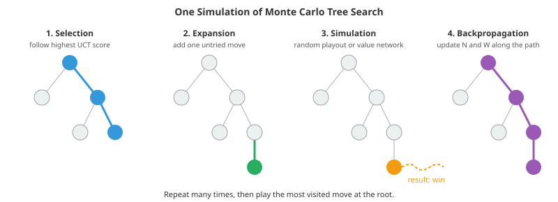

# Advanced Reinforcement Learning

*The reinforcement learning file covered MDPs, value functions, Q-learning, policy gradients, PPO and the basics of RLHF. This file goes further: planning with search (Monte Carlo tree search, AlphaZero, MuZero), model-based RL, continuous control, exploration, offline RL and off-policy evaluation, self-play and multi-agent learning, and reinforcement learning for language models (the KL-regularised objective, reward over-optimisation, GRPO and verifiable rewards), ending with what makes RL hard in practice*

- Model-free RL learns from trial and error alone and needs vast amounts of experience: DQN played each Atari game for the equivalent of weeks. Most of this file is about doing better with less: thinking ahead with a model (planning), learning a model when none is given, exploring deliberately, reusing logged data, and starting from a pretrained model, as language model training does.

## Planning and Search

- When a perfect simulator is available (board games, puzzles, some scheduling problems), an agent can **plan**: look ahead through possible futures before acting. Exhaustive search (**minimax**, which assumes both players play perfectly, usually sped up by alpha-beta pruning) is exact, but its cost grows exponentially with depth; Go has roughly 250 legal moves per position.

- **Monte Carlo tree search** (MCTS) builds a search tree selectively, spending simulations on the most promising lines. Each simulation has four steps:
  1. **Selection**: from the root, repeatedly choose the child with the highest upper confidence bound (below) until reaching a node with untried moves.
  2. **Expansion**: add a new node for an untried move.
  3. **Simulation**: estimate the new position's value, originally by playing random moves to the end of the game.
  4. **Backpropagation**: add the result to the statistics of every node on the path.

- The selection rule, **UCT** (Kocsis and Szepesvári, 2006), applies the bandit algorithm UCB1 at every node. It balances a move's average result $W/N$ against how rarely it has been tried:

$$\text{UCT}(s, a) = \frac{W(s, a)}{N(s, a)} + c\,\sqrt{\frac{\ln N(s)}{N(s, a)}}$$



- The move played is the root's most visited child. The first coding task runs MCTS against a perfect minimax player at tic-tac-toe: with few simulations it blunders, and with enough it never loses, using only the rules and random playouts.

- **AlphaGo** (Silver et al., 2016) defeated Lee Sedol, one of the strongest Go players, by combining MCTS with neural networks trained on expert games and self-play. **AlphaZero** (2018) removed the human data. A single network outputs a **policy** $p(a \mid s)$ (prior probabilities over moves) and a **value** $v(s)$ (expected outcome). Selection uses the prior to focus the search,

$$a = \arg\max_a \; Q(s, a) + c\, p(a \mid s)\, \frac{\sqrt{N(s)}}{1 + N(s, a)},$$

- and leaf positions are evaluated by $v(s)$ instead of random playouts. Training alternates: self-play games are generated with MCTS; the policy head is trained to match MCTS's visit counts (search acts as a **policy improvement operator**, producing better targets than the network alone), and the value head to predict the game result. Starting from random play, AlphaZero surpassed the strongest programs at chess, shogi and Go.

- **MuZero** (Schrittwieser et al., 2020) went further, learning its own model: rather than a simulator, it plans inside a learned latent space with a network that predicts rewards, values and policies for imagined future states. It matched AlphaZero at board games and also handled Atari, where no rules are given. The same planning-and-learning loop underlies AlphaTensor and AlphaDev, which discovered faster matrix multiplication and sorting routines, and search over reasoning steps in language models (chapter 19's agentic systems file).

## Model-Based RL

- When no simulator exists, an agent can **learn a model** of the environment from experience, predicting the next state and reward, and use it to plan or to generate extra training data.

- **Dyna** (Sutton, 1990) is the simplest version: after each real step, update the model, then perform several Q-learning updates on transitions "imagined" from the model. The second coding task shows that this reaches a good policy with several times fewer real steps. Modern descendants include:
  - **World models** (Ha and Schmidhuber, 2018) and **Dreamer** (Hafner et al.): learn a compact latent dynamics model from pixels and train the policy entirely on imagined rollouts. DreamerV3 used one set of hyperparameters across many domains and was the first method to collect diamonds in Minecraft from scratch without human data.
  - **MBPO** (Janner et al., 2019): branch short imagined rollouts from real states, limiting how far model errors can compound.
  - **Model predictive control** (MPC): at every step, optimise a short sequence of actions through the model, execute the first, and replan, the standard approach in robotics and process control (chapter 11).

- The central difficulty is **model exploitation**: the policy is optimised against the model, so it seeks out exactly the states where the model is wrong in its favour. Defences include ensembles of models (treating their disagreement as uncertainty), short rollouts, and continually refitting the model on new real data. The same failure mode returns below as reward over-optimisation.

## Continuous Control

- DQN takes a maximum over actions, which is easy for a few discrete actions and impossible for continuous ones such as joint torques. Actor-critic methods for continuous control learn a **deterministic or stochastic actor** alongside a critic $Q(s, a)$:
  - **DDPG** (Lillicrap et al., 2016): a deterministic actor $\mu(s)$ trained by following the critic's gradient $\nabla_a Q(s, a)$, with replay and target networks from DQN.
  - **TD3** (Fujimoto et al., 2018) fixes DDPG's tendency to overestimate Q-values (maximising a noisy estimate selects its errors): it takes the minimum of two critics, adds noise to target actions, and updates the actor less often.
  - **SAC** (soft actor-critic, Haarnoja et al., 2018) maximises reward plus the policy's **entropy**, $\mathbb{E}[\sum_t r_t + \alpha\, \mathcal{H}(\pi(\cdot \mid s_t))]$. The entropy term keeps exploring, makes training more robust, and its temperature $\alpha$ can be tuned automatically. SAC is a common default for continuous control.

- These off-policy methods reuse old data and are far more sample-efficient than PPO, while PPO is simpler and more stable, and is favoured when simulation is cheap, as in massively parallel GPU simulators for robot locomotion (chapter 11's robot learning file).

## Exploration

- Epsilon-greedy exploration (the reinforcement learning file) fails when rewards are **sparse**: in Montezuma's Revenge, an Atari game where the first reward requires a long precise sequence of moves, random actions essentially never find it. Better strategies direct exploration towards the unknown:
  - **Optimism under uncertainty**: treat poorly known actions as if they might be excellent (UCB bonuses, optimistic initial values), the same idea as UCT.
  - **Thompson sampling**: sample a plausible model or value function from the posterior and act greedily on the sample (chapter 06's Gaussian process file uses it for Bayesian optimisation), naturally exploring where uncertainty is high.
  - **Count-based bonuses**: reward visiting rarely seen states, $r + \beta / \sqrt{N(s)}$; in large state spaces, counts are replaced by density models (pseudo-counts).
  - **Curiosity**: reward the agent for reaching states where a learned predictor is wrong. Random network distillation (Burda et al., 2018) uses the error in predicting a fixed random network's output on the state as the bonus, which shrinks for familiar states.
  - **Go-Explore** (Ecoffet et al., 2021): remember promising states, return to them (by resetting the simulator or with a goal-conditioned policy), and explore from there.

- Exploration bonuses can attract agents to unpredictable but useless things, such as a screen of random noise (the "noisy TV" problem), which is why bonuses based on learnable prediction error work better than raw surprise.

## Offline RL

- In many applications, interacting with the world to learn is expensive or dangerous: medicine, driving, industrial control, recommendation. **Offline (batch) RL** learns a policy from a fixed dataset of logged transitions collected by some other **behaviour policy**, with no further interaction.

- Applying off-policy algorithms naively fails because of **distribution shift**. Q-learning's target $\max_{a'} Q(s', a')$ queries actions the data never contains; their values are pure extrapolation, errors there are never corrected (no new data arrives), and maximisation selects precisely the overestimated ones. The third coding task shows it: in a cliff-walking world, the naive offline learner prefers untried actions and walks off the cliff.

- The fix is **pessimism**: stay close to what the data supports.
  - **Behaviour cloning** (supervised learning of the logged actions) is a strong, simple baseline when the data is good.
  - **Policy constraints** (BCQ, BEAR, TD3+BC) keep the learned policy near the behaviour policy.
  - **Conservative Q-learning** (CQL, Kumar et al., 2020) penalises Q-values of actions outside the data, giving a lower bound on the true values. **Implicit Q-learning** (IQL) avoids querying unseen actions at all.
  - **Uncertainty penalties**, as in the coding task, subtract a bonus that shrinks with data, the mirror image of optimism in exploration.

- Done right, offline RL can improve on the behaviour policy by **stitching** together the best parts of different trajectories; the coding task's mildly pessimistic learner finds the optimal path from an operator's noisy detours, while a strongly pessimistic one merely copies the operator. Sequence-model approaches (Decision Transformer, Chen et al., 2021) recast RL as predicting actions conditioned on a desired return, connecting offline RL to the language models of chapter 07.

- **Off-policy evaluation** (OPE) estimates how well a new policy would perform using only logged data, before deploying it. Importance sampling reweights logged returns by $\prod_t \pi(a_t \mid s_t) / \beta(a_t \mid s_t)$, which is unbiased but has variance that explodes with the horizon; **doubly robust** estimators combine it with a learned value model, exactly as AIPW does for causal effects (chapter 06's causal inference file). OPE is how recommendation and advertising systems evaluate policies offline (chapter 18).

## Self-Play and Multiple Agents

- In games, an agent can generate its own opponents. **Self-play** produced AlphaZero, and in more complex games AlphaStar (StarCraft II, 2019) and OpenAI Five (Dota 2, 2019) reached top human level. Pure self-play can cycle (strategy A beats B beats C beats A) or forget how to beat old strategies, so these systems keep **leagues** of past and specialised opponents to train against.

- With several learning agents, each one's environment includes the others, so it is **non-stationary** from each agent's point of view, breaking the assumptions behind single-agent convergence results. Game theory supplies the right solution concepts, such as **Nash equilibria** (no player gains by changing strategy alone), and algorithms built on counterfactual regret minimisation beat top professionals at heads-up no-limit poker (Libratus, 2017) and six-player poker (Pluribus, 2019). Cooperative settings, such as teams of robots or traffic signals, add credit assignment across agents. CICERO (2022) combined a language model with planning to play the negotiation game Diplomacy at a strong human level.

## Reinforcement Learning for Language Models

- RL is now a central stage in training language models (chapter 07): first to align them with human preferences (RLHF), and since 2024 to teach them to reason with verifiable rewards. The language model is the policy, a prompt is the state, a generated response is the action (or a sequence of token-level actions), and the reward arrives at the end.

- **The KL-regularised objective.** RLHF maximises reward while penalising divergence from the supervised reference model $\pi_{\text{ref}}$:

$$\max_\pi \; \mathbb{E}_{x,\, y \sim \pi}\big[r(x, y)\big] - \beta\, \text{KL}\big(\pi(\cdot \mid x) \,\|\, \pi_{\text{ref}}(\cdot \mid x)\big)$$

- Its optimum has a closed form, a reweighting of the reference model by exponentiated reward:

$$\pi^*(y \mid x) = \frac{1}{Z(x)}\, \pi_{\text{ref}}(y \mid x)\, \exp\!\big(r(x, y) / \beta\big)$$

- Solving for $r$ gives $r(x, y) = \beta \log \frac{\pi^*(y \mid x)}{\pi_{\text{ref}}(y \mid x)} + \beta \log Z(x)$. Substituting this into the Bradley-Terry model of preferences, $P(y_w \succ y_l) = \sigma(r(x, y_w) - r(x, y_l))$, cancels $Z(x)$ and yields exactly the DPO loss from the reinforcement learning file: DPO trains the policy as its own implicit reward model.

- **Reward over-optimisation.** A reward model trained on human comparisons is only a proxy. Optimising hard against it finds responses it overrates: verbose, flattering, confidently wrong, or exploiting quirks. True quality first rises, then falls as the proxy score keeps climbing (Gao, Schulman and Hilton, 2023, who found that this gap follows predictable scaling laws). The fifth coding task reproduces the curve with the closed-form optimum above and with **best-of-$n$ sampling** (generate $n$ responses and keep the highest-scoring), which over-optimises in the same way as $n$ grows. The KL penalty, early stopping, reward model ensembles and fresh human labels on the policy's own outputs are the standard defences; this is Goodhart's law ("when a measure becomes a target, it ceases to be a good measure") in its machine learning form.

- **GRPO and verifiable rewards.** For problems with checkable answers (mathematics with known solutions, code with tests, puzzles), the reward can be computed exactly instead of learned: **RL with verifiable rewards** (RLVR). **GRPO** (group relative policy optimisation, Shao et al., 2024) samples a group of $G$ responses per prompt and uses each response's reward normalised within its group as the advantage,

$$A_i = \frac{r_i - \text{mean}(r_1, \ldots, r_G)}{\text{std}(r_1, \ldots, r_G)},$$

- inside a PPO-style clipped objective with a KL term. This removes PPO's learned value network, which is large and hard to train for language models. DeepSeek-R1 (2025) showed that RL of this kind on a strong base model produces long chains of thought with self-checking and backtracking, and large gains on mathematics and coding benchmarks; such training is now standard for reasoning models.

- The fourth coding task applies the idea to a toy model and shows a key property: a group whose answers are all wrong (or all right) has zero advantage and gives no learning signal. RL therefore mostly sharpens behaviour the model could already sometimes produce. Studies comparing base and RL-trained models found that the base models, given many attempts (high pass@$k$), solve a similar or larger set of problems (Yue et al., 2025), suggesting RLVR largely improves reliability rather than adding new abilities, although longer training and better exploration may change this, and the question is actively debated.

- **Process versus outcome rewards.** An outcome reward scores only the final answer; a **process reward model** scores each reasoning step (Lightman et al., 2023, "Let's Verify Step by Step"), giving denser credit assignment and catching right answers reached by wrong reasoning, at the cost of step-level labels and a new target for reward hacking. Verifiers are not immune to gaming either: a code model rewarded for passing tests can learn to special-case the tests, so test suites, held-out checks and monitoring of the reasoning itself matter.

## Why RL Is Hard in Practice

- **Reward design**: agents optimise what you specify, not what you mean. Classic examples include a boat-racing agent that circled endlessly collecting points instead of finishing the race. Shaping rewards to speed up learning can change the optimal policy unless done carefully (potential-based shaping preserves it).
- **Instability and variance**: results depend strongly on random seeds, hyperparameters and implementation details (Henderson et al., 2018, "Deep Reinforcement Learning That Matters"). Report many seeds with confidence intervals (chapter 06's model evaluation file).
- **Sample efficiency and sim-to-real**: simulators make data cheap, but policies must transfer to the real world; domain randomisation and system identification help (chapter 11).
- **Credit assignment over long horizons**: which of thousands of actions caused a reward that arrives much later? Discounting, value functions and hierarchical RL (options and skills operating at several time scales) all address it.
- **Safety**: exploration can be dangerous. **Constrained RL** maximises reward subject to limits on expected cost, and offline training with careful evaluation keeps learning away from the real system until it is trusted.

- A useful rule of thumb: if the problem can be solved by supervised learning, imitation, or a simple heuristic plus search, do that first. RL earns its complexity when decisions affect future data, when long-term consequences matter, and when a good simulator or verifier exists.

## Coding Tasks (use CoLab or notebook)

1. Monte Carlo tree search with UCT, playing tic-tac-toe against a perfect minimax opponent, with increasing numbers of simulations per move.
```python
import numpy as np
from functools import lru_cache

# Monte Carlo tree search (UCT) on tic-tac-toe, played against a perfect minimax opponent.
# MCTS needs only a simulator of the game: no evaluation function and no learned model.
LINES = [(0,1,2),(3,4,5),(6,7,8),(0,3,6),(1,4,7),(2,5,8),(0,4,8),(2,4,6)]
def winner(b):
    for i, j, k in LINES:
        if b[i] != 0 and b[i] == b[j] == b[k]: return b[i]
    return 0
def moves(b): return [i for i in range(9) if b[i] == 0]
def play(b, m, p): return b[:m] + (p,) + b[m + 1:]

@lru_cache(maxsize=None)
def minimax(b, p):
    """Exact game value for player p to move (+1 win, 0 draw, -1 loss) and the best move."""
    w = winner(b)
    if w: return (1 if w == p else -1), None
    if not moves(b): return 0, None
    best = (-2, None)
    for m in moves(b):
        v = -minimax(play(b, m, p), -p)[0]
        if v > best[0]: best = (v, m)
    return best

class Node:
    def __init__(self, b, p):
        self.b, self.p = b, p                  # board, and the player to move here
        self.children, self.N, self.W = {}, 0, 0.0   # W: total value from the view of the player who moved INTO this node

def rollout(b, p, rng):
    """Play random moves to the end; return the result from the view of player p (to move at b)."""
    me = p
    while True:
        w = winner(b)
        if w: return 1 if w == me else -1
        ms = moves(b)
        if not ms: return 0
        b = play(b, ms[rng.integers(len(ms))], p); p = -p

def mcts(b, p, n_sim, rng, c=1.4):
    root = Node(b, p)
    for _ in range(n_sim):
        node, path = root, [root]
        # 1. Selection: descend with UCB1 while the node is fully expanded
        while node.children and len(node.children) == len(moves(node.b)) and not winner(node.b):
            node = max(node.children.values(),
                       key=lambda ch: ch.W / ch.N + c * np.sqrt(np.log(node.N) / ch.N))
            path.append(node)
        # 2. Expansion: add one untried move
        if not winner(node.b) and moves(node.b):
            m = [m for m in moves(node.b) if m not in node.children][0]
            child = Node(play(node.b, m, node.p), -node.p)
            node.children[m] = child; node = child; path.append(node)
        # 3. Simulation: random playout, value for the player to move at the leaf
        v = rollout(node.b, node.p, rng)
        # 4. Backpropagation: each node stores value for the player who moved into it (the opponent of node.p)
        for nd in reversed(path):
            nd.N += 1; nd.W += -v; v = -v
    return max(root.children.items(), key=lambda kv: kv[1].N)[0]   # most-visited move

def match(n_sim, games, rng):
    results = []
    for g in range(games):
        b, p = (0,) * 9, 1
        mcts_player = 1 if g % 2 == 0 else -1        # alternate who starts
        while not winner(b) and moves(b):
            m = mcts(b, p, n_sim, rng) if p == mcts_player else minimax(b, p)[1]
            b = play(b, m, p); p = -p
        w = winner(b)
        results.append(0 if w == 0 else (1 if w == mcts_player else -1))
    return np.array(results)

rng = np.random.default_rng(0)
print("Tic-tac-toe is a draw with perfect play, so the best any player can do against minimax is draw.")
print(f"{'simulations per move':>22s} {'losses':>7s} {'draws':>6s}")
for n_sim in (10, 30, 100, 300, 1000):
    r = match(n_sim, 12, rng)
    print(f"{n_sim:22d} {np.mean(r == -1):7.0%} {np.mean(r == 0):6.0%}")
print("\nWith few simulations MCTS blunders; losses fall as simulations grow, and at 1,000 per move it no longer"
      "\nloses, although it was given no evaluation function, only the rules and random playouts."
      "\nMinimax searched the whole game tree, which is impossible for chess or Go. AlphaZero replaces the random"
      "\nplayout with a learned value network and guides selection with a learned policy.")
```

2. Model-based RL with Dyna-Q: how much planning with a learned model reduces the real experience needed in a gridworld.
```python
import numpy as np
import matplotlib.pyplot as plt

# Model-based RL with Dyna-Q (Sutton, 1990): learn a model of the environment from real experience, then
# "imagine" extra transitions from it to update the value function. Compare with plain Q-learning.
H, W = 6, 9
walls = {(1, 2), (2, 2), (3, 2), (4, 5), (0, 7), (1, 7), (2, 7)}
start, goal = (2, 0), (0, 8)
ACTIONS = [(-1, 0), (1, 0), (0, -1), (0, 1)]

def step(s, a):
    r, c = s[0] + ACTIONS[a][0], s[1] + ACTIONS[a][1]
    if not (0 <= r < H and 0 <= c < W) or (r, c) in walls: r, c = s
    return (r, c), (1.0 if (r, c) == goal else 0.0), (r, c) == goal

def run(n_planning, episodes, seed, alpha=0.1, gamma=0.95, eps=0.1):
    rng = np.random.default_rng(seed)
    Q = np.zeros((H, W, 4)); model, keys = {}, []
    steps_per_episode = []
    for _ in range(episodes):
        s, n = start, 0
        while True:
            q = Q[s]
            a = rng.integers(4) if rng.random() < eps else rng.choice(np.flatnonzero(q == q.max()))
            s2, r, done = step(s, a)
            Q[s][a] += alpha * (r + gamma * (0 if done else Q[s2].max()) - Q[s][a])   # learn from real experience
            if (s, a) not in model: keys.append((s, a))
            model[(s, a)] = (s2, r, done)                                                 # remember what happened
            for _ in range(n_planning):                                                   # planning: replay imagined steps
                ps, pa = keys[rng.integers(len(keys))]
                ps2, pr, pdone = model[(ps, pa)]
                Q[ps][pa] += alpha * (pr + gamma * (0 if pdone else Q[ps2].max()) - Q[ps][pa])
            s, n = s2, n + 1
            if done: break
        steps_per_episode.append(n)
    return np.array(steps_per_episode)

def shortest_path():
    dist, frontier = {start: 0}, [start]
    while frontier:
        nxt = []
        for s in frontier:
            for a in range(4):
                s2 = step(s, a)[0]
                if s2 not in dist: dist[s2] = dist[s] + 1; nxt.append(s2)
        frontier = nxt
    return dist[goal]

episodes, seeds = 40, 6
shortest = shortest_path()
fig, ax = plt.subplots(figsize=(8, 4))
print(f"shortest path: {shortest} steps")
print(f"{'planning steps per real step':>29s} {'real steps, episodes 2-40':>26s} {'first episode within 1.5x of shortest':>39s}")
for n_plan in (0, 5, 25):
    runs = np.array([run(n_plan, episodes, sd) for sd in range(seeds)]).mean(0)
    near = np.argmax(runs < shortest * 1.5) + 1 if np.any(runs < shortest * 1.5) else None
    print(f"{n_plan:29d} {runs[1:].sum():26.0f} {str(near):>39s}")
    ax.plot(np.arange(2, episodes + 1), runs[1:], label=f"{n_plan} planning steps")
ax.set_xlabel("episode"); ax.set_ylabel("steps to reach goal (mean of 6 runs)"); ax.set_yscale("log")
ax.legend(); ax.set_title("Dyna-Q: planning with a learned model")
plt.tight_layout(); plt.show()

print("\nThe first episode is a random walk for every agent (nothing has been learned yet). After that, each real"
      "\nstep feeds many imagined updates, so the reward spreads back along the path far faster: the planning agents"
      "\nneed several times fewer real interactions. When real experience is expensive (robots, patients, markets)"
      "\nand computation is cheap, a model is worth having, provided it is accurate; errors in a learned model are"
      "\nexploited by the planner, which is the central difficulty of model-based RL.")
```

3. Offline RL in a cliff-walking world: behaviour cloning, naive offline Q-learning, and Q-learning with mild and strong pessimism, all from the same logged data.
```python
import numpy as np

# Offline RL: learn a policy from a fixed log of someone else's behaviour, with no further interaction.
# Cliff walking (4 x 12): start bottom-left, goal bottom-right, the bottom row between them is a cliff (-100).
H, W = 4, 12
start, goal = (3, 0), (3, 11)
ACTIONS = [(-1, 0), (1, 0), (0, -1), (0, 1)]           # up, down, left, right
NAMES = "^v<>"

def step(s, a):
    r, c = min(max(s[0] + ACTIONS[a][0], 0), H - 1), min(max(s[1] + ACTIONS[a][1], 0), W - 1)
    if r == 3 and 0 < c < 11: return start, -100.0, False     # fell off the cliff: back to start
    return (r, c), -1.0, (r, c) == goal

def evaluate(policy, max_steps=100):
    s, total = start, 0.0
    for _ in range(max_steps):
        s, r, done = step(s, policy[s]); total += r
        if done: return total, True
    return total, False

# The logged data: a cautious operator who climbs to the top row, walks along it and comes down,
# taking a random action 20% of the time. 200 episodes.
rng = np.random.default_rng(0)
def behaviour(s):
    if rng.random() < 0.2: return int(rng.integers(4))
    if s[1] < 11 and s[0] > 0: return 0 if s[1] == 0 else 3   # climb at the start, otherwise keep heading right
    if s[1] < 11: return 3
    return 1
data = []
for _ in range(200):
    s = start
    for _ in range(60):
        a = behaviour(s); s2, r, done = step(s, a)
        data.append((s, a, r, s2, done)); s = s2
        if done: break
counts = np.zeros((H, W, 4))
for s, a, *_ in data: counts[s][a] += 1
print(f"{len(data)} logged transitions; {np.mean(counts.reshape(-1, 4).sum(1) > 0):.0%} of states visited,"
      f" {np.mean(counts > 0):.0%} of state-action pairs ever tried")

def fitted_q(penalty, sweeps=300, gamma=0.99):
    """Q-learning over the fixed dataset, repeated until convergence. penalty > 0 subtracts an uncertainty
    bonus from rarely-seen actions and treats never-seen actions as very bad (pessimism)."""
    Q = np.zeros((H, W, 4))
    S = np.array([d[0] for d in data]); A = np.array([d[1] for d in data])
    R = np.array([d[2] for d in data]); S2 = np.array([d[3] for d in data]); D = np.array([d[4] for d in data])
    n = counts.copy()
    for _ in range(sweeps):
        if penalty > 0:
            Qp = np.where(n > 0, Q - penalty / np.sqrt(np.maximum(n, 1)), -1e3)   # lower confidence bound
        else:
            Qp = Q
        target = R + gamma * (1 - D) * Qp[S2[:, 0], S2[:, 1]].max(1)
        newQ = np.zeros_like(Q); np.add.at(newQ, (S[:, 0], S[:, 1], A), target)
        Q = np.where(n > 0, newQ / np.maximum(n, 1), Q)                          # average target per seen pair
    final = np.where(n > 0, Q - penalty / np.sqrt(np.maximum(n, 1)), -1e3) if penalty > 0 else Q
    return final.argmax(2)

def behaviour_cloning():
    return np.where(counts.sum(2) > 0, counts.argmax(2), 3)

results = {"behaviour cloning (copy the most common action)": behaviour_cloning(),
           "naive offline Q-learning": fitted_q(0.0),
           "pessimistic offline Q-learning, mild penalty (1)": fitted_q(1.0),
           "pessimistic offline Q-learning, strong penalty (10)": fitted_q(10.0)}
print(f"\n{'policy':52s} {'return':>7s} {'reaches goal':>13s}")
print(f"{'(optimal: walk along the cliff edge)':52s} {-13:7.0f} {'yes':>13s}")
for name, pol in results.items():
    ret, ok = evaluate(pol)
    print(f"{name:52s} {ret:7.0f} {'yes' if ok else 'no':>13s}")
for name in ("naive offline Q-learning", "pessimistic offline Q-learning, mild penalty (1)"):
    print(f"\n{name} policy:")
    for r in range(H):
        print("  " + "".join("C" if (r == 3 and 0 < c < 11) else "G" if (r, c) == goal else NAMES[results[name][r, c]]
                             for c in range(W)))

print("\nActions the operator never took have no data, so their values stay at their initial 0, which looks better"
      "\nthan any real action (every real step costs -1). The naive learner chooses exactly those untried actions,"
      "\nfor example stepping off the cliff. Pessimism (penalising actions with little or no data, as in CQL and"
      "\nrelated methods) keeps the policy within what the data supports. A mild penalty still improves on the"
      "\noperator, finding the shortest path from the noisy detours in the log; a strong one simply copies the"
      "\noperator. How much to trust the data is the key hyperparameter of offline RL, and it cannot be tuned by"
      "\ntrying policies out, so in practice it is chosen with off-policy evaluation or a small, safe trial.")
```

4. RL with verifiable rewards on a toy language model: REINFORCE against group-relative advantages (GRPO-style), and which prompts RL can and cannot improve.
```python
import numpy as np
import matplotlib.pyplot as plt

# RL with verifiable rewards, as used to train reasoning models: a toy "language model" answers a+b questions;
# the reward is 1 if the answer is right. Compare REINFORCE with group-relative advantages (GRPO-style).
rng = np.random.default_rng(0)
prompts = [(a, b) for a in range(10) for b in range(10)]
n_ans = 19                                                   # possible answers 0..18
correct = np.array([a + b for a, b in prompts])

# A "pretrained" model: knows some sums well, others barely (the probability it gives the right answer varies)
skill = rng.beta(0.6, 1.2, len(prompts))                     # chance of the correct answer per prompt
logits0 = rng.normal(0, 1, (len(prompts), n_ans))
for i, c in enumerate(correct):                               # set logits so that p(correct) = skill
    others = np.delete(np.arange(n_ans), c)
    logits0[i, c] = np.log(skill[i] / (1 - skill[i])) + np.log(np.exp(logits0[i, others]).sum())
def softmax(z): e = np.exp(z - z.max(-1, keepdims=True)); return e / e.sum(-1, keepdims=True)
p0 = softmax(logits0)[np.arange(len(prompts)), correct]

def train(method, steps=150, G=8, lr=0.5, batch=32):
    logits = logits0.copy(); acc, zero_signal = [], []
    for _ in range(steps):
        idx = rng.choice(len(prompts), batch, replace=False)
        probs = softmax(logits[idx])
        grad = np.zeros_like(logits); zero = 0
        for j, i in enumerate(idx):
            samples = rng.choice(n_ans, G, p=probs[j])              # G sampled answers to the same prompt
            r = (samples == correct[i]).astype(float)
            if method == "REINFORCE":
                adv = r                                            # raw reward, no baseline
            else:
                adv = (r - r.mean()) / (r.std() + 1e-6)              # GRPO: compare with the rest of the group
                zero += r.std() == 0                               # all right or all wrong: no learning signal
            for s, A in zip(samples, adv):                          # gradient of log softmax: onehot - probs
                g = -probs[j].copy(); g[s] += 1
                grad[i] += A * g / G
        logits += lr * grad
        acc.append(np.mean(softmax(logits)[np.arange(len(prompts)), correct]))
        zero_signal.append(zero / batch)
    return logits, np.array(acc), np.array(zero_signal)

print(f"pretrained model: expected accuracy {p0.mean():.1%}")
fig, ax = plt.subplots(figsize=(8, 4))
for method in ("REINFORCE", "GRPO"):
    logits, acc, zero = train(method)
    pf = softmax(logits)[np.arange(len(prompts)), correct]
    hard = p0 < 0.02                                             # prompts where the right answer was very unlikely
    print(f"{method:10s} final accuracy {acc[-1]:.1%};  on prompts the pretrained model almost never got right"
          f" ({hard.sum()}): {p0[hard].mean():.1%} -> {pf[hard].mean():.1%}")
    if method == "GRPO":
        print(f"{'':10s} groups with no learning signal (all 8 answers equally right or wrong):"
              f" {zero[:10].mean():.0%} early, {zero[-10:].mean():.0%} late")
    ax.plot(acc, label=method)
ax.set_xlabel("training step"); ax.set_ylabel("expected accuracy"); ax.legend()
ax.set_title("RL with verifiable rewards on a toy model")
plt.tight_layout(); plt.show()

print("\nWithout a baseline only right answers contribute (wrong ones get zero weight), and the step size for a"
      "\nprompt depends on how often it is already answered correctly. GRPO subtracts the group's mean reward and"
      "\ndivides by its standard deviation: answers better than their siblings are pushed up, worse ones pushed"
      "\ndown, every prompt gets a comparable step, and no value network is needed. A group that is all wrong gives"
      "\nno signal at all, so RL mostly sharpens answers the model could already sometimes produce: prompts it almost"
      "\nnever answered correctly improve little. Late in training most groups are all right, which also gives no signal.")
```

5. Reward over-optimisation: the closed-form KL-regularised optimum and best-of-n sampling against an imperfect reward model, tracking the reward model's score and the true reward.
```python
import numpy as np
import matplotlib.pyplot as plt

# Reward over-optimisation (Goodhart's law) in RLHF. A learned reward model is a proxy for what people want.
# Optimising it too hard finds the responses where the proxy is most wrong. The KL penalty limits this.
rng = np.random.default_rng(0)
n = 20000                                                  # candidate responses to one prompt
true_r = rng.normal(0, 1, n)                               # what people actually think of each response
rm_error = rng.standard_t(4, n) * 0.5                      # reward-model errors: mostly small, occasionally huge
proxy_r = true_r + rm_error
log_ref = rng.normal(0, 1, n)                              # the reference (supervised) model's preferences
ref = np.exp(log_ref - log_ref.max()); ref /= ref.sum()
print(f"correlation between reward model and true reward: {np.corrcoef(true_r, proxy_r)[0, 1]:.2f}")

# The KL-regularised RLHF objective  max E[r] - beta * KL(pi || pi_ref)  has the closed-form optimum
#   pi_beta(y) ∝ pi_ref(y) exp(r(y) / beta)      (which DPO exploits to skip the RL step)
print(f"\n{'beta':>6s} {'KL from reference (nats)':>25s} {'reward-model score':>19s} {'true reward':>12s}")
betas = np.geomspace(3, 0.05, 25)
rows = []
for beta in betas:
    logp = np.log(ref) + proxy_r / beta
    p = np.exp(logp - logp.max()); p /= p.sum()
    kl = np.sum(p * (np.log(p + 1e-300) - np.log(ref)))
    rows.append((beta, kl, p @ proxy_r, p @ true_r))
rows = np.array(rows)
for k in range(0, 25, 3):
    print(f"{rows[k, 0]:6.2f} {rows[k, 1]:25.2f} {rows[k, 2]:19.2f} {rows[k, 3]:12.2f}")
best = rows[:, 3].argmax()
print(f"true reward peaks at beta = {rows[best, 0]:.2f} (KL {rows[best, 1]:.1f} nats), then falls while the"
      f" reward-model score keeps rising")

# Best-of-n sampling against the same reward model shows the same effect
bon = []
for N in (1, 4, 16, 64, 256, 1024, 4096):
    s_idx = np.array([rng.choice(n, N, p=ref) for _ in range(300)])
    chosen = s_idx[np.arange(300), proxy_r[s_idx].argmax(1)]
    bon.append((N, proxy_r[chosen].mean(), true_r[chosen].mean()))
print(f"\n{'best of n':>9s} {'reward-model score':>19s} {'true reward':>12s}")
for N, pr, tr in bon:
    print(f"{N:9d} {pr:19.2f} {tr:12.2f}")

fig, ax = plt.subplots(figsize=(8, 4))
ax.plot(np.sqrt(rows[:, 1]), rows[:, 2], label="reward-model score")
ax.plot(np.sqrt(rows[:, 1]), rows[:, 3], label="true reward")
ax.set_xlabel("sqrt(KL from reference)"); ax.legend(); ax.set_title("Optimising a proxy reward")
plt.tight_layout(); plt.show()

print("\nAt first, optimising the reward model improves real quality. Pushed further, the policy concentrates on"
      "\nthe few responses whose score is inflated by a large reward-model error, and true quality falls even as"
      "\nthe measured score climbs (Gao et al., 2023 measured such curves for real reward models). Staying close to"
      "\nthe reference model (the KL penalty), early stopping, ensembles of reward models and verifiable rewards"
      "\n(harder, though not impossible, to game) are the standard defences.")
```
