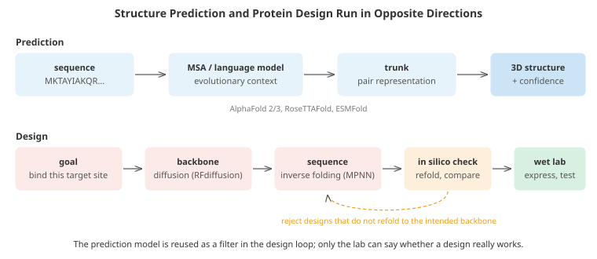

# Protein Structure and Design

*Proteins are the molecular machines of life, and predicting and designing them has become one of machine learning's most celebrated scientific successes. This file covers the biology needed to follow the methods, coevolution and contact prediction, AlphaFold 2 and 3 and how they work, protein language models, how predicted structures are scored, inverse folding and generative design with diffusion, variant effect prediction, the limits of current methods, and related sequence models for DNA and cells*

- In 2020, AlphaFold 2 predicted protein structures from sequence with accuracy comparable to experiment for most targets in the CASP14 assessment, a problem that had been open for fifty years. Within two years, predicted structures for over 200 million proteins were freely available. Within four, AI-designed proteins that do not exist in nature were binding targets, neutralising toxins and assembling into new materials, and the 2024 Nobel Prize in Chemistry went to Demis Hassabis and John Jumper for structure prediction and to David Baker for computational protein design.

- This file explains how the methods work, drawing on chapters 07 (transformers and language models), 08 (diffusion), 10 (multimodal models) and 12 (geometric and equivariant networks). Chapter 12's 3D graph network file covers the equivariant architectures in depth; this file focuses on what is specific to proteins.

## Just Enough Biology

- A **protein** is a chain of **amino acids**, each one of 20 types, linked by peptide bonds. The chain is written as a string over a 20-letter alphabet, such as `MKTAYIAKQR...`, and real proteins range from tens to thousands of residues. Every amino acid shares the same **backbone** atoms (N, Cα, C, O) and differs in its **side chain**, which can be small, large, charged, polar or hydrophobic.

- The chain folds into a specific 3D shape. Local patterns form **secondary structure** (α-helices and β-sheets), these pack into a **tertiary structure**, and several chains can assemble into a **quaternary** complex. Backbone shape is described by two torsion angles per residue, $\phi$ and $\psi$, and the rest of the geometry is nearly fixed.

- **Anfinsen's experiments** (Nobel Prize, 1972) showed that, for many proteins, the sequence alone determines the folded structure: it is the shape of lowest free energy. Yet a chain cannot search its conformations at random (there are astronomically many, **Levinthal's paradox**); folding follows a funnel-shaped energy landscape. Structure matters because **structure determines function**: an enzyme's active site, an antibody's binding surface, a channel's pore.

- Experimental structure determination (X-ray crystallography, NMR, cryo-electron microscopy) is slow and expensive. The **Protein Data Bank (PDB)** holds about 200,000 experimental structures, while sequence databases hold hundreds of millions of sequences. That gap, and the community's biennial **CASP** blind-prediction competition (since 1994), set the stage for machine learning.

## Coevolution: Structure Hidden in Sequences

- Proteins in a **family** (the same protein in different species, or related proteins) share a fold but differ in sequence. Line their sequences up in a **multiple sequence alignment (MSA)** and the columns tell a story. Residues that touch in 3D must stay chemically compatible: if one mutates (a small residue becoming large), its partner tends to compensate (a large one becoming small). So **contacting residues mutate together**, and correlated columns in the MSA reveal 3D contacts.

- Naive correlation measures, such as the mutual information between two columns, are confounded by **indirect** correlations: if A contacts B and B contacts C, then A and C correlate too without touching. **Direct coupling analysis** fits a global statistical model, a **Potts model** (a pairwise Markov random field, related to the graphical models of chapter 05), over the whole sequence:

$$P(s_1, \dots, s_L) \propto \exp\left(\sum_i h_i(s_i) + \sum_{i < j} J_{ij}(s_i, s_j)\right)$$

- The fields $h_i$ capture each position's preferences, and the couplings $J_{ij}$ capture direct dependencies between positions. Because the model explains every correlation at once, it attributes them to direct couplings only where needed. The norm of each fitted $J_{ij}$ ranks how likely $i$ and $j$ are in contact. Fitting by **pseudo-likelihood** (predict each column from all the others with regularised logistic regression, the approach of plmDCA) is fast and accurate.

- The first coding task simulates a protein family from a Potts model with a known contact map, then recovers the contacts from the sequences alone. Mutual information gets most of them; the pseudo-likelihood Potts model gets nearly all, because it separates direct from indirect correlation. Before deep learning, predicted contacts like these, fed into folding simulations, were the state of the art.

## AlphaFold 2

- AlphaFold 2 (Jumper et al., 2021) replaced hand-built statistics with an end-to-end neural network that reads an MSA (and any template structures) and outputs atomic coordinates. Its main components:

- **Two representations.** An **MSA representation** (one vector per sequence and position) and a **pair representation** (one vector per pair of positions $i, j$, encoding their relationship: distance, orientation, coupling). The pair representation is the learned successor of the contact map.

- **The Evoformer**, 48 blocks that repeatedly exchange information between the two:
    - attention along the rows and columns of the MSA, with the pair representation biasing row attention;
    - an **outer product** update that turns MSA column correlations into pair features, the learned equivalent of coevolution analysis;
    - **triangle updates** on the pair representation. If $i$ is close to $k$ and $k$ is close to $j$, then $i$ and $j$ cannot be arbitrarily far apart. Triangle multiplicative updates and triangle attention update each pair $(i, j)$ using all pairs $(i, k)$ and $(k, j)$, building in geometric consistency (the triangle inequality) as an inductive bias.

- **The structure module.** Each residue is a rigid body (a rotation and translation, a "frame"). **Invariant point attention** updates the frames with attention that takes 3D positions into account while remaining invariant to rotating and translating the whole protein (the equivariance ideas of chapter 12). Side-chain torsion angles complete the atomic model.

- **The loss and training.** The **frame aligned point error (FAPE)** measures atomic position errors in the local frame of every residue, so it is invariant to global rotation and sensitive to chirality. **Recycling** feeds the output back into the network several times to refine it. The model was trained on the PDB and then on its own confident predictions for unlabelled sequences (self-distillation, compare the noisy student idea in chapter 06's limited-labels file).

- **Confidence.** AlphaFold predicts its own accuracy. **pLDDT** (0 to 100) estimates per-residue local accuracy: above 90 is very high, below about 50 usually means the region is disordered or unpredictable. The **predicted aligned error (PAE)** estimates the error in residue $j$'s position when the structure is aligned on residue $i$, revealing whether two domains' relative placement is trustworthy. These confidence estimates are what make predictions usable in practice.

- The **AlphaFold Protein Structure Database** released predictions for over 200 million sequences, nearly every known protein. **RoseTTAFold** (Baek et al., 2021), developed in parallel, uses a three-track architecture (sequence, pair distances, 3D coordinates) and is open-source; its successors underpin much of the design work below.

## AlphaFold 3 and All-Atom Models

- AlphaFold 3 (Abramson et al., 2024) extends prediction from single proteins to **complexes** of proteins with DNA, RNA, small-molecule ligands, ions and chemical modifications. It simplifies MSA processing (a **Pairformer** operating mainly on the pair representation) and replaces the structure module with a **diffusion module** that generates all atom coordinates directly by denoising, the generative approach of chapter 08. Diffusion handles the variety of chemistry naturally: there is no need for a residue-specific frame for every kind of molecule. Generative models can also **hallucinate** plausible structure in disordered regions, which the confidence measures must flag. Similar all-atom models (RoseTTAFold All-Atom, Boltz, Chai and others) followed, several fully open.

## Protein Language Models

- Instead of building an MSA for every query, train a **language model** on hundreds of millions of individual protein sequences, with the masked-token objective of BERT (chapter 07): hide some amino acids and predict them from the rest. To predict well, the model has to learn which residues co-vary, which is to say, it learns the family statistics that coevolution analysis extracts explicitly.

- **ESM-2** (Lin et al., 2023), with up to 15 billion parameters, showed that structural information emerges in the attention maps and embeddings as models scale. **ESMFold** attaches a folding head to ESM-2 and predicts structure from a **single sequence**, without an MSA, much faster than AlphaFold, with somewhat lower accuracy on average. It was used to predict over 600 million structures of metagenomic proteins (from environmental samples), many unlike anything in the PDB.

- Protein language models are also general-purpose feature extractors: their embeddings feed classifiers for function, localisation, stability or binding, usually with far less labelled data than training from scratch. **Generative** protein language models (ProGen, ESM3 and others) sample new sequences, optionally conditioned on function, structure or keywords; ESM3 was used to generate a fluorescent protein far from any known one in sequence.

## Scoring Predicted Structures

- Comparing a predicted structure with an experimental one needs metrics that ignore how the structures happen to be oriented:
    - **RMSD** (root-mean-square deviation) of corresponding atoms after **optimal superposition**. The optimal rotation comes from the **Kabsch algorithm**: centre both structures, take the SVD of their cross-covariance matrix $U \Sigma V^\top$, and the rotation is $UV^\top$ (with a sign correction to avoid a reflection), an application of chapter 02's decompositions. RMSD is dominated by the worst-placed regions: one wrongly angled hinge between two correct domains makes it huge.
    - **TM-score** searches for the superposition that maximises $\frac{1}{N}\sum_i 1 / (1 + (d_i / d_0)^2)$, where $d_0$ grows slowly with protein length. Close residues count fully and distant ones barely at all, so a partially right structure gets partial credit. TM-score above about 0.5 generally means the same fold, and values below about 0.17 are what random structures get.
    - **GDT** (global distance test) averages the fraction of residues within 1, 2, 4 and 8 Å, and **lDDT** compares local inter-atomic distances without any superposition, which makes it robust to domain movements. pLDDT is AlphaFold's prediction of lDDT.

- The third coding task implements Kabsch superposition, RMSD and a TM-score search, and shows why they disagree for a structure that is right except for one hinge.

## Designing Proteins

- **Design** runs in the opposite direction from prediction: start from a desired function or shape and find a sequence that will fold into it. Classical computational design (the Rosetta software, from David Baker's lab) searched sequences and side-chain conformations against a physics-inspired energy function, with successes such as new folds and enzymes but low hit rates. Machine learning has raised success rates dramatically.

- **Inverse folding** predicts a sequence for a given backbone. **ProteinMPNN** (Dauparas et al., 2022) is a message-passing network (chapter 12) over the backbone's nearest-neighbour graph that decodes amino acids autoregressively. It recovers the native amino acid at about 52% of positions, against about 33% for Rosetta, and its sequences fold as intended far more often in experiments.

- **Backbone generation.** **RFdiffusion** (Watson et al., 2023) fine-tunes RoseTTAFold as a denoiser in a diffusion model over residue frames: start from random frames and iteratively denoise into a protein backbone. Conditioning steers generation: a target protein to bind, a functional motif to scaffold, a symmetry for an assembly. Other backbone generators (Chroma, FrameDiff, Genie and successors) work on similar principles. Earlier, **hallucination** generated new proteins by optimising a random sequence until a structure predictor was confident in its fold.

- A standard pipeline, shown below, combines them: generate many backbones with diffusion, design several sequences for each with ProteinMPNN, re-predict each sequence's structure with AlphaFold or ESMFold, keep designs that **refold** to the intended backbone with high confidence (self-consistency, typically within about 2 Å), and test the survivors in the lab. Results include binders to therapeutic targets designed without any starting antibody, symmetric nanocages for vaccines, and designed proteins that neutralise snake venom toxins.



- Design is optimisation against learned models, and the usual caution applies (compare the evaluation file's winner's curse): a design that a model scores highly may exploit the model's errors, especially far from natural proteins. Computational filters improve hit rates, but expression, stability, aggregation, immunogenicity and real binding affinity can only be established experimentally.

## Predicting the Effects of Mutations

- Many diseases are caused by single amino acid changes (**missense variants**), and protein engineering is largely about choosing beneficial mutations. A family model provides a **zero-shot** predictor: a mutation that makes the sequence less like its family is probably harmful. With a Potts model, the effect of mutating position $i$ from $a$ to $b$ is the change in log-probability, which includes the couplings to every other position, so the predicted effect depends on the rest of the sequence (**epistasis**). Masked language models give the same kind of score, $\log P(b \mid \text{context}) - \log P(a \mid \text{context})$, without an alignment.

- In the second coding task, the pairwise model predicts the true effects of every single mutant far better than an independent-site profile (rank correlation 0.95 against 0.64), and simulated annealing on the learned model designs sequences fitter than any in the family. That success depends on the learned model being nearly correct; real fitness landscapes are messier, and predictions are least reliable far from natural sequences, which is exactly where optimisation leads.

- **AlphaMissense** (2023) combines AlphaFold-style structural context with language-model scores to classify human missense variants as likely benign or pathogenic, providing predictions for tens of millions of possible variants, most of which have never been observed. Deep mutational scanning experiments, which measure thousands of variants at once, are the main benchmark (ProteinGym collects them).

## Limits

- Predicted structures are **static snapshots**, but proteins move: they switch conformations, breathe, and bind partners by changing shape. Generating **ensembles** of conformations is an active research area.
- A substantial fraction of the human proteome contains **intrinsically disordered** regions with no fixed structure; low pLDDT there is the correct answer, not a failure.
- Accuracy drops for proteins with **few homologues** (shallow MSAs), many designed or orphan proteins, some antibody loops, and large flexible complexes.
- Structure predictors are not good at the **thermodynamics** of small changes: whether a point mutation stabilises or destabilises a protein, or exactly how tightly a ligand binds (see the drug discovery file).
- Models trained on the PDB inherit its biases (crystallisable proteins, common folds), and high benchmark scores can partly reflect memorisation of similar structures.

## Beyond Proteins: DNA and Cells

- **Genomic sequence models** apply the same ideas to DNA (a 4-letter alphabet, but sequences billions of letters long). **Enformer** (Avsec et al., 2021) predicts gene expression and chromatin signals from 200,000 base pairs of sequence, combining convolutions with attention to capture distant regulatory elements; later models extend the context to around a million base pairs. **DNA language models** such as the **Evo** family, trained on genomes across the tree of life, model long-range genome organisation and can score variants and generate sequences. Long contexts make these models a natural home for efficient architectures (state-space models and other sub-quadratic sequence models from chapter 07).

- **Single-cell biology** measures the expression of thousands of genes in each of millions of individual cells. Standard analysis uses the methods of chapter 06's clustering file: normalisation, PCA, nearest-neighbour graphs, UMAP for visualisation, and graph-based clustering into cell types. **Single-cell foundation models** (Geneformer, scGPT and others) pretrain transformers on tens of millions of cells; independent evaluations have found that their zero-shot embeddings do not always beat simple baselines, so their value is still being established, a useful reminder to compare against strong simple methods.

## Coding Tasks (use CoLab or notebook)

1. Coevolution in a simulated protein family: sample sequences from a Potts model whose couplings follow a hidden contact map, then recover the contacts with mutual information and with a pseudo-likelihood Potts model.
```python
import matplotlib.pyplot as plt
import numpy as np

# A toy protein family. L positions, q letters; a hidden 3D "fold" puts some position pairs in contact.
# Sequences are sampled from a Potts model, P(s) ~ exp(sum_i h_i(s_i) + sum_contacts J_ij(s_i, s_j)),
# the statistical model behind coevolution analysis: contacting residues must stay compatible, so they mutate together.
rng = np.random.default_rng(0)
L, q = 40, 5
pairs = [(i, j) for i in range(L) for j in range(i + 5, L)]
contacts = [pairs[k] for k in rng.choice(len(pairs), 60, replace=False)]
h = rng.normal(0, 0.5, (L, q))
J = {}
for (i, j) in contacts:
    M = rng.normal(0, 1.0, (q, q)); J[(i, j)] = 1.6 * (M + M.T) / 2

def neighbours(i):
    for (a, b), M in J.items():
        if a == i: yield b, M
        elif b == i: yield a, M.T

def gibbs(n_chains, sweeps, seed=1):
    r = np.random.default_rng(seed)
    S = r.integers(0, q, (n_chains, L))
    nb = [list(neighbours(i)) for i in range(L)]
    for _ in range(sweeps):
        for i in range(L):
            logits = np.tile(h[i], (n_chains, 1))
            for j, M in nb[i]:
                logits += M[:, S[:, j]].T                       # coupling to the current letter at j
            p = np.exp(logits - logits.max(1, keepdims=True)); p /= p.sum(1, keepdims=True)
            S[:, i] = (r.uniform(size=(n_chains, 1)) > np.cumsum(p, 1)).sum(1)
    return S

def energy(S):
    """Higher = fitter (log-probability up to a constant)."""
    E = h[np.arange(L), S].sum(-1)
    for (i, j), M in J.items():
        E = E + M[S[..., i], S[..., j]]
    return E

msa = gibbs(2000, 150)                                         # our "multiple sequence alignment"
onehot = np.eye(q)[msa].reshape(len(msa), -1)                   # (N, L*q)

# Method 1: mutual information between columns, with average product correction (APC)
def column_mi(msa, pseudo=0.5):
    f1 = np.array([np.bincount(msa[:, i], minlength=q) + pseudo for i in range(L)]); f1 /= f1.sum(1, keepdims=True)
    MI = np.zeros((L, L))
    for i in range(L):
        for j in range(i + 1, L):
            f2 = np.full((q, q), pseudo / q); np.add.at(f2, (msa[:, i], msa[:, j]), 1); f2 /= f2.sum()
            MI[i, j] = MI[j, i] = np.sum(f2 * np.log(f2 / np.outer(f1[i], f1[j])))
    return MI

# Method 2: pseudo-likelihood Potts model (plmDCA): predict each column from all others with
# regularised multinomial logistic regression; the coupling weights between i and j score the pair.
from sklearn.linear_model import LogisticRegression
def plm_couplings(msa, C=0.05):
    W = np.zeros((L, L))
    blocks = {}
    for i in range(L):
        others = [j for j in range(L) if j != i]
        X = np.eye(q)[msa[:, others]].reshape(len(msa), -1)
        coef = LogisticRegression(C=C, max_iter=500).fit(X, msa[:, i]).coef_   # (q, (L-1)*q)
        for k, j in enumerate(others):
            B = coef[:, k * q:(k + 1) * q]
            B = B - B.mean(0) - B.mean(1, keepdims=True) + B.mean()          # zero-sum gauge
            blocks[(i, j)] = B
    for i in range(L):
        for j in range(i + 1, L):
            W[i, j] = W[j, i] = np.linalg.norm((blocks[(i, j)] + blocks[(j, i)].T) / 2)
    return W

def apc(M):
    m = M.copy(); np.fill_diagonal(m, 0)
    row = m.sum(1) / (L - 1)
    return m - np.outer(row, row) / (m.sum() / (L * (L - 1)))

truth = set(contacts)
def top_precision(score, k):
    cand = sorted(((score[i, j], (i, j)) for i in range(L) for j in range(i + 5, L)), reverse=True)[:k]
    return np.mean([p in truth for _, p in cand])

MI, PLM = apc(column_mi(msa)), apc(plm_couplings(msa))
for k in [15, 30, 60]:
    print(f"top-{k:2d} predicted pairs that are true contacts:  mutual information {top_precision(MI, k):.0%},"
          f"  pseudo-likelihood Potts {top_precision(PLM, k):.0%}   (random guess {len(truth) / len(pairs):.0%})")
print("\nMutual information mixes direct couplings with indirect chains (A-B and B-C make A and C correlate)."
      "\nA global model that explains every column from all the others separates direct from indirect,"
      "\nwhich is why coevolution-based contact prediction (and AlphaFold's MSA processing) works.")

fig, axes = plt.subplots(1, 3, figsize=(15, 4.5))
T = np.zeros((L, L))
for i, j in contacts: T[i, j] = T[j, i] = 1
for ax, M, title in [(axes[0], T, "true contacts"), (axes[1], MI, "mutual information (APC)"), (axes[2], PLM, "Potts couplings (APC)")]:
    ax.imshow(M, cmap="Blues"); ax.set_title(title)
plt.tight_layout(); plt.show()
```

2. Zero-shot mutation effects and design: fit independent-site and pairwise models to the same family, predict the effect of every single mutation of a natural sequence, then design new sequences by simulated annealing on the learned model and check them against the true fitness.
```python
import numpy as np

# A toy protein family. L positions, q letters; a hidden 3D "fold" puts some position pairs in contact.
# Sequences are sampled from a Potts model, P(s) ~ exp(sum_i h_i(s_i) + sum_contacts J_ij(s_i, s_j)),
# the statistical model behind coevolution analysis: contacting residues must stay compatible, so they mutate together.
rng = np.random.default_rng(0)
L, q = 40, 5
pairs = [(i, j) for i in range(L) for j in range(i + 5, L)]
contacts = [pairs[k] for k in rng.choice(len(pairs), 60, replace=False)]
h = rng.normal(0, 0.5, (L, q))
J = {}
for (i, j) in contacts:
    M = rng.normal(0, 1.0, (q, q)); J[(i, j)] = 1.6 * (M + M.T) / 2

def neighbours(i):
    for (a, b), M in J.items():
        if a == i: yield b, M
        elif b == i: yield a, M.T

def gibbs(n_chains, sweeps, seed=1):
    r = np.random.default_rng(seed)
    S = r.integers(0, q, (n_chains, L))
    nb = [list(neighbours(i)) for i in range(L)]
    for _ in range(sweeps):
        for i in range(L):
            logits = np.tile(h[i], (n_chains, 1))
            for j, M in nb[i]:
                logits += M[:, S[:, j]].T                       # coupling to the current letter at j
            p = np.exp(logits - logits.max(1, keepdims=True)); p /= p.sum(1, keepdims=True)
            S[:, i] = (r.uniform(size=(n_chains, 1)) > np.cumsum(p, 1)).sum(1)
    return S

def energy(S):
    """Higher = fitter (log-probability up to a constant)."""
    E = h[np.arange(L), S].sum(-1)
    for (i, j), M in J.items():
        E = E + M[S[..., i], S[..., j]]
    return E
from sklearn.linear_model import LogisticRegression

msa = gibbs(2000, 150)
true_fit = energy(msa)

# --- Fit two models of the family from the sequences alone ---
# (a) independent sites: a position-specific profile (like a PSSM)
freq = np.array([np.bincount(msa[:, i], minlength=q) + 1.0 for i in range(L)]); freq /= freq.sum(1, keepdims=True)
# (b) pairwise Potts model by pseudo-likelihood (as in the previous task), keeping fields and couplings
h_hat, J_hat = np.zeros((L, q)), np.zeros((L, L, q, q))
for i in range(L):
    others = [j for j in range(L) if j != i]
    lr = LogisticRegression(C=0.05, max_iter=500).fit(np.eye(q)[msa[:, others]].reshape(len(msa), -1), msa[:, i])
    h_hat[i] = lr.intercept_
    for k, j in enumerate(others):
        J_hat[i, j] = lr.coef_[:, k * q:(k + 1) * q]
J_hat = (J_hat + J_hat.transpose(1, 0, 3, 2)) / 2                    # symmetrise the two estimates of each pair
def model_score(S):
    S = np.atleast_2d(S)
    E = h_hat[np.arange(L), S].sum(1)
    for i in range(L):
        E += 0.5 * J_hat[i][np.arange(L), S[:, [i]], S].sum(1)        # 0.5: each pair is visited twice
    return E

# --- 1. Zero-shot variant effect prediction: score every single mutant of a good natural sequence ---
wt = msa[np.argmax(true_fit)]
muts = [(i, b) for i in range(L) for b in range(q) if b != wt[i]]
mutants = np.array([np.where(np.arange(L) == i, b, wt) for i, b in muts])
true_delta = energy(mutants) - energy(wt)
pssm_delta = np.array([np.log(freq[i, b] / freq[i, wt[i]]) for i, b in muts])
potts_delta = model_score(mutants) - model_score(wt)
rank = lambda x: np.argsort(np.argsort(x))
spearman = lambda a, b: np.corrcoef(rank(a), rank(b))[0, 1]
print(f"{len(muts)} single mutants. Spearman correlation with the true fitness effect:")
print(f"   independent-site profile (PSSM):   {spearman(pssm_delta, true_delta):.2f}")
print(f"   pairwise Potts model:              {spearman(potts_delta, true_delta):.2f}")

# --- 2. Design: simulated annealing on the LEARNED model, then check the TRUE fitness ("the lab") ---
calib = np.polyfit(model_score(msa), true_fit, 1)                       # map model score to the fitness scale
predict = lambda S: np.polyval(calib, model_score(S))
r = np.random.default_rng(7)
slope = calib[0]
designs = []
N_DESIGNS, STEPS = 6, 12000
for run in range(N_DESIGNS):
    s = r.integers(0, q, L)
    for step in range(STEPS):
        T = 2.0 * (1 - step / STEPS) + 0.02
        i, b = r.integers(L), r.integers(q)
        a = s[i]
        # change in model score from setting position i to b: field + couplings to every other position
        delta = h_hat[i, b] - h_hat[i, a] + (J_hat[i, np.arange(L), b, s] - J_hat[i, np.arange(L), a, s]).sum() \
                - (J_hat[i, i, b, b] - J_hat[i, i, a, a])
        delta *= slope                                                 # on the calibrated fitness scale
        if delta > 0 or r.uniform() < np.exp(delta / T):
            s[i] = b
    designs.append(s.copy())
designs = np.array(designs)
top_nat = msa[np.argsort(true_fit)[-N_DESIGNS:]]
print(f"\n{'':24s} {'predicted fitness':>18s} {'true fitness':>13s}")
print(f"{f'{N_DESIGNS} best natural sequences':24s} {predict(top_nat).mean():18.2f} {energy(top_nat).mean():13.2f}")
print(f"{f'{N_DESIGNS} designed sequences':24s} {predict(designs).mean():18.2f} {energy(designs).mean():13.2f}")
print(f"\ndesigned sequences differ from their nearest natural sequence at "
      f"{np.mean([np.min((msa != d).sum(1)) for d in designs]):.0f} of {L} positions")
print("Pairwise models capture epistasis (a mutation's effect depends on the rest of the sequence), which is"
      "\nwhy they predict mutation effects better. Here the learned model is nearly the true one (the family"
      "\nreally is a Potts model), so designs it favours are genuinely better than any natural sequence. Real"
      "\nfitness landscapes are not Potts models: learned models are misspecified, and their predictions are"
      "\nleast reliable far from natural sequences, which is exactly where optimisation pushes. Designs must be tested.")
```

3. Comparing structures: Kabsch superposition, RMSD and a TM-score search, applied to a near-correct prediction, one with a wrong hinge, and a random chain.
```python
import numpy as np

# A toy protein backbone: 120 C-alpha atoms on a helix-loop-helix path, 3.8 angstroms apart.
rng = np.random.default_rng(5)
t = np.linspace(0, 6 * np.pi, 120)
native = np.c_[2.3 * np.cos(t), 2.3 * np.sin(t), 1.5 * t / np.pi * 2]
native[60:] = native[60:] @ np.array([[1, 0, 0], [0, 0, -1], [0, 1, 0]]) + [6, 0, 12]   # second helix folded back
steps = np.linalg.norm(np.diff(native, axis=0), axis=1)
native *= 3.8 / steps.mean()

def random_rotation(r):
    Q, R = np.linalg.qr(r.normal(size=(3, 3)))
    Q *= np.sign(np.diag(R))
    return Q if np.linalg.det(Q) > 0 else -Q

def kabsch(P, Q):
    """Optimal rotation and translation superposing P onto Q (both N x 3), via the SVD."""
    Pc, Qc = P - P.mean(0), Q - Q.mean(0)
    U, _, Vt = np.linalg.svd(Pc.T @ Qc)
    d = np.sign(np.linalg.det(U @ Vt))                       # avoid an improper rotation (a reflection)
    R = U @ np.diag([1, 1, d]) @ Vt
    return Pc @ R + Q.mean(0)

rmsd = lambda P, Q: np.sqrt(np.mean(np.sum((P - Q) ** 2, 1)))
def superpose_on(P, Q, idx):
    """Rotate and translate ALL of P using the Kabsch fit computed on the residues idx only."""
    Pc, Qc = P[idx].mean(0), Q[idx].mean(0)
    U, _, Vt = np.linalg.svd((P[idx] - Pc).T @ (Q[idx] - Qc))
    R = U @ np.diag([1, 1, np.sign(np.linalg.det(U @ Vt))]) @ Vt
    return (P - Pc) @ R + Qc

def tm_score(P, Q):
    """TM-score: the superposition that MAXIMISES sum 1/(1 + (d_i/d0)^2), searched from many seed fragments
    and refined on the residues that end up close (as in the TM-score program, for a fixed residue pairing)."""
    N = len(Q); d0 = 1.24 * (N - 15) ** (1 / 3) - 1.8
    score = lambda X: np.mean(1 / (1 + (np.linalg.norm(X - Q, axis=1) / d0) ** 2))
    best = 0.0
    for length in [N, N // 2, N // 4, 12]:
        for start in range(0, N - length + 1, max(1, length // 2)):
            idx = np.arange(start, start + length)
            for _ in range(5):                                        # refine on residues within d0
                X = superpose_on(P, Q, idx)
                best = max(best, score(X))
                close = np.flatnonzero(np.linalg.norm(X - Q, axis=1) < d0)
                if len(close) < 3: break
                idx = close
    return best

# Predictions: (a) the native plus small coordinate noise, (b) correct helices but wrong hinge angle,
# (c) a random compact chain. All are randomly rotated and shifted first, as real predictions would be.
pred_a = native + rng.normal(0, 0.8, native.shape)
pred_b = native.copy(); pred_b[60:] = (native[60:] - native[60]) @ random_rotation(np.random.default_rng(1)).T * 1 + native[60]
pred_c = np.cumsum(rng.normal(0, 2.2, native.shape), 0)
print(f"{'prediction':40s} {'raw RMSD':>9s} {'RMSD after Kabsch':>18s} {'TM-score':>9s}")
for name, P in [("native + 0.8 A noise", pred_a), ("both helices right, hinge wrong", pred_b),
                ("random chain", pred_c)]:
    moved = P @ random_rotation(rng).T + rng.normal(0, 20, 3)
    aligned = kabsch(moved, native)
    print(f"{name:40s} {rmsd(moved, native):9.1f} {rmsd(aligned, native):18.2f} {tm_score(aligned, native):9.2f}")
print("\nRMSD must be computed after optimal superposition, or it measures orientation, not shape. One wrong"
      "\nhinge inflates RMSD a lot even though most of the structure is right; TM-score, which saturates for"
      "\ndistant residues, is more forgiving. TM-score above about 0.5 usually means the same fold."
      "\n(TM-score searches for the superposition that maximises it, so here it finds the half that is right.)")
```
