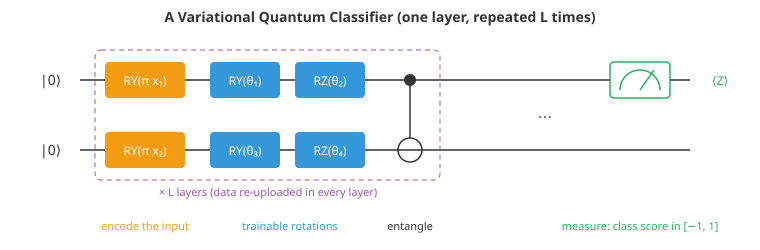

# Quantum Machine Learning

*Quantum computers manipulate information in a way no classical computer can efficiently imitate, and quantum machine learning asks whether that can make learning faster or better. This file covers the quantum computing needed to follow the field (qubits, superposition, entanglement, gates and measurement), the famous quantum algorithms and their caveats, today's noisy hardware and error correction, variational quantum circuits and how they are trained, quantum kernels, the obstacles of data loading, barren plateaus and kernel concentration, and an honest assessment of where quantum advantage for machine learning stands*

- Quantum computing promises exponential speedups for some problems, most famously factoring large numbers, and machine learning is full of large linear algebra, sampling and optimisation problems that look like natural targets. The field of quantum machine learning has produced elegant ideas, strong theoretical results, and a great deal of hype. Its honest state, as of the mid-2020s, is that no practically useful machine learning task has been shown to run better on a quantum computer than on a classical one, while there are clear theoretical reasons to expect advantages for certain problems, especially those whose data are themselves quantum.

- This file builds a small quantum simulator in numpy (chapter 02's linear algebra is all that is needed), uses it to train a quantum classifier, and then measures two of the obstacles that make quantum machine learning hard.

## Qubits and Superposition

- A classical bit is 0 or 1. A **qubit** is a unit vector in a two-dimensional complex vector space, written in Dirac notation as a combination of the basis states $|0\rangle$ and $|1\rangle$:

$$|\psi\rangle = \alpha|0\rangle + \beta|1\rangle, \qquad |\alpha|^2 + |\beta|^2 = 1$$

- The complex numbers $\alpha$ and $\beta$ are **amplitudes**. **Measuring** the qubit gives 0 with probability $|\alpha|^2$ and 1 with probability $|\beta|^2$ (the **Born rule**), and the state collapses to the outcome. A qubit in a **superposition** such as $(|0\rangle + |1\rangle)/\sqrt{2}$ is not secretly 0 or 1; but any single measurement returns just one bit, so the amplitudes can only be estimated by preparing and measuring the state many times (each repetition is a **shot**).

- A single qubit's state can be pictured as a point on the **Bloch sphere**: $|0\rangle$ at the north pole, $|1\rangle$ at the south pole, and equal superpositions around the equator, with the angle around the equator recording the relative **phase** between the amplitudes. Phase does not affect a measurement on its own, but it controls how amplitudes add or cancel when states are combined: **interference**, the resource quantum algorithms exploit.

## Many Qubits and Entanglement

- The state of $n$ qubits lives in the **tensor product** of their spaces: a vector of $2^n$ complex amplitudes, one for each bit string from $00\ldots0$ to $11\ldots1$. That exponential size is the source of both the promise and the difficulty. Simulating 30 qubits classically needs about 17 GB to store the state; 50 qubits need about 18 million GB (the first coding task prints the table). A quantum computer manipulates such a state physically.

- Some multi-qubit states cannot be written as a product of single-qubit states. The **Bell state**

$$|\Phi^+\rangle = \frac{|00\rangle + |11\rangle}{\sqrt{2}}$$

- gives a random bit when either qubit is measured, yet the two results always agree. This **entanglement** is a correlation stronger than any classical system can produce (as Bell's inequalities show), and quantum algorithms need it: circuits that generate little entanglement can be simulated efficiently on classical computers.

- A note on the exponential state: $n$ qubits do not store $2^n$ usable numbers. Measurement returns only $n$ bits, so quantum algorithms must arrange for interference to concentrate amplitude on useful answers before measuring. Most problems do not admit such an arrangement.

## Gates and Circuits

- Quantum computations are sequences of **gates**: unitary matrices ($U^\dagger U = I$, so total probability is preserved) applied to one or two qubits at a time. Common ones:
  - **Pauli gates** $X$ (bit flip), $Y$, $Z$ (phase flip).
  - **Hadamard** $H$, which maps $|0\rangle$ to the equal superposition $(|0\rangle + |1\rangle)/\sqrt{2}$.
  - **Rotations** $R_X(\theta), R_Y(\theta), R_Z(\theta)$, for example $R_Y(\theta) = \cos(\theta/2) I - i \sin(\theta/2) Y$, which have continuous parameters and are the trainable "weights" of quantum machine learning.
  - **CNOT**, a two-qubit gate that flips the target qubit when the control qubit is 1. A Hadamard followed by a CNOT creates the Bell state.

- A **quantum circuit** is a diagram of gates on wires (one wire per qubit, time running left to right), ending in measurements. Its **width** is the number of qubits and its **depth** the number of sequential gate layers. Single-qubit rotations plus CNOT are **universal**: any unitary can be approximated arbitrarily well, though usually with exponentially many gates.

- Applying a gate to qubit $q$ of a simulated state is a contraction of a $2 \times 2$ matrix with one axis of the $2 \times 2 \times \dots \times 2$ amplitude tensor (`np.tensordot`); the first coding task builds the whole simulator in about 40 lines.

## Quantum Algorithms and Their Fine Print

- **Shor's algorithm** (1994) factors integers in polynomial time, exponentially faster than the best known classical algorithm, which threatens today's public-key cryptography once large fault-tolerant machines exist. **Grover's algorithm** searches an unstructured list of $N$ items in about $\sqrt{N}$ steps instead of $N$, a quadratic speedup that is provably optimal for unstructured search.

- **Quantum linear algebra.** The HHL algorithm (Harrow, Hassidim and Lloyd, 2009) solves linear systems $Ax = b$ in time logarithmic in the dimension, which inspired proposals for exponentially faster regression, recommendation, PCA and SVMs. The speedups come with demanding fine print: the input must be loaded into amplitudes efficiently (which needs a special quantum memory that does not yet exist at scale), the matrix must be sparse or low-rank and well conditioned, and the output is a quantum state from which only limited information can be read without destroying the speedup. Moreover, Ewin Tang (2018) showed that a quantum recommendation algorithm, believed to be exponentially faster than classical methods, could be matched by a classical algorithm given comparable data access. This **dequantisation** extended to several other quantum machine learning algorithms, removing their claimed exponential advantages.

## Today's Hardware and Error Correction

- Current quantum computers have from tens to around a thousand physical qubits, built from superconducting circuits, trapped ions, neutral atoms or photons. Every operation has an error rate (typically 0.1% to 1% for two-qubit gates), and qubits lose their quantum state (**decoherence**) within microseconds to seconds depending on the technology. John Preskill named this the **NISQ** era (noisy intermediate-scale quantum, 2018): machines too large to simulate easily but too noisy to run long algorithms.

- **Quantum error correction** encodes each **logical qubit** in many physical qubits so that errors can be detected and corrected faster than they accumulate; the surface code is the leading scheme. It only helps once physical error rates are below a threshold, and recent experiments (including Google's Willow processor in 2024) have shown logical error rates falling as more physical qubits are added, a key milestone. Fault-tolerant machines running algorithms like Shor's at useful scale are expected to need many thousands of logical qubits, and so millions of physical ones; timelines are uncertain.

- Claims of **quantum advantage** so far concern specially designed sampling tasks of no direct practical use, and several were later narrowed by improved classical simulation methods. They are demonstrations that quantum devices do something hard to simulate, not yet that they do something useful faster.

## Variational Quantum Circuits

- Since NISQ machines cannot run long algorithms, much quantum machine learning uses **variational** or **parameterised quantum circuits (PQCs)**, the quantum analogue of a neural network:
  1. **Encode** the input $x$ into a quantum state, for example by rotation angles $R_Y(\pi x_i)$ on each qubit (angle encoding).
  2. Apply layers of **trainable rotations** with parameters $\theta$, interleaved with entangling gates.
  3. **Measure** an observable, such as $Z$ on one qubit, whose expectation value $\langle Z \rangle \in [-1, 1]$ is the model's output.
  4. A classical optimiser updates $\theta$ to minimise a loss, and the loop repeats: a **hybrid** quantum-classical algorithm.



- Re-encoding the input in every layer (**data re-uploading**) makes the model more expressive: the output is a Fourier series in the input, with frequencies set by how many times each input is encoded.

- **Gradients without backpropagation.** On hardware, the internal state cannot be inspected, so backpropagation is impossible. For gates of the form $e^{-i\theta P/2}$ with $P$ a Pauli matrix, the **parameter-shift rule** gives the exact derivative from two extra runs of the circuit:

$$\frac{\partial \langle O \rangle}{\partial \theta} = \frac{\langle O \rangle_{\theta + \pi/2} - \langle O \rangle_{\theta - \pi/2}}{2}$$

- This is not a finite-difference approximation: it is exact, because the expectation is a sinusoid in $\theta$. The cost is two circuit evaluations per parameter per gradient, each estimated from many shots, so training large circuits is slow. The second coding task trains a two-qubit classifier with it, after checking it against a numerical derivative. The same structure underlies the **variational quantum eigensolver (VQE)**, which minimises the energy of a molecule's Hamiltonian, and **QAOA** for combinatorial optimisation.

## Quantum Kernels

- A quantum feature map $x \mapsto |\phi(x)\rangle$ defines a kernel through the overlap of the encoded states:

$$k(x, x') = |\langle \phi(x) | \phi(x') \rangle|^2$$

- which a quantum computer can estimate by preparing one state, undoing the other, and measuring how often it returns to the start. Plugged into an SVM (chapter 06, file 01), this is a **quantum kernel method** (Havlíček et al., 2019). If the feature map is hard to simulate classically, the kernel is too, which is the hoped-for source of advantage. A kernel being hard to compute does not make it useful for learning, though, and there is a more specific obstacle (next section).

## Why It Is Hard

- **Data loading.** Classical data must be encoded into quantum states. Amplitude encoding packs $2^n$ numbers into $n$ qubits but generally needs circuits as deep as the data are large, erasing exponential speedups; angle encoding is cheap but uses one or more qubits per feature.

- **Barren plateaus.** For randomly initialised, sufficiently deep parameterised circuits, the variance of the gradient decays exponentially with the number of qubits (McClean et al., 2018). The loss landscape is essentially flat almost everywhere, and estimating a gradient to enough precision needs exponentially many shots. The third coding task measures the gradient variance shrinking roughly as $2^{-n}$ for a global cost, and more slowly for a cost measured on a single qubit. Mitigations include local cost functions, shallow or problem-inspired circuits, and careful initialisation. Recent theoretical work suggests a deeper tension: many circuits that provably avoid barren plateaus are also efficiently simulable on classical computers, which would remove the reason to use a quantum computer for them.

- **Kernel concentration.** For expressive feature maps, the encoded states of different inputs become nearly orthogonal as the number of qubits grows, so off-diagonal kernel values concentrate exponentially close to zero. The kernel matrix looks like the identity, every training point looks unrelated to every other, and resolving the tiny differences needs exponentially many measurements. The fourth coding task shows the typical kernel value falling from about 0.35 at 2 qubits to about 0.002 at 10. Reducing the encoding bandwidth (scaling the input angles down) keeps the kernel informative, but tends to make it behave like a classical kernel.

- **Noise.** On real hardware, gate errors and decoherence add further flattening and bias, limiting circuits to shallow depths.

## Where Quantum Machine Learning Stands

- **Quantum data.** The most convincing prospects involve data that are quantum to begin with: states produced by quantum sensors, simulations or experiments. Here, learning with a quantum memory can be provably exponentially more efficient than measuring each state classically and learning from the results (Huang et al., 2022, demonstrated such advantages experimentally for specific tasks). Applications include characterising quantum devices, quantum sensing and studying quantum materials.

- **Quantum chemistry and materials.** Simulating molecules and materials is the most widely expected useful application of quantum computers generally, and it intersects machine learning through hybrid workflows, though classical machine learning force fields and DFT (chapter 12) are strong competitors.

- **Classical data.** For ordinary datasets (images, text, tables), there is currently no evidence of a practical quantum advantage, and the obstacles above suggest it will be hard to find; dequantisation has removed several claimed speedups. Benchmarks on small problems typically show quantum models matching, not beating, simple classical baselines.

- **Quantum-inspired classical algorithms.** A lasting benefit of the field has been classical: randomised linear-algebra algorithms and tensor-network methods developed to dequantise or simulate quantum proposals are useful in their own right.

- Software frameworks (Qiskit, PennyLane, Cirq) let anyone build and simulate circuits and run them on cloud-accessible hardware. As with the other bleeding-edge topics in this chapter, the right attitude is curiosity combined with skepticism: learn the ideas, check the fine print, and compare against strong classical baselines.

## Coding Tasks (use CoLab or notebook)

1. A statevector simulator in numpy: superposition, a Bell state and its correlations, unitarity checks, and the memory needed to simulate $n$ qubits classically.
```python
import numpy as np

# A tiny statevector simulator. The state of n qubits is a vector of 2**n complex amplitudes,
# stored as an array of shape (2, 2, ..., 2) so that each axis is one qubit.
I2 = np.eye(2, dtype=complex)
X = np.array([[0, 1], [1, 0]], dtype=complex)
Y = np.array([[0, -1j], [1j, 0]], dtype=complex)
Z = np.array([[1, 0], [0, -1]], dtype=complex)
H = np.array([[1, 1], [1, -1]], dtype=complex) / np.sqrt(2)
def RX(t): return np.cos(t / 2) * I2 - 1j * np.sin(t / 2) * X
def RY(t): return np.cos(t / 2) * I2 - 1j * np.sin(t / 2) * Y
def RZ(t): return np.cos(t / 2) * I2 - 1j * np.sin(t / 2) * Z

def zero_state(n):
    psi = np.zeros((2,) * n, dtype=complex); psi[(0,) * n] = 1; return psi

def apply_1q(psi, gate, q):
    """Apply a 2x2 gate to qubit q: contract the gate with that axis."""
    return np.moveaxis(np.tensordot(gate, psi, axes=([1], [q])), 0, q)

def apply_cnot(psi, control, target):
    psi = psi.copy()
    idx = [slice(None)] * psi.ndim; idx[control] = 1          # where the control qubit is 1 ...
    sub = psi[tuple(idx)]
    t = target if target < control else target - 1
    psi[tuple(idx)] = np.flip(sub, axis=t)                    # ... flip the target qubit
    return psi

def expect_z(psi, q):
    """Expectation of Pauli Z on qubit q: P(q = 0) - P(q = 1)."""
    p = np.abs(psi) ** 2
    p0 = np.take(p, 0, axis=q).sum(); return p0 - (p.sum() - p0)

def sample(psi, shots, rng):
    p = (np.abs(psi) ** 2).ravel()
    outcomes = rng.choice(len(p), shots, p=p / p.sum())
    n = psi.ndim
    return [format(int(o), f"0{n}b") for o in outcomes]

def counts(bitstrings):
    out = {}
    for b in bitstrings: out[b] = out.get(b, 0) + 1
    return dict(sorted(out.items()))

rng = np.random.default_rng(0)
# 1. Superposition: a Hadamard puts one qubit into an equal mix of 0 and 1
psi = apply_1q(zero_state(1), H, 0)
print("H|0> amplitudes:", np.round(psi, 3) + 0, " measurement counts:", counts(sample(psi, 1000, rng)))

# 2. Entanglement: H then CNOT makes the Bell state (|00> + |11>) / sqrt(2)
bell = apply_cnot(apply_1q(zero_state(2), H, 0), 0, 1)
print("Bell state amplitudes:", np.round(bell.ravel(), 3) + 0, " counts:", counts(sample(bell, 1000, rng)))
print("Each qubit alone is a fair coin, but the two always agree: the state cannot be written as"
      "\na product of two single-qubit states. That correlation is entanglement.")

# 3. Gates are unitary (U^dagger U = I), so they preserve the total probability
for name, U in [("H", H), ("RY(0.7)", RY(0.7)), ("X", X)]:
    print(f"{name:8s} unitary: {np.allclose(U.conj().T @ U, np.eye(2))}")

# 4. Why classical simulation runs out of road: memory for the full state vector
print("\nqubits | amplitudes          | memory (complex128)")
for n in [10, 20, 30, 40, 50]:
    print(f"{n:6d} | {2 ** n:19,d} | {2 ** n * 16 / 1e9:14,.3f} GB")
```

2. A variational quantum classifier on two qubits with data re-uploading, trained with exact parameter-shift gradients (checked against a finite difference) to separate points inside and outside a circle.
```python
import numpy as np

# A tiny statevector simulator. The state of n qubits is a vector of 2**n complex amplitudes,
# stored as an array of shape (2, 2, ..., 2) so that each axis is one qubit.
I2 = np.eye(2, dtype=complex)
X = np.array([[0, 1], [1, 0]], dtype=complex)
Y = np.array([[0, -1j], [1j, 0]], dtype=complex)
Z = np.array([[1, 0], [0, -1]], dtype=complex)
H = np.array([[1, 1], [1, -1]], dtype=complex) / np.sqrt(2)
def RX(t): return np.cos(t / 2) * I2 - 1j * np.sin(t / 2) * X
def RY(t): return np.cos(t / 2) * I2 - 1j * np.sin(t / 2) * Y
def RZ(t): return np.cos(t / 2) * I2 - 1j * np.sin(t / 2) * Z

def zero_state(n):
    psi = np.zeros((2,) * n, dtype=complex); psi[(0,) * n] = 1; return psi

def apply_1q(psi, gate, q):
    """Apply a 2x2 gate to qubit q: contract the gate with that axis."""
    return np.moveaxis(np.tensordot(gate, psi, axes=([1], [q])), 0, q)

def apply_cnot(psi, control, target):
    psi = psi.copy()
    idx = [slice(None)] * psi.ndim; idx[control] = 1          # where the control qubit is 1 ...
    sub = psi[tuple(idx)]
    t = target if target < control else target - 1
    psi[tuple(idx)] = np.flip(sub, axis=t)                    # ... flip the target qubit
    return psi

def expect_z(psi, q):
    """Expectation of Pauli Z on qubit q: P(q = 0) - P(q = 1)."""
    p = np.abs(psi) ** 2
    p0 = np.take(p, 0, axis=q).sum(); return p0 - (p.sum() - p0)

def sample(psi, shots, rng):
    p = (np.abs(psi) ** 2).ravel()
    outcomes = rng.choice(len(p), shots, p=p / p.sum())
    n = psi.ndim
    return [format(int(o), f"0{n}b") for o in outcomes]

def counts(bitstrings):
    out = {}
    for b in bitstrings: out[b] = out.get(b, 0) + 1
    return dict(sorted(out.items()))

import matplotlib.pyplot as plt
# A variational quantum classifier on 2 qubits.
# Encode a 2D point by rotation angles, apply trainable layers of rotations and a CNOT,
# and read the class from the expectation of Z on qubit 0 (in [-1, 1]).
rng = np.random.default_rng(1)
n_layers = 3

CNOT = np.array([[1, 0, 0, 0], [0, 1, 0, 0], [0, 0, 0, 1], [0, 0, 1, 0]], dtype=complex)
Z0 = np.array([1, 1, -1, -1])                             # Pauli Z on qubit 0 (diagonal), identity on qubit 1

def ry(a):                                                # batch of RY rotations, shape (B, 2, 2)
    c, s = np.cos(a / 2), np.sin(a / 2)
    return np.stack([np.stack([c, -s], -1), np.stack([s, c], -1)], -2).astype(complex)
def rz(a):
    return np.stack([np.stack([np.exp(-0.5j * a), 0 * a], -1), np.stack([0 * a, np.exp(0.5j * a)], -1)], -2)

def circuit(X, theta):
    """<Z on qubit 0> for a batch of inputs X (B, 2). Same gates as the simulator above, written as
    batched 4x4 matrices for speed (2 qubits = 4 amplitudes)."""
    X = np.atleast_2d(X); B = len(X)
    psi = np.zeros((B, 4), dtype=complex); psi[:, 0] = 1
    for layer in range(n_layers):
        q0 = rz(np.full(B, theta[layer, 1])) @ ry(np.full(B, theta[layer, 0])) @ ry(np.pi * X[:, 0])
        q1 = rz(np.full(B, theta[layer, 3])) @ ry(np.full(B, theta[layer, 2])) @ ry(np.pi * X[:, 1])
        U = np.einsum("bij,bkl->bikjl", q0, q1).reshape(B, 4, 4)       # kron(q0, q1) for each input
        psi = (CNOT @ (U @ psi[:, :, None]))[:, :, 0]                   # data re-uploading every layer
    return np.real((np.abs(psi) ** 2) @ Z0)

def parameter_shift_grad(X, theta):
    """Exact gradient from two extra circuit runs per parameter: f(t + pi/2) - f(t - pi/2), halved.
    This is how gradients are obtained on real quantum hardware, where backpropagation is impossible."""
    g = np.zeros((len(np.atleast_2d(X)),) + theta.shape)
    for idx in np.ndindex(theta.shape):
        tp, tm = theta.copy(), theta.copy()
        tp[idx] += np.pi / 2; tm[idx] -= np.pi / 2
        g[(slice(None),) + idx] = (circuit(X, tp) - circuit(X, tm)) / 2
    return g

# Check the parameter-shift rule against a finite difference
theta = rng.uniform(0, 2 * np.pi, (n_layers, 4)); x0 = np.array([0.3, -0.5])
fd = (circuit(x0, theta + np.eye(theta.size)[0].reshape(theta.shape) * 1e-6) - circuit(x0, theta))[0] / 1e-6
print(f"parameter-shift gradient {parameter_shift_grad(x0, theta)[0].ravel()[0]:.6f}, finite difference {fd:.6f}")

# Data: points inside vs outside a circle, labels +1 / -1
X = rng.uniform(-1, 1, (120, 2)); y = np.where((X ** 2).sum(1) < 0.45, 1.0, -1.0)
Xt = rng.uniform(-1, 1, (400, 2)); yt = np.where((Xt ** 2).sum(1) < 0.45, 1.0, -1.0)
lr, momentum, velocity, losses = 0.1, 0.8, np.zeros_like(theta), []
for epoch in range(40):                                     # full-batch gradient descent with momentum
    residual = circuit(X, theta) - y
    grad = np.mean(2 * residual[:, None, None] * parameter_shift_grad(X, theta), 0)   # gradient of mean (f - y)^2
    velocity = momentum * velocity - lr * grad
    theta += velocity
    losses.append(np.mean((circuit(X, theta) - y) ** 2))
acc = np.mean(np.sign(circuit(Xt, theta)) == yt)
print(f"training loss {losses[0]:.3f} -> {losses[-1]:.3f}; test accuracy {acc:.2f} with {theta.size} parameters")

g = np.linspace(-1, 1, 25)
A, Bg = np.meshgrid(g, g)
Z_ = circuit(np.c_[A.ravel(), Bg.ravel()], theta).reshape(A.shape)
plt.figure(figsize=(5, 5)); plt.contourf(g, g, Z_, levels=20, cmap='coolwarm')
plt.scatter(*Xt.T, c=yt, cmap='coolwarm', edgecolors='k', s=10); plt.title("Variational quantum classifier")
plt.show()
print("A small classical network would solve this easily: the point is the workflow (encode, parameterised"
      "\ncircuit, measure, parameter-shift gradients), not an advantage.")
```

3. Barren plateaus: measure how the variance of a gradient in random deep circuits shrinks with the number of qubits, for a global and a local cost.
```python
import numpy as np

# A tiny statevector simulator. The state of n qubits is a vector of 2**n complex amplitudes,
# stored as an array of shape (2, 2, ..., 2) so that each axis is one qubit.
I2 = np.eye(2, dtype=complex)
X = np.array([[0, 1], [1, 0]], dtype=complex)
Y = np.array([[0, -1j], [1j, 0]], dtype=complex)
Z = np.array([[1, 0], [0, -1]], dtype=complex)
H = np.array([[1, 1], [1, -1]], dtype=complex) / np.sqrt(2)
def RX(t): return np.cos(t / 2) * I2 - 1j * np.sin(t / 2) * X
def RY(t): return np.cos(t / 2) * I2 - 1j * np.sin(t / 2) * Y
def RZ(t): return np.cos(t / 2) * I2 - 1j * np.sin(t / 2) * Z

def zero_state(n):
    psi = np.zeros((2,) * n, dtype=complex); psi[(0,) * n] = 1; return psi

def apply_1q(psi, gate, q):
    """Apply a 2x2 gate to qubit q: contract the gate with that axis."""
    return np.moveaxis(np.tensordot(gate, psi, axes=([1], [q])), 0, q)

def apply_cnot(psi, control, target):
    psi = psi.copy()
    idx = [slice(None)] * psi.ndim; idx[control] = 1          # where the control qubit is 1 ...
    sub = psi[tuple(idx)]
    t = target if target < control else target - 1
    psi[tuple(idx)] = np.flip(sub, axis=t)                    # ... flip the target qubit
    return psi

def expect_z(psi, q):
    """Expectation of Pauli Z on qubit q: P(q = 0) - P(q = 1)."""
    p = np.abs(psi) ** 2
    p0 = np.take(p, 0, axis=q).sum(); return p0 - (p.sum() - p0)

def sample(psi, shots, rng):
    p = (np.abs(psi) ** 2).ravel()
    outcomes = rng.choice(len(p), shots, p=p / p.sum())
    n = psi.ndim
    return [format(int(o), f"0{n}b") for o in outcomes]

def counts(bitstrings):
    out = {}
    for b in bitstrings: out[b] = out.get(b, 0) + 1
    return dict(sorted(out.items()))

# Barren plateaus: for randomly initialised, sufficiently deep circuits, gradients shrink
# exponentially with the number of qubits, so training sees an essentially flat landscape.
rng = np.random.default_rng(2)

def random_circuit_cost(theta, n, depth, cost):
    psi = zero_state(n)
    for d in range(depth):
        for q in range(n):
            psi = apply_1q(psi, RY(theta[d, q, 0]), q)
            psi = apply_1q(psi, RZ(theta[d, q, 1]), q)
        for q in range(n - 1):
            psi = apply_cnot(psi, q, q + 1)
    p = np.abs(psi) ** 2
    if cost == "local":                                    # Z on the first qubit only
        return expect_z(psi, 0)
    parity = np.indices(p.shape).sum(0) % 2               # global: Z on every qubit (total parity)
    return np.sum(p * (1 - 2 * parity))

def grad_variance(n, cost, samples=60):
    depth = n
    grads = []
    for _ in range(samples):
        theta = rng.uniform(0, 2 * np.pi, (depth, n, 2))
        tp, tm = theta.copy(), theta.copy()
        tp[0, 0, 0] += np.pi / 2; tm[0, 0, 0] -= np.pi / 2  # derivative w.r.t. the very first rotation
        grads.append((random_circuit_cost(tp, n, depth, cost) - random_circuit_cost(tm, n, depth, cost)) / 2)
    return np.var(grads)

print(" qubits | Var[dC/dtheta], global cost | Var[dC/dtheta], local cost")
for n in [2, 4, 6, 8, 10]:
    print(f"{n:7d} | {grad_variance(n, 'global'):27.2e} | {grad_variance(n, 'local'):.2e}")
print("\nWith a global cost the gradient variance falls roughly like 2^-n: at 50 qubits a gradient could not be"
      "\ndistinguished from zero without an astronomical number of measurement shots. A local cost keeps gradients"
      "\nlarger (it also decays here, more slowly, because the circuit depth grows with n). Local costs, shallow or"
      "\nstructured circuits and careful initialisation help, though recent theory suggests that circuits"
      "\nprovably free of barren plateaus can often be simulated efficiently on a classical computer.")
```

4. Quantum kernel concentration: compute fidelity kernels for random inputs with an IQP-style feature map and watch the off-diagonal entries collapse towards zero as qubits are added, then shrink the encoding bandwidth.
```python
import numpy as np

# A tiny statevector simulator. The state of n qubits is a vector of 2**n complex amplitudes,
# stored as an array of shape (2, 2, ..., 2) so that each axis is one qubit.
I2 = np.eye(2, dtype=complex)
X = np.array([[0, 1], [1, 0]], dtype=complex)
Y = np.array([[0, -1j], [1j, 0]], dtype=complex)
Z = np.array([[1, 0], [0, -1]], dtype=complex)
H = np.array([[1, 1], [1, -1]], dtype=complex) / np.sqrt(2)
def RX(t): return np.cos(t / 2) * I2 - 1j * np.sin(t / 2) * X
def RY(t): return np.cos(t / 2) * I2 - 1j * np.sin(t / 2) * Y
def RZ(t): return np.cos(t / 2) * I2 - 1j * np.sin(t / 2) * Z

def zero_state(n):
    psi = np.zeros((2,) * n, dtype=complex); psi[(0,) * n] = 1; return psi

def apply_1q(psi, gate, q):
    """Apply a 2x2 gate to qubit q: contract the gate with that axis."""
    return np.moveaxis(np.tensordot(gate, psi, axes=([1], [q])), 0, q)

def apply_cnot(psi, control, target):
    psi = psi.copy()
    idx = [slice(None)] * psi.ndim; idx[control] = 1          # where the control qubit is 1 ...
    sub = psi[tuple(idx)]
    t = target if target < control else target - 1
    psi[tuple(idx)] = np.flip(sub, axis=t)                    # ... flip the target qubit
    return psi

def expect_z(psi, q):
    """Expectation of Pauli Z on qubit q: P(q = 0) - P(q = 1)."""
    p = np.abs(psi) ** 2
    p0 = np.take(p, 0, axis=q).sum(); return p0 - (p.sum() - p0)

def sample(psi, shots, rng):
    p = (np.abs(psi) ** 2).ravel()
    outcomes = rng.choice(len(p), shots, p=p / p.sum())
    n = psi.ndim
    return [format(int(o), f"0{n}b") for o in outcomes]

def counts(bitstrings):
    out = {}
    for b in bitstrings: out[b] = out.get(b, 0) + 1
    return dict(sorted(out.items()))

# Quantum kernels: encode x as a state |phi(x)>, and use k(x, x') = |<phi(x)|phi(x')>|^2 in an SVM.
rng = np.random.default_rng(3)

def feature_state(x, scale):
    """An IQP-style feature map: Hadamards, then single-qubit and pairwise ZZ phase rotations, twice."""
    n = len(x); psi = zero_state(n)
    for _ in range(2):
        for q in range(n):
            psi = apply_1q(psi, H, q)
            psi = apply_1q(psi, RZ(scale * x[q]), q)
        for q in range(n - 1):                              # entangle neighbours with exp(-i x_q x_q+1 ZZ / 2)
            psi = apply_cnot(psi, q, q + 1)
            psi = apply_1q(psi, RZ(scale * x[q] * x[q + 1]), q + 1)
            psi = apply_cnot(psi, q, q + 1)
    return psi.ravel()

print(" qubits | scale | mean off-diagonal kernel | std     | shots to resolve differences (~1/std^2)")
for scale in [1.0, 0.2]:
    for n in [2, 4, 6, 8, 10]:
        X = rng.uniform(0, np.pi, (30, n))
        S = np.array([feature_state(x, scale) for x in X])
        K = np.abs(S.conj() @ S.T) ** 2
        off = K[~np.eye(len(X), dtype=bool)]
        print(f"{n:7d} | {scale:5.1f} | {off.mean():24.4f} | {off.std():.4f} | {1 / off.std() ** 2:12,.0f}")
print("\nWith full-range angles, different inputs map to nearly orthogonal states as qubits are added: the kernel"
      "\nmatrix approaches the identity, every point looks unrelated to every other, and estimating the small"
      "\nentries from measurements needs exponentially many shots. Shrinking the encoding (a smaller 'bandwidth')"
      "\nkeeps the kernel informative, but then it often behaves much like a classical kernel.")
```
