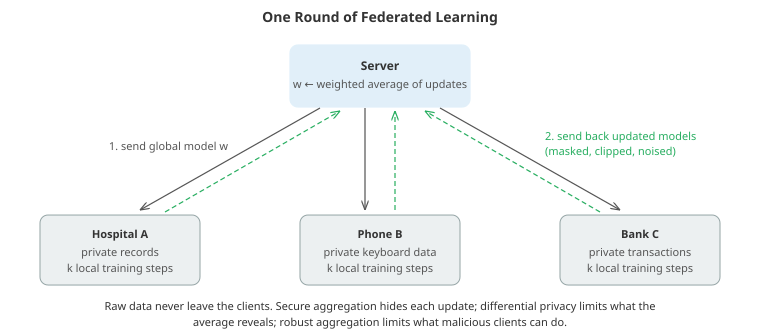

# Decentralised AI

*Most AI today is trained in a few very large data centres on data gathered in one place. Decentralised AI spreads training and inference across many independent parties: phones, hospitals, companies or volunteers who keep their data and hardware. This file covers why that is worth doing, federated learning and its algorithms, privacy (what gradients leak, secure aggregation, differential privacy), robustness to malicious participants, peer-to-peer training without a server, training large models over the internet with little communication, volunteer and incentive-driven networks, and collaboration through model merging*

- There are several distinct reasons to decentralise, and they lead to different designs:
  - **The data cannot move.** Medical records, keyboard input, financial transactions and industrial telemetry are protected by law, contracts or common sense. Bringing the model to the data is often the only option.
  - **Bandwidth and latency.** Billions of devices generate more data than is sensible to upload, and some decisions must be made locally.
  - **Compute is scattered.** Much of the world's computing power sits in consumer GPUs, smaller clusters and idle data centres, not in one place.
  - **Concentration.** Pooling the ability to train frontier models in a few organisations raises economic and governance concerns; decentralised training and open models are one response.
  - **Resilience**: no single point of failure or control.

- This file builds on chapter 06's distributed deep learning file, which covers data, model and pipeline parallelism inside a single data centre with fast, reliable networks. Decentralised settings remove those assumptions: participants are slow, unreliable, heterogeneous, possibly far apart, and not necessarily trustworthy.

## Federated Learning

- **Federated learning** (McMahan et al., 2017) trains a shared model across many **clients** that never share their raw data. A central server coordinates rounds:
  1. The server sends the current global model to a sample of clients.
  2. Each client trains it on its own data for a few local steps.
  3. Each client sends back its updated model (or the update).
  4. The server averages the updates, weighted by how much data each client has, to form the new global model.



- This is **federated averaging (FedAvg)**. With a single local step per round it is ordinary distributed SGD; with many local steps it trades extra computation on the clients for far fewer communication rounds, which is the scarce resource. Google's keyboard next-word prediction was an early large deployment, training across millions of phones.

- Two regimes differ greatly:
  - **Cross-device**: millions of phones or sensors, each with little data, available only intermittently (when charging and on Wi-Fi), so each round samples a small fraction of clients.
  - **Cross-silo**: a handful of institutions (hospitals, banks, companies) with large datasets, reliable connections and stronger legal agreements. Multi-hospital studies have trained tumour segmentation and clinical outcome models this way without pooling patient data (chapter 19's healthcare file).

- **Heterogeneity** is the central difficulty. Clients' data differ: one phone's user writes in Spanish, another in English; one hospital sees mostly elderly patients. With such **non-IID** data, each client's local optimum differs from the global one, and many local steps pull local models in different directions (**client drift**), slowing or biasing convergence. Remedies include **FedProx** (a proximal penalty keeping local models near the global model), **SCAFFOLD** (control variates that estimate and subtract each client's drift), server-side optimisers (applying Adam or momentum to the averaged update), and **personalisation**, where each client fine-tunes the shared model or keeps some personal layers. Systems heterogeneity (slow or dropped clients, "stragglers") adds asynchronous and partial-participation variants.

- The first coding task runs FedAvg with evenly mixed and with heavily skewed clients. Federation beats training alone, dramatically so when each client sees only a few classes, and more local steps reach better accuracy within the same number of communication rounds. The model there is convex, which makes averaging forgiving; client drift is a much larger problem for deep networks.

## Privacy: What Gets Leaked, and How to Stop It

- Keeping raw data on the device is not, by itself, privacy. **Updates leak information.** For a softmax layer, the gradient of a single example is the outer product of the input with the prediction error, so the input can be read off exactly (the second coding task does this). For deep networks, optimisation attacks reconstruct recognisable images and text from shared gradients (Zhu, Liu and Han, 2019, "Deep Leakage from Gradients"), and membership inference can reveal whether a record was used (chapter 06's robustness file).

- **Secure aggregation** (Bonawitz et al., 2017) lets the server learn only the *sum* of the clients' updates. Each pair of clients agrees on a random mask; one adds it and the other subtracts it, so every mask cancels in the sum while each individual masked update looks like noise. Real protocols use cryptographic key agreement, work modulo a large integer so the masks hide updates perfectly, and handle clients that drop out mid-round via secret sharing.

- **Differential privacy** limits what the *aggregate* reveals. In DP federated averaging, each client's update is clipped to a maximum norm and calibrated Gaussian noise is added to the sum, guaranteeing that the trained model would be almost equally likely whether or not any single user participated. It costs accuracy, less so with many participants, and is the only one of these defences with a formal guarantee about the final model.

- Other tools include **trusted execution environments** (hardware enclaves that run aggregation code attested to be unmodified) and **homomorphic encryption** (computing on encrypted values), the latter still expensive for large models. Each defends against a different adversary; real systems combine them.

## Robustness to Malicious Participants

- In open or large federations some clients may be malicious (or simply broken). A **poisoning** attack sends crafted updates to degrade the model or implant a backdoor. Plain averaging has no defence: one client sending a huge update moves the average anywhere. In the third coding task, two of ten clients sending sign-flipped, scaled gradients drive a model's accuracy to almost zero.

- **Byzantine-robust aggregation** replaces the mean with a statistic that a minority cannot control:
  - **coordinate-wise median** or **trimmed mean** (drop the most extreme values in each coordinate);
  - **Krum** and related rules, which pick the update closest to most others;
  - norm clipping, anomaly scoring of updates, and reputation over rounds.

- These tolerate a minority of attackers at some cost in efficiency, and they rely on honest updates looking alike, which non-IID data undermines: a hospital with unusual patients can look like an attacker. Robustness, heterogeneity and privacy pull against each other (secure aggregation hides exactly the individual updates a robust aggregator wants to inspect), and combining them is an active research area.

## Without a Server: Peer-to-Peer Training

- **Decentralised SGD** removes the server entirely. Each node keeps its own model, takes local gradient steps, and periodically averages with its neighbours in a communication graph (**gossip**). If $W$ is the matrix of mixing weights (doubly stochastic: rows and columns sum to one), repeated mixing drives every node towards the global average, with disagreement shrinking like $\lambda_2^t$, where $\lambda_2$ is the second-largest eigenvalue magnitude of $W$. The **spectral gap** $1 - \lambda_2$ therefore sets the speed, linking decentralised learning to the graph theory of chapter 12.

- The fourth coding task measures it: on a ring of 64 nodes, agreement takes thousands of rounds; adding one random long-range link per node (turning the ring into an **expander graph**) cuts that roughly 25-fold. Well-designed topologies give most of the benefit of all-to-all communication at a fraction of its cost, with no central coordinator.

## Training Large Models Over the Internet

- Training a large language model normally needs tightly coupled accelerators exchanging gradients many times per second over networks of hundreds of gigabits per second. Over the internet, bandwidth is thousands of times lower and latency much higher. Several techniques narrow the gap:
  - **Gradient compression**: send only the largest entries (top-$k$ sparsification), quantise to a few bits, or send a low-rank approximation (PowerSGD). Dropping information biases training unless the dropped part is accumulated locally and added back later (**error feedback**). In the fifth coding task, sending 1% of each gradient cuts communication 50-fold; without error feedback the model learns far worse, and with it the loss matches full communication.
  - **Infrequent synchronisation**: local SGD and **DiLoCo** (Douillard et al., 2023) let each worker take hundreds of local optimiser steps between synchronisations, then apply an outer optimiser (Nesterov momentum) to the averaged change, reducing communication by hundreds of times with little loss. Prime Intellect's INTELLECT-1 (2024), a 10-billion-parameter model, was trained this way across multiple continents, and later projects extended decentralised training to reinforcement learning of reasoning models.
  - **Pipeline training over unreliable peers**: SWARM parallelism and related systems route each micro-batch through whichever peers are available for each pipeline stage, tolerating failures and heterogeneous hardware.
  - **Decentralised inference**: Petals runs very large models collaboratively, each volunteer serving some of the layers, like BitTorrent for model inference.

- These methods are real and improving, but decentralised training of the very largest models remains far from matching dedicated clusters, mostly because of the bandwidth needed during the inner steps and the overhead of verifying untrusted participants.

## Volunteer Computing, Incentives and Verification

- **Volunteer computing** has a long history: SETI@home analysed radio telescope data on home computers from 1999, and Folding@home, simulating protein dynamics, briefly exceeded an exaflop of aggregate computing in 2020 when millions joined during the pandemic. Volunteers donate idle cycles; trust is handled by redundancy (send the same work to several machines and compare).

- Some projects pay participants instead, often with cryptocurrency tokens, creating marketplaces for GPU time or networks that reward contributions of models and computation. These raise two hard problems:
  - **Verification**: how do you know an untrusted node really did the training or inference it claims, rather than returning garbage or a cheaper model's output? Approaches include redundant computation, **proof-of-learning** (recording training checkpoints that others can spot-check), **optimistic verification** (accept results unless someone challenges and re-executes a disputed step), and **zero-knowledge proofs** of inference (zkML), which are mathematically strong but still far too expensive for large models.
  - **Incentive design**: rewards must favour genuinely useful work and resist gaming, collusion and spam, which is a mechanism-design problem as much as a machine learning one.

- These systems vary widely in substance, so evaluate them like any other claim: what is actually computed, how it is verified, what it costs compared with renting the same hardware centrally, and who controls the result.

## Collaboration Without Shared Training

- Decentralisation can also happen after training. Open-weight models (chapter 07) let anyone fine-tune and run models locally, on-device inference (chapter 17) keeps data on the user's hardware, and **model merging** combines models trained separately: averaging fine-tuned copies of the same base model ("model soups") or adding and subtracting the weight changes that fine-tuning produced for different tasks ("task arithmetic"). Merging works because fine-tuned models from a common starting point tend to remain in a connected low-loss region of weight space; it lets teams combine skills without sharing data or coordinating training.

## Coding Tasks (use CoLab or notebook)

1. Federated averaging with evenly mixed and with heavily skewed clients: compare it with training on all data centrally and with each client training alone, for different numbers of local steps per round.
```python
import numpy as np

# Federated averaging (FedAvg): clients train locally on their own data; only model updates are shared.
rng = np.random.default_rng(0)
K, d, n_clients = 5, 20, 10                        # classes, features, clients
W_true = rng.normal(0, 1, (d, K))
def make(n):
    X = rng.normal(0, 1, (n, d))
    y = np.argmax(X @ W_true + rng.gumbel(size=(n, K)), 1)
    return X, y
X_all, y_all = make(10000); X_test, y_test = make(5000)

def split(skewed):
    """IID: random shards. Non-IID: each client holds mostly 1-2 classes (like phones of different users)."""
    if not skewed:
        return np.array_split(rng.permutation(len(y_all)), n_clients)
    shards = []
    for c in range(n_clients):
        main = [c % K, (c + 1) % K]
        p = np.where(np.isin(y_all, main), 1.0, 0.02); p /= p.sum()
        shards.append(rng.choice(len(y_all), 1000, replace=False, p=p))
    return shards

def softmax(Z):
    Z = Z - Z.max(1, keepdims=True); E = np.exp(Z); return E / E.sum(1, keepdims=True)
def grad(W, X, y):
    return X.T @ (softmax(X @ W) - np.eye(K)[y]) / len(y)
acc = lambda W: np.mean(np.argmax(X_test @ W, 1) == y_test)

def fedavg(shards, rounds=30, local_steps=10, lr=0.5, mu=0.0):
    """mu > 0 adds the FedProx term mu/2 ||W - W_global||^2, which keeps local models near the global one."""
    W = np.zeros((d, K))
    for r in range(rounds):
        updates, sizes = [], []
        for idx in shards:
            Wl = W.copy()
            for _ in range(local_steps):
                Wl -= lr * (grad(Wl, X_all[idx], y_all[idx]) + mu * (Wl - W))
            updates.append(Wl); sizes.append(len(idx))
        W = np.average(updates, axis=0, weights=sizes)   # the server only ever sees model parameters
    return W

W_central = np.zeros((d, K))
for _ in range(300):
    W_central -= 0.5 * grad(W_central, X_all, y_all)
print(f"centralised training on all data (the privacy-violating ideal): test accuracy {acc(W_central):.3f}")
for skewed in [False, True]:
    shards = split(skewed)
    local_only = np.mean([acc(fedavg([s], rounds=10, local_steps=10)) for s in shards[:3]])
    print(f"\n{'non-IID' if skewed else 'IID'} clients")
    print(f"  each client trains alone:                       test accuracy {local_only:.3f}")
    for steps in [1, 10, 50]:
        print(f"  FedAvg, 10 rounds of communication, {steps:2d} local steps: test accuracy "
              f"{acc(fedavg(shards, rounds=10, local_steps=steps)):.3f}")
print("\nCollaboration beats training alone, most dramatically when each client's data are skewed, and no raw"
      "\ndata leave the clients. More local computation per round reaches higher accuracy for the same number of"
      "\ncommunication rounds. This model is convex, which makes averaging forgiving; with deep networks and"
      "\nskewed clients, many local steps can pull local models apart ('client drift'), which methods such as"
      "\nFedProx and SCAFFOLD correct.")
```

2. Privacy: reconstruct a private input exactly from a single shared gradient, then hide individual updates with pairwise masks that cancel in the sum (secure aggregation).
```python
import numpy as np

rng = np.random.default_rng(1)
d, K = 64, 10
W = rng.normal(0, 0.1, (d, K)); b = np.zeros(K)

# 1. Gradients can leak the data. A client computes the gradient of a softmax classifier on ONE private example.
x_private = rng.uniform(0, 1, d)                   # e.g. an 8x8 image
y_private = 3
z = x_private @ W + b
p = np.exp(z - z.max()); p /= p.sum()
err = p - np.eye(K)[y_private]                     # dL/dz
grad_W = np.outer(x_private, err)                  # what the client would send
grad_b = err

# The server's reconstruction: each column of grad_W is x scaled by err_k, and grad_b gives err_k exactly
k = np.argmax(np.abs(grad_b))
x_reconstructed = grad_W[:, k] / grad_b[k]
label_guess = np.argmin(grad_b)                    # the true class is the only negative entry of p - onehot
print(f"reconstruction error of the private input: {np.max(np.abs(x_reconstructed - x_private)):.2e}")
print(f"recovered label: {label_guess} (true {y_private})")
print("For this layer the gradient of one example reveals the example exactly. For deep networks, optimisation"
      "\nattacks ('deep leakage from gradients') recover recognisable images and text from shared gradients.")

# 2. Secure aggregation: the server learns only the SUM of the clients' updates.
n_clients = 5
updates = [rng.normal(0, 1, 6) for _ in range(n_clients)]
# Every pair of clients agrees on a shared random mask (in practice via a key exchange, and with uniform
# random integers modulo a large number, which hide the update perfectly; Gaussian masks keep this demo short);
# client i adds it, client j subtracts it, so all masks cancel in the sum.
masks = {(i, j): rng.normal(0, 100, 6) for i in range(n_clients) for j in range(i + 1, n_clients)}
masked = []
for i in range(n_clients):
    m = updates[i].copy()
    for (a, c), mask in masks.items():
        if a == i: m += mask
        if c == i: m -= mask
    masked.append(m)
print(f"\nclient 0's true update:        {np.round(updates[0], 2)}")
print(f"what the server receives from 0: {np.round(masked[0], 2)}   (looks like noise)")
print(f"sum of masked updates:  {np.round(np.sum(masked, 0), 6)}")
print(f"sum of true updates:    {np.round(np.sum(updates, 0), 6)}")
print("Individual updates are hidden, the aggregate is exact. Real protocols (Bonawitz et al., 2017) also"
      "\nhandle clients that drop out mid-round. Differential privacy (clipping plus noise) additionally limits"
      "\nwhat the aggregate itself reveals about any one participant.")
```

3. Byzantine robustness: two of ten clients send poisoned updates. Compare the mean with coordinate-wise median, trimmed mean and Krum.
```python
import numpy as np

# Robust aggregation: 10 clients, of which 2 are malicious and send poisoned updates.
rng = np.random.default_rng(2)
K, d = 5, 20
W_true = rng.normal(0, 1, (d, K))
def make(n):
    X = rng.normal(0, 1, (n, d)); return X, np.argmax(X @ W_true + rng.gumbel(size=(n, K)), 1)
clients = [make(500) for _ in range(10)]
X_test, y_test = make(4000)
softmax = lambda Z: (lambda E: E / E.sum(1, keepdims=True))(np.exp(Z - Z.max(1, keepdims=True)))
grad = lambda W, X, y: X.T @ (softmax(X @ W) - np.eye(K)[y]) / len(y)
acc = lambda W: np.mean(np.argmax(X_test @ W, 1) == y_test)
bad = {0, 1}

def aggregate(updates, rule, f=2):
    U = np.array([u.ravel() for u in updates])
    if rule == "mean":
        g = U.mean(0)
    elif rule == "coordinate-wise median":
        g = np.median(U, 0)
    elif rule == "trimmed mean":
        S = np.sort(U, 0); g = S[f:len(U) - f].mean(0)     # drop the f largest and f smallest per coordinate
    elif rule == "Krum":
        # choose the update closest to its n - f - 2 nearest neighbours
        D = ((U[:, None] - U[None]) ** 2).sum(-1)
        scores = np.sort(D, 1)[:, 1:len(U) - f - 1].sum(1)
        g = U[np.argmin(scores)]
    return g.reshape(updates[0].shape)

for attack in ["none", "sign flip x10", "random noise"]:
    print(f"\nattack: {attack}")
    for rule in ["mean", "coordinate-wise median", "trimmed mean", "Krum"]:
        W = np.zeros((d, K))
        for r in range(60):
            updates = []
            for i, (X, y) in enumerate(clients):
                g = grad(W, X, y)
                if i in bad and attack == "sign flip x10": g = -10 * g
                if i in bad and attack == "random noise": g = rng.normal(0, 5, g.shape)
                updates.append(g)
            W -= 0.5 * aggregate(updates, rule)
        print(f"   {rule:24s} test accuracy {acc(W):.3f}")
print("\nPlain averaging can be dragged anywhere by a single bad participant. Median-style and distance-based"
      "\nrules tolerate a minority of attackers, at some cost in efficiency, and assume honest clients look alike,"
      "\nwhich skewed (non-IID) data make harder to tell apart from attacks.")
```

4. Gossip averaging without a server: how the shape of the communication graph and its spectral gap determine how fast nodes agree.
```python
import numpy as np

# Gossip averaging: no central server. Each node repeatedly replaces its value with a weighted average of
# its neighbours'. How fast everyone agrees depends on the network's shape.
rng = np.random.default_rng(3)
n = 64

def metropolis(A):
    """Symmetric, doubly stochastic mixing weights from an adjacency matrix (Metropolis-Hastings rule)."""
    deg = A.sum(1)
    W = np.where(A > 0, 1.0 / (1 + np.maximum(deg[:, None], deg[None, :])), 0.0)
    np.fill_diagonal(W, 1 - W.sum(1))
    return W

def ring(n):
    A = np.zeros((n, n))
    for i in range(n): A[i, (i + 1) % n] = A[(i + 1) % n, i] = 1
    return A
def ring_plus_random(n):
    A = ring(n)                                       # a ring plus one random perfect matching of long-range links
    p = rng.permutation(n)
    for a, b in zip(p[::2], p[1::2]): A[a, b] = A[b, a] = 1
    np.fill_diagonal(A, 0)
    return A
def complete(n):
    return np.ones((n, n)) - np.eye(n)

x0 = rng.normal(0, 1, n)                              # each node's local model (one number for simplicity)
rounds_needed = {}
print(f"{'topology':22s} {'links per node':>14s} {'second eigenvalue':>18s} {'rounds to 1e-6':>15s}")
for name, A in [("ring", ring(n)), ("ring + random links", ring_plus_random(n)), ("complete graph", complete(n))]:
    W = metropolis(A)
    lam2 = np.sort(np.abs(np.linalg.eigvalsh(W)))[-2]   # the largest eigenvalue is 1 (consensus)
    x, rounds = x0.copy(), 0
    while np.max(np.abs(x - x0.mean())) > 1e-6 and rounds < 100000:
        x = W @ x; rounds += 1
    rounds_needed[name] = rounds
    print(f"{name:22s} {A.sum(1).mean():14.1f} {lam2:18.4f} {rounds:15d}")
speedup = rounds_needed["ring"] / rounds_needed["ring + random links"]
print("\nThe disagreement shrinks like (second eigenvalue)^t, so the spectral gap 1 - lambda_2 sets the speed."
      f"\nOne extra random long-range link per node (making the graph an 'expander') cuts the rounds {speedup:.0f}-fold;"
      "\nall-to-all is fastest but needs a link to every other node. Decentralised SGD interleaves such gossip"
      "\nsteps with local gradient steps.")
```

5. Communication compression: send only the top 1% of each gradient, with and without error feedback.
```python
import numpy as np

# Communication-efficient training: 8 workers, logistic regression with 1,000 features.
# Each step, every worker sends its gradient to be averaged. Can we send 1% of it instead?
rng = np.random.default_rng(4)
d, n_workers = 1000, 8
w_true = rng.normal(0, 1, d) * (rng.uniform(size=d) < 0.1)
data = []
for _ in range(n_workers):
    X = rng.normal(0, 1, (300, d)) / np.sqrt(d)
    y = (rng.uniform(size=300) < 1 / (1 + np.exp(-X @ w_true * 5))).astype(float)
    data.append((X, y))
def loss_grad(w, X, y):
    p = 1 / (1 + np.exp(-X @ w))
    loss = -np.mean(y * np.log(p + 1e-12) + (1 - y) * np.log(1 - p + 1e-12))
    return loss, X.T @ (p - y) / len(y)

def top_k(v, k):
    out = np.zeros_like(v); idx = np.argpartition(np.abs(v), -k)[-k:]; out[idx] = v[idx]; return out

def train(compress, error_feedback, steps=400, lr=8.0):
    w = np.zeros(d)
    memory = [np.zeros(d) for _ in range(n_workers)]
    sent = 0
    for _ in range(steps):
        msgs = []
        for i, (X, y) in enumerate(data):
            _, g = loss_grad(w, X, y)
            if compress:
                g_plus = g + memory[i] if error_feedback else g
                m = top_k(g_plus, d // 100)                   # send only the 1% largest entries
                if error_feedback: memory[i] = g_plus - m     # remember what was not sent, add it next time
                sent += 2 * (d // 100)                        # values + indices
            else:
                m = g; sent += d
            msgs.append(m)
        w -= lr * np.mean(msgs, 0)
    return np.mean([loss_grad(w, X, y)[0] for X, y in data]), sent

full_sent = None
for name, c, ef in [("full gradients", False, False), ("top-1% only", True, False), ("top-1% + error feedback", True, True)]:
    loss, sent = train(c, ef)
    full_sent = full_sent or sent
    print(f"{name:26s} final training loss {loss:.4f}   numbers sent {sent:10,d} ({full_sent / sent:4.0f}x less)")
print("\nSending 1% of each gradient (plus its positions) cuts communication about 50-fold. Dropping the rest outright biases training: small"
      "\ncoordinates never get updated. Error feedback accumulates the dropped part locally and sends it once it"
      "\ngrows large, recovering most of the accuracy. Methods that synchronise only every few hundred local steps"
      "\n(local SGD, DiLoCo) cut communication further and made training across distant data centres practical.")
```
