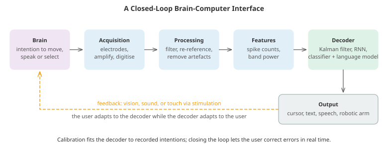

# Brain-Machine Interfaces

*A brain-machine interface (BMI, or brain-computer interface, BCI) records brain activity and turns it into commands for a computer, a cursor, a robotic arm or a voice, or delivers signals back into the nervous system. This file covers how the brain is recorded, the signal processing that turns raw voltages into features, decoding movement from populations of neurons, non-invasive EEG interfaces, speech and handwriting neuroprostheses built on language models, stimulating the brain, foundation models for neural data, the devices in human trials, and the ethical questions that come with reading and writing neural activity*

- A BCI is a pipeline: **record** neural activity, **process** it into features, **decode** an intended action, **act**, and give the user **feedback** so they can correct course. Most of it is signal processing and machine learning applied to unusually noisy, unusually personal, non-stationary data.



- The main users today are people with paralysis from spinal cord injury, stroke or amyotrophic lateral sclerosis (ALS), for whom restoring communication or movement is life-changing. The oldest and most widespread neural interfaces, though, are those that *write* to the nervous system: cochlear implants, which restore hearing to on the order of a million people, and deep brain stimulation for Parkinson's disease.

- Some history. Hans Berger recorded the first human electroencephalogram (EEG) in 1924; Jacques Vidal coined "brain-computer interface" in 1973; Georgopoulos and colleagues showed in the 1980s that motor cortex neurons encode movement direction; monkeys controlled cursors and robotic arms with implanted electrodes around 2000; and in 2006 the BrainGate trial (Hochberg et al.) reported a man with tetraplegia moving a computer cursor using an implanted array. The 2020s brought speech decoding at conversational speed and commercial devices in human trials.

## Recording the Brain

- Every recording method trades **invasiveness** against **signal quality**. Signals degrade with distance from the neurons: skull and scalp blur and attenuate them, and they mix the activity of millions of cells.

| Method | Placement | What it measures | Spatial resolution | Time resolution |
|---|---|---|---|---|
| EEG | scalp | summed synaptic currents of millions of neurons | several cm | milliseconds |
| MEG | outside head | magnetic fields of the same currents | ~1 cm | milliseconds |
| fNIRS, fMRI | outside head | blood oxygenation (a slow proxy for activity) | cm (fNIRS), mm (fMRI) | seconds |
| ECoG | brain surface, under the skull | local population activity | mm | milliseconds |
| Endovascular | inside a blood vessel next to cortex | local population activity | mm | milliseconds |
| Intracortical microelectrodes | inside cortex | spikes of individual neurons, local field potentials | ~0.1 mm | sub-millisecond |

- **EEG** is cheap, safe and portable, which makes it the most common BCI modality, but its information rate is low. **fMRI** gives detailed maps of activity across the whole brain, but it needs a scanner and responds over seconds, so it is a research tool, not a practical interface.

- **Intracortical arrays** record single neurons. The **Utah array**, a 4 mm square of 96 silicon needles each about 1-1.5 mm long, has been the workhorse of human BCI research for two decades. Newer devices have far more channels: flexible polymer threads inserted by a robot, high-density thin-film grids laid on the cortex, and stent-mounted electrodes placed through the blood vessels without opening the skull.

- Implants face biology: the brain treats them as foreign bodies, scar tissue forms around electrodes, and recording quality changes over months and years. Smaller, softer electrodes provoke less reaction; long-term stability remains one of the field's central engineering problems.

## Neural Signals and Signal Processing

- An electrode inside cortex records two things on top of each other. **Action potentials (spikes)** of nearby neurons last about a millisecond and appear at frequencies of roughly 300-5,000 Hz. **Local field potentials** (LFP), below about 300 Hz, reflect the summed synaptic activity around the electrode. A band-pass filter separates them (chapter 09's digital signal processing file covers filters).

- **Spike detection** thresholds the filtered signal, typically at 4-5 times the noise level. The noise level is estimated as the median absolute value divided by 0.6745, which equals the standard deviation for Gaussian noise but is barely affected by the spikes themselves.

- **Spike sorting** assigns each spike to a neuron: one electrode often hears two to five cells, each with a characteristic waveform shape depending on its size and distance. The classic pipeline extracts each spike's waveform, reduces it with PCA (chapter 02) and clusters it (chapter 06's clustering file). The third coding task builds this pipeline from a simulated recording. Modern high-channel-count arrays use automated sorters that match templates across neighbouring channels. Many clinical BCIs skip sorting entirely and decode from the count of **threshold crossings** per electrode. This loses little information, needs no sorting, and is more robust as waveforms change over time.

- **EEG** has its own processing chain. Signals are re-referenced (for example to the common average of all electrodes) and filtered into frequency bands with names going back to Berger: delta (below 4 Hz), theta (4-8 Hz), alpha or mu (8-13 Hz), beta (13-30 Hz) and gamma (above 30 Hz). Artefacts are removed: eye blinks and muscle activity are tens of times larger than brain signals. Independent component analysis (chapter 09's source separation file) is the standard tool for separating them out.

- Neural signals are **non-stationary**. Electrodes shift by micrometres, neurons appear and disappear from recordings, and the brain itself changes with attention, fatigue and learning. A decoder calibrated today will degrade tomorrow, and handling that drift is as important as the decoder's accuracy on day one.

## Decoding Movement

- Neurons in motor cortex are broadly **tuned** to movement. Georgopoulos et al. (1982) found that a neuron's firing rate varies roughly with the cosine of the angle between the movement direction and the neuron's **preferred direction**:

$$r_i(\theta) = b_i + m_i \cos(\theta - \theta_i)$$

- No single neuron determines the direction, but a population does. The **population vector** (Georgopoulos et al., 1986) sums each neuron's preferred direction, weighted by how much its rate rises above baseline:

$$\hat{\mathbf{d}} = \sum_i \frac{r_i - b_i}{m_i}\, \begin{pmatrix} \cos\theta_i \\ \sin\theta_i \end{pmatrix}$$

- It is elegant and works when preferred directions are spread evenly. When they are not, as with the few dozen neurons a small array happens to record, it is biased. The **optimal linear estimator** regresses the movement directly on the firing rates, and **maximum likelihood** decoding uses a probabilistic model of spike counts (Poisson). Both correct the bias. The first coding task compares all three.

- Continuous control (moving a cursor smoothly) decodes **velocity** in short time bins, typically 20-50 ms. A single bin holds only a few spikes per neuron, so the decoder must combine evidence over time:
  - The **Wiener filter** regresses velocity on the recent history of every neuron's spike counts: linear regression with lagged features (chapter 06's time series file).
  - The **Kalman filter** (Wu et al., 2003) combines a model of how movement evolves ($\mathbf{x}_t = A\mathbf{x}_{t-1} + \mathbf{w}_t$) with a model of how neurons respond to it ($\mathbf{y}_t = H\mathbf{x}_t + \mathbf{q}_t$), the same predict-and-correct recursion as in chapter 06's time series file and chapter 08's tracking. The second coding task shows a practical benefit of this split. When the neurons drift, only the neural model $H$ needs refitting, which takes half a minute of data, while the movement model stays fixed.
  - **ReFIT** (Gilja et al., 2012) refits the Kalman filter on closed-loop data. During calibration it assumes the user always intended to move straight towards the target, and so corrects for the difference between what was decoded and what was meant. That substantially improved control, and closed-loop recalibration of this kind is now standard.
  - **Recurrent neural networks** and transformers trained on many sessions now outperform linear decoders, especially for complex movements and for speech.

- **Closing the loop** changes everything. Offline accuracy on recorded data is a poor predictor of online control, because the user sees the cursor and adjusts. The brain adapts to the decoder while the decoder adapts to the brain (**co-adaptation**). Decoders are therefore evaluated online, by task completion time and bits per second, not just by $R^2$ on held-out data.

- Restoring movement goes beyond cursors. People with tetraplegia have controlled robotic arms to drink from a cup (BrainGate, 2012) and to manipulate objects with many degrees of freedom (Collinger et al., 2013). Other studies have decoded intended movement to drive electrical stimulation of a person's own paralysed muscles. In a 2023 study, a "digital bridge" between a cortical implant and a spinal cord stimulator let a man with paralysis from spinal cord injury walk more naturally (Lorach et al.).

## Non-Invasive BCIs with EEG

- EEG BCIs use a few well-characterised brain responses:
  - **P300**: an attended, rare stimulus evokes a positive voltage peak about 300 ms later. In the **P300 speller** (Farwell and Donchin, 1988), rows and columns of a letter grid flash in turn, and the letter whose row and column evoke a P300 is selected.
  - **Steady-state visual evoked potentials (SSVEP)**: looking at a target flickering at a fixed frequency produces EEG activity at that frequency and its harmonics over visual cortex. Each target flickers at its own frequency. Laboratory SSVEP spellers have exceeded 200 bits per minute (Chen et al., 2015), the fastest non-invasive systems.
  - **Motor imagery**: imagining moving a hand reduces the mu and beta rhythms over the opposite motor cortex (**event-related desynchronisation**). Motor imagery needs no external stimulus, but it is slow, needs training, and a sizeable minority of users never achieve reliable control.

- The classic motor imagery decoder is **common spatial patterns** (CSP). It finds spatial filters $\mathbf{w}$ whose output variance is as different as possible between the two classes, by solving the generalised eigenvalue problem

$$C_1 \mathbf{w} = \lambda\, (C_1 + C_2)\, \mathbf{w}$$

- where $C_k$ is the average spatial covariance of class $k$. Filters with eigenvalues near 1 or near 0 give high variance for one class and low for the other. The log-variance of the filtered signals is then classified with linear discriminant analysis (LDA), a linear classifier that models each class as a Gaussian with a shared covariance matrix. The fourth coding task builds the pipeline. It also shows a trap: CSP is fitted to labels, so fitting it on all trials before cross-validation leaks the test trials into the features (chapter 06's model evaluation file). With a weak effect, that makes a mediocre decoder look like a good one.

- **Riemannian geometry** methods treat each trial's covariance matrix as a point on the manifold of symmetric positive-definite matrices and classify by distances on that manifold. They are among the most robust EEG decoders. Deep networks designed for EEG (such as EEGNet) learn spatial and temporal filters end to end. With the small datasets typical of EEG, they often do not beat these classical methods by much.

- **Information transfer rate** compares BCIs with different numbers of choices and accuracies. Wolpaw's formula gives the bits per selection for $N$ equally likely choices selected with accuracy $P$:

$$B = \log_2 N + P \log_2 P + (1 - P) \log_2 \frac{1 - P}{N - 1}$$

- Divide by the time per selection to get bits per minute. The fifth coding task uses it to find the best number of flash repetitions in a P300 speller. The rate peaks at an accuracy well below 100%, although users may prefer more accuracy than the rate suggests, since correcting errors is tiring.

## Communication: Handwriting and Speech

- For people who cannot speak, restoring communication is the most valuable thing a BCI can do, and progress since 2021 has been rapid:
  - **Handwriting** (Willett et al., 2021): a participant with an intracortical implant imagined writing letters by hand. A recurrent network decoded about 90 characters per minute, with 94% raw accuracy and over 99% after language-model autocorrection. Pointing at a keyboard with a decoded cursor had reached about 40 characters per minute.
  - **Speech** (Willett et al., 2023; Metzger et al., 2023): two groups decoded attempted speech, one from intracortical arrays and one from a high-density ECoG grid. They reached 62 and 78 words per minute, with word error rates around 25% on large vocabularies; one system also drove a synthesised voice and a talking avatar. Natural conversation runs at about 150 words per minute.
  - In 2024, Card et al. reported a man with ALS who communicated with his family using a speech BCI at about 97% word accuracy, used daily over many months. In 2025, groups demonstrated streaming synthesis of a participant's own voice, with intonation, and with little delay.

- These systems are built like speech recognisers (chapter 09). A recurrent network maps neural features to phoneme probabilities every few tens of milliseconds and is trained with the CTC loss, because the alignment between neural activity and phonemes is unknown. A language model (chapter 07) then searches for the most probable sentence. The language model contributes much of the accuracy: the neural signal narrows the possibilities, and the model's knowledge of language chooses among them. That raises a question with no settled answer: when does the system express what the person meant, and when does it put words in their mouth?

## Writing to the Brain

- Stimulation sends information the other way:
  - **Cochlear implants** turn sound into patterns of electrical stimulation of the auditory nerve. They are the most successful neural interface by far.
  - **Deep brain stimulation** (DBS) delivers continuous pulses to deep structures to treat Parkinson's disease tremor and other movement disorders, and it has been used in well over 100,000 people. **Closed-loop** stimulators record as well as stimulate. NeuroPace's responsive neurostimulation detects the onset of epileptic seizures and stimulates to disrupt them, and adaptive DBS adjusts stimulation to the patient's brain state.
  - **Sensory feedback** for BCIs: stimulating the somatosensory cortex through implanted electrodes evokes touch sensations felt in the paralysed hand. Adding this feedback to robotic arm control roughly halved the time to complete grasping tasks (Flesher et al., 2021). Without touch, a robotic hand must be guided by vision alone.
  - **Visual prostheses** stimulate the retina or visual cortex to produce spots of light (phosphenes). Restoring useful vision remains far harder than restoring hearing.

## AI and Neural Data

- Machine learning is now central to BCIs beyond the decoder itself:
  - **Foundation models for neural data**: transformers pretrained on spiking activity from many sessions, subjects and tasks (such as NDT and POYO) learn representations that transfer. They need far less calibration data for a new session or person. This is the neural-data counterpart of pretrained language and vision models.
  - **Decoding perception from fMRI**: models trained on hours of each person's scans have reconstructed approximations of viewed images, by mapping brain activity into the latent space of a diffusion model (Takagi and Nishimoto, 2023). They have also produced paraphrases of heard or imagined stories, by scoring a language model's candidates against predicted brain responses (Tang et al., 2023). These are striking, but they need extensive, cooperative training data per person, and they degrade sharply when the participant resists: they are not "mind reading" at a distance.
  - **Neuroscience as data science**: large public datasets of neural recordings, standard formats and benchmarks have begun to do for neural decoding what ImageNet did for vision (chapter 08).

## The State of the Field

- As of 2025-2026, several companies and academic consortia had devices in human trials, with different trade-offs:
  - BrainGate and similar academic trials (Utah arrays) have involved dozens of participants over two decades, producing most of the scientific record.
  - Neuralink's N1 implant uses 1,024 electrodes on 64 flexible threads, inserted by a surgical robot, with wireless power and data. Its first human participant, implanted in January 2024, controlled a computer cursor, and a growing number of participants followed. Some threads retracting from the cortex early on illustrated the stability challenge.
  - Synchron's Stentrode is delivered through the jugular vein into a large vessel next to the motor cortex, with no open brain surgery. It records lower-resolution signals that participants have used to text and browse.
  - Thin-film ECoG grids with thousands of electrodes, from companies such as Precision Neuroscience, sit on the cortical surface. They are first tested during brain surgery for other reasons.

- Hard problems remain: devices that record stably for a decade or more, fully implanted wireless systems with low enough power to avoid heating tissue, decoders that need little or no recalibration, regulatory approval, and reimbursement models that make devices available beyond trials.

## Ethics

- BCIs raise questions beyond those of other medical devices:
  - **Neural data privacy**: neural recordings can reveal health conditions, emotional states and, increasingly, perceptual and linguistic content. Chile amended its constitution in 2021 to protect "neurorights", and in 2024 Colorado and California extended their privacy laws to cover neural data. Consumer EEG devices sit largely outside medical regulation.
  - **Agency and authorship**: if a language model completes a person's sentence, who said it? Users need ways to check and veto what is decoded in their name.
  - **Long-term support**: implant recipients depend on companies that may fail. When the maker of one retinal implant stopped supporting it, users were left with unmaintained hardware in their eyes. Ethical trials plan for device maintenance, removal and data stewardship after the study ends.
  - **Informed consent and expectations**: participants are often people with severe disabilities, and trial results are reported publicly with much attention. Both raise the stakes of describing benefits and risks honestly.
  - **Enhancement and access**: devices for healthy users, and the question of who gets access to therapeutic ones, raise questions of fairness (chapter 06's fairness file) as well as safety.

## Coding Tasks (use CoLab or notebook)

1. Decode reach direction from simulated cosine-tuned motor cortex neurons, comparing the population vector, the optimal linear estimator and Poisson maximum likelihood, with evenly and unevenly spread preferred directions.
```python
import numpy as np
import matplotlib.pyplot as plt

# Motor cortex neurons are "cosine tuned" (Georgopoulos, 1982): each fires most for movements in its preferred
# direction, and its rate falls off with the cosine of the angle away from it. Decode reach direction from them.
rng = np.random.default_rng(0)
n_neurons, T = 60, 0.5                                     # 60 recorded neurons, 500 ms counting window

def make_population(uniform):
    if uniform:
        pd = rng.uniform(0, 2 * np.pi, n_neurons)          # preferred directions spread evenly
    else:
        pd = rng.vonmises(0.0, 1.5, n_neurons)             # most electrodes landed on neurons preferring "right"
    baseline = rng.uniform(5, 20, n_neurons)               # spikes per second
    depth = rng.uniform(5, 20, n_neurons)
    return pd, baseline, depth

def spike_counts(theta, pd, baseline, depth):
    rate = baseline + depth * np.cos(theta[:, None] - pd[None, :])
    return rng.poisson(np.clip(rate, 0, None) * T)          # Poisson spike counts, trials x neurons

def angle_error(a, b):
    return np.degrees(np.abs(np.angle(np.exp(1j * (a - b)))))

for uniform in (True, False):
    pd, baseline, depth = make_population(uniform)
    theta_train = rng.uniform(0, 2 * np.pi, 400)           # calibration reaches with known directions
    theta_test = rng.uniform(0, 2 * np.pi, 2000)
    X_train, X_test = spike_counts(theta_train, pd, baseline, depth), spike_counts(theta_test, pd, baseline, depth)

    # Fit each neuron's tuning curve by linear regression: count = b0 + bx cos(theta) + by sin(theta)
    D = np.column_stack([np.ones_like(theta_train), np.cos(theta_train), np.sin(theta_train)])
    coef, *_ = np.linalg.lstsq(D, X_train, rcond=None)     # 3 x neurons
    b0, bxy = coef[0], coef[1:]
    pd_hat = np.arctan2(bxy[1], bxy[0])

    # 1. Population vector: each neuron votes for its preferred direction, weighted by its normalised activity
    w = (X_test - b0) / np.linalg.norm(bxy, axis=0)
    pv = w @ np.column_stack([np.cos(pd_hat), np.sin(pd_hat)])
    theta_pv = np.arctan2(pv[:, 1], pv[:, 0])

    # 2. Optimal linear estimator: regress the movement direction (cos, sin) directly on the spike counts
    A = np.column_stack([np.ones(len(X_train)), X_train])
    W_ole, *_ = np.linalg.lstsq(A, np.column_stack([np.cos(theta_train), np.sin(theta_train)]), rcond=None)
    ole = np.column_stack([np.ones(len(X_test)), X_test]) @ W_ole
    theta_ole = np.arctan2(ole[:, 1], ole[:, 0])

    # 3. Maximum likelihood with the Poisson model, searched over a grid of directions
    grid = np.linspace(0, 2 * np.pi, 360, endpoint=False)
    rates = np.clip(b0[None, :] + np.column_stack([np.cos(grid), np.sin(grid)]) @ bxy, 0.1, None)
    loglik = X_test @ np.log(rates).T - rates.sum(1)[None, :]
    theta_ml = grid[loglik.argmax(1)]

    label = "evenly spread preferred directions" if uniform else "preferred directions bunched around 0 degrees"
    print(f"{label}:")
    for name, est in [("population vector", theta_pv), ("optimal linear estimator", theta_ole),
                      ("Poisson maximum likelihood", theta_ml)]:
        print(f"  {name:28s} median error {np.median(angle_error(est, theta_test)):5.1f} degrees")
    if not uniform:
        bins = np.linspace(0, 2 * np.pi, 9)
        idx = np.digitize(theta_test, bins) - 1
        bias = [np.degrees(np.angle(np.mean(np.exp(1j * (theta_pv - theta_test))[idx == k]))) for k in range(8)]
        print("  population vector bias for true directions in 45-degree bins starting at 0 (degrees):",
              np.round(bias, 0))

    if uniform:
        fig, ax = plt.subplots(1, 2, figsize=(11, 4))
        th = np.linspace(0, 2 * np.pi, 200)
        for k in range(5):
            ax[0].plot(np.degrees(th), baseline[k] + depth[k] * np.cos(th - pd[k]))
        ax[0].set_xlabel("movement direction (degrees)"); ax[0].set_ylabel("firing rate (Hz)")
        ax[0].set_title("Cosine tuning curves of five neurons")
        ax[1].scatter(np.degrees(theta_test[:300]), np.degrees(theta_ml[:300]), s=6)
        ax[1].set_xlabel("true direction"); ax[1].set_ylabel("decoded direction (maximum likelihood)")
        ax[1].set_title("Decoding reach direction from 60 neurons")
        plt.tight_layout(); plt.show()

print("\nWith evenly spread preferred directions the simple population vector works well. When the recorded"
      "\nneurons are unevenly spread, which is normal for a small electrode array, its estimates are pulled"
      "\ntowards the axis of the over-represented direction (0 and 180 degrees: a neuron preferring 0 also votes,"
      "\nwith negative weight, for 180). Decoders fitted to the calibration data (the optimal linear"
      "\nestimator) or built on a probabilistic model of spiking (maximum likelihood) correct for that.")
```

2. Continuous cursor control: decode velocity with a Wiener filter and a Kalman filter, then simulate a later day on which the neurons have drifted, and recalibrate with 30 seconds of data.
```python
import numpy as np
import matplotlib.pyplot as plt

# Continuous cursor control: decode 2-D hand velocity every 50 ms from velocity-tuned neurons,
# comparing a linear (Wiener) filter with a Kalman filter, and see what happens when the neurons drift.
rng = np.random.default_rng(1)
dt, n_neurons = 0.05, 40

def trajectory(n):
    v = np.zeros((n, 2))                                    # smooth random reaching velocities (AR(1) process)
    for t in range(1, n):
        v[t] = 0.95 * v[t - 1] + rng.normal(0, 0.05, 2)
    return v

def neurons(rotate_fraction=0.0, base=None):
    if base is None:
        pd = rng.uniform(0, 2 * np.pi, n_neurons)
        baseline, gain = rng.uniform(5, 30, n_neurons), rng.uniform(20, 60, n_neurons)
    else:
        pd, baseline, gain = (b.copy() for b in base)
        k = rng.choice(n_neurons, int(rotate_fraction * n_neurons), replace=False)
        pd[k] += rng.normal(0, 1.0, len(k))                   # some neurons change their preferred direction
        baseline *= rng.uniform(0.6, 1.4, n_neurons)          # and every neuron's baseline wanders
    return pd, baseline, gain

def record(v, pd, baseline, gain):
    rate = baseline + gain * (v @ np.vstack([np.cos(pd), np.sin(pd)]))
    return rng.poisson(np.clip(rate, 0, None) * dt).astype(float)

def r2(v_hat, v):
    return 1 - ((v_hat - v) ** 2).sum() / ((v - v.mean(0)) ** 2).sum()

# ---- Wiener filter: ridge regression of velocity on the last L bins of every neuron
L = 8
def lagged(Y):
    Z = np.zeros((len(Y), L * Y.shape[1]))
    for l in range(L):
        Z[l:, l * Y.shape[1]:(l + 1) * Y.shape[1]] = Y[:len(Y) - l]
    return np.column_stack([np.ones(len(Y)), Z])
def fit_wiener(Y, v, lam=10.0):
    Z = lagged(Y)
    return np.linalg.solve(Z.T @ Z + lam * np.eye(Z.shape[1]), Z.T @ v)

# ---- Kalman filter: x_t = A x_{t-1} + w (how hands move), y_t = H x_t + q (how neurons respond)
def fit_kinematics(v):
    X0, X1 = v[:-1], v[1:]
    A = np.linalg.lstsq(X0, X1, rcond=None)[0].T
    W = np.cov((X1 - X0 @ A.T).T)
    return A, W
def fit_observation(Y, v):
    D = np.column_stack([v, np.ones(len(v))])
    Hb = np.linalg.lstsq(D, Y, rcond=None)[0].T              # neurons x 3 (two velocity weights and a baseline)
    Q = np.cov((Y - D @ Hb.T).T)
    return Hb, Q
def kalman(Y, A, W, Hb, Q):
    H, b = Hb[:, :2], Hb[:, 2]
    x, P, out = np.zeros(2), np.eye(2) * 0.1, []
    for y in Y:
        x, P = A @ x, A @ P @ A.T + W                          # predict from the movement model
        S = H @ P @ H.T + Q
        K = P @ H.T @ np.linalg.inv(S)                         # Kalman gain: how much to trust the neurons
        x = x + K @ (y - H @ x - b)                            # correct with the observed spike counts
        P = (np.eye(2) - K @ H) @ P
        out.append(x)
    return np.array(out)

day1 = neurons()
v_train, v_test = trajectory(6000), trajectory(2000)          # 5 minutes of calibration, 100 s of testing
Y_train, Y_test = record(v_train, *day1), record(v_test, *day1)

Wf = fit_wiener(Y_train, v_train)
A, Wk = fit_kinematics(v_train)
Hb, Q = fit_observation(Y_train, v_train)
v_kf = kalman(Y_test, A, Wk, Hb, Q)
v_wf = lagged(Y_test) @ Wf
D1 = np.column_stack([np.ones(len(Y_train)), Y_train])
v_1 = np.column_stack([np.ones(len(Y_test)), Y_test]) @ np.linalg.lstsq(D1, v_train, rcond=None)[0]
print("Day 1, decoders calibrated on 5 minutes of data:")
print(f"  linear, current bin only     R^2 = {r2(v_1, v_test):.2f}")
print(f"  Wiener filter (400 ms)       R^2 = {r2(v_wf, v_test):.2f}")
print(f"  Kalman filter                R^2 = {r2(v_kf, v_test):.2f}")

# ---- A later day: the recorded neurons have changed
day2 = neurons(rotate_fraction=0.3, base=day1)
v2_test = trajectory(2000)
Y2_test = record(v2_test, *day2)
v2_small = trajectory(600)                                   # 30 seconds of fresh calibration data
Y2_small = record(v2_small, *day2)
Hb2, Q2 = fit_observation(Y2_small, v2_small)
print("\nA later day: 30% of neurons changed tuning and all baselines drifted:")
print(f"  Wiener filter, day-1 weights            R^2 = {r2(lagged(Y2_test) @ Wf, v2_test):.2f}")
print(f"  Kalman filter, day-1 model              R^2 = {r2(kalman(Y2_test, A, Wk, Hb, Q), v2_test):.2f}")
print(f"  Wiener filter refitted on 30 s          R^2 = {r2(lagged(Y2_test) @ fit_wiener(Y2_small, v2_small), v2_test):.2f}")
print(f"  Kalman: keep movement model, refit only the neural model on 30 s"
      f"  R^2 = {r2(kalman(Y2_test, A, Wk, Hb2, Q2), v2_test):.2f}")

fig, ax = plt.subplots(figsize=(11, 3.5))
s = slice(0, 300)
t = np.arange(300) * dt
ax.plot(t, v_test[s, 0], "k", lw=2, label="true x velocity")
ax.plot(t, v_1[s, 0], color="#bbb", lw=1, label="linear, one bin")
ax.plot(t, v_kf[s, 0], color="#e74c3c", lw=1.5, label="Kalman filter")
ax.set_xlabel("time (s)"); ax.legend(); ax.set_title("Decoding cursor velocity from 40 neurons")
plt.tight_layout(); plt.show()

print("\nOne 50 ms bin holds only a few spikes, so single-bin decoding is noisy. Using recent history helps;"
      "\nthe Kalman filter does this with a prior on how hands move, updated by each new bin of spikes."
      "\nNeural recordings drift from day to day, so decoders degrade. The Kalman filter separates the movement"
      "\nmodel, which does not change, from the neural model, which does, so 30 s of recalibration restores it."
      "\nThe Wiener filter has 8 times as many weights (one per neuron per lag) and overfits so little data.")
```

3. Spike sorting: band-pass filter a simulated extracellular recording, detect spikes with a robust threshold, extract waveforms, reduce them with PCA, cluster them with k-means and score the result against the ground truth.
```python
import numpy as np
import matplotlib.pyplot as plt
from scipy.signal import butter, filtfilt
from scipy.optimize import linear_sum_assignment
from sklearn.decomposition import PCA
from sklearn.cluster import KMeans
from sklearn.metrics import silhouette_score

# Spike sorting: one electrode picks up several nearby neurons. Detect the spikes in the raw voltage, then
# group them by waveform shape to work out which neuron fired each one.
rng = np.random.default_rng(7)
fs, dur = 30000, 20.0                                         # 30 kHz sampling, 20 seconds
n = int(fs * dur)
t_w = np.arange(-15, 30) / fs                                  # a 1.5 ms waveform window

def waveform(amp, width, repol):
    """A spike shape: a sharp negative trough followed by a slower positive bump."""
    return amp * (-np.exp(-(t_w / width) ** 2) + repol * np.exp(-((t_w - 3 * width) / (2 * width)) ** 2))
templates = [waveform(110, 0.00020, 0.35), waveform(70, 0.00028, 0.5), waveform(45, 0.00018, 0.25)]
rates = [8, 12, 20]                                           # firing rates (Hz)

# Build the recording: slow drift and wide-band noise, plus each neuron's spikes
x = np.cumsum(rng.normal(0, 0.5, n)) * 0.05 + 30 * np.sin(2 * np.pi * 7 * np.arange(n) / fs) + rng.normal(0, 12, n)
truth_t, truth_id = [], []
for k, (tmp, r) in enumerate(zip(templates, rates)):
    times = np.cumsum(rng.exponential(1 / r, int(r * dur * 1.5)))
    times = (times[times < dur - 0.01] * fs).astype(int)
    times = times[np.insert(np.diff(times) > 60, 0, True)]      # 2 ms refractory period
    for s in times:
        x[s - 15:s + 30] += tmp * rng.uniform(0.9, 1.1)
    truth_t += list(times); truth_id += [k] * len(times)
truth_t, truth_id = np.array(truth_t), np.array(truth_id)

# 1. Band-pass filter 300-5000 Hz: removes slow drift and local field potentials, keeps spikes
b, a = butter(3, [300 / (fs / 2), 5000 / (fs / 2)], btype="band")
xf = filtfilt(b, a, x)

# 2. Detect threshold crossings. The noise level is estimated robustly from the median absolute value,
#    which the spikes themselves barely affect (unlike the standard deviation).
sigma = np.median(np.abs(xf)) / 0.6745
thr = -4.5 * sigma
cross = np.where((xf[1:] < thr) & (xf[:-1] >= thr))[0] + 1
peaks = []
for c in cross:
    p = c + np.argmin(xf[c:c + 15])                             # align each spike on its trough
    if not peaks or p - peaks[-1] > 30: peaks.append(p)
peaks = np.array([p for p in peaks if 15 <= p < n - 30])
snips = np.array([xf[p - 15:p + 30] for p in peaks])
print(f"noise level {sigma:.1f} uV, threshold {thr:.0f} uV, detected {len(peaks)} spikes ({len(truth_t)} true)")

# 3. Features: project each waveform onto its first principal components
feats = PCA(3).fit_transform(snips)

# 4. Cluster, choosing the number of neurons with the silhouette score
scores = {k: silhouette_score(feats, KMeans(k, n_init=10, random_state=0).fit_predict(feats)) for k in range(2, 7)}
print("silhouette by number of clusters:", {k: round(float(v), 3) for k, v in scores.items()})
k_best = max(scores, key=scores.get)
labels = KMeans(k_best, n_init=10, random_state=0).fit_predict(feats)

# 5. Score against the ground truth: match each detected spike to a true spike within 0.5 ms
order = np.argsort(truth_t)
ts, ids = truth_t[order], truth_id[order]
j = np.clip(np.searchsorted(ts, peaks), 1, len(ts) - 1)
nearest = np.where(np.abs(ts[j] - peaks) < np.abs(ts[j - 1] - peaks), j, j - 1)
hit = np.abs(ts[nearest] - peaks) < 0.0005 * fs + 15
true_lab = ids[nearest][hit]
C = np.zeros((k_best, 3))
for l, tl in zip(labels[hit], true_lab): C[l, tl] += 1
r, c = linear_sum_assignment(-C)
print(f"chose {k_best} clusters; {hit.mean():.1%} of detections match a real spike;"
      f" {C[r, c].sum() / hit.sum():.1%} of matched spikes assigned to the right neuron")
for k in range(3):
    found = C[:, k].sum()
    print(f"  neuron {k}: {np.sum(truth_id == k)} true spikes, {int(found)} detected ({found / np.sum(truth_id == k):.0%})")

fig, ax = plt.subplots(1, 3, figsize=(14, 3.8))
s = slice(0, int(0.1 * fs))
ax[0].plot(np.arange(s.stop) / fs * 1000, xf[s], lw=0.6, color="#555"); ax[0].axhline(thr, color="#e74c3c", ls="--")
ax[0].set_xlabel("ms"); ax[0].set_title("Filtered voltage and threshold")
colors = ["#3498db", "#27ae60", "#e74c3c", "#f39c12", "#9b59b6", "#555"]
for l in range(k_best):
    ax[1].plot(t_w * 1000, snips[labels == l][:40].T, color=colors[l], lw=0.4, alpha=0.5)
    ax[2].scatter(feats[labels == l, 0], feats[labels == l, 1], s=3, color=colors[l])
ax[1].set_xlabel("ms"); ax[1].set_title("Waveforms by cluster"); ax[2].set_title("First two principal components")
plt.tight_layout(); plt.show()

print("\nThe smallest neuron sits close to the threshold, so some of its spikes are missed. Sorting here is"
      "\nnearly perfect because the simulation is kind: real recordings add electrode drift, overlapping spikes,"
      "\nwaveforms that change during bursts and many more neurons. Arrays with hundreds or thousands of channels"
      "\nuse automated sorters (template matching across neighbouring channels), and many BCIs skip sorting and"
      "\ndecode from raw threshold crossings per electrode, which is almost as informative and far more stable.")
```

4. A motor-imagery EEG BCI: common spatial patterns and linear discriminant analysis on simulated 22-channel EEG, compared with simpler features, and a demonstration of how fitting CSP outside cross-validation inflates accuracy.
```python
import numpy as np
import matplotlib.pyplot as plt
from scipy.signal import butter, filtfilt
from scipy.linalg import eigh
from sklearn.base import BaseEstimator, TransformerMixin
from sklearn.discriminant_analysis import LinearDiscriminantAnalysis
from sklearn.pipeline import make_pipeline
from sklearn.model_selection import cross_val_score, StratifiedKFold

# A motor-imagery EEG BCI: imagining moving the left or right hand weakens the 8-13 Hz "mu" rhythm over the
# opposite hemisphere (event-related desynchronisation). Decode which hand from 2-second trials.
rng = np.random.default_rng(5)
fs, n_ch, n_t = 250, 22, 500
pos = np.column_stack([np.tile(np.linspace(-1, 1, 11), 2), np.repeat([0.2, -0.2], 11)])   # electrode positions
def scalp(src):                                     # how a source spreads across electrodes (volume conduction)
    return np.exp(-((pos - src) ** 2).sum(1) / 0.5)
mix_left, mix_right = scalp(np.array([-0.45, 0.0])), scalp(np.array([0.45, 0.0]))     # motor cortex sources

def trials(n_per_class, erd=0.5):
    X, y = [], []
    t = np.arange(n_t) / fs
    for label in (0, 1):                             # 0 = imagine left hand, 1 = imagine right hand
        for _ in range(n_per_class):
            mu = lambda: np.sin(2 * np.pi * rng.uniform(9, 12) * t + rng.uniform(0, 6.3)) * rng.uniform(0.8, 1.2)
            a_left = 1.0 if label == 0 else erd       # right-hand imagery weakens the left hemisphere's rhythm
            a_right = erd if label == 0 else 1.0
            noise_src = rng.normal(0, 1, (12, n_t))                                # many other brain sources
            noise_mix = rng.normal(0, 0.6, (n_ch, 12))
            eeg = (np.outer(mix_left, a_left * mu()) + np.outer(mix_right, a_right * mu())
                   + noise_mix @ noise_src + rng.normal(0, 1.0, (n_ch, n_t)))
            X.append(eeg); y.append(label)
    return np.array(X), np.array(y)

b, a = butter(4, [8 / (fs / 2), 30 / (fs / 2)], btype="band")
def bandpass(X): return filtfilt(b, a, X, axis=-1)

class LogVariance(BaseEstimator, TransformerMixin):
    """Baseline features: the log power of every channel."""
    def fit(self, X, y=None): return self
    def transform(self, X): return np.log(X.var(-1))

class CSP(BaseEstimator, TransformerMixin):
    """Common spatial patterns: spatial filters whose output variance differs most between the two classes."""
    def __init__(self, n_pairs=2): self.n_pairs = n_pairs
    def fit(self, X, y):
        C = [np.mean([x @ x.T / np.trace(x @ x.T) for x in X[y == k]], 0) for k in (0, 1)]
        vals, vecs = eigh(C[0], C[0] + C[1])         # generalised eigenproblem: C0 w = lambda (C0 + C1) w
        idx = np.r_[np.arange(self.n_pairs), np.arange(len(vals) - self.n_pairs, len(vals))]
        self.W_ = vecs[:, idx].T                      # extremes: high variance for one class, low for the other
        return self
    def transform(self, X):
        Z = np.einsum("fc,nct->nft", self.W_, X)
        return np.log(Z.var(-1))

cv = StratifiedKFold(5, shuffle=True, random_state=0)
X, y = trials(60)
Xf = bandpass(X)
c3, c4 = 3, 7                                         # the electrodes nearest the two motor cortices
acc_pair = cross_val_score(LinearDiscriminantAnalysis(), np.log(Xf[:, [c3, c4]].var(-1)), y, cv=cv).mean()
acc_all = cross_val_score(make_pipeline(LogVariance(), LinearDiscriminantAnalysis()), Xf, y, cv=cv).mean()
acc_csp = cross_val_score(make_pipeline(CSP(2), LinearDiscriminantAnalysis()), Xf, y, cv=cv).mean()
print("Five-fold accuracy, 60 trials per class:")
print(f"  log power at the two motor electrodes   {acc_pair:.1%}")
print(f"  log power at all {n_ch} electrodes          {acc_all:.1%}")
print(f"  CSP (4 spatial filters) + LDA           {acc_csp:.1%}")

# Fitting CSP on all trials before cross-validation lets the test trials shape the filters (leakage)
for n_per in (20, 60):
    Xs, ys = trials(n_per, erd=0.85)
    Xs = bandpass(Xs)
    honest = cross_val_score(make_pipeline(CSP(3), LinearDiscriminantAnalysis()), Xs, ys, cv=cv).mean()
    leaky = cross_val_score(LinearDiscriminantAnalysis(), CSP(3).fit(Xs, ys).transform(Xs), ys, cv=cv).mean()
    print(f"weak effect, {n_per:2d} trials per class: CSP fitted inside each fold {honest:.1%},"
          f" fitted on all trials first {leaky:.1%}")

csp = CSP(2).fit(Xf, y)
patterns = np.linalg.pinv(csp.W_)                      # how each filtered source appears on the scalp
fig, ax = plt.subplots(1, 3, figsize=(13, 3.5))
for j, (k, title) in enumerate([(0, "CSP pattern 1"), (3, "CSP pattern 4")]):
    ax[j].scatter(pos[:, 0], pos[:, 1], c=patterns[:, k], s=300, cmap="RdBu_r")
    ax[j].set_title(title); ax[j].set_xticks([]); ax[j].set_yticks([])
F = csp.transform(Xf)
ax[2].scatter(F[y == 0, 0], F[y == 0, 3], s=10, label="imagine left hand")
ax[2].scatter(F[y == 1, 0], F[y == 1, 3], s=10, label="imagine right hand")
ax[2].set_xlabel("log power, filter 1"); ax[2].set_ylabel("log power, filter 4"); ax[2].legend()
plt.tight_layout(); plt.show()
print("left-right position where CSP patterns 1 and 4 are strongest (sources at -0.45 and +0.45):",
      np.round(pos[np.abs(patterns[:, [0, 3]]).argmax(0), 0], 1))

print("\nEach electrode sees a blurred mixture of many sources. CSP learns spatial filters that unmix the"
      "\nsources whose power differs between the classes; its most discriminative patterns sit over the two motor"
      "\ncortices. Like any fitted preprocessing it must be learned inside each cross-validation fold: with a weak"
      "\neffect and 22 channels, fitting it on all trials first makes a weak decoder look like a good one.")
```

5. Information transfer rate: Wolpaw's formula, and the speed-accuracy trade-off in a P300 speller.
```python
import numpy as np
import matplotlib.pyplot as plt

# How fast can a BCI communicate? Wolpaw's information transfer rate, and the classic trade-off in a P300
# speller between accuracy (average more flashes) and speed (fewer flashes per letter).
def bits_per_selection(N, P):
    """Wolpaw et al. (1998): bits per selection for N equally likely choices chosen correctly with probability P
    (errors assumed spread evenly over the other N - 1 choices)."""
    P = np.clip(P, 1e-12, 1 - 1e-12)
    B = np.log2(N) + P * np.log2(P) + (1 - P) * np.log2((1 - P) / (N - 1))
    return np.where(P > 1 / N, B, 0.0)

print("bits per selection:")
for N in (2, 4, 36):
    print(f"  {N:2d} choices:", "  ".join(f"P={P:.0%} -> {float(bits_per_selection(N, P)):.2f}" for P in (0.7, 0.9, 1.0)))

# A 6 x 6 P300 speller (Farwell and Donchin, 1988): rows and columns flash in random order; flashing the
# letter you are attending to evokes a P300 brain response. Each "repetition" flashes all 12 rows and columns.
rng = np.random.default_rng(2)
flash_s, pause_s = 0.175, 2.5                       # time per flash, and between letters
d_prime = 1.3                                       # separability of one single-trial target vs non-target response

def speller_accuracy(reps, n_letters=4000):
    """Simulate classifier scores: each row and column gets the mean of `reps` noisy single-flash scores."""
    rows = rng.normal(0, 1, (n_letters, 6, reps)).mean(-1)
    cols = rng.normal(0, 1, (n_letters, 6, reps)).mean(-1)
    rows[:, 0] += d_prime; cols[:, 0] += d_prime        # the attended row and column (index 0)
    return np.mean((rows.argmax(1) == 0) & (cols.argmax(1) == 0))

reps = np.arange(1, 16)
acc = np.array([speller_accuracy(r) for r in reps])
sec_per_letter = reps * 12 * flash_s + pause_s
itr = bits_per_selection(36, acc) * 60 / sec_per_letter     # bits per minute
best = itr.argmax()
print("\nP300 speller, 36 characters:")
for r in (1, 3, 5, 10, 15):
    i = r - 1
    print(f"  {r:2d} repetitions: accuracy {acc[i]:5.1%}, {sec_per_letter[i]:4.1f} s per letter,"
          f" {itr[i]:5.1f} bits/min, {60 / sec_per_letter[i] * acc[i]:4.1f} correct letters/min")
print(f"  information rate peaks at {reps[best]} repetitions ({acc[best]:.0%} accurate), not at the most accurate setting")

fig, ax = plt.subplots(1, 2, figsize=(11, 3.8))
P = np.linspace(0.01, 1, 200)
for N in (2, 4, 8, 36):
    ax[0].plot(P, bits_per_selection(N, P), label=f"N = {N}")
ax[0].set_xlabel("accuracy P"); ax[0].set_ylabel("bits per selection"); ax[0].legend()
ax[1].plot(reps, itr, "o-", color="#9b59b6"); ax2 = ax[1].twinx()
ax2.plot(reps, acc, "s--", color="#27ae60"); ax2.set_ylabel("accuracy", color="#27ae60")
ax[1].set_xlabel("repetitions per letter"); ax[1].set_ylabel("bits per minute", color="#9b59b6")
ax[1].set_title("P300 speller: accuracy against speed")
plt.tight_layout(); plt.show()

# For comparison: recent intracortical speech BCIs decode sentences at tens of words per minute.
# English carries roughly one bit per character once context is known, so about 6 bits per word with its space:
print(f"\nfor scale: 60 words/min at ~6 bits per word is ~{60 * 6} bits/min, against ~{itr.max():.0f} for this speller.")
print("Bits per minute is a crude yardstick (it assumes uniform choices and errors, and ignores error correction"
      "\nand language models that predict the next letter), but it makes BCIs with very different designs"
      "\ncomparable and exposes the speed-accuracy trade-off every BCI has to tune.")
```
